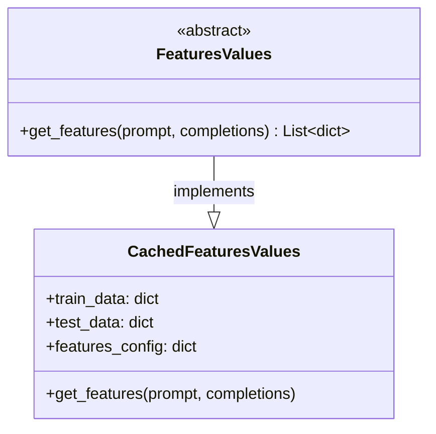
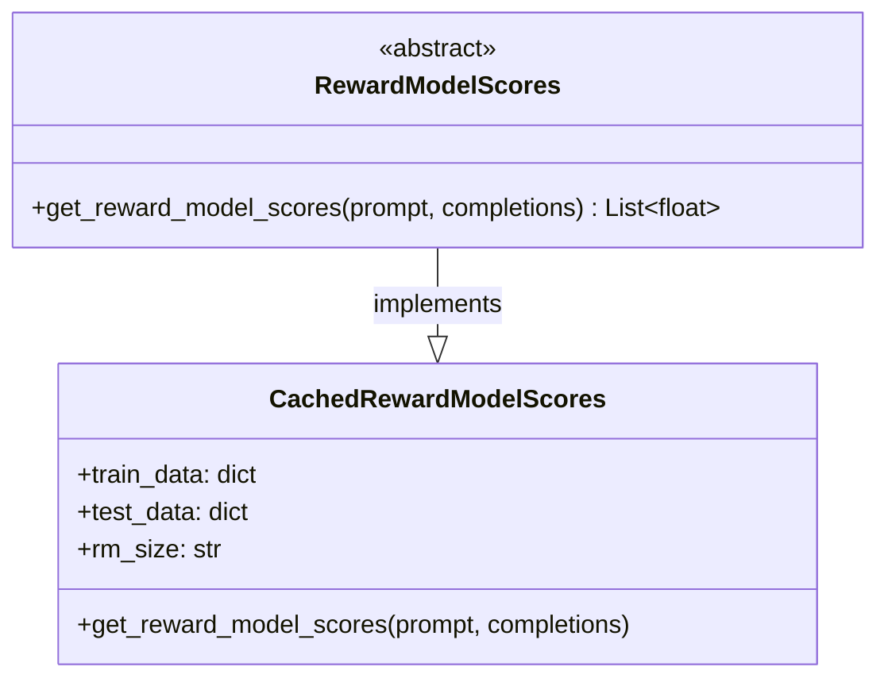
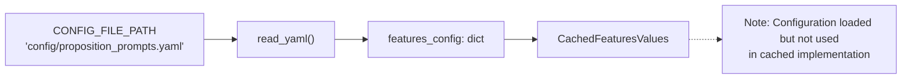
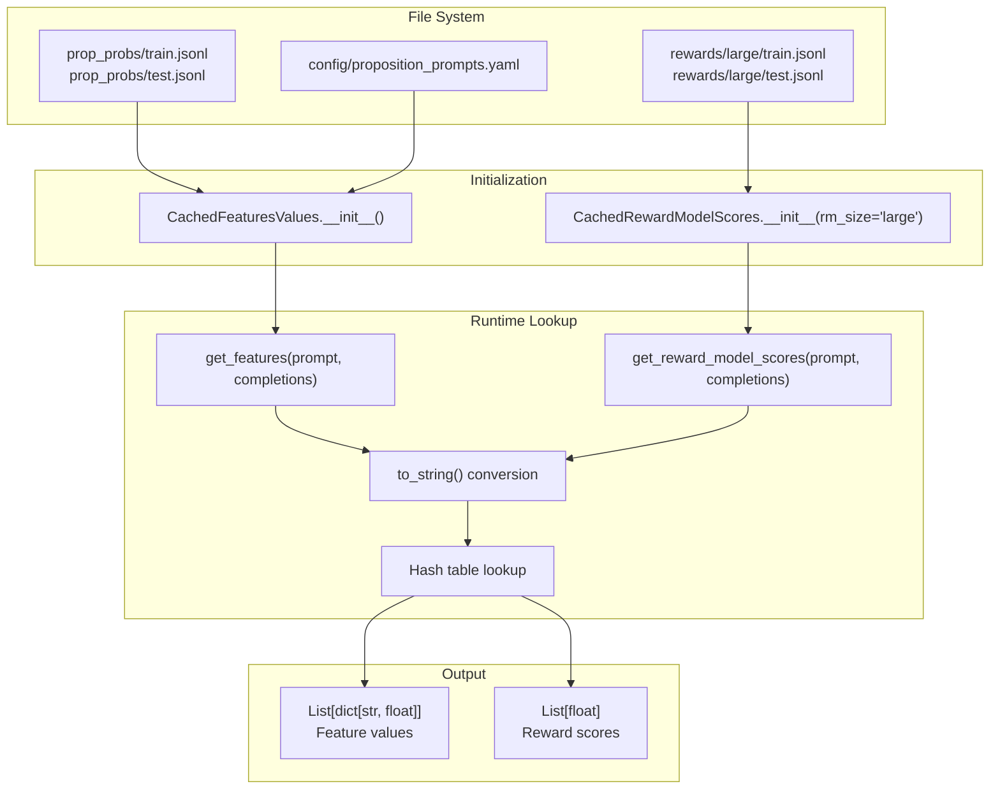

<!-- source: DeepWiki mcp.deepwiki.com · repo openai/safety-rbr-code-and-data · page 2.2 Base Architecture · fetched 2026-10-26 -->

# Base Architecture

Relevant source files

The following files were used as context for generating this wiki page:

- [base_classes.py](base_classes.py)
- [cached_classes.py](cached_classes.py)

This document covers the foundational architecture for the RBR weight fitting system, specifically the abstract base classes and their cached implementations that provide feature extraction and reward model scoring capabilities. For information about the weight optimization engine that uses these components, see [Weight Fitting Engine](#2.1). For details about the underlying datasets, see [Weight Fitting Dataset](#3.2).

## Abstract Interface Layer

The base architecture defines two core abstract interfaces that provide standardized access to features and reward scores for prompt-completion pairs.

### FeaturesValues Abstract Base Class

The `FeaturesValues` class defines the interface for extracting safety-related features from AI responses.

The `get_features` method takes a prompt and list of completions, returning feature dictionaries with float values representing safety-related properties of each completion.

**Sources:** [base_classes.py:4-8]()

### RewardModelScores Abstract Base Class  

The `RewardModelScores` class defines the interface for obtaining quality scores from reward models.

The `get_reward_model_scores` method returns numerical quality scores for each completion given a prompt.

**Sources:** [base_classes.py:10-14]()

## Cached Implementation Layer

The cached implementations provide concrete functionality by loading pre-computed data from disk and serving it through hash-based lookups.

### Data Loading Architecture

Both cached classes follow a consistent pattern for loading and accessing pre-computed data:

```mermaid
flowchart TD
    subgraph "CachedFeaturesValues"
        A1["CACHED_FEATURES<br/>'data/weight_fitting_data/prop_probs/{split}.jsonl'"]
        B1["read_jsonl()"]
        C1["train_data: dict<br/>test_data: dict"]
        D1["Hash Key: (prompt, completion) tuple"]
    end
    
    subgraph "CachedRewardModelScores" 
        A2["CACHED_REWARD_MODEL_SCORES<br/>'data/weight_fitting_data/rewards/{rm_size}/{split}.jsonl'"]
        B2["read_jsonl()"]
        C2["train_data: dict<br/>test_data: dict"]
        D2["Hash Key: (prompt, completion) tuple"]
    end
    
    A1 --> B1
    B1 --> C1
    C1 --> D1
    
    A2 --> B2  
    B2 --> C2
    C2 --> D2
```

**Sources:** [cached_classes.py:8-9](), [cached_classes.py:16-21](), [cached_classes.py:38-43]()

### Hash-Based Lookup Pattern

Both implementations use a consistent lookup mechanism:

| Component | Hash Key Generation | Data Structure | Fallback Behavior |
|-----------|-------------------|----------------|-------------------|
| `CachedFeaturesValues` | `(to_string(prompt), to_string(completion))` | `train_data`, `test_data` dicts | Raises `ValueError` if not found |
| `CachedRewardModelScores` | `(to_string(prompt), to_string(completion))` | `train_data`, `test_data` dicts | Raises `ValueError` if not found |

The lookup process checks the training data first, then test data, and raises an exception if the prompt-completion pair is not found in either dataset.

**Sources:** [cached_classes.py:25-32](), [cached_classes.py:50-57]()

## Configuration Integration

The `CachedFeaturesValues` class maintains a reference to the proposition prompts configuration, though this is not actively used in the cached implementation:

**Sources:** [cached_classes.py:7](), [cached_classes.py:46]()

## Data Flow Architecture

The complete data flow from cached files to feature/reward extraction:

**Sources:** [cached_classes.py:14-34](), [cached_classes.py:36-59]()

---

