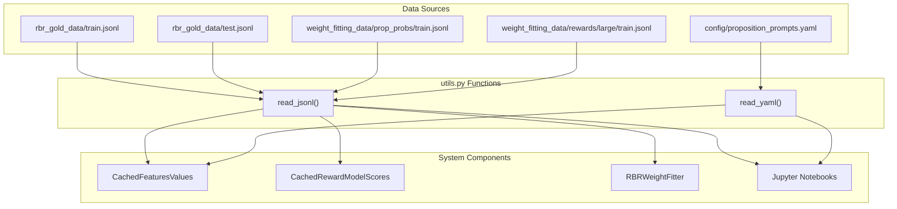
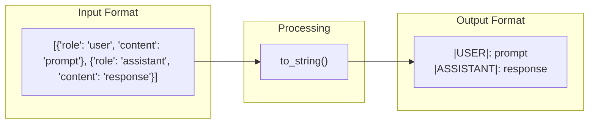
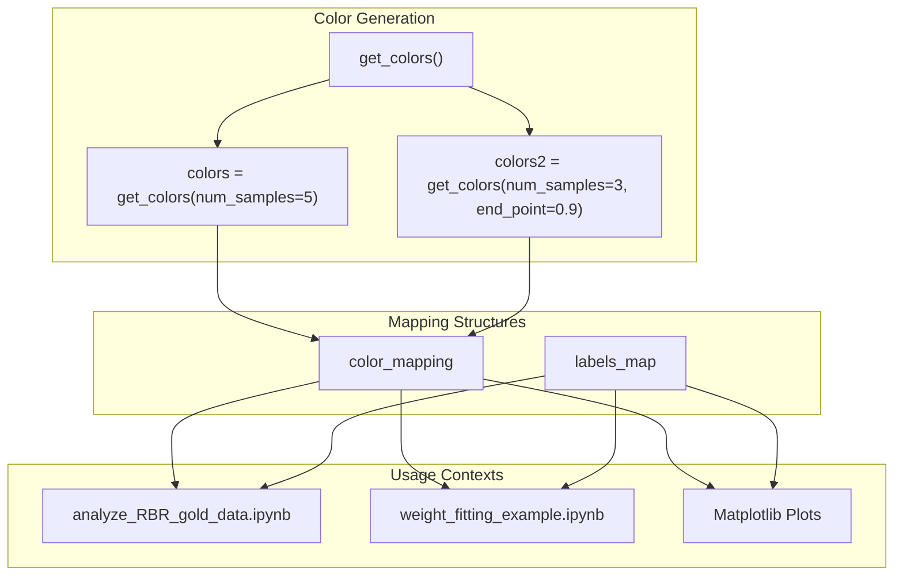
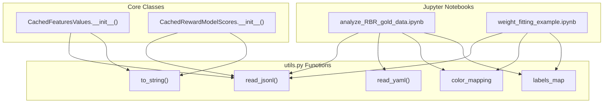

<!-- source: DeepWiki mcp.deepwiki.com · repo openai/safety-rbr-code-and-data · page 2.3 Utilities · fetched 2026-10-26 -->

# Utilities

Relevant source files

The following files were used as context for generating this wiki page:

- [utils.py](utils.py)

The utilities module provides essential helper functions for data loading, format conversion, and visualization support across the RBR weight fitting system. These functions handle common operations like reading JSONL and YAML files, converting conversation data structures, and providing consistent styling for data visualization.

For information about the core weight fitting algorithms, see [2.1](#2.1). For details about data structures these utilities operate on, see [3.1](#3.1) and [3.2](#3.2).

## Data Loading Functions

The utilities module provides standardized functions for reading the various data formats used throughout the RBR system.

### JSONL File Reading

The `read_jsonl()` function handles the primary data format used for both the gold dataset and weight fitting dataset:

**Function**: `read_jsonl(file_path)`
- **Purpose**: Reads JSON Lines files and returns a list of parsed objects
- **Error Handling**: Catches `FileNotFoundError` and `json.JSONDecodeError` with descriptive messages
- **Usage**: Loading training data, test data, and feature probability files

### YAML Configuration Loading

The `read_yaml()` function loads configuration files that define the response classification system:

**Function**: `read_yaml(file_path)`
- **Purpose**: Safely loads YAML configuration files
- **Primary Use**: Loading `proposition_prompts.yaml` for response classification rules

**System Integration Diagram**

Sources: [utils.py:7-27](), [utils.py:36-39]()

## Data Conversion Functions

### Conversation String Conversion

The `to_string()` function converts conversation data structures into standardized string representations:

**Function**: `to_string(conversation)`
- **Purpose**: Converts conversation arrays to hashable string format
- **Format**: `|ROLE|: content` with newline separators
- **Usage**: Creating consistent identifiers for conversations across different data processing stages

**Conversation Processing Flow**

Sources: [utils.py:29-33]()

## Visualization Support Functions

The utilities module provides comprehensive support for consistent visualization across analysis notebooks and reports.

### Color Generation

The `get_colors()` function generates color palettes using matplotlib's viridis colormap:

**Function**: `get_colors(num_samples=3, end_point=1.0)`
- **Purpose**: Generate evenly spaced colors from viridis colormap
- **Parameters**: Number of colors and colormap endpoint
- **Output**: Array of RGB color values

### Response Classification Color Mapping

The module defines standardized color mappings for different response types and completion qualities:

| Response Type | Completion Quality | Color Assignment |
|---------------|-------------------|------------------|
| Comply | fully complies | colors[0] |
| Comply | partially complies | colors[1] |
| Comply | random non-refusal | colors[2] |
| Comply | imperfect refusal | colors[3] |
| Comply | perfect refusal | colors[4] |
| Hard Refuse | perfect hard refusal | colors2[0] |
| Hard Refuse | bad hard refusal | colors2[1] |
| Hard Refuse | disallowed content | colors2[2] |
| Safe Refuse | perfect safe completion | colors2[0] |
| Safe Refuse | bad safe completion | colors2[1] |
| Safe Refuse | disallowed content | colors2[2] |

### Label Standardization

The `labels_map` dictionary provides human-readable labels for visualization:

**Key Mappings**:
- `'fully complies'` → `"Complies (Ideal)"`
- `'perfect hard refusal'` → `"Perfect Refusal (Ideal)"`  
- `'perfect safe completion'` → `"Perfect Safe Refusal (Ideal)"`
- `'disallowed content'` → `"Disallowed"`

**Visualization System Architecture**

Sources: [utils.py:42-79]()

## Integration with System Components

The utilities module serves as a foundational layer that supports data processing throughout the RBR system:

### Direct Dependencies

- **CachedFeaturesValues**: Uses `read_jsonl()` to load feature probability data
- **CachedRewardModelScores**: Uses `read_jsonl()` to load reward model scores  
- **Analysis Notebooks**: Uses all utility functions for data loading and visualization
- **Weight Fitting Process**: Indirectly uses utilities through cached classes

### Data Flow Pattern

1. Raw data files → `read_jsonl()`/`read_yaml()` → Parsed data structures
2. Conversation objects → `to_string()` → Hashable identifiers
3. Analysis results → `color_mapping`/`labels_map` → Consistent visualizations

**Utility Function Call Pattern**

Sources: [utils.py:1-79]()

The utilities module ensures consistent data handling and presentation across all components of the RBR weight fitting system, providing a stable foundation for both automated processing and human analysis.

---

