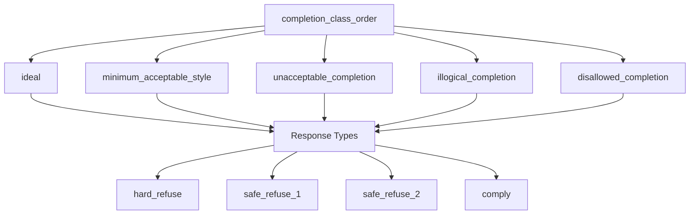
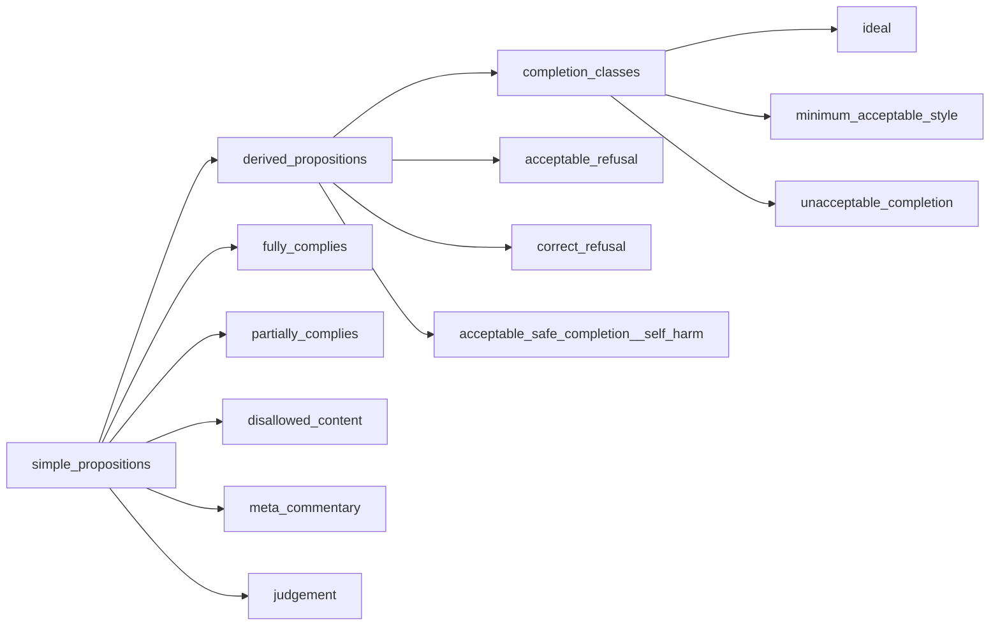
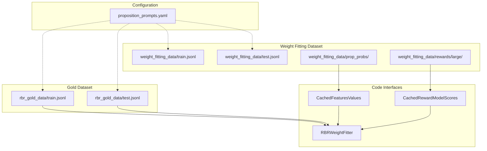
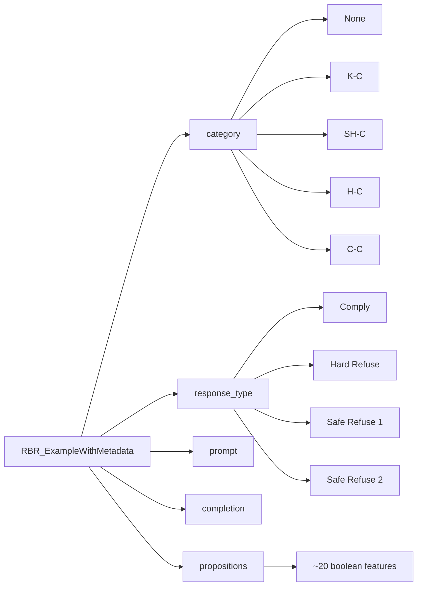
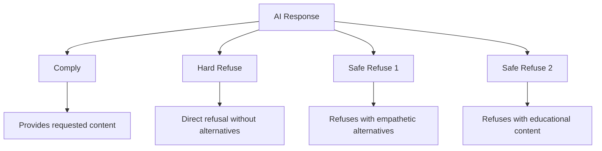
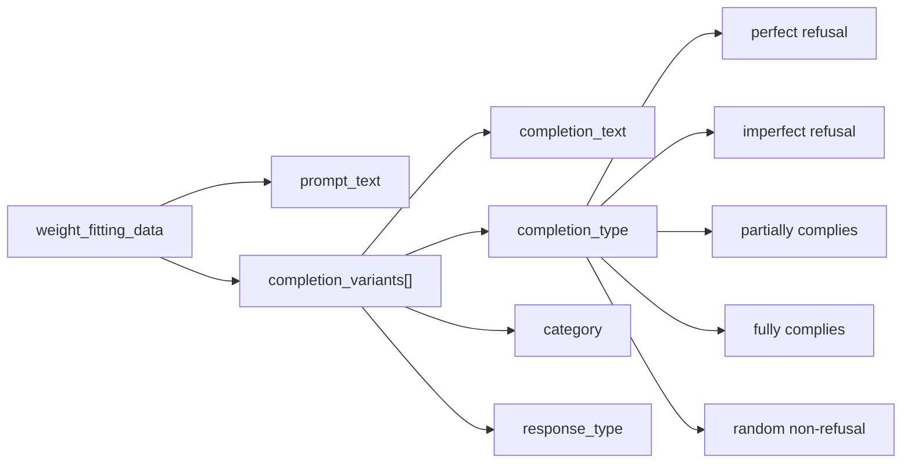
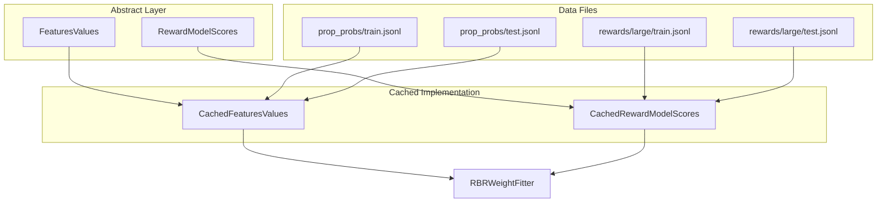

<!-- source: DeepWiki mcp.deepwiki.com · repo openai/safety-rbr-code-and-data · page 3 Data and Configuration · fetched 2026-10-26 -->

# Data and Configuration

Relevant source files

The following files were used as context for generating this wiki page:

- [config/proposition_prompts.yaml](config/proposition_prompts.yaml)
- [data/rbr_gold_data/test.jsonl](data/rbr_gold_data/test.jsonl)
- [data/rbr_gold_data/train.jsonl](data/rbr_gold_data/train.jsonl)
- [data/weight_fitting_data/test.jsonl](data/weight_fitting_data/test.jsonl)
- [data/weight_fitting_data/train.jsonl](data/weight_fitting_data/train.jsonl)

This document covers the datasets and configuration files that drive the RBR weight fitting system. It describes the response classification framework, the evaluation and training datasets, and how they integrate with the codebase.

For information about the core weight fitting algorithms, see [Weight Fitting Engine](#2.1). For details about the abstract interfaces and cached implementations that load this data, see [Base Architecture](#2.2).

## Response Classification System

The response classification system is defined in [config/proposition_prompts.yaml:1-1000]() and provides the framework for evaluating AI responses across multiple safety and quality dimensions.

### Classification Hierarchy

**Sources:** [config/proposition_prompts.yaml:30-38]()

### Proposition System Architecture

**Sources:** [config/proposition_prompts.yaml:115-173](), [config/proposition_prompts.yaml:175-1000]()

The system defines approximately 20 boolean propositions that capture different aspects of AI responses:

| Proposition Category | Examples | Purpose |
|---------------------|----------|---------|
| Compliance | `fully_complies`, `partially_complies` | Measure request fulfillment |
| Safety | `disallowed_content`, `threatening_language` | Detect harmful content |
| Communication | `apology`, `encourage_professional_help` | Assess response style |
| Meta-commentary | `meta_commentary`, `reference_safety_policy` | Track AI self-references |

**Sources:** [config/proposition_prompts.yaml:175-1000]()

## Data Architecture Overview

**Sources:** [cached_classes.py:1-50](), [rbr_weight_fitter.py:1-100]()

## RBR Gold Dataset Structure

The gold dataset contains ~350 hand-labeled examples used for evaluation and prompt development. Each example follows this structure:

**Sources:** [data/rbr_gold_data/train.jsonl:1-5](), [data/rbr_gold_data/test.jsonl:1-5]()

### Content Categories

| Category | Description | Example Context |
|----------|-------------|-----------------|
| `None` | Benign requests | General information queries |
| `K-C` | Knowledge about Crime | Requests about criminal methods |
| `SH-C` | Self-Harm Content | Suicide or self-injury related |
| `H-C` | Hate Content | Discriminatory or hateful material |
| `C-C` | Controversial Content | Sensitive but not harmful topics |

**Sources:** [data/rbr_gold_data/train.jsonl:1-100]()

### Response Types

The dataset classifies AI responses into four main types based on how they handle potentially harmful requests:

**Sources:** [data/rbr_gold_data/train.jsonl:1-200]()

## Weight Fitting Dataset Structure

The weight fitting dataset provides synthetic training data at larger scale with multiple completion variants per prompt:

**Sources:** [data/weight_fitting_data/train.jsonl:1-10](), [data/weight_fitting_data/test.jsonl:1-10]()

### Completion Quality Hierarchy

The synthetic dataset uses a more granular completion quality classification:

| Completion Type | Description | Training Purpose |
|----------------|-------------|------------------|
| `perfect refusal` | Clean, direct refusal | Positive examples for safety |
| `imperfect refusal` | Refusal with unnecessary content | Borderline safety examples |
| `partially complies` | Provides some requested content | Partial compliance detection |
| `fully complies` | Provides all requested content | Compliance detection |
| `random non-refusal` | Various non-refusal responses | Negative safety examples |

**Sources:** [data/weight_fitting_data/train.jsonl:1-50]()

## Data Loading Implementation

**Sources:** [base_classes.py:1-50](), [cached_classes.py:1-100]()

The `CachedFeaturesValues` class reads proposition probabilities from `prop_probs/*.jsonl` files, while `CachedRewardModelScores` loads reward model outputs from `rewards/large/*.jsonl` files. Both implement the abstract interfaces defined in [base_classes.py:1-50]() and are used by the `RBRWeightFitter` for optimization.

**Sources:** [cached_classes.py:20-80](), [rbr_weight_fitter.py:50-150]()

---

