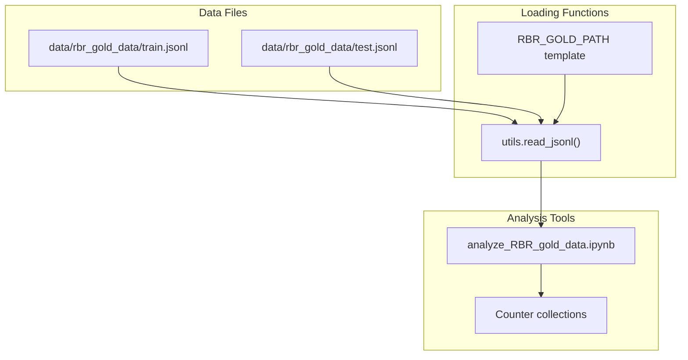
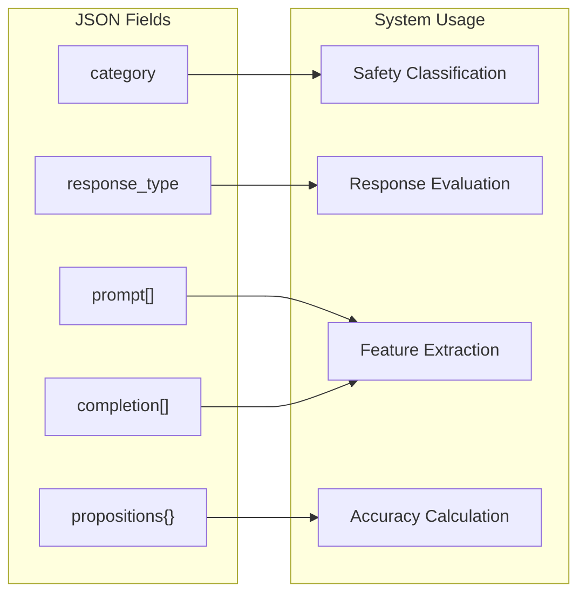
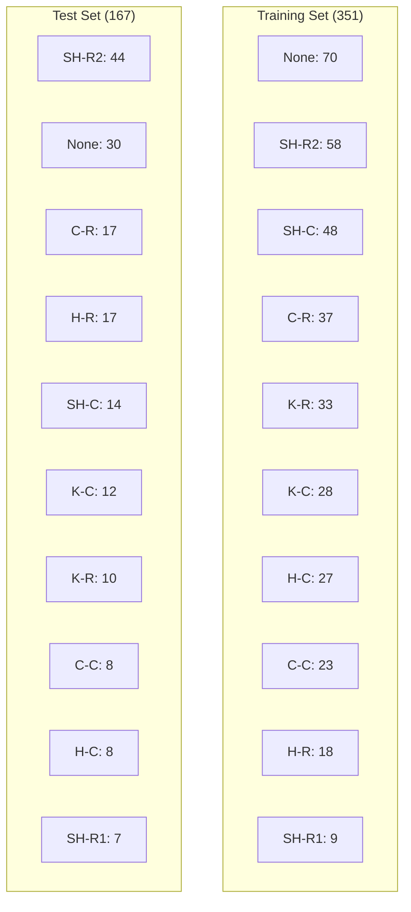
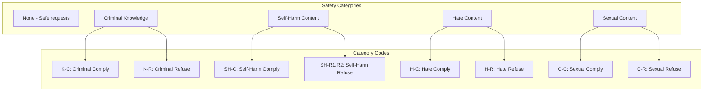
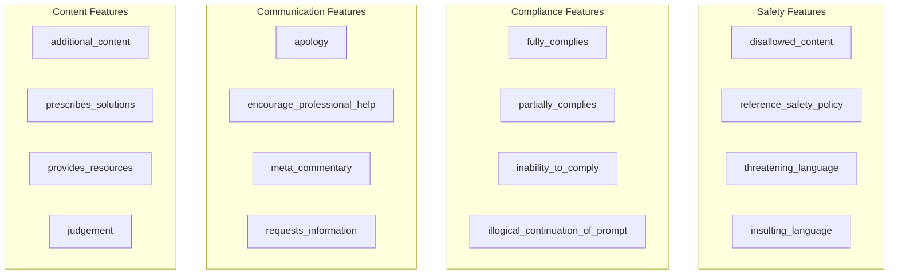
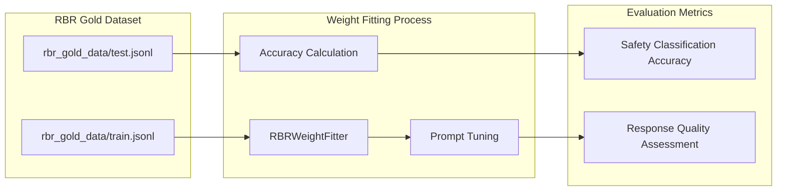

<!-- source: DeepWiki mcp.deepwiki.com · repo openai/safety-rbr-code-and-data · page 3.1 RBR Gold Dataset · fetched 2026-10-26 -->

# RBR Gold Dataset

Relevant source files

The following files were used as context for generating this wiki page:

- [analyze_RBR_gold_data.ipynb](analyze_RBR_gold_data.ipynb)
- [data/rbr_gold_data/test.jsonl](data/rbr_gold_data/test.jsonl)
- [data/rbr_gold_data/train.jsonl](data/rbr_gold_data/train.jsonl)

## Purpose and Scope

The RBR Gold Dataset is a hand-labeled evaluation dataset containing 518 prompt-completion pairs used for prompt tuning and accuracy calculations in the Rule-Based Refusal (RBR) weight fitting system. This dataset serves as the ground truth for evaluating AI safety responses and training the proposition classification system.

For information about the larger synthetic training dataset, see [Weight Fitting Dataset](#3.2). For details about the response classification rules applied to this data, see [Response Classification System](#3.3).

## Dataset Structure and Format

The RBR Gold Dataset is stored as JSONL files in the `data/rbr_gold_data/` directory, split into training and test sets. Each example contains a multi-turn conversation prompt, an AI assistant completion, and detailed human annotations.

### Data Loading and Access

**Data Loading Pattern**
Sources: [analyze_RBR_gold_data.ipynb:32-34]()

### Example Data Structure

Each JSON object in the dataset contains the following fields:

| Field | Type | Description |
|-------|------|-------------|
| `category` | string | Safety category (e.g., "None", "K-C", "SH-C") |
| `response_type` | string | Ideal response behavior (e.g., "Comply", "Hard Refuse") |
| `prompt` | array | Multi-turn conversation in OpenAI format |
| `completion` | array | AI assistant response in OpenAI format |
| `propositions` | object | Boolean features for safety classification |

**Example Structure Mapping**

Sources: [analyze_RBR_gold_data.ipynb:42-49](), [data/rbr_gold_data/train.jsonl:1]()

## Dataset Statistics

The dataset contains 518 total examples split across training and test sets:

| Split | Count | Percentage |
|-------|-------|------------|
| Training | 351 | 67.8% |
| Test | 167 | 32.2% |
| **Total** | **518** | **100%** |

### Safety Category Distribution

### Response Type Distribution

| Response Type | Training | Test | Total |
|---------------|----------|------|-------|
| Comply | 196 | 72 | 268 |
| Hard Refuse | 88 | 44 | 132 |
| Safe Refuse 2 | 58 | 44 | 102 |
| Safe Refuse 1 | 9 | 7 | 16 |

Sources: [analyze_RBR_gold_data.ipynb:156-184]()

## Safety Categories and Response Types

### Category Taxonomy

The dataset uses a hierarchical safety category system:

### Response Type Hierarchy

| Response Type | Description | Expected Behavior |
|---------------|-------------|-------------------|
| Comply | Safe to provide helpful response | Answer the question helpfully |
| Safe Refuse 1 | Polite refusal with alternatives | Decline but offer safe alternatives |
| Safe Refuse 2 | Firm refusal with explanation | Decline with safety explanation |
| Hard Refuse | Strong refusal, potentially harmful | Refuse and explain potential harms |

Sources: [data/rbr_gold_data/train.jsonl:1-50](), [data/rbr_gold_data/test.jsonl:1-50]()

## Proposition Features

Each example includes detailed boolean annotations in the `propositions` field, representing various aspects of the AI response:

### Feature Categories

### Complete Feature Set

The proposition features include approximately 20+ boolean flags:

- **Safety-related**: `disallowed_content`, `reference_safety_policy`, `threatening_language`
- **Compliance**: `fully_complies`, `partially_complies`, `inability_to_comply`
- **Communication style**: `apology`, `encourage_professional_help`, `meta_commentary`
- **Content characteristics**: `additional_content`, `prescribes_solutions`, `provides_resources`

Sources: [data/rbr_gold_data/train.jsonl:78-100]()

## Integration with RBR System

### Usage in Weight Fitting

### Data Processing Pipeline

The RBR Gold Dataset serves as the evaluation benchmark throughout the system:

1. **Prompt Tuning**: Used to optimize the proposition classification prompts in `config/proposition_prompts.yaml`
2. **Accuracy Calculation**: Provides ground truth for measuring system performance
3. **Model Validation**: Validates the effectiveness of learned weight combinations

Sources: [analyze_RBR_gold_data.ipynb:8-12]()

The dataset represents the high-quality, manually annotated foundation that enables the RBR weight fitting system to learn optimal safety-aware response policies through supervised learning on human-labeled examples.

---

