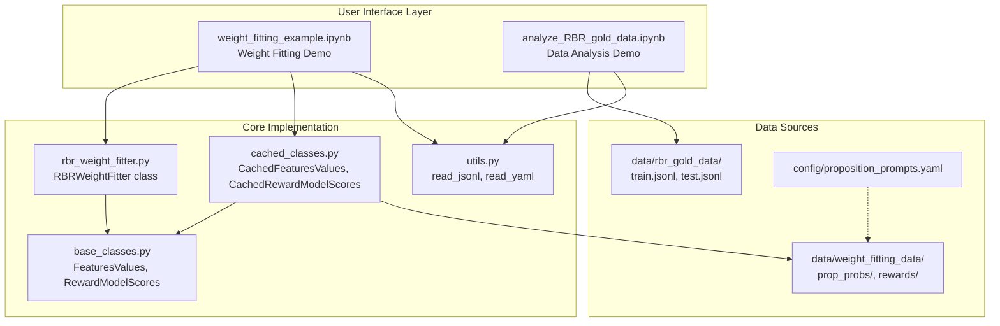
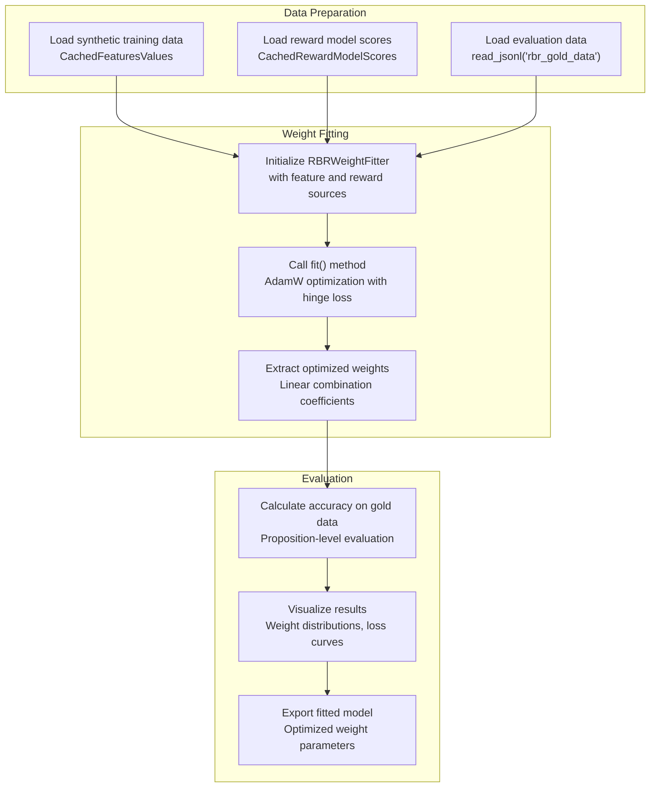
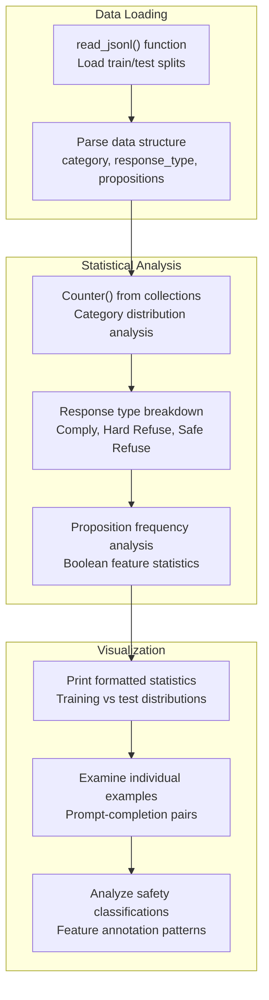
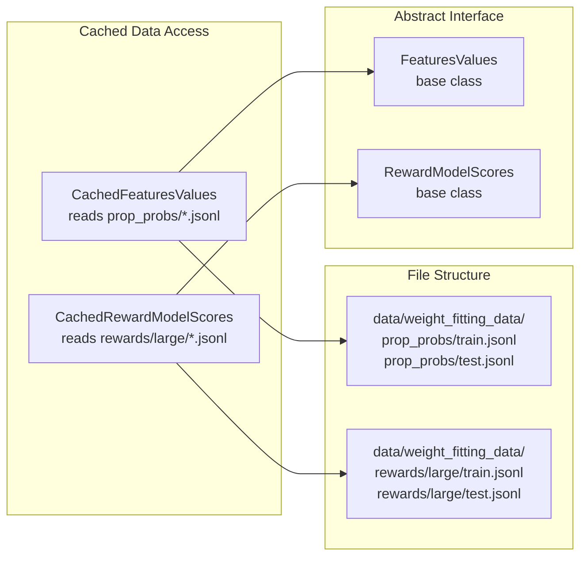
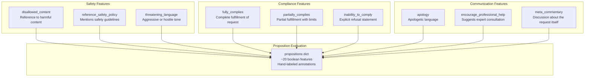

<!-- source: DeepWiki mcp.deepwiki.com · repo openai/safety-rbr-code-and-data · page 4 Usage and Examples · fetched 2026-10-26 -->

# Usage and Examples

<details>
<summary>Relevant source files</summary>

The following files were used as context for generating this wiki page:

- [analyze_RBR_gold_data.ipynb](analyze_RBR_gold_data.ipynb)
- [readme.md](readme.md)
- [weight_fitting_example.ipynb](weight_fitting_example.ipynb)

</details>


This document provides practical guidance for using the RBR (Rule-Based Refusal) weight fitting system, including common workflows, data analysis patterns, and concrete examples. It covers the primary entry points and usage patterns for researchers and practitioners working with AI safety through rule-based feature optimization.

For detailed tutorials on specific tasks, see [Getting Started](#4.1) for basic weight fitting workflows and [Data Analysis](#4.2) for analyzing the RBR gold dataset. For information about the underlying system architecture, see [Core Components](#2).

## System Entry Points

The RBR weight fitting system provides two primary entry points through Jupyter notebooks that serve as comprehensive examples:

### Primary Notebooks

| Notebook | Purpose | Key Components |
|----------|---------|----------------|
| `weight_fitting_example.ipynb` | Demonstrates RBR weight optimization using synthetic data | `RBRWeightFitter`, cached feature extraction, visualization |
| `analyze_RBR_gold_data.ipynb` | Shows analysis of hand-labeled safety evaluation data | Data loading utilities, statistical analysis, proposition evaluation |

### Supporting Code Structure



Sources: [readme.md:13-18](), [analyze_RBR_gold_data.ipynb:22-34]()

## Core Usage Workflows

The system supports two primary workflows for different use cases:

### Weight Optimization Workflow



Sources: [readme.md:17]()

### Data Analysis Workflow



Sources: [analyze_RBR_gold_data.ipynb:32-34](), [analyze_RBR_gold_data.ipynb:157-162]()

## Data Loading Patterns

### RBR Gold Dataset Loading

The system uses a consistent pattern for loading the hand-labeled evaluation dataset:

```python
# Pattern used in analyze_RBR_gold_data.ipynb
from utils import read_jsonl

RBR_GOLD_PATH = 'data/rbr_gold_data/{split}.jsonl'
rbr_gold_train = read_jsonl(RBR_GOLD_PATH.format(split='train'))
rbr_gold_test = read_jsonl(RBR_GOLD_PATH.format(split='test'))
```

### Data Structure Format

Each data point in the RBR gold dataset follows this structure:

| Field | Type | Description |
|-------|------|-------------|
| `category` | String | Safety category (None, K-C, SH-C, H-C, etc.) |
| `response_type` | String | Expected behavior (Comply, Hard Refuse, Safe Refuse 1/2) |
| `prompt` | List[Dict] | Conversation history with role/content format |
| `completion` | List[Dict] | Assistant response in role/content format |
| `propositions` | Dict[str, bool] | Hand-labeled boolean features (~20 safety attributes) |

Sources: [analyze_RBR_gold_data.ipynb:44-48](), [analyze_RBR_gold_data.ipynb:78-100]()

### Weight Fitting Data Loading



Sources: [readme.md:11]()

## Common Usage Examples

### Basic Statistical Analysis

The `analyze_RBR_gold_data.ipynb` notebook demonstrates standard analysis patterns:

**Dataset Size Analysis:**
- Training examples: 351
- Testing examples: 167
- Total: 518 hand-labeled examples

**Category Distribution Analysis:**
```python
from collections import Counter
train_categories = Counter([item['category'] for item in rbr_gold_train])
test_categories = Counter([item['category'] for item in rbr_gold_test])
```

**Response Type Distribution:**
- Comply: Most common response type (~55% of examples)
- Hard Refuse: Direct refusal responses (~25% of examples)
- Safe Refuse 1/2: Graduated refusal strategies (~20% of examples)

Sources: [analyze_RBR_gold_data.ipynb:132-137](), [analyze_RBR_gold_data.ipynb:151-162](), [analyze_RBR_gold_data.ipynb:175-184]()

### Proposition Analysis Pattern

Each example includes detailed boolean feature annotations:



Sources: [analyze_RBR_gold_data.ipynb:78-100]()

### Integration Points

The usage examples demonstrate integration between components:

| Component Integration | Purpose | Implementation |
|----------------------|---------|----------------|
| `utils.read_jsonl()` → Analysis | Data loading for notebooks | Standard file I/O with JSON Lines format |
| `CachedFeaturesValues` → `RBRWeightFitter` | Feature extraction pipeline | Cached access to proposition probabilities |
| `CachedRewardModelScores` → `RBRWeightFitter` | Reward signal integration | Cached access to quality scores |
| Gold dataset → Evaluation | Accuracy calculation | Human-labeled ground truth for validation |

The system provides clear entry points through the two primary notebooks, with modular components that can be used independently or in combination for different research and evaluation tasks.

Sources: [readme.md:9-11](), [readme.md:17-18]()

---

