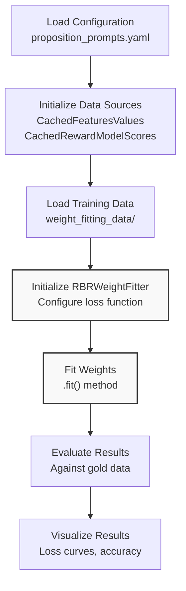
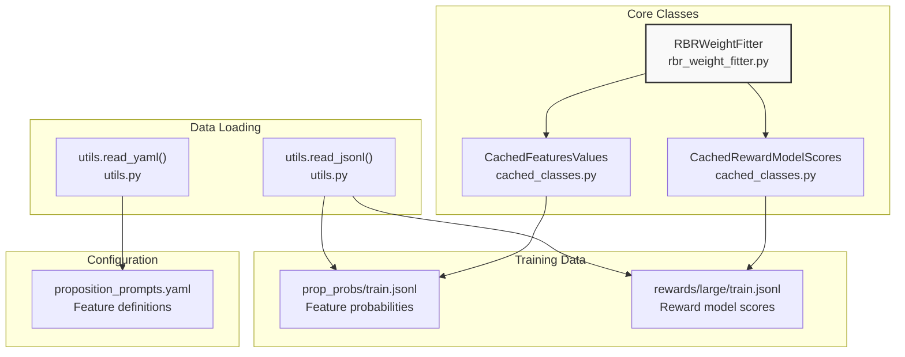
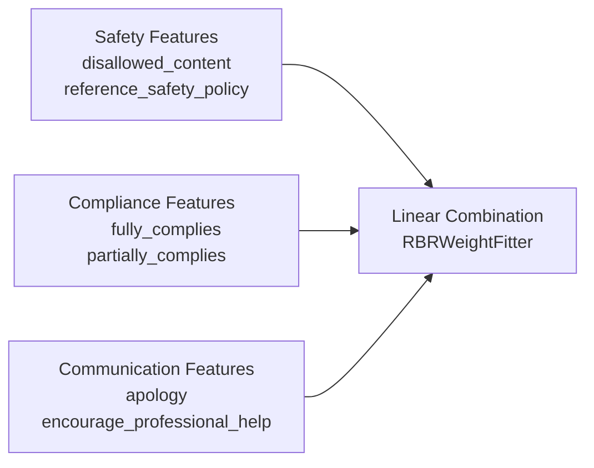

<!-- source: DeepWiki mcp.deepwiki.com · repo openai/safety-rbr-code-and-data · page 4.1 Getting Started · fetched 2026-10-26 -->

# Getting Started

<details>
<summary>Relevant source files</summary>

The following files were used as context for generating this wiki page:

- [readme.md](readme.md)
- [weight_fitting_example.ipynb](weight_fitting_example.ipynb)

</details>


This document provides a basic tutorial for using the RBR (Rule-Based Refusal) weight fitting system to optimize AI safety features. It covers the essential workflow from loading data to fitting weights and evaluating results.

For detailed information about the datasets used in this system, see [RBR Gold Dataset](#3.1) and [Weight Fitting Dataset](#3.2). For comprehensive analysis examples, see [Data Analysis](#4.2).

## Purpose and Scope

The RBR weight fitting system allows you to:
- Load synthetic training data containing safety feature probabilities and reward model scores
- Optimize linear combination weights to balance rule-based safety features with reward model signals
- Evaluate the fitted weights against gold standard human-labeled data
- Visualize the optimization process and results

The primary entry point is the `RBRWeightFitter` class, which implements hinge loss optimization using the AdamW optimizer to learn optimal weights for safety-aware AI response evaluation.

## Quick Start Workflow

The recommended approach for getting started is to follow the examples provided in the Jupyter notebooks, particularly `weight_fitting_example.ipynb`.

### Basic Usage Flow



Sources: [readme.md:13-18](), [weight_fitting_example.ipynb]()

### Essential Code Components



Sources: [rbr_weight_fitter.py](), [cached_classes.py](), [utils.py]()

## Step-by-Step Tutorial

### 1. Environment Setup

Ensure you have the required dependencies and data files in place:

| Component | Location | Purpose |
|-----------|----------|---------|
| Training data | `data/weight_fitting_data/` | Feature probabilities and reward scores |
| Gold data | `data/rbr_gold_data/` | Human-labeled evaluation data |
| Configuration | `config/proposition_prompts.yaml` | Feature definitions and classification rules |

### 2. Initialize Data Sources

The system uses cached implementations to efficiently load pre-computed features:

```python
# Initialize feature and reward model score providers
features_values = CachedFeaturesValues()
reward_model_scores = CachedRewardModelScores()
```

These classes automatically load data from the appropriate subdirectories in `data/weight_fitting_data/`.

Sources: [cached_classes.py](), [base_classes.py]()

### 3. Configure Weight Fitter

Create an `RBRWeightFitter` instance with your data sources:

```python
weight_fitter = RBRWeightFitter(
    features_values=features_values,
    reward_model_scores=reward_model_scores
)
```

The fitter uses hinge loss optimization by default with configurable learning rates and batch sizes.

Sources: [rbr_weight_fitter.py]()

### 4. Load Training Examples

Training examples are loaded as `RBR_ExampleWithMetadata` objects containing:
- Input prompts and AI responses
- Feature probability vectors
- Reward model scores
- Human-labeled ground truth (for evaluation data)

### 5. Fit Weights

Execute the optimization process:

```python
# Fit weights using training data
results = weight_fitter.fit(train_examples)

# Access optimized weights
optimized_weights = results.weights
```

The fitting process minimizes hinge loss to learn optimal linear combination weights between rule-based features and reward model scores.

Sources: [rbr_weight_fitter.py]()

### 6. Evaluate Performance

Test the fitted weights against gold standard data:

```python
# Evaluate on test set
accuracy = weight_fitter.evaluate(test_examples, optimized_weights)
```

## Key Data Structures

### Training Data Format

The weight fitting system expects data in JSONL format with specific schemas:

| File Pattern | Contents | Schema |
|--------------|----------|---------|
| `prop_probs/*.jsonl` | Feature probabilities | Response ID + feature probability vectors |
| `rewards/large/*.jsonl` | Reward scores | Response ID + reward model scores |
| `rbr_gold_data/*.jsonl` | Human labels | Complete example metadata + ground truth |

### Feature Categories

The system processes approximately 20 boolean safety features across categories:



Sources: [config/proposition_prompts.yaml](), [rbr_weight_fitter.py]()

## Example Notebooks

Two Jupyter notebooks provide comprehensive examples:

| Notebook | Purpose | Key Demonstrations |
|----------|---------|-------------------|
| `weight_fitting_example.ipynb` | Weight fitting workflow | Data loading, optimization, visualization |
| `analyze_RBR_gold_data.ipynb` | Gold dataset analysis | Human-labeled data exploration, statistics |

The weight fitting example notebook is the recommended starting point for new users.

Sources: [readme.md:13-18]()

## Next Steps

After following this basic workflow:

1. **Experiment with hyperparameters** - Modify learning rates, batch sizes, and loss function parameters in `RBRWeightFitter`
2. **Analyze feature importance** - Examine the learned weights to understand which safety features are most influential
3. **Validate on custom data** - Test the fitted weights on your own AI response datasets
4. **Explore advanced configurations** - Modify the proposition prompts in `config/proposition_prompts.yaml` for different safety criteria

For detailed analysis techniques and advanced usage patterns, see [Data Analysis](#4.2).

Sources: [readme.md:1-23](), [weight_fitting_example.ipynb]()

---

