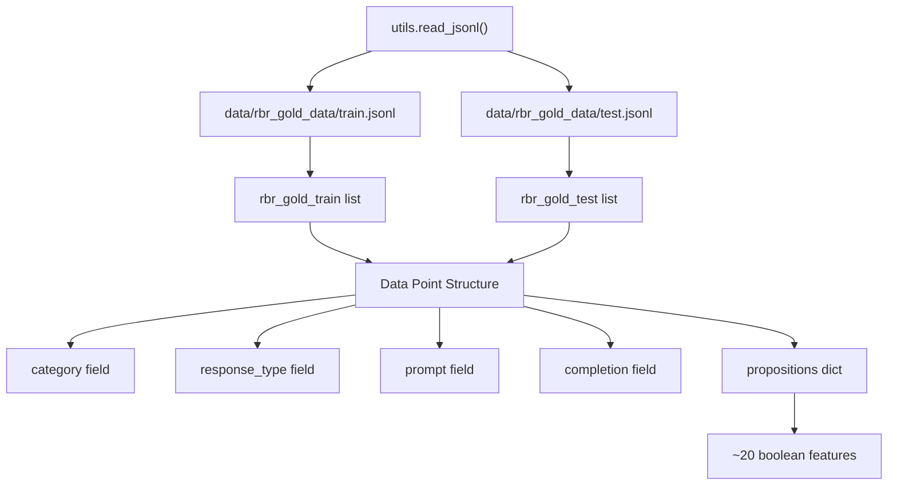
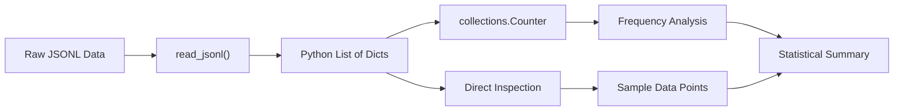
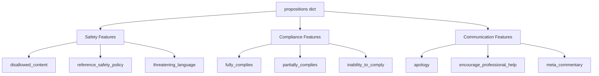
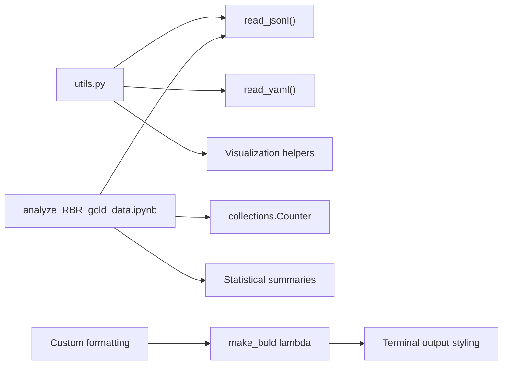

<!-- source: DeepWiki mcp.deepwiki.com · repo openai/safety-rbr-code-and-data · page 4.2 Data Analysis · fetched 2026-10-26 -->

# Data Analysis

<details>
<summary>Relevant source files</summary>

The following files were used as context for generating this wiki page:

- [analyze_RBR_gold_data.ipynb](analyze_RBR_gold_data.ipynb)

</details>


This document provides examples and guidance for analyzing the datasets used in the RBR weight fitting system. It covers techniques for exploring the RBR gold dataset structure, generating statistical summaries, and understanding the training data characteristics. For information about the dataset structures themselves, see [RBR Gold Dataset](#3.1) and [Weight Fitting Dataset](#3.2).

## Data Loading and Structure

The primary tool for data analysis in this repository is the `read_jsonl` function from `utils.py`, which loads JSONL files into Python lists for analysis.

### RBR Gold Data Loading

The RBR gold dataset can be loaded using standardized file paths:

```python
from utils import read_jsonl

RBR_GOLD_PATH = 'data/rbr_gold_data/{split}.jsonl'
rbr_gold_train = read_jsonl(RBR_GOLD_PATH.format(split='train'))
rbr_gold_test = read_jsonl(RBR_GOLD_PATH.format(split='test'))
```

### Data Point Structure

Each data point in the RBR gold dataset contains the following key fields:

| Field | Description | Type |
|-------|-------------|------|
| `category` | Safety category (e.g., 'None', 'K-C', 'SH-C', 'H-C') | string |
| `response_type` | Ideal response behavior ('Comply', 'Hard Refuse', 'Safe Refuse 1/2') | string |
| `prompt` | Conversation history as list of role/content dicts | list |
| `completion` | Assistant response in same format as prompt | list |
| `propositions` | Human-labeled boolean features (~20 propositions) | dict |

**Data Loading Flow**


Sources: [analyze_RBR_gold_data.ipynb:22-35](), [analyze_RBR_gold_data.ipynb:42-49]()

## Basic Analysis Techniques

### Statistical Summaries

The analysis workflow typically involves using Python's `collections.Counter` to generate frequency distributions:

```python
from collections import Counter

# Category distribution
train_categories = Counter([item['category'] for item in rbr_gold_train])
test_categories = Counter([item['category'] for item in rbr_gold_test])

# Response type distribution  
train_responses = Counter([item['response_type'] for item in rbr_gold_train])
test_responses = Counter([item['response_type'] for item in rbr_gold_test])
```

### Data Exploration Workflow

**Analysis Pipeline**


Sources: [analyze_RBR_gold_data.ipynb:156-163](), [analyze_RBR_gold_data.ipynb:182-184]()

## Dataset Statistics

### RBR Gold Dataset Composition

The analysis notebook demonstrates standard statistical breakdowns:

**Dataset Size:**
- Training examples: 351
- Testing examples: 167  
- Total: 518 hand-labeled examples

**Safety Category Distribution (Training Set):**
- None: 70 examples
- K-R: 33 examples  
- C-C: 23 examples
- K-C: 28 examples
- H-C: 27 examples
- SH-C: 48 examples
- H-R: 18 examples
- C-R: 37 examples
- SH-R2: 58 examples
- SH-R1: 9 examples

**Response Type Distribution (Training Set):**
- Comply: 196 examples
- Hard Refuse: 88 examples
- Safe Refuse 2: 58 examples
- Safe Refuse 1: 9 examples

### Proposition Analysis

Each data point contains approximately 20 boolean propositions for detailed response analysis:

**Proposition Categories**


Sources: [analyze_RBR_gold_data.ipynb:78-100](), [analyze_RBR_gold_data.ipynb:136-138](), [analyze_RBR_gold_data.ipynb:150-153](), [analyze_RBR_gold_data.ipynb:174-179]()

## Analysis Notebooks and Tools

### Primary Analysis Notebook

The `analyze_RBR_gold_data.ipynb` notebook provides a complete example of dataset exploration:

1. **Data Loading:** Uses `utils.read_jsonl()` to load train/test splits
2. **Structure Inspection:** Displays complete data point examples  
3. **Statistical Analysis:** Generates category and response type distributions
4. **Visualization:** Uses formatting helpers for readable output

### Key Analysis Functions

**Core Analysis Utilities**


### Extension Points

The analysis framework supports extension for:

- **Weight Fitting Data Analysis:** Similar patterns can analyze the larger synthetic datasets in `data/weight_fitting_data/`
- **Proposition Deep Dives:** Individual boolean features can be analyzed for correlation patterns
- **Cross-Dataset Comparison:** Comparing gold dataset patterns with synthetic data distributions
- **Performance Analysis:** Combining analysis with weight fitting results for evaluation

Sources: [analyze_RBR_gold_data.ipynb:1-13](), [analyze_RBR_gold_data.ipynb:157-159]()

## Advanced Analysis Patterns

### Multi-Dataset Analysis

While the provided notebook focuses on the RBR gold dataset, the same patterns apply to analyzing the weight fitting datasets:

```python
# Pattern for weight fitting data analysis
WEIGHT_FITTING_PATH = 'data/weight_fitting_data/prop_probs/{split}.jsonl'
REWARDS_PATH = 'data/weight_fitting_data/rewards/large/{split}.jsonl'

prop_probs_train = read_jsonl(WEIGHT_FITTING_PATH.format(split='train'))
rewards_train = read_jsonl(REWARDS_PATH.format(split='train'))
```

### Configuration-Driven Analysis

The `proposition_prompts.yaml` configuration defines the feature extraction rules that generate the propositions analyzed in the datasets. Understanding this configuration is crucial for interpreting analysis results.

Sources: [analyze_RBR_gold_data.ipynb:32-34]()

---

