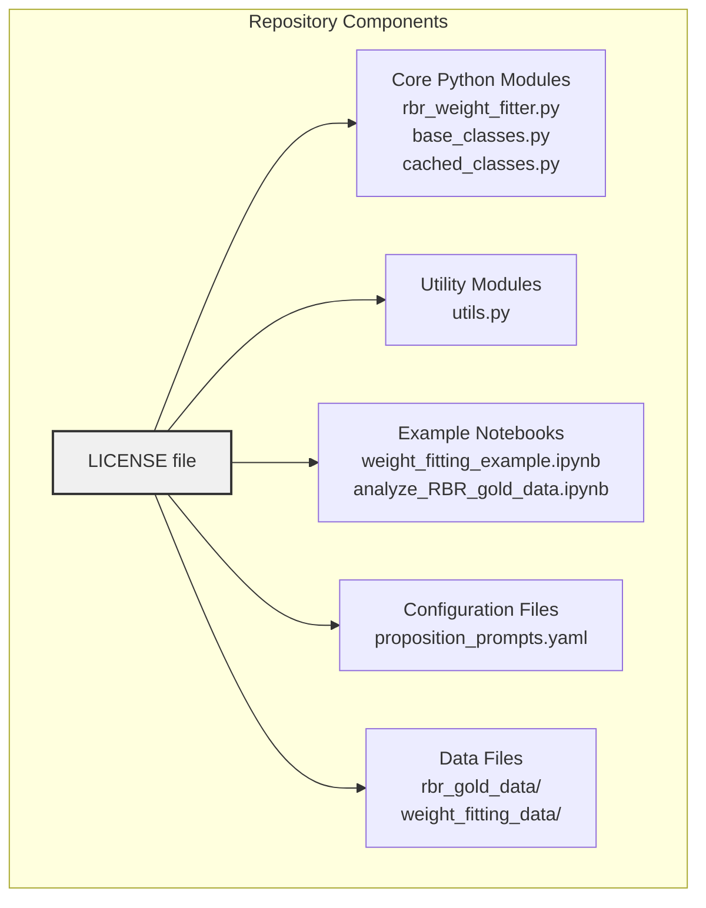
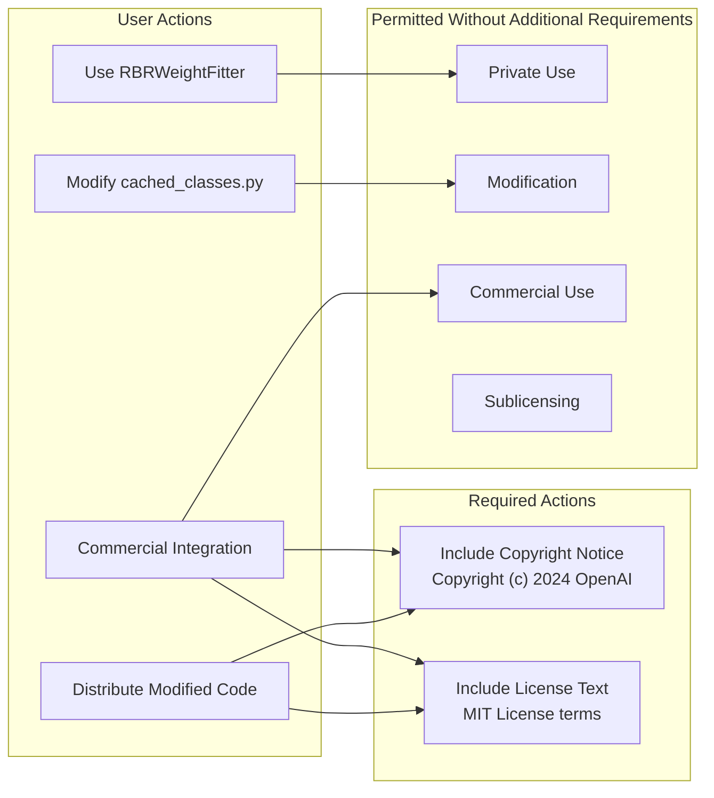

<!-- source: DeepWiki mcp.deepwiki.com · repo openai/safety-rbr-code-and-data · page 5 License · fetched 2026-10-26 -->

# License

<details>
<summary>Relevant source files</summary>

The following files were used as context for generating this wiki page:

- [LICENSE](LICENSE)

</details>


This document covers the licensing terms and conditions under which the RBR weight fitting codebase is released. The repository is distributed under the MIT License, which governs how the code, data, and documentation may be used, modified, and redistributed.

## License Overview

The RBR weight fitting repository is released under the MIT License, a permissive open-source license. The full license text is contained in the root-level [`LICENSE`]() file and applies to all components of the system including the core weight fitting engine, data processing utilities, and example notebooks.

**License Structure:**


**MIT License Coverage Diagram**

Sources: [LICENSE:1-21]()

## Full License Text

The complete MIT License text as specified in the repository:

```
MIT License

Copyright (c) 2024 OpenAI

Permission is hereby granted, free of charge, to any person obtaining a copy
of this software and associated documentation files (the "Software"), to deal
in the Software without restriction, including without limitation the rights
to use, copy, modify, merge, publish, distribute, sublicense, and/or sell
copies of the Software, and to permit persons to whom the Software is
furnished to do so, subject to the following conditions:

The above copyright notice and this permission notice shall be included in all
copies or substantial portions of the Software.

THE SOFTWARE IS PROVIDED "AS IS", WITHOUT WARRANTY OF ANY KIND, EXPRESS OR
IMPLIED, INCLUDING BUT NOT LIMITED TO THE WARRANTIES OF MERCHANTABILITY,
FITNESS FOR A PARTICULAR PURPOSE AND NONINFRINGEMENT. IN NO EVENT SHALL THE
AUTHORS OR COPYRIGHT HOLDERS BE LIABLE FOR ANY CLAIM, DAMAGES OR OTHER
LIABILITY, WHETHER IN AN ACTION OF CONTRACT, TORT OR OTHERWISE, ARISING FROM,
OUT OF OR IN CONNECTION WITH THE SOFTWARE OR THE USE OR OTHER DEALINGS IN THE
SOFTWARE.
```

Sources: [LICENSE:1-21]()

## License Terms Summary

The MIT License grants broad permissions while requiring minimal obligations:

| **Permissions** | **Conditions** | **Limitations** |
|-----------------|----------------|-----------------|
| Commercial use | License and copyright notice | No liability |
| Modification | | No warranty |
| Distribution | | |
| Private use | | |
| Sublicensing | | |

**License Requirements for Usage:**


**MIT License Obligations Flowchart**

Sources: [LICENSE:1-21]()

## Copyright Information

- **Copyright Holder**: OpenAI
- **Copyright Year**: 2024
- **Scope**: All software and documentation files in the repository

The copyright notice must be preserved in all copies or substantial portions of the software, as specified in [LICENSE:12-13]().

## Warranty and Liability Disclaimers

The MIT License includes important disclaimers:

- **No Warranty**: The software is provided "AS IS" without warranty of any kind ([LICENSE:15-17]())
- **No Liability**: Authors are not liable for claims, damages, or other liability ([LICENSE:18-21]())
- **No Support Obligation**: No requirement to provide maintenance or support

These disclaimers apply to all components including:
- `RBRWeightFitter` class optimization algorithms
- `CachedFeaturesValues` and `CachedRewardModelScores` implementations  
- Data processing utilities in `utils.py`
- Example notebooks and configuration files

Sources: [LICENSE:15-21]()

## Integration Guidelines

When integrating this codebase into other projects:

1. **Include License File**: Copy the complete [`LICENSE`]() file to your project
2. **Preserve Copyright**: Maintain the copyright notice in source files
3. **Attribution**: Credit OpenAI as the original author when redistributing
4. **Derivative Works**: May apply different licenses to your modifications while preserving the original license for unchanged portions

The permissive nature of the MIT License allows the `RBRWeightFitter` system to be integrated into both open-source and proprietary AI safety research projects without licensing conflicts.

Sources: [LICENSE:1-21]()