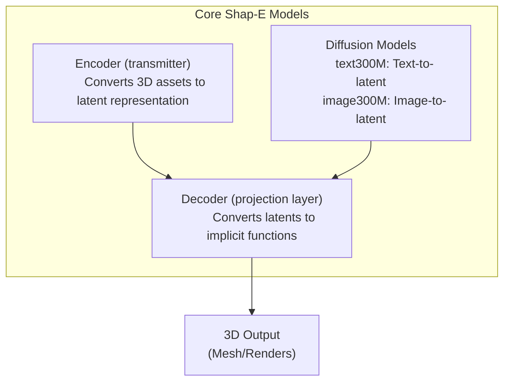
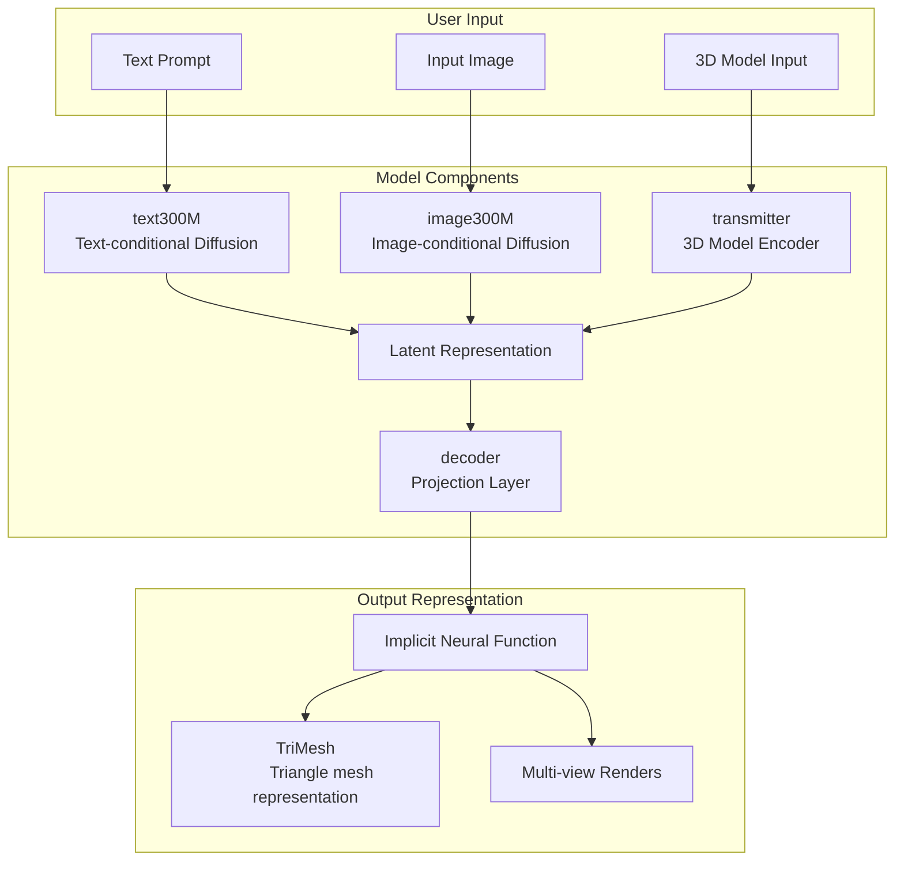
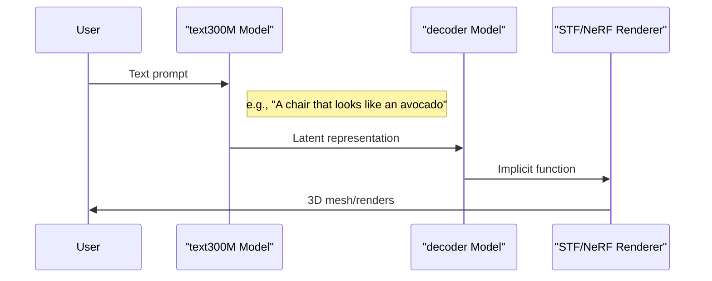
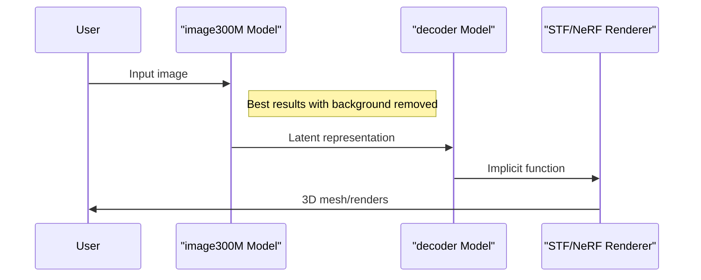
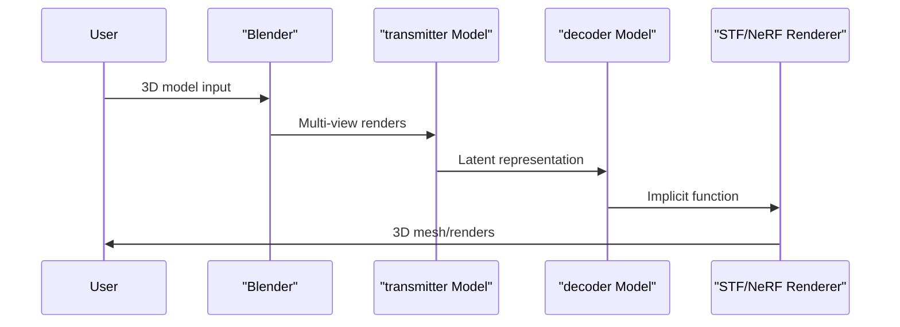
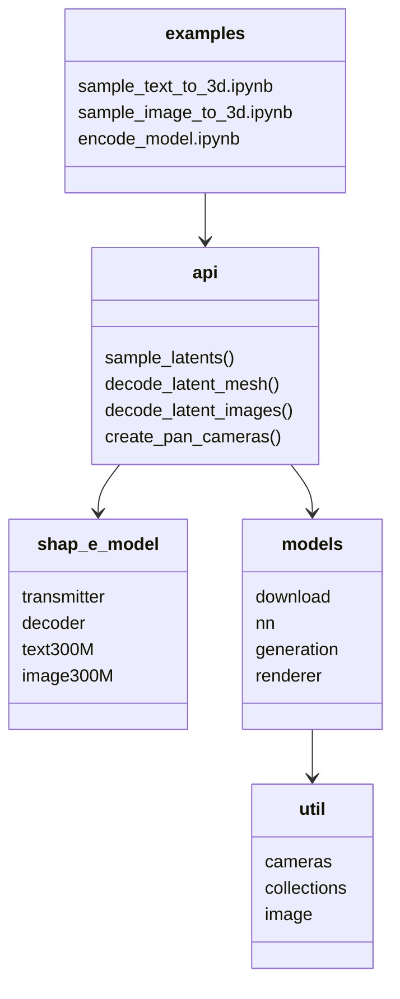

<!-- source: DeepWiki mcp.deepwiki.com · repo openai/shap-e · page 1 Overview · fetched 2026-10-26 -->

# Overview

Relevant source files

The following files were used as context for generating this wiki page:

- [README.md](README.md)
- [model-card.md](model-card.md)

This document provides an introduction to Shap-E, a system for generating 3D models from text prompts or images, and encoding existing 3D models into a latent representation. Shap-E implements the methods described in the research paper "Shap-E: Generating Conditional 3D Implicit Functions." For detailed information about specific components, refer to the [System Architecture](#2) page.

## What is Shap-E?

Shap-E is a deep learning framework that allows for the creation of 3D assets through multiple conditioning approaches. The system can:

1. Generate 3D models from text descriptions
2. Convert single-view images into complete 3D models
3. Encode existing 3D assets into a compact latent representation

The generated 3D models are represented as implicit neural functions that can be rendered from arbitrary viewpoints or exported as triangle meshes for use in downstream applications.

Sources: [model-card.md:1-14](), [README.md:1-4]()

## Core Components

Shap-E consists of two primary types of models:

| Model | Description | Purpose |
|-------|-------------|---------|
| `transmitter` | Encoder and projection layers | Converts 3D assets into parameters of neural networks representing 3D shapes |
| `decoder` | Final projection layer | Converts diffusion model outputs into implicit neural representations |
| `text300M` | Text-conditional diffusion | Generates latent representations from text prompts |
| `image300M` | Image-conditional diffusion | Generates latent representations from images |

Sources: [model-card.md:7-11](), [model-card.md:22-27]()

## System Architecture

The following diagram shows how the different components of Shap-E interact with each other:

In this architecture:
1. User inputs (text, image, or 3D model) are processed by the appropriate model
2. All paths converge to produce a latent representation
3. The decoder converts the latent representation into an implicit neural function
4. The implicit function can be rendered or converted to a mesh

Sources: [model-card.md:7-11]()

## Main Workflows

Shap-E supports three primary workflows:

### 1. Text-to-3D Generation

### 2. Image-to-3D Generation

### 3. 3D Model Encoding

Sources: [README.md:66-73]()

## Code Structure and Implementation

The following diagram shows the key code entities and their relationships:

The repository provides three example notebooks to demonstrate the main workflows:

1. `sample_text_to_3d.ipynb` - Generate 3D models from text prompts
2. `sample_image_to_3d.ipynb` - Generate 3D models from images 
3. `encode_model.ipynb` - Encode existing 3D models into latent space

Sources: [README.md:69-73]()

## Getting Started

To use Shap-E:

1. Install the package: `pip install -e .`
2. For 3D model encoding, install Blender 3.3.1+ and set the `BLENDER_PATH` environment variable
3. Run the example notebooks to understand the workflows:
   - Text-to-3D generation
   - Image-to-3D generation  
   - 3D model encoding

Each notebook demonstrates how to load the appropriate models, generate samples, and visualize or export the results.

Sources: [README.md:66-73]()

## Limitations and Considerations

Shap-E has several known limitations:

- Generated 3D assets often have rough edges, holes, or blurry surface textures
- The text-conditional model may struggle with complex prompts that combine multiple objects
- The image-conditional model works best with synthetic renderings with removed backgrounds
- The models reflect the style of the training data, which includes many simple, cartoonish 3D assets

For research purposes, these models have been evaluated on:
- Generating 3D renderings or meshes conditioned on single, synthetic images
- Generating 3D renderings or meshes conditioned on text descriptions

Sources: [model-card.md:52-66]()

---

