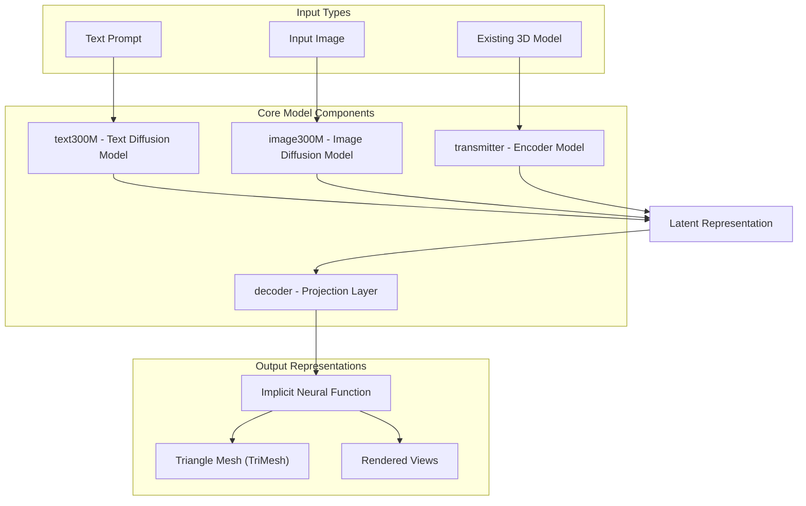
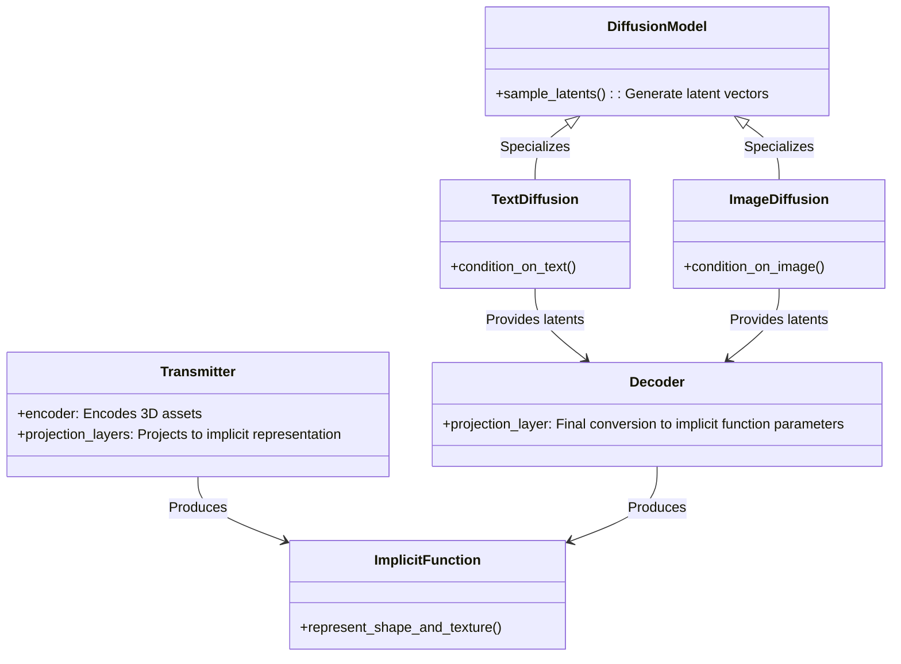
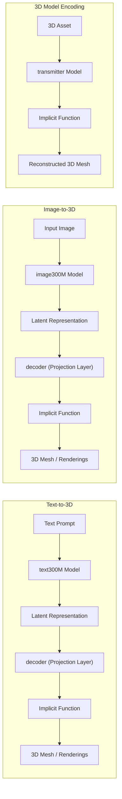
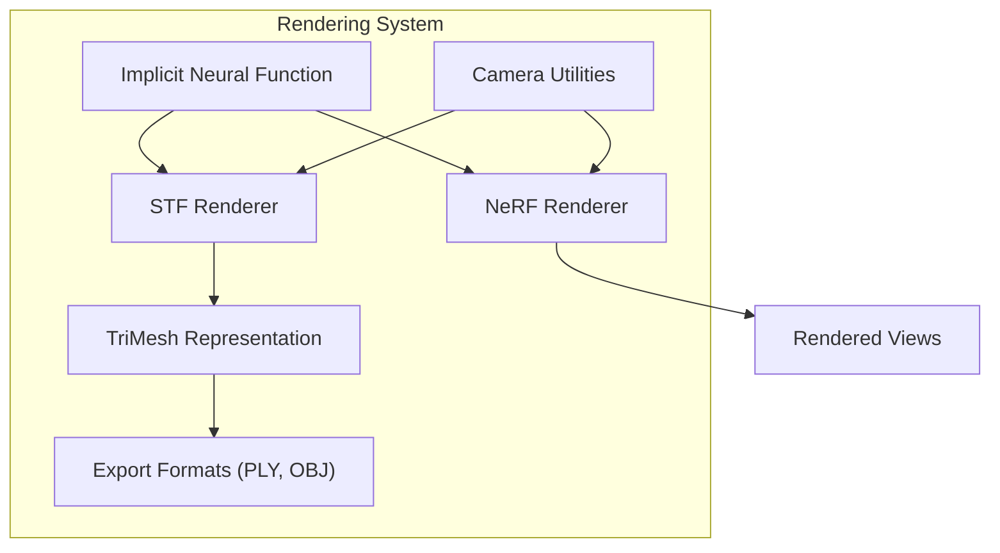
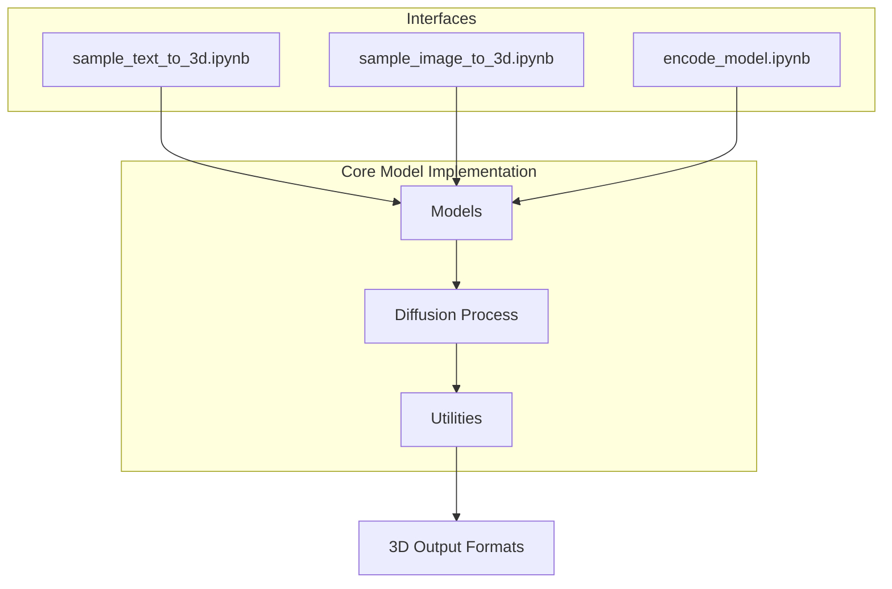

<!-- source: DeepWiki mcp.deepwiki.com · repo openai/shap-e · page 2 System Architecture · fetched 2026-10-26 -->

# System Architecture

Relevant source files

The following files were used as context for generating this wiki page:

- [model-card.md](model-card.md)

## Purpose and Scope

This document describes the core architecture of the Shap-E system, explaining the fundamental components and their relationships. It covers the encoder (transmitter), diffusion models, latent space representation, and how these components interact to generate 3D content. For detailed information about specific model components, see [Model Components](#2.1). For rendering specifics, see [Rendering System](#2.2).

## High-Level Architecture Overview

Shap-E provides a generative AI system for creating 3D models from text prompts or images, as well as encoding existing 3D models. The system is built around a latent diffusion approach where conditional inputs are used to generate implicit neural functions that represent 3D shapes and textures.

Sources: model-card.md:7-11

## Model Types and Functions

Shap-E consists of two main types of models, both focused on creating and manipulating implicit neural representations of 3D objects:

1. **Encoder (transmitter)**: Converts existing 3D assets into parameters of neural networks that represent 3D shapes and textures as implicit functions
2. **Latent Diffusion Models**: Generate novel implicit functions conditioned on either:
   - Text descriptions (text300M)
   - Images (image300M)

The system also includes a **decoder** (projection layer) that transforms latent representations into the final implicit neural function parameters.

Sources: model-card.md:22-27

## Data Flow Pipelines

The system supports three main workflows: text-to-3D, image-to-3D, and 3D model encoding. Each follows a different data flow path through the system components.

Sources: model-card.md:9-11, model-card.md:47-51

## Key System Components

The system integrates several specialized components to handle different aspects of 3D generation and processing:

### Model Components

| Component | Purpose | Key Characteristics |
|-----------|---------|---------------------|
| `transmitter` | Encoder model | Converts 3D assets into parameters of neural networks that represent shapes as implicit functions |
| `decoder` | Projection layer | Final layer that converts latent representations into implicit function parameters |
| `text300M` | Text diffusion model | Generates latent vectors conditioned on text descriptions |
| `image300M` | Image diffusion model | Generates latent vectors conditioned on input images |

Sources: model-card.md:22-27

### Rendering System

The system supports multiple rendering approaches to visualize and export the generated 3D content:

The system uses two primary rendering approaches:
1. STF (Signed Texture Field) rendering for generating meshes
2. NeRF-style rendering for creating image renderings from different viewpoints

Sources: model-card.md:9-11

## Code Structure and Implementation

The repository implements this architecture through several interconnected modules that handle different parts of the pipeline:

The system is exposed to users primarily through three Jupyter notebooks that demonstrate the different workflows (text-to-3D, image-to-3D, and 3D model encoding).

Sources: model-card.md:22-27, model-card.md:47-51

## Performance and Constraints

The architecture has specific performance characteristics and limitations that affect its usage:

- Image-conditional models work best with synthetic renderings but may struggle with occluded parts
- Text-conditional models can generate diverse objects but have difficulty with complex scenes or multiple objects
- Output quality typically has some imperfections such as rough edges, holes, or blurry textures
- Models tend to produce somewhat cartoonish 3D assets, reflecting the training data characteristics

Sources: model-card.md:52-65

## Conclusion

The Shap-E system architecture represents a complete pipeline for 3D content generation and processing through latent diffusion models. By combining specialized models for different input modalities with efficient representation and rendering systems, it enables the creation of 3D content from text descriptions, images, or existing 3D assets.

For more detailed information about specific components, please refer to the linked wiki pages for [Model Components](#2.1) and [Rendering System](#2.2).

---

