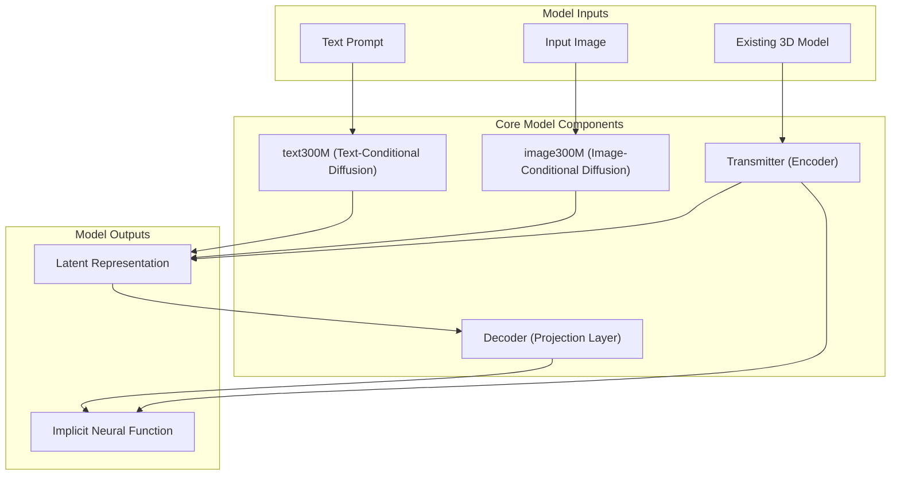
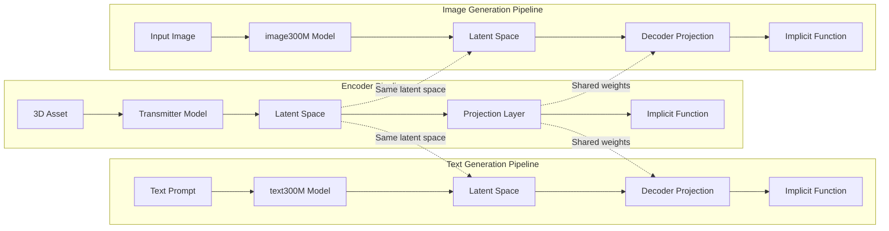
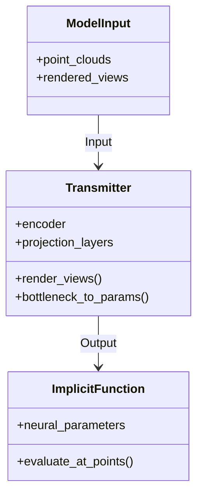
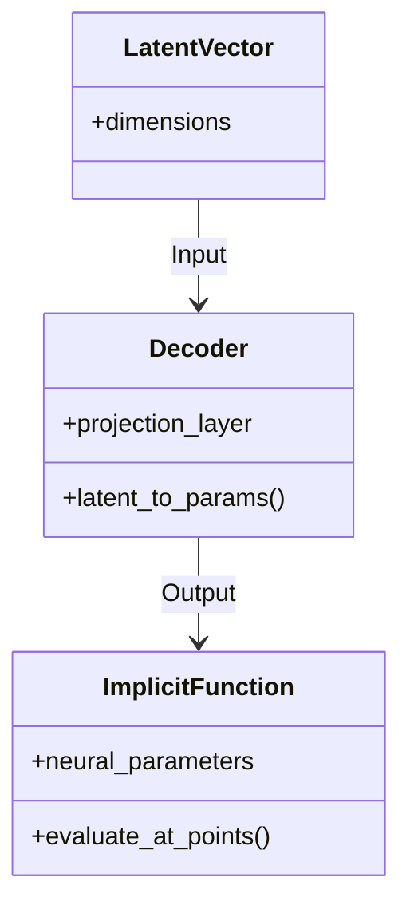
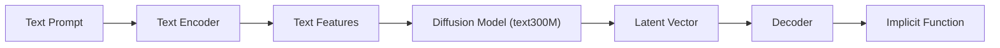
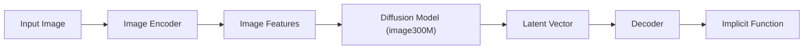
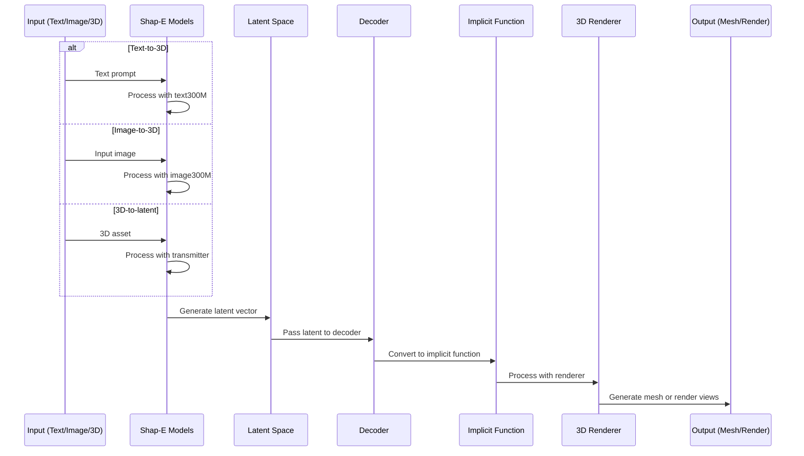

<!-- source: DeepWiki mcp.deepwiki.com · repo openai/shap-e · page 2.1 Model Components · fetched 2026-10-26 -->

# Model Components

Relevant source files

The following files were used as context for generating this wiki page:

- [README.md](README.md)
- [model-card.md](model-card.md)

This document provides a detailed technical breakdown of the core model components in the Shap-E system. We focus on explaining the four primary model components: the transmitter (encoder), decoder, and the text and image conditional diffusion models, along with their interactions and roles in the 3D generation pipeline. For information about the rendering system and how these models produce 3D outputs, see [Rendering System](#2.2).

## Overview of Model Components

Shap-E's architecture consists of two primary types of models that work together to generate and encode 3D content:

1. **Encoder Model**: The transmitter which converts 3D assets into neural network parameters
2. **Latent Diffusion Models**: Generate parameters for implicit functions based on text or image inputs

Sources: [model-card.md:7-10]()

## Available Model Checkpoints

Shap-E provides four pre-trained model checkpoints that implement the core components:

| Model Name | Description | Purpose |
|------------|-------------|---------|
| `transmitter` | Encoder + projection layers | Converts 3D assets into implicit neural representations |
| `decoder` | Final projection layer | Converts diffusion outputs into implicit neural representations |
| `text300M` | Text-conditional latent diffusion | Generates 3D content from text descriptions |
| `image300M` | Image-conditional latent diffusion | Generates 3D content from input images |

Sources: [model-card.md:22-27]()

## Component Relationships and Data Flow

The following diagram illustrates how data flows through the model components during generation and encoding:

Sources: [model-card.md:7-10](), [README.md:70-73]()

## Transmitter (Encoder) Component

The transmitter is a comprehensive encoder model that converts existing 3D assets into the parameters of small neural networks which represent the 3D shape and texture as an implicit function.

### Architecture and Purpose

The transmitter consists of two main parts:
- An encoder that processes 3D inputs
- Projection layers that convert encoder outputs into implicit neural function parameters

Sources: [model-card.md:9](), [model-card.md:24-25]()

### Usage Context

The transmitter is primarily used in the 3D encoding workflow, where existing 3D models are converted into the Shap-E latent representation. The encoder first processes multi-view renders and point clouds of the input 3D model, then projects this representation to the parameters of an implicit neural function.

Sources: [README.md:73]()

## Decoder Component

The decoder is a specialized component that serves as the final projection layer used to convert latent representations into implicit neural functions.

### Architecture and Purpose

Sources: [model-card.md:25-26]()

### Key Characteristics

- The decoder is a subset of the transmitter, containing only the final projection layer
- It's a smaller checkpoint than the full transmitter since it doesn't include parameters for encoding 3D assets
- The decoder is the minimum required model to convert diffusion outputs into implicit neural representations
- It shares the same projection layer weights as the transmitter component

Sources: [model-card.md:25-26]()

## Diffusion Models

Shap-E includes two conditional latent diffusion models that generate 3D content based on different types of prompts.

### Text-conditional Diffusion Model (text300M)

The text300M model generates implicit functions conditioned on text descriptions. It was trained on an expanded dataset with roughly a million 3D assets and 120K human-annotated captions.

Sources: [model-card.md:10](), [model-card.md:41-42]()

### Image-conditional Diffusion Model (image300M)

The image300M model generates implicit functions conditioned on single view images. It was trained on the same dataset as Point-E but with improved post-processing.

Sources: [model-card.md:10](), [model-card.md:35-40]()

### Training Dataset Information

Both diffusion models were trained on specialized datasets:

- **image300M**: Trained on the same dataset as Point-E, with improvements:
  - 60 views rendered per model (instead of 20)
  - 16K points in each point cloud (instead of 4K)
  - Simplified lighting and material setup with only diffuse materials

- **text300M**: Used an expanded dataset with:
  - Approximately one million more 3D assets
  - 120K human-annotated captions for a high-quality subset of assets

Sources: [model-card.md:34-42]()

## End-to-End Generation Flow

The following diagram shows the complete end-to-end flow when generating 3D content with Shap-E models:

Sources: [README.md:70-73](), [model-card.md:7-10]()

## Model Component Implementation

The model components are implemented as neural networks with specific architectures designed for 3D generation. Each component plays a distinct role in the pipeline:

1. **Transmitter**: Full encoder architecture that processes 3D inputs and produces both latent representations and implicit functions
2. **Decoder**: Lightweight network that only contains the final projection layer from the transmitter
3. **text300M**: Conditional diffusion model that maps text descriptions to latent vectors
4. **image300M**: Conditional diffusion model that maps image inputs to latent vectors

The strength of the system comes from how these components interact with each other in a unified latent space, allowing for flexible generation of 3D content from multiple modalities.

Sources: [model-card.md:22-27]()

## Technical Limitations

The model components have several technical limitations that affect their performance:

- The image-conditional model can sometimes fail to infer the correct occluded parts of an object
- The text-conditional model often fails with complex prompts that require placing multiple objects in a scene
- Generated 3D assets often have rough edges, holes, or blurry surface textures
- The models tend to imitate the simple, cartoonish style of many of the training assets

Sources: [model-card.md:53-60]()

---

