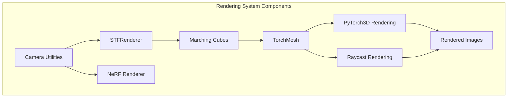
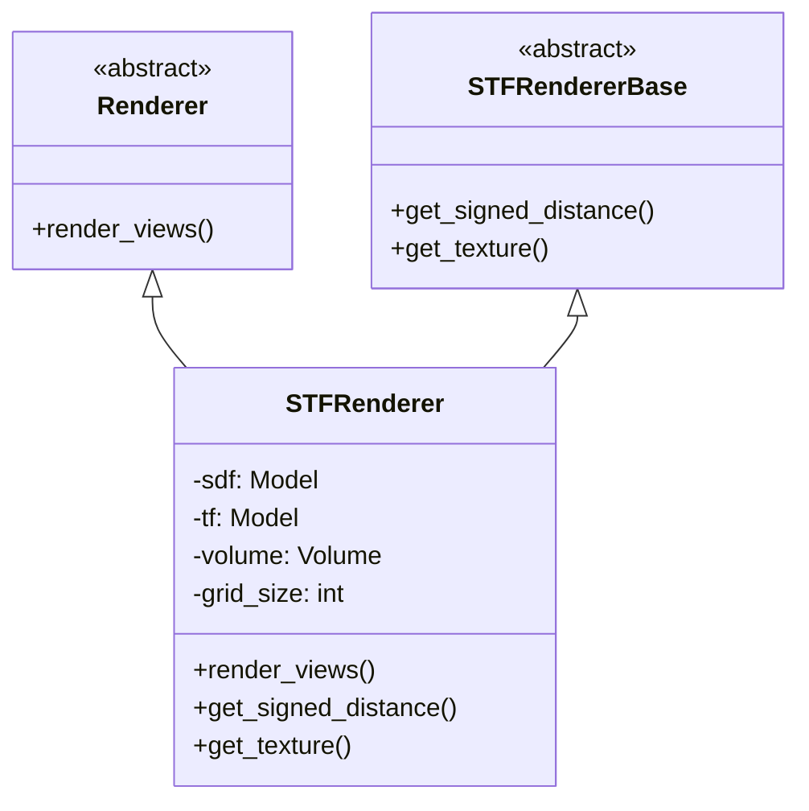
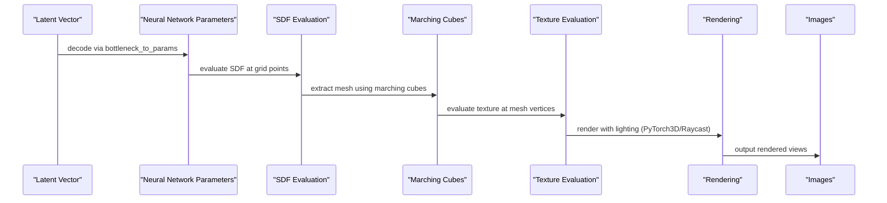
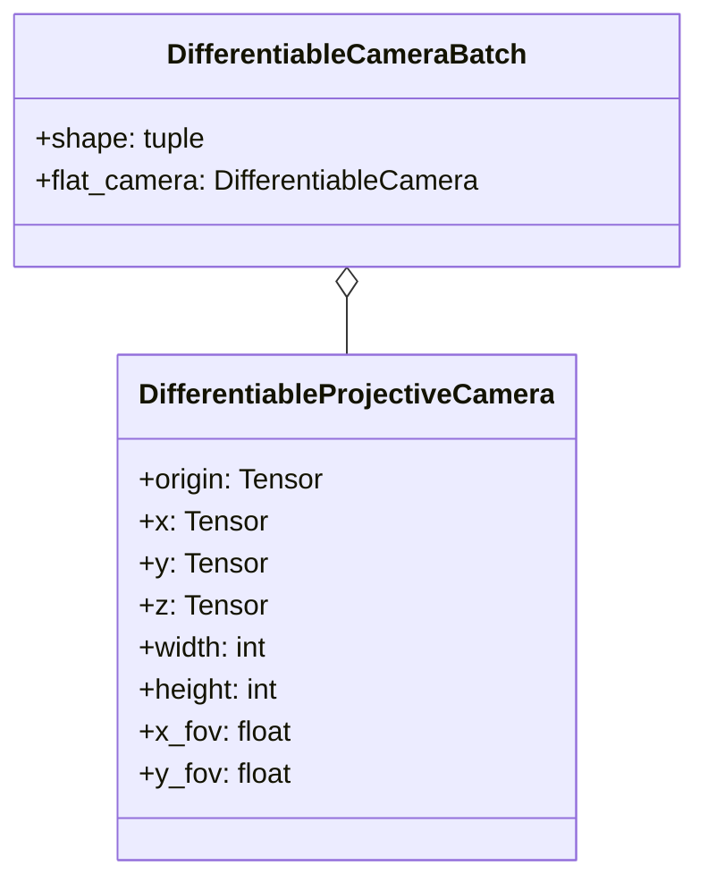
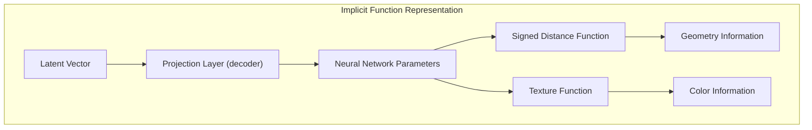
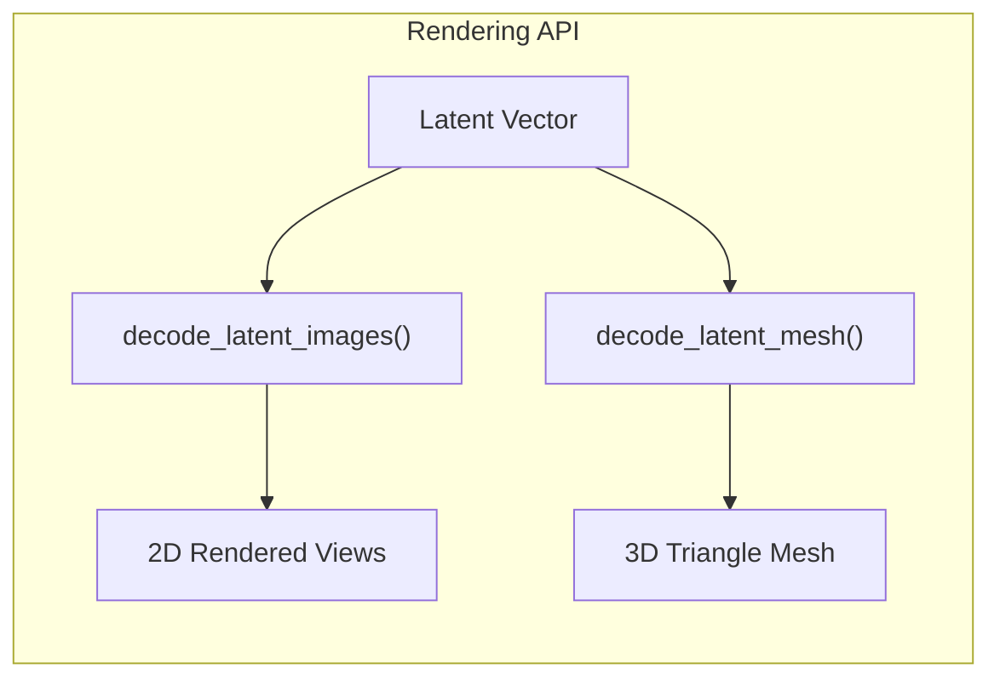
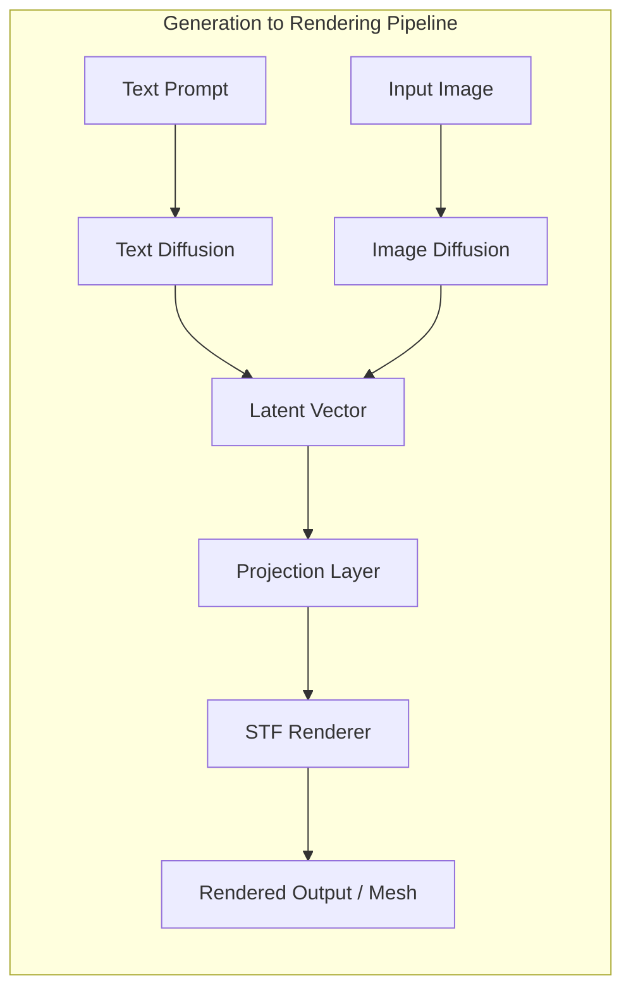

<!-- source: DeepWiki mcp.deepwiki.com · repo openai/shap-e · page 2.2 Rendering System · fetched 2026-10-26 -->

# Rendering System

Relevant source files

The following files were used as context for generating this wiki page:

- [model-card.md](model-card.md)
- [shap_e/models/stf/renderer.py](shap_e/models/stf/renderer.py)
- [shap_e/util/notebooks.py](shap_e/util/notebooks.py)

The Rendering System in Shap-E is responsible for generating visual representations of 3D models from latent vectors. It converts implicit neural function representations into both mesh-based 3D models and 2D renderings from different viewpoints. This component bridges the gap between the abstract latent space generated by the diffusion models and the final visual outputs.

## Core Components

The rendering system consists of two primary renderers and supporting utilities for camera positioning and mesh processing:

Sources: [shap_e/models/stf/renderer.py:45-129](). [shap_e/util/notebooks.py:16-43]()

### STF Renderer

The STF (Signed Distance Function and Texture Function) Renderer is the primary rendering system in Shap-E. It represents 3D shapes implicitly using:

1. **Signed Distance Function (SDF)** - Defines the geometry of the shape
2. **Texture Function (TF)** - Defines the surface properties (color, etc.)

The `STFRenderer` class implements two key methods from `STFRendererBase`:

- `get_signed_distance`: Evaluates the signed distance function at given positions
- `get_texture`: Evaluates the texture function at given positions

Sources: [shap_e/models/stf/renderer.py:25-128]()

### Rendering Process

The STF rendering process involves several steps:

The key function implementing this workflow is `render_views_from_stf` [shap_e/models/stf/renderer.py:131-311](), which:

1. Samples points in a 3D grid and evaluates the SDF at these points
2. Uses marching cubes to extract a mesh from the SDF
3. Evaluates the texture function at mesh vertices
4. Renders the textured mesh from different viewpoints

Sources: [shap_e/models/stf/renderer.py:131-311]()

### Rendering Backends

The system supports two rendering backends:

1. **PyTorch3D**: Primary renderer for high-quality output with full gradient support
2. **Raycast**: Fallback renderer with more limited gradient support

The system automatically falls back to the raycast renderer if PyTorch3D is not available.

Sources: [shap_e/models/stf/renderer.py:315-455]()

## Camera System

The rendering system uses a sophisticated camera system to create multi-view renderings:

The utility function `create_pan_cameras` [shap_e/util/notebooks.py:16-43]() creates a batch of cameras that orbit around a central point, which is useful for generating 360-degree views of objects.

Sources: [shap_e/util/notebooks.py:16-43]()

## NeRF Renderer

While the STF renderer is the primary rendering system, Shap-E also supports Neural Radiance Fields (NeRF) rendering as mentioned in the architecture diagrams. The NeRF rendering approach represents scenes as continuous volumetric functions rather than explicit meshes, allowing for novel view synthesis with smooth interpolation between viewpoints.

## Implicit Function Representation

At the core of the rendering system is the representation of 3D objects as implicit neural functions:

This representation allows for:
- Compact storage of 3D information
- Differentiable operations for end-to-end training
- Conversion to explicit mesh representations for visualization and export

Sources: [model-card.md:7-10]()

## Usage Workflow

The rendering system provides two primary functions for working with latent vectors:

1. `decode_latent_images`: Converts a latent vector into rendered images from multiple viewpoints
2. `decode_latent_mesh`: Converts a latent vector into a triangle mesh

These functions provide a clean interface for applications to convert latent vectors into visual representations.

Sources: [shap_e/util/notebooks.py:46-76]()

## Key Objects and Data Structures

| Object | Description | Key Properties |
|--------|-------------|----------------|
| `TorchMesh` | Represents a 3D mesh | `verts`, `faces`, `vertex_channels` |
| `DifferentiableCameraBatch` | Collection of cameras | `flat_camera` |
| `DifferentiableProjectiveCamera` | Single camera | `origin`, `x`, `y`, `z`, `width`, `height`, `x_fov`, `y_fov` |
| `AttrDict` | Dictionary with attribute access | Various parameters for rendering |

Sources: [shap_e/models/stf/renderer.py:45-76](), [shap_e/util/notebooks.py:16-43]()

## Integration with Generation Pipeline

The rendering system is the final stage in both the text-to-3D and image-to-3D pipelines:

The rendering system is responsible for converting the abstract latent representations produced by the diffusion models into visible 3D content that can be viewed or exported.

Sources: [model-card.md:7-10]()

---

