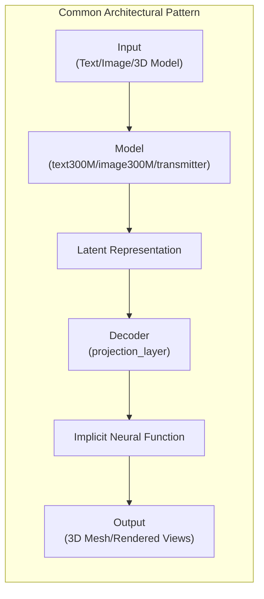
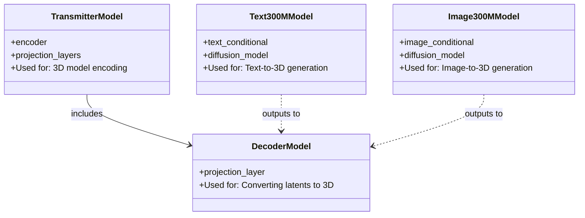
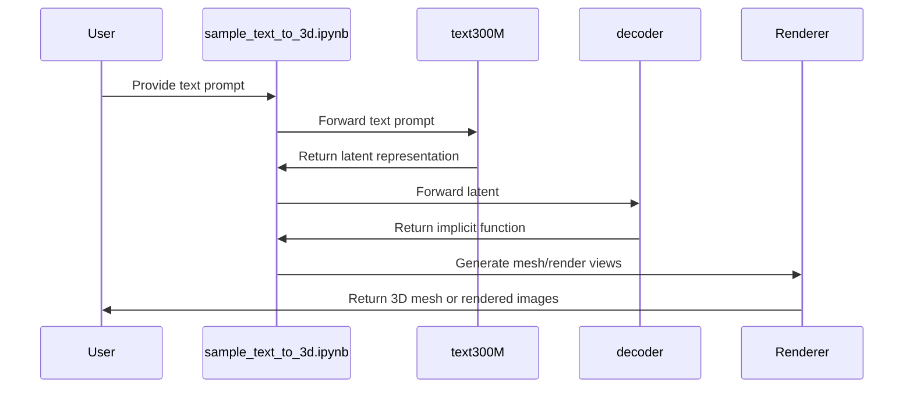
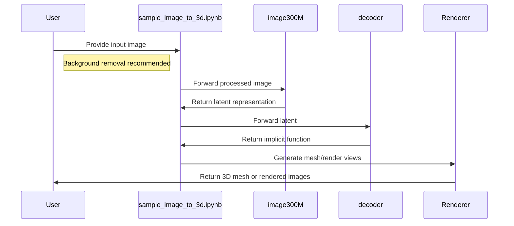
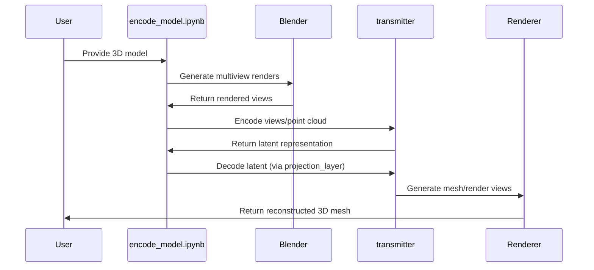
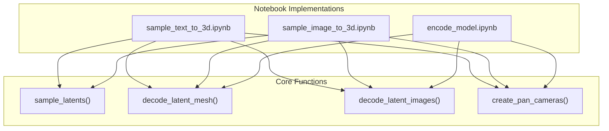

<!-- source: DeepWiki mcp.deepwiki.com · repo openai/shap-e · page 3 Generation Workflows · fetched 2026-10-26 -->

# Generation Workflows

Relevant source files

The following files were used as context for generating this wiki page:

- [README.md](README.md)
- [model-card.md](model-card.md)

This document provides an overview of the three main workflows in Shap-E for generating and encoding 3D content. It explains the overall process flow, key components, and relationships between different models in each workflow. For detailed instructions on using specific workflows, see the dedicated pages for [Text-to-3D Generation](#3.1), [Image-to-3D Generation](#3.2), and [3D Model Encoding](#3.3).

## Generation Workflow Architecture

Shap-E supports three primary workflows that leverage different models but share a common architectural pattern of generating or encoding content through a latent representation, which is then decoded into an implicit neural representation of 3D objects.

Sources: model-card.md

## Workflow Types and Models

Each workflow uses different models from the Shap-E library but follows the same general pattern of transforming input into a latent representation and then decoding it to produce 3D content.

### Available Models

Shap-E provides four pre-trained model checkpoints that work together to enable the different generation workflows:

Sources: model-card.md:23-27

## Generation Workflow Diagram

The following diagram illustrates how the three main generation workflows operate from input to output, highlighting the key components and data transformations:

```mermaid
flowchart TD
    subgraph "Text-to-3D Workflow"
        textPrompt["Text Prompt"] --> text300M["text300M Model"]
        text300M --> textLatent["Latent Vector"]
        textLatent --> textDecoder["decoder (projection_layer)"]
        textDecoder --> textImplicit["Implicit Function"]
        textImplicit --> textMesh["3D Mesh/Renders"]
    end
    
    subgraph "Image-to-3D Workflow"
        imageInput["Input Image"] --> image300M["image300M Model"]
        image300M --> imageLatent["Latent Vector"]
        imageLatent --> imageDecoder["decoder (projection_layer)"]
        imageDecoder --> imageImplicit["Implicit Function"]
        imageImplicit --> imageMesh["3D Mesh/Renders"]
    end
    
    subgraph "3D Encoding Workflow"
        modelInput["3D Model Input"] --> transmitter["transmitter Model"]
        transmitter --> modelLatent["Latent Vector"]
        modelLatent --> modelDecoder["projection_layer (part of transmitter)"]
        modelDecoder --> modelImplicit["Implicit Function"]
        modelImplicit --> modelMesh["3D Mesh/Renders"]
    end
```

Sources: README.md:69-73, model-card.md:7-11

## Common Functions Across Workflows

All three workflows share key functions for sampling, decoding, and rendering content:

| Function | Purpose | Used In |
|----------|---------|---------|
| `sample_latents()` | Generate latent representation from inputs | Text-to-3D, Image-to-3D |
| `decode_latent_mesh()` | Convert latent to triangle mesh | All workflows |
| `decode_latent_images()` | Render the latent from specified camera viewpoints | All workflows |
| `create_pan_cameras()` | Create camera positions for rendering multiple views | All workflows |

Sources: model-card.md

## Text-to-3D Generation Workflow

The text-to-3D workflow transforms natural language prompts into 3D models using a diffusion model trained on text-3D pairs.

Key components in the text-to-3D workflow:
- **Input**: Text prompt describing the desired 3D object
- **Model**: `text300M` text-conditional diffusion model 
- **Output**: Implicit neural representation that can be rendered or exported as a mesh

Sources: README.md:71, model-card.md:26

## Image-to-3D Generation Workflow

The image-to-3D workflow takes a 2D image and generates a corresponding 3D model that matches the appearance from the input view while inferring the object's complete 3D structure.

Key components in the image-to-3D workflow:
- **Input**: 2D image (ideally with background removed)
- **Model**: `image300M` image-conditional diffusion model
- **Output**: Implicit neural representation that can be rendered or exported as a mesh

Sources: README.md:72, model-card.md:27

## 3D Model Encoding Workflow

The 3D model encoding workflow converts existing 3D assets into the latent space representation used by Shap-E, allowing for manipulation, reconstruction, or transfer of 3D content.

Key components in the 3D encoding workflow:
- **Input**: Existing 3D model or mesh
- **Dependencies**: Requires Blender 3.3.1+ (`BLENDER_PATH` environment variable)
- **Model**: `transmitter` encoder model
- **Output**: Implicit neural representation that can be rendered or exported as a mesh

Sources: README.md:73, model-card.md:24-25

## Common Output Methods

All workflows support the same output methods for visualizing and exporting the generated 3D content:

| Output Method | Description | Function |
|---------------|-------------|----------|
| Rendered Views | 2D renders from different camera angles | `decode_latent_images()` |
| Triangle Mesh | Exportable 3D mesh | `decode_latent_mesh()` |
| PLY/OBJ Export | Save 3D model to standard file formats | `write_ply()` / `write_obj()` |

Sources: model-card.md, README.md

## Workflow Implementation Details

The implementation of these workflows is demonstrated in example notebooks, each focusing on one of the three main workflows:

Sources: README.md:69-73

The notebooks provide practical examples of how to use the Shap-E models for various 3D generation tasks, with each workflow utilizing the same core functions but different initial models and inputs.

---

