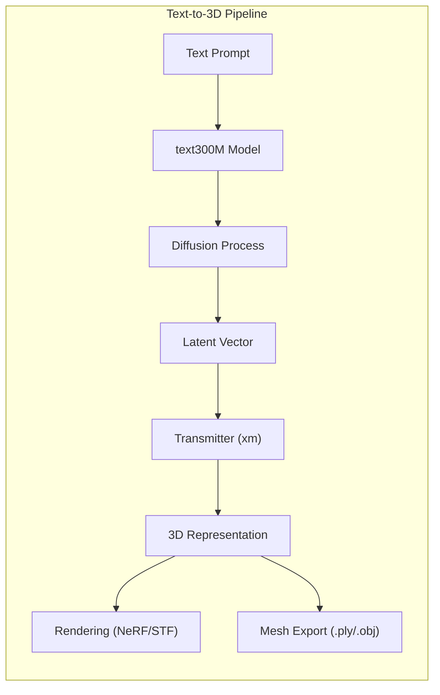
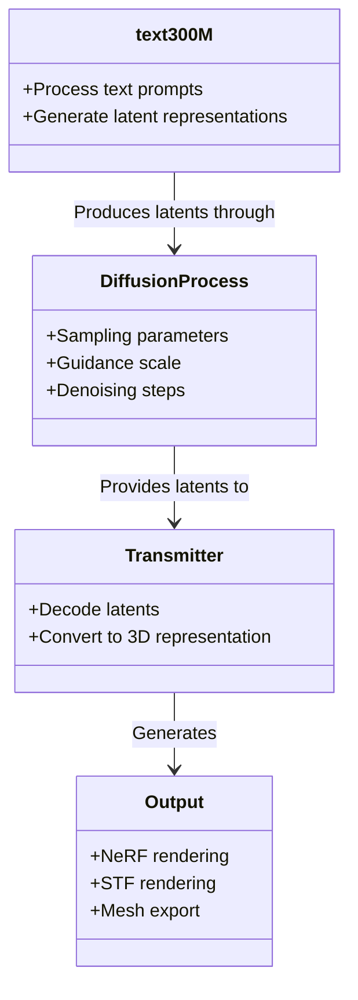
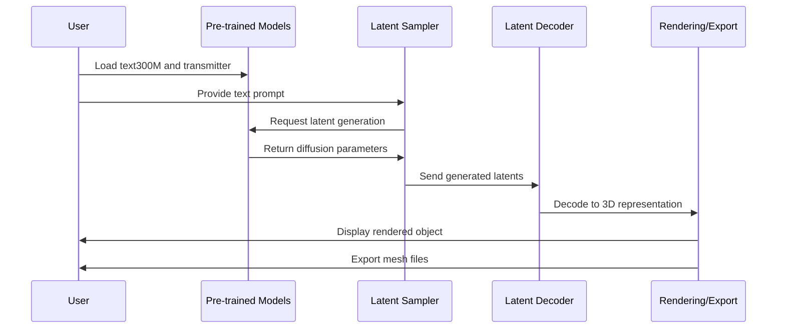
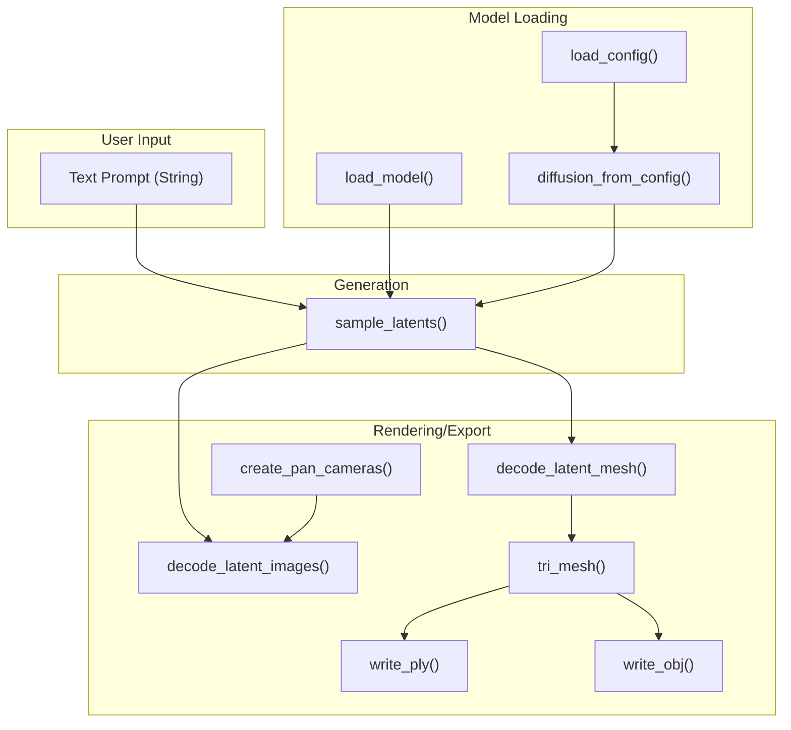

<!-- source: DeepWiki mcp.deepwiki.com · repo openai/shap-e · page 3.1 Text-to-3D Generation · fetched 2026-10-26 -->

# Text-to-3D Generation

<details>
<summary>Relevant source files</summary>

The following files were used as context for generating this wiki page:

- [README.md](README.md)
- [shap_e/examples/sample_text_to_3d.ipynb](shap_e/examples/sample_text_to_3d.ipynb)

</details>


This document explains the Text-to-3D generation workflow in Shap-E, which allows users to create 3D models from text prompts. The system uses a text-conditional diffusion model to generate high-quality 3D shapes that match the provided text description. For information about generating 3D models from images, see [Image-to-3D Generation](#3.2), and for encoding existing 3D models, see [3D Model Encoding](#3.3).

## Overview

The Text-to-3D generation pipeline transforms a text prompt into a 3D model through a diffusion-based process. It uses pre-trained models to generate latent representations which are then decoded into renderable 3D content.



Sources: [shap_e/examples/sample_text_to_3d.ipynb:9-15](), [shap_e/examples/sample_text_to_3d.ipynb:35-37](), [shap_e/examples/sample_text_to_3d.ipynb:51-65]()

## Components and Process

### Core Components

The Text-to-3D generation system consists of three main components:

1. **text300M Model** - A text-conditional diffusion model trained to generate 3D latent representations from text descriptions
2. **Transmitter (xm)** - A model that decodes latent representations into renderable 3D representations
3. **Diffusion Process** - The sampling process used to generate coherent latent representations



Sources: [shap_e/examples/sample_text_to_3d.ipynb:35-37](), [shap_e/examples/sample_text_to_3d.ipynb:75-81](), [shap_e/examples/sample_text_to_3d.ipynb:91-99]()

### Generation Workflow

The Text-to-3D generation process follows these steps:

1. **Load Models**: Load the required pre-trained models (transmitter and text300M)
2. **Create Text Prompt**: Define the text description of the desired 3D object
3. **Generate Latents**: Sample latent representations using the diffusion model
4. **Decode Latents**: Convert latents to 3D representations using the transmitter
5. **Render or Export**: Either visualize the 3D model or export it as a mesh file



Sources: [shap_e/examples/sample_text_to_3d.ipynb:35-37](), [shap_e/examples/sample_text_to_3d.ipynb:47-65](), [shap_e/examples/sample_text_to_3d.ipynb:75-81](), [shap_e/examples/sample_text_to_3d.ipynb:91-99]()

## Implementation Details

### Required Models

The Text-to-3D generation pipeline requires two pre-trained models:

| Model Name | Variable | Purpose |
|------------|----------|---------|
| 'transmitter' | `xm` | Decodes latent vectors into 3D representations |
| 'text300M' | `model` | Text-conditional diffusion model that generates latent vectors |

Additionally, a diffusion configuration is loaded to define the diffusion process parameters.

Sources: [shap_e/examples/sample_text_to_3d.ipynb:35-37]()

### Latent Sampling

The core of the generation process is the `sample_latents` function, which takes the text prompt and applies the diffusion process to generate latent representations:

```python
latents = sample_latents(
    batch_size=batch_size,
    model=model,
    diffusion=diffusion,
    guidance_scale=guidance_scale,
    model_kwargs=dict(texts=[prompt] * batch_size),
    progress=True,
    clip_denoised=True,
    use_fp16=True,
    use_karras=True,
    karras_steps=64,
    sigma_min=1e-3,
    sigma_max=160,
    s_churn=0,
)
```

Key parameters include:

| Parameter | Description |
|-----------|-------------|
| `batch_size` | Number of samples to generate |
| `guidance_scale` | Controls how strongly the generation follows the text prompt |
| `use_karras` | Whether to use Karras sampling schedule |
| `karras_steps` | Number of denoising steps |
| `sigma_min/max` | Range of noise levels in the diffusion process |

Sources: [shap_e/examples/sample_text_to_3d.ipynb:47-65]()

### Rendering and Visualization

The generated latents can be visualized using two rendering methods:

1. **NeRF Rendering** - Neural Radiance Fields rendering (default)
2. **STF Rendering** - Signed distance functions and texture fields rendering

The visualization process uses camera positioning to create rotating views of the object:

```python
cameras = create_pan_cameras(size, device)
images = decode_latent_images(xm, latent, cameras, rendering_mode=render_mode)
```

Sources: [shap_e/examples/sample_text_to_3d.ipynb:75-81]()

### Exporting Meshes

Generated 3D models can be exported as mesh files in PLY or OBJ formats:

```python
t = decode_latent_mesh(xm, latent).tri_mesh()
with open(f'example_mesh_{i}.ply', 'wb') as f:
    t.write_ply(f)
with open(f'example_mesh_{i}.obj', 'w') as f:
    t.write_obj(f)
```

The exported meshes can be imported into standard 3D modeling software for further editing or use.

Sources: [shap_e/examples/sample_text_to_3d.ipynb:91-99]()

## Code Implementation

The following diagram shows how the components in the text-to-3D generation system map to specific code entities:



Sources: [shap_e/examples/sample_text_to_3d.ipynb:10-15](), [shap_e/examples/sample_text_to_3d.ipynb:35-37](), [shap_e/examples/sample_text_to_3d.ipynb:51-65](), [shap_e/examples/sample_text_to_3d.ipynb:78-80](), [shap_e/examples/sample_text_to_3d.ipynb:92-99]()

## Sample Usage Walkthrough

Here's a step-by-step walkthrough of the text-to-3D generation process using the sample notebook:

1. **Import dependencies and setup device**:
   ```python
   import torch
   from shap_e.diffusion.sample import sample_latents
   from shap_e.diffusion.gaussian_diffusion import diffusion_from_config
   from shap_e.models.download import load_model, load_config
   from shap_e.util.notebooks import create_pan_cameras, decode_latent_images, gif_widget
   
   device = torch.device('cuda' if torch.cuda.is_available() else 'cpu')
   ```

2. **Load models**:
   ```python
   xm = load_model('transmitter', device=device)
   model = load_model('text300M', device=device)
   diffusion = diffusion_from_config(load_config('diffusion'))
   ```

3. **Set generation parameters and create latents**:
   ```python
   batch_size = 4
   guidance_scale = 15.0
   prompt = "a shark"
   
   latents = sample_latents(
       batch_size=batch_size,
       model=model,
       diffusion=diffusion,
       guidance_scale=guidance_scale,
       model_kwargs=dict(texts=[prompt] * batch_size),
       # ... additional parameters
   )
   ```

4. **Render and visualize the results**:
   ```python
   render_mode = 'nerf'  # or 'stf'
   size = 64  # render size, higher values take longer
   
   cameras = create_pan_cameras(size, device)
   for i, latent in enumerate(latents):
       images = decode_latent_images(xm, latent, cameras, rendering_mode=render_mode)
       display(gif_widget(images))
   ```

5. **Export meshes**:
   ```python
   for i, latent in enumerate(latents):
       t = decode_latent_mesh(xm, latent).tri_mesh()
       with open(f'example_mesh_{i}.ply', 'wb') as f:
           t.write_ply(f)
       with open(f'example_mesh_{i}.obj', 'w') as f:
           t.write_obj(f)
   ```

Sources: [shap_e/examples/sample_text_to_3d.ipynb:10-99]()

## Best Practices and Tips

1. **Prompt Engineering**:
   - Be specific in text descriptions
   - Simple, clear descriptions often work better than complex ones
   - Single objects tend to generate better than complex scenes

2. **Parameter Tuning**:
   - Higher `guidance_scale` values (15-20) produce results that more closely match the text prompt
   - Increasing `batch_size` generates multiple variations of the same prompt
   - The default `karras_steps=64` provides a good balance between quality and speed

3. **Rendering Options**:
   - `nerf` rendering typically produces smoother results but may be slower
   - `stf` rendering can be faster but may produce more artifacts
   - Increase `size` parameter for higher quality renders (at the cost of speed)

4. **Hardware Considerations**:
   - GPU acceleration is highly recommended for reasonable generation times
   - Generating with CPU only will be significantly slower
   - Higher batch sizes and render sizes require more VRAM

Sources: [shap_e/examples/sample_text_to_3d.ipynb:47-65](), [shap_e/examples/sample_text_to_3d.ipynb:75-81]()

---

