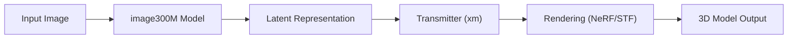
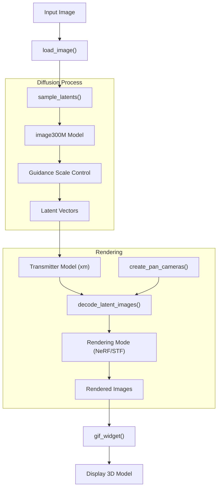
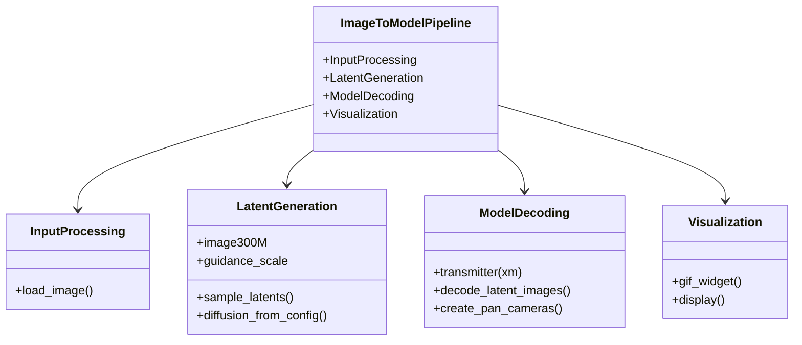

<!-- source: DeepWiki mcp.deepwiki.com · repo openai/shap-e · page 3.2 Image-to-3D Generation · fetched 2026-10-26 -->

# Image-to-3D Generation

<details>
<summary>Relevant source files</summary>

The following files were used as context for generating this wiki page:

- [README.md](README.md)
- [shap_e/examples/sample_image_to_3d.ipynb](shap_e/examples/sample_image_to_3d.ipynb)

</details>


## Purpose and Scope

This document details the Image-to-3D generation capability of the Shap-E system, which converts 2D images into 3D models. This workflow enables the creation of detailed 3D representations from single image inputs. For text-based 3D generation, see [Text-to-3D Generation](#3.1), and for encoding existing 3D models, see [3D Model Encoding](#3.3).

Sources: [README.md:72-73]()

## System Overview

Image-to-3D generation represents one of the three primary workflows in Shap-E. The process uses a pre-trained diffusion model (`image300M`) to convert a 2D image into a latent representation, which is then decoded using a transmitter model to create a 3D model that can be rendered in different ways.

### Image-to-3D Pipeline Diagram



Sources: [shap_e/examples/sample_image_to_3d.ipynb:10-16](), [shap_e/examples/sample_image_to_3d.ipynb:36-38]()

## Detailed Workflow

The Image-to-3D generation process consists of these key steps:

1. **Image Loading**: Input image is loaded and preprocessed via `load_image()`
2. **Latent Sampling**: Image is processed through the `image300M` diffusion model to generate latent vectors using `sample_latents()`
3. **3D Decoding**: Latent vectors are processed through the transmitter model (xm)
4. **Rendering**: The 3D representation is rendered using either NeRF or STF methods
5. **Visualization**: The 3D model is visualized from multiple camera angles

### Detailed Code Components Workflow



Sources: [shap_e/examples/sample_image_to_3d.ipynb:10-16](), [shap_e/examples/sample_image_to_3d.ipynb:48-68](), [shap_e/examples/sample_image_to_3d.ipynb:78-84]()

### Pipeline Components and Roles



Sources: [shap_e/examples/sample_image_to_3d.ipynb]()

## Implementation Guide

The Shap-E repository provides a sample notebook, `sample_image_to_3d.ipynb`, that demonstrates the Image-to-3D generation process.

### Setup and Model Loading

First, the required modules are imported and the pre-trained models loaded:

```python
import torch
from shap_e.diffusion.sample import sample_latents
from shap_e.diffusion.gaussian_diffusion import diffusion_from_config
from shap_e.models.download import load_model, load_config
from shap_e.util.notebooks import create_pan_cameras, decode_latent_images, gif_widget
from shap_e.util.image_util import load_image

device = torch.device('cuda' if torch.cuda.is_available() else 'cpu')

xm = load_model('transmitter', device=device)
model = load_model('image300M', device=device)
diffusion = diffusion_from_config(load_config('diffusion'))
```

Sources: [shap_e/examples/sample_image_to_3d.ipynb:10-38]()

### Generate Latent Vectors

Next, parameters are defined and latent vectors are generated from the input image:

```python
batch_size = 4
guidance_scale = 3.0

# Load the input image
image = load_image("example_data/corgi.png")

latents = sample_latents(
    batch_size=batch_size,
    model=model,
    diffusion=diffusion,
    guidance_scale=guidance_scale,
    model_kwargs=dict(images=[image] * batch_size),
    progress=True,
    clip_denoised=True,
    use_fp16=True,
    use_karras=True,
    karras_steps=64,
    sigma_min=1e-3,
    sigma_max=160,
    s_churn=0,
)
```

Sources: [shap_e/examples/sample_image_to_3d.ipynb:48-68]()

### Render and Visualize the 3D Model

Finally, the 3D model is rendered from different camera angles and visualized:

```python
render_mode = 'nerf'  # Options: 'nerf' or 'stf'
size = 64  # Size of rendered images

cameras = create_pan_cameras(size, device)
for i, latent in enumerate(latents):
    images = decode_latent_images(xm, latent, cameras, rendering_mode=render_mode)
    display(gif_widget(images))
```

Sources: [shap_e/examples/sample_image_to_3d.ipynb:78-84]()

## Parameters and Options

### Key Parameters

The Image-to-3D generation process is controlled by these important parameters:

| Parameter | Description | Typical Values |
|-----------|-------------|----------------|
| `batch_size` | Number of 3D models to generate from the input image | 1-4 |
| `guidance_scale` | Controls how closely the generation follows the input image | 3.0 |
| `use_karras` | Whether to use Karras sampling for improved quality | `True` |
| `karras_steps` | Number of steps for Karras sampling | 64 |
| `sigma_min` | Minimum noise level for sampling | 1e-3 |
| `sigma_max` | Maximum noise level for sampling | 160 |
| `s_churn` | Stochasticity parameter | 0 |
| `render_mode` | Method for rendering the 3D model | 'nerf' or 'stf' |
| `size` | Size of the rendered images in pixels | 64 |

Sources: [shap_e/examples/sample_image_to_3d.ipynb:48-68](), [shap_e/examples/sample_image_to_3d.ipynb:78-84]()

### Rendering Modes

Shap-E supports two rendering modes for visualizing the generated 3D models:

1. **NeRF (Neural Radiance Fields)**: A volumetric rendering approach that produces high-quality results but may be slower.
2. **STF (Surface Texture Fields)**: A mesh-based rendering approach that is faster but may have lower quality in some cases.

Sources: [shap_e/examples/sample_image_to_3d.ipynb:78]()

## Limitations and Best Practices

### Input Image Preparation

For optimal results with Image-to-3D generation:

- **Remove backgrounds**: The model performs best when the input image has a clean background with only the object of interest visible.
- **Center the object**: Position the target object in the center of the image.
- **Use clear, well-lit images**: Ensure the object is clearly visible and well-lit.
- **Avoid complex scenes**: Images with multiple objects or complex backgrounds may produce unpredictable results.

As noted in the sample notebook: *"To get the best result, you should remove the background and show only the object of interest to the model."*

Sources: [shap_e/examples/sample_image_to_3d.ipynb:51-52](), [README.md:72]()

### Performance Considerations

- **Hardware Requirements**: The generation process is computationally intensive and benefits from GPU acceleration (the code automatically uses CUDA if available).
- **Render Size**: Larger render sizes (`size` parameter) produce higher quality visualizations but require more computational resources.
- **Batch Size**: Larger batch sizes generate more variations but require more memory.

Sources: [shap_e/examples/sample_image_to_3d.ipynb:26](), [shap_e/examples/sample_image_to_3d.ipynb:79](), [shap_e/examples/sample_image_to_3d.ipynb:48]()

---

