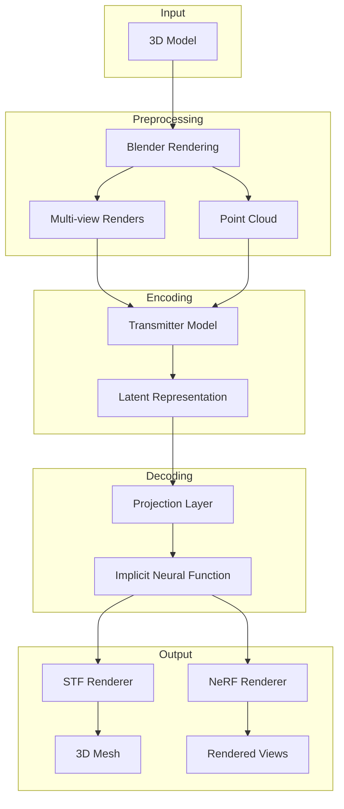
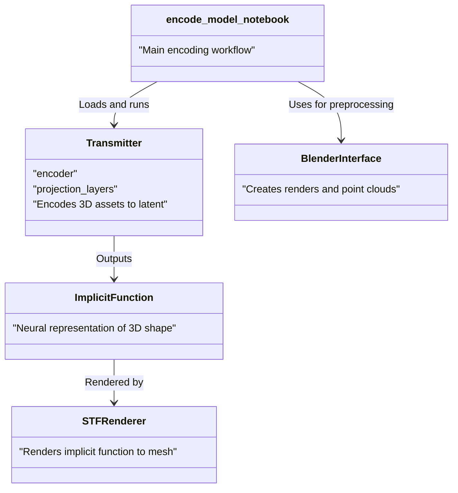
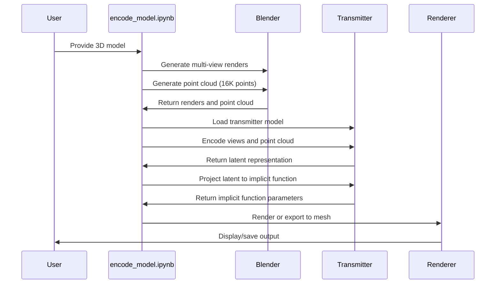

<!-- source: DeepWiki mcp.deepwiki.com · repo openai/shap-e · page 3.3 3D Model Encoding · fetched 2026-10-26 -->

# 3D Model Encoding

Relevant source files

The following files were used as context for generating this wiki page:

- [README.md](README.md)
- [model-card.md](model-card.md)

## Purpose and Scope

This document explains how to encode existing 3D models into Shap-E's latent space using the transmitter model. This process allows you to convert 3D assets into a compact neural representation that can be manipulated and rendered back as 3D meshes. For information about generating new 3D models from text or images, see [Text-to-3D Generation](#3.1) and [Image-to-3D Generation](#3.2).

## System Architecture

The 3D model encoding system uses the transmitter model to convert existing 3D assets into the parameters of small neural networks that represent shape and texture as an implicit function.

### Components and Data Flow

Sources: [model-card.md:7-10](), [README.md:72-73]()

### Code Components to Encoding Process Mapping

Sources: [model-card.md:24-25](), [README.md:73]()

## Encoding Process

The 3D model encoding process involves these key steps:

1. **Input Preparation**: Load a 3D model (mesh) into the system
2. **Multi-view Rendering**: Use Blender to create multiple views of the model from different camera angles
3. **Point Cloud Generation**: Create a point cloud representation of the 3D model
4. **Encoding**: Process the renders and point cloud through the transmitter's encoder to produce a latent representation
5. **Projection**: Convert the latent representation to the parameters of an implicit neural function using projection layers
6. **Output Generation**: Render the implicit function or convert it to a mesh for visualization or export

### Detailed Workflow

Sources: [model-card.md:9](), [README.md:73](), [model-card.md:37-38]()

## Technical Details

### Transmitter Model

The transmitter is a two-part model consisting of:

1. **Encoder**: Processes multi-view renders and point clouds to produce a latent representation
2. **Projection Layers**: Transform the latent representation into parameters for neural networks that represent the 3D shape

The model checkpoint `transmitter` contains both the encoder and projection layers, while the smaller `decoder` checkpoint only contains the projection layers. For the encoding process, the full `transmitter` checkpoint is required.

Sources: [model-card.md:24-25]()

### Input Processing

When encoding a 3D model, the system:

- Creates 60 views of each model from different angles
- Generates a point cloud with 16K points
- Uses simplified lighting and diffuse materials for rendering

These parameters were optimized to avoid small cracks and improve quality over previous systems.

Sources: [model-card.md:37-39]()

## Using the encode_model.ipynb Notebook

The `encode_model.ipynb` notebook provides a complete example of how to encode a 3D model:

1. **Setup Requirements**:
   - Install the Shap-E package: `pip install -e .`
   - Install Blender version 3.3.1 or higher
   - Set the `BLENDER_PATH` environment variable to the path of the Blender executable

2. **Notebook Workflow**:
   - Load a 3D model or trimesh
   - Create batch of multiview renders and a point cloud
   - Encode them into a latent representation
   - Render the result back as a 3D model

Sources: [README.md:73]()

## Requirements and Limitations

### Requirements
- Blender 3.3.1 or higher for preprocessing operations
- The `transmitter` model checkpoint

### Limitations
- Encoded 3D assets often have rough edges, holes, or blurry surface textures
- The quality of results depends on the quality and complexity of the input model
- The encoding process is computationally intensive, particularly the rendering steps

Sources: [model-card.md:14](), [README.md:73]()

## Applications

The 3D model encoding functionality can be used for:

- Converting existing 3D assets into Shap-E's neural representation
- Creating variants of existing 3D models
- Preparing 3D assets for applications that use Shap-E's implicit function representation

Sources: [model-card.md:9]()

---

