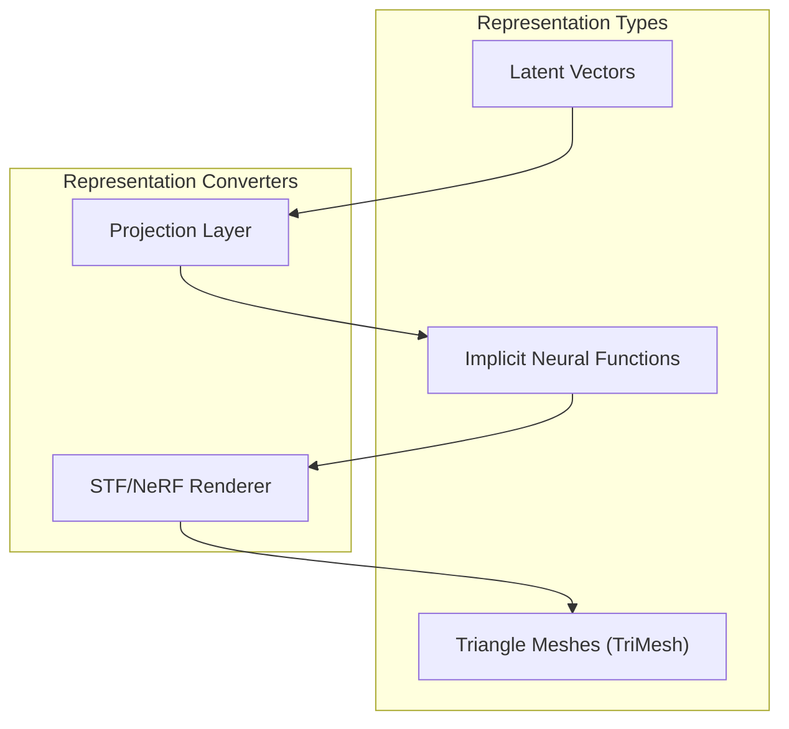
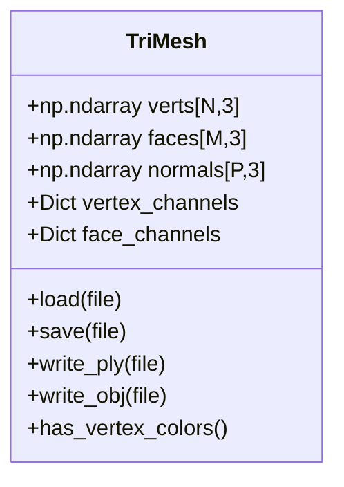
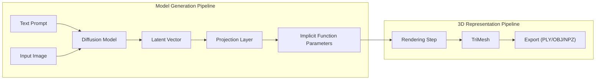
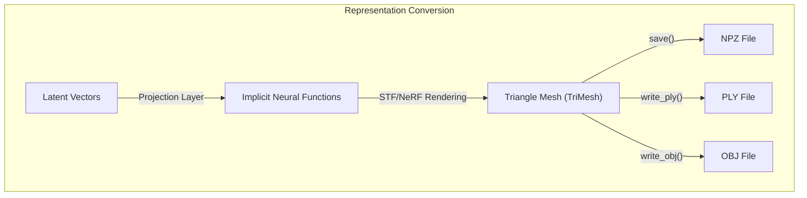
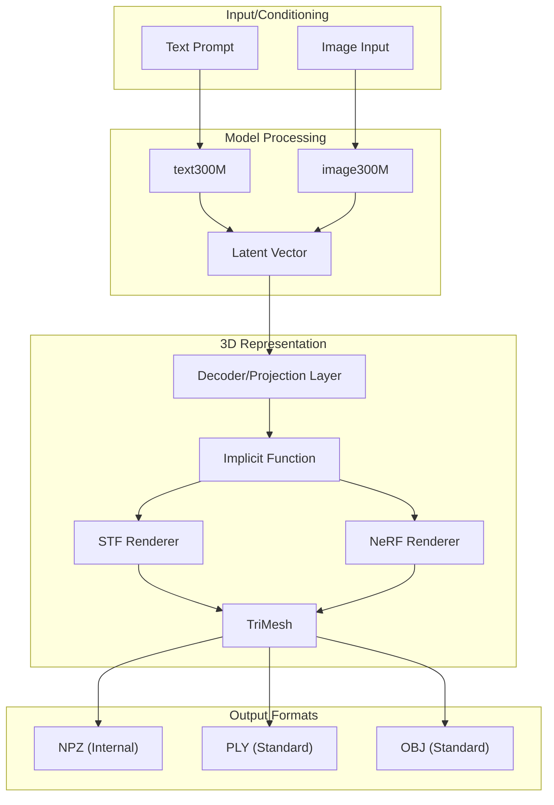

<!-- source: DeepWiki mcp.deepwiki.com · repo openai/shap-e · page 4 3D Representation · fetched 2026-10-26 -->

# 3D Representation

<details>
<summary>Relevant source files</summary>

The following files were used as context for generating this wiki page:

- [model-card.md](model-card.md)
- [shap_e/rendering/mesh.py](shap_e/rendering/mesh.py)

</details>


This document explains how 3D models are represented, stored, and manipulated within the Shap-E system. It covers the internal representation formats, conversion processes, and export capabilities used throughout the system. For details about specific mesh operations and file formats, see [TriMesh Class](#4.1) and [File Import/Export](#4.2).

## Overview of 3D Representations

Shap-E uses multiple representations of 3D assets at different stages of its pipeline. Understanding these representations is essential for working with the system effectively.



Sources: [model-card.md:9-10]()

## Internal Representation

The core 3D representation in Shap-E uses two primary formats:

1. **Implicit Neural Functions**: These are compact neural network parameters that define a 3D shape and its texture. This representation allows for:
   - Efficient storage of complex 3D shapes
   - Rendering from arbitrary viewpoints
   - Smooth latent space operations

2. **Triangle Meshes (TriMesh)**: A concrete representation that consists of vertices, faces, and optional attributes like normals and color information.



Sources: [shap_e/rendering/mesh.py:10-27]()

### Implicit Function Representation

Implicit functions are a core concept in Shap-E. They represent 3D shapes as functions that map 3D coordinates to properties like signed distance (for shape) and RGB values (for texture). 

Key characteristics:
- Generated by the diffusion models or encoder
- Represented as neural network parameters
- Allow for continuous representation of surfaces
- Can be evaluated at arbitrary resolution
- Require rendering to visualize or convert to explicit formats



Sources: [model-card.md:7-10]()

## TriMesh Structure

The `TriMesh` class is the primary explicit representation of 3D models in Shap-E. It contains the following key components:

| Component | Description | Data Type |
|-----------|-------------|-----------|
| `verts` | Vertex coordinates in 3D space | Numpy array [N×3] |
| `faces` | Triangle indices (pointing to vertices) | Numpy array [M×3] |
| `normals` | Normal vectors for faces (optional) | Numpy array [P×3] |
| `vertex_channels` | Additional per-vertex data (e.g., RGB colors) | Dictionary of arrays |
| `face_channels` | Additional per-face data | Dictionary of arrays |

A typical mesh with vertex colors stores RGB values in the `vertex_channels` dictionary with keys 'R', 'G', and 'B'.

Sources: [shap_e/rendering/mesh.py:10-27]()

## Conversion Between Representations

Shap-E provides several mechanisms to convert between different 3D representations:



The key conversion processes are:

1. **Latent to Implicit**: The projection layer (decoder) converts latent vectors from the diffusion model into implicit function parameters.
2. **Implicit to Mesh**: The rendering system (STF or NeRF renderer) evaluates the implicit function to produce a triangle mesh.
3. **Mesh to Files**: The `TriMesh` class provides methods to export meshes to standard formats:
   - `.npz` (internal format with full metadata)
   - `.ply` (standard format supporting vertex colors)
   - `.obj` (widespread format for 3D modeling)

Sources: [shap_e/rendering/mesh.py:58-107](), [model-card.md:23-27]()

## Working with TriMesh Instances

The `TriMesh` class provides methods for working with 3D meshes:

1. **Loading and Saving**:
   ```python
   # Load a mesh from an NPZ file
   mesh = TriMesh.load("path/to/mesh.npz")
   
   # Save a mesh to an NPZ file
   mesh.save("output_mesh.npz")
   ```

2. **Exporting to Standard Formats**:
   ```python
   # Export to PLY format
   with open("output.ply", "wb") as f:
       mesh.write_ply(f)
   
   # Export to OBJ format
   with open("output.obj", "w") as f:
       mesh.write_obj(f)
   ```

3. **Checking for Vertex Colors**:
   ```python
   if mesh.has_vertex_colors():
       # Process colored mesh
   ```

Sources: [shap_e/rendering/mesh.py:30-107]()

## Relationship to System Architecture

The 3D representation components fit into the broader Shap-E architecture as follows:



The 3D representation layer acts as a bridge between the generative models (diffusion models or encoder) and the final output formats. It enables conversion between abstract mathematical representations (latent vectors, implicit functions) and concrete 3D formats that can be visualized or exported to other software.

Sources: [model-card.md:7-11](), [shap_e/rendering/mesh.py:10-107]()

## Limitations and Characteristics

As noted in the model card, Shap-E's 3D representations have certain characteristics and limitations:

- Samples often have rough edges, holes, or blurry surface textures
- Lower fidelity than professional 3D assets
- Many generated assets follow a simple, cartoonish style (reflecting the training data)
- Text-conditional generation may struggle with complex scenes or specific quantities

These limitations are inherent to the current generation capabilities and representation techniques used in the system.

Sources: [model-card.md:14](), [model-card.md:54-56]()

---

