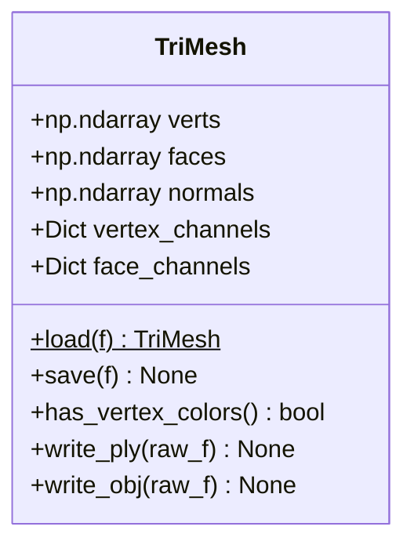
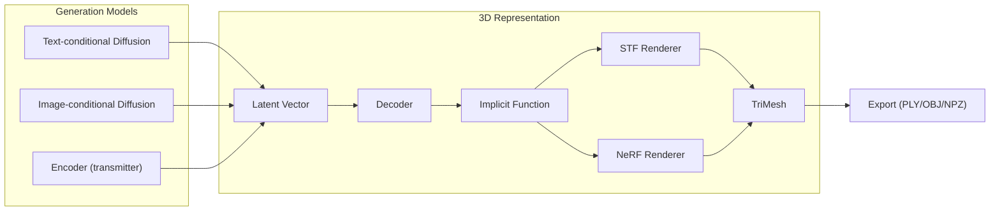
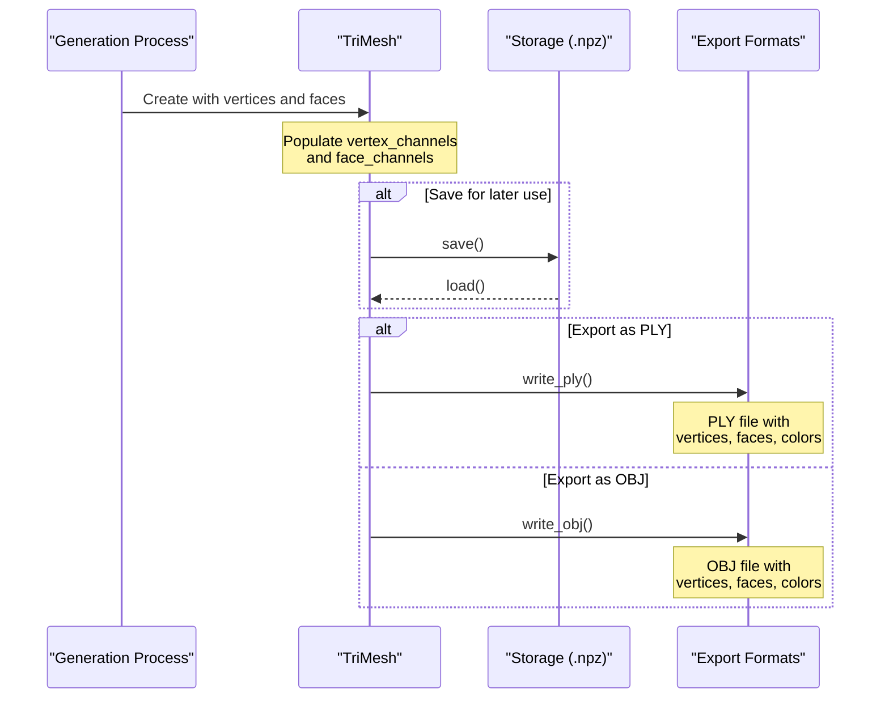

<!-- source: DeepWiki mcp.deepwiki.com · repo openai/shap-e · page 4.1 TriMesh Class · fetched 2026-10-26 -->

# TriMesh Class

Relevant source files

The following files were used as context for generating this wiki page:

- [shap_e/rendering/mesh.py](shap_e/rendering/mesh.py)

## Purpose and Overview

The TriMesh class is a core data structure in Shap-E that represents 3D triangle meshes. It provides functionality for storing, manipulating, and exporting 3D mesh data generated by the Shap-E system. This page documents the TriMesh class structure, its attributes, and methods for working with 3D meshes. For information about importing and exporting 3D models in various formats, see [File Import/Export](#4.2).

Sources: [shap_e/rendering/mesh.py:10-14]()

## Class Structure

The TriMesh class is implemented as a Python dataclass with several core attributes and methods for handling 3D mesh data.

Sources: [shap_e/rendering/mesh.py:10-108]()

## Attributes

The TriMesh class contains the following core attributes:

| Attribute | Type | Description |
|-----------|------|-------------|
| `verts` | np.ndarray | An N×3 array of vertex coordinates in 3D space |
| `faces` | np.ndarray | An M×3 array of triangular faces, where each value is an index into the `verts` array |
| `normals` | Optional[np.ndarray] | A P×3 array of normal vectors per face (optional) |
| `vertex_channels` | Dict[str, np.ndarray] | Additional per-vertex data (e.g., RGB color information) |
| `face_channels` | Dict[str, np.ndarray] | Additional per-face data |

Sources: [shap_e/rendering/mesh.py:16-27]()

## Methods

### Loading and Saving

TriMesh provides methods for serialization and deserialization of mesh data to/from .npz files:

1. **load**: Class method that loads a TriMesh from a .npz file
2. **save**: Instance method that saves a TriMesh to a .npz file

These methods handle both file paths and file-like objects, making them flexible for various I/O scenarios.

Sources: [shap_e/rendering/mesh.py:29-73]()

### Export Functionality

TriMesh supports exporting to common 3D file formats:

1. **write_ply**: Exports the mesh to PLY format
2. **write_obj**: Exports the mesh to OBJ format

Both methods handle vertex colors if present in the vertex_channels.

Sources: [shap_e/rendering/mesh.py:78-107]()

### Utility Methods

1. **has_vertex_colors**: Checks if the mesh has RGB color information in its vertex channels

Sources: [shap_e/rendering/mesh.py:75-76]()

## TriMesh in the Shap-E System

TriMesh serves as the primary output representation format in the Shap-E 3D generation pipeline:

Sources: [shap_e/rendering/mesh.py:10-108]()

## Data Flow for TriMesh Operations

The following diagram illustrates how data flows through the TriMesh class during typical operations:

Sources: [shap_e/rendering/mesh.py:29-107]()

## Implementation Details

### Vertex and Face Channels

The `vertex_channels` and `face_channels` dictionaries allow for flexible storage of additional per-vertex and per-face attributes. For example, RGB color information is stored as separate channels:

- `vertex_channels["R"]`: Red component for each vertex
- `vertex_channels["G"]`: Green component for each vertex 
- `vertex_channels["B"]`: Blue component for each vertex

When saving to .npz files, these channels are prefixed with "v_" and "f_" respectively.

Sources: [shap_e/rendering/mesh.py:44-55](), [shap_e/rendering/mesh.py:69-72]()

### Color Handling

The class provides convenience methods for working with vertex colors:

- `has_vertex_colors()` checks if 'R', 'G', and 'B' channels all exist
- When exporting to PLY or OBJ, these colors are automatically included if present

Sources: [shap_e/rendering/mesh.py:75-96]()

## Usage in Workflows

The TriMesh class is typically the final output representation in the Shap-E generation pipeline:

1. Text or image inputs are processed through diffusion models
2. Latent representations are decoded into implicit functions
3. Implicit functions are rendered into TriMesh objects
4. TriMesh objects can be saved (.npz) or exported (PLY/OBJ)

The TriMesh class provides a standardized way to handle and export the 3D models generated by Shap-E, making it a crucial component in the overall system architecture.

Sources: [shap_e/rendering/mesh.py:10-108]()

---

