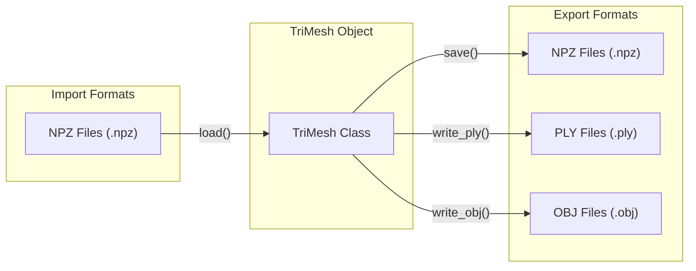
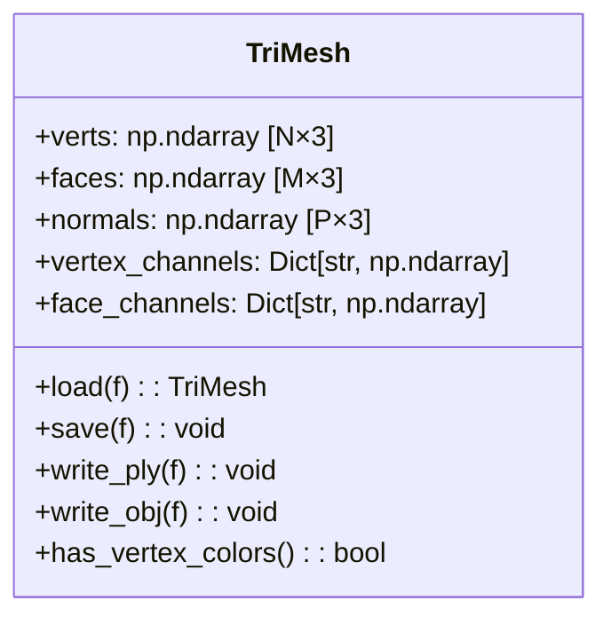
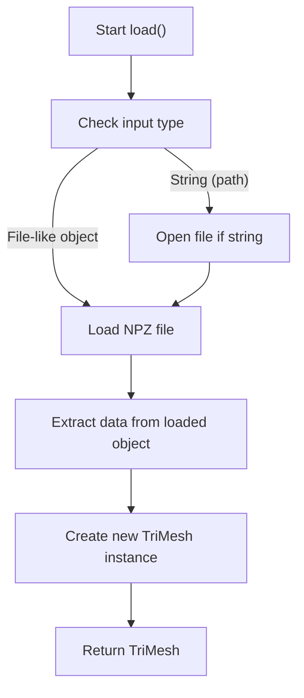
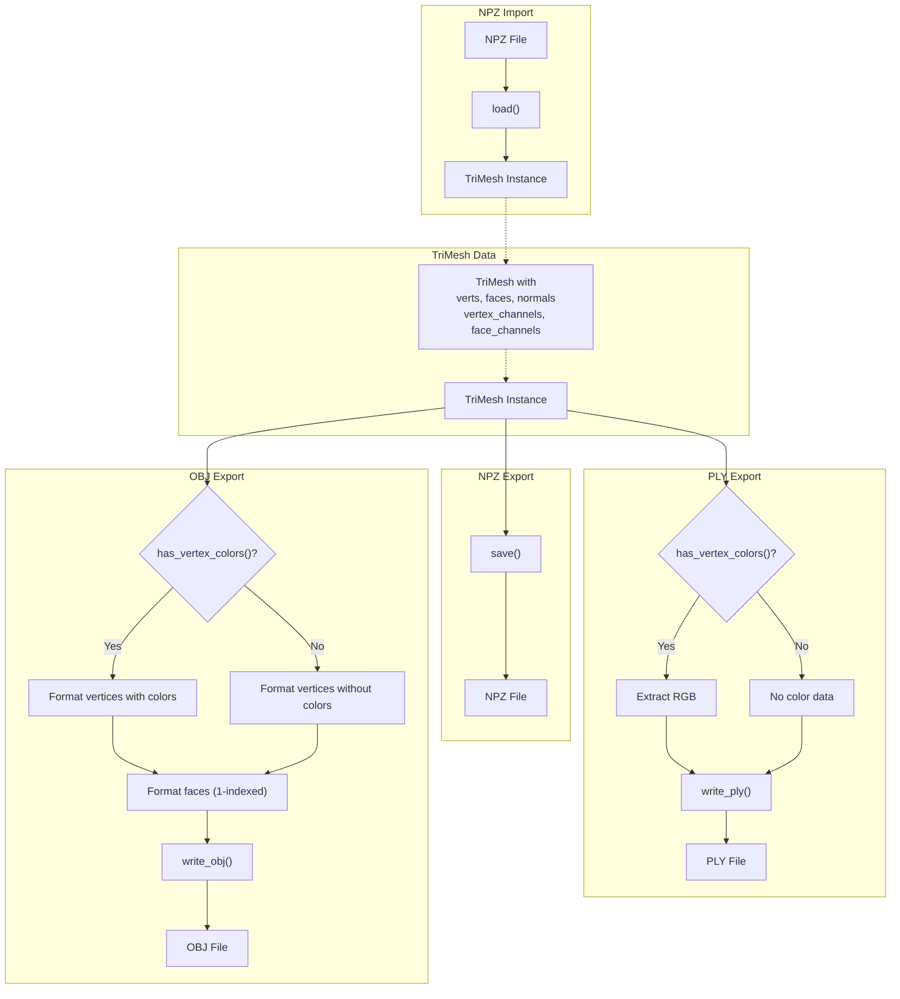

<!-- source: DeepWiki mcp.deepwiki.com · repo openai/shap-e · page 4.2 File Import/Export · fetched 2026-10-26 -->

# File Import/Export

<details>
<summary>Relevant source files</summary>

The following files were used as context for generating this wiki page:

- [README.md](README.md)
- [shap_e/rendering/mesh.py](shap_e/rendering/mesh.py)

</details>


This document details the file import and export capabilities in Shap-E, explaining how to load existing 3D models and save generated models in various formats. For information about the internal TriMesh representation used by Shap-E, see [TriMesh Class](#4.1).

## Overview of Supported Formats

Shap-E provides functionality to work with several 3D file formats through the `TriMesh` class, allowing users to:

1. **Import** 3D models from:
   - `.npz` files (NumPy compressed format)

2. **Export** 3D models to:
   - `.npz` files (NumPy compressed format)
   - `.ply` files (Polygon File Format / Stanford Triangle Format)
   - `.obj` files (Wavefront OBJ)



Sources: [shap_e/rendering/mesh.py:11-108]()

## TriMesh Data Model for Import/Export

The `TriMesh` class serves as the central data model for all import and export operations. Understanding its structure is essential for working with the file import/export functionality.



Sources: [shap_e/rendering/mesh.py:11-28]()

## Importing 3D Models

### Loading from NPZ Files

The `load` class method imports a mesh from a NumPy compressed (.npz) file. This method can accept either a filename or a file-like object.



The loading process:
1. Accepts a path string or file-like object
2. Loads the NumPy compressed data
3. Extracts the vertices and faces (required)
4. Extracts normals (optional)
5. Extracts additional vertex and face data with prefixes "v_" and "f_"
6. Returns a new `TriMesh` instance

Sources: [shap_e/rendering/mesh.py:30-56]()

## Exporting 3D Models

Shap-E provides three methods to export 3D models from the `TriMesh` representation:

### 1. Saving to NPZ Files

The `save` method exports a mesh to a NumPy compressed (.npz) file, which can later be loaded using the `load` method.

```python
# Saving a TriMesh to an NPZ file
mesh.save("my_model.npz")
```

This format preserves all mesh data, including vertices, faces, normals, and all additional vertex and face channels.

Sources: [shap_e/rendering/mesh.py:58-73]()

### 2. Exporting to PLY Files

The `write_ply` method exports a mesh to the PLY (Polygon File Format) format, which is widely supported by 3D software.

```python
# Exporting a TriMesh to a PLY file
with open("my_model.ply", "wb") as f:
    mesh.write_ply(f)
```

Note that when exporting to PLY format:
- Vertex colors are included if available (RGB channels in vertex_channels)
- The method requires a binary file-like object

Sources: [shap_e/rendering/mesh.py:78-88]()

### 3. Exporting to OBJ Files

The `write_obj` method exports a mesh to the Wavefront OBJ format, which is another widely supported 3D file format.

```python
# Exporting a TriMesh to an OBJ file
with open("my_model.obj", "w") as f:
    mesh.write_obj(f)
```

When exporting to OBJ format:
- Vertex colors are included if available (RGB channels in vertex_channels)
- Face indices are adjusted to be 1-indexed (as required by the OBJ format)
- The method writes text data, not binary

Sources: [shap_e/rendering/mesh.py:90-107]()

## File Format Data Preservation

Different export formats preserve different aspects of the 3D model data:

| Feature | NPZ | PLY | OBJ |
|---------|-----|-----|-----|
| Vertices | ✓ | ✓ | ✓ |
| Faces | ✓ | ✓ | ✓ |
| Normals | ✓ | ✗ | ✗ |
| Vertex Colors | ✓ | ✓ (RGB) | ✓ (RGB) |
| Custom Vertex Data | ✓ | ✗ | ✗ |
| Custom Face Data | ✓ | ✗ | ✗ |

Sources: [shap_e/rendering/mesh.py:58-107]()

## Import/Export Data Flow

The following diagram illustrates the data flow during file import and export operations:



Sources: [shap_e/rendering/mesh.py:30-107]()

## Example Usage

Below are examples of how to use the import/export functionality in Shap-E:

### Loading a Model from NPZ

```python
from shap_e.rendering.mesh import TriMesh

# Load a mesh from an NPZ file
mesh = TriMesh.load("path/to/model.npz")
```

### Saving a Model to Various Formats

```python
# Save in NPZ format (preserves all data)
mesh.save("model.npz")

# Export to PLY format
with open("model.ply", "wb") as f:
    mesh.write_ply(f)

# Export to OBJ format
with open("model.obj", "w") as f:
    mesh.write_obj(f)
```

Sources: [README.md:65-73]()

## Working with Generated Models

When generating 3D models using Shap-E's text-to-3D or image-to-3D capabilities, you'll typically want to export the resulting models. The example notebooks demonstrate this process:

- In `sample_text_to_3d.ipynb` and `sample_image_to_3d.ipynb`, models are generated and can be exported to various formats
- The `encode_model.ipynb` notebook shows how to load external models, encode them, and then export them again

Sources: [README.md:69-73]()

## Limitations and Considerations

When working with the import/export functionality, be aware of these considerations:

1. **Selective Format Support**: Import is currently limited to NPZ files, while export supports NPZ, PLY, and OBJ.

2. **Data Preservation**: Only NPZ format preserves all mesh data. PLY and OBJ exports may lose some information.

3. **Vertex Colors**: The system checks for RGB channels in `vertex_channels` when exporting to PLY and OBJ. If these channels exist, vertex colors will be included in the export.

4. **Binary vs. Text**: PLY export requires a binary file object, while OBJ uses text format.

5. **Indexing Differences**: OBJ format uses 1-indexed faces, while the internal representation uses 0-indexed faces. The conversion is handled automatically.

Sources: [shap_e/rendering/mesh.py:75-107]()

---

