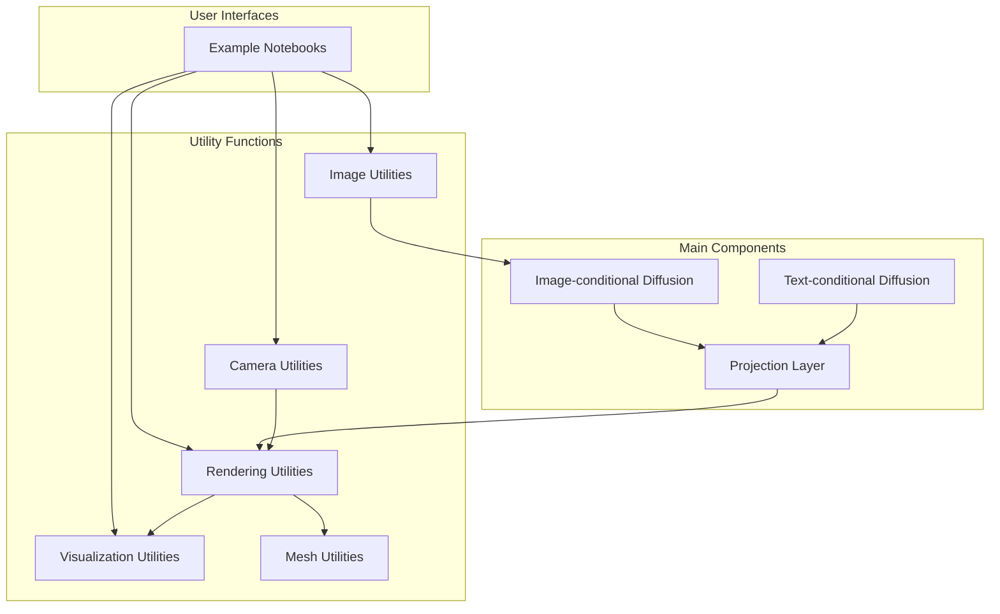
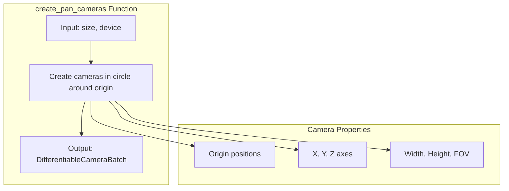
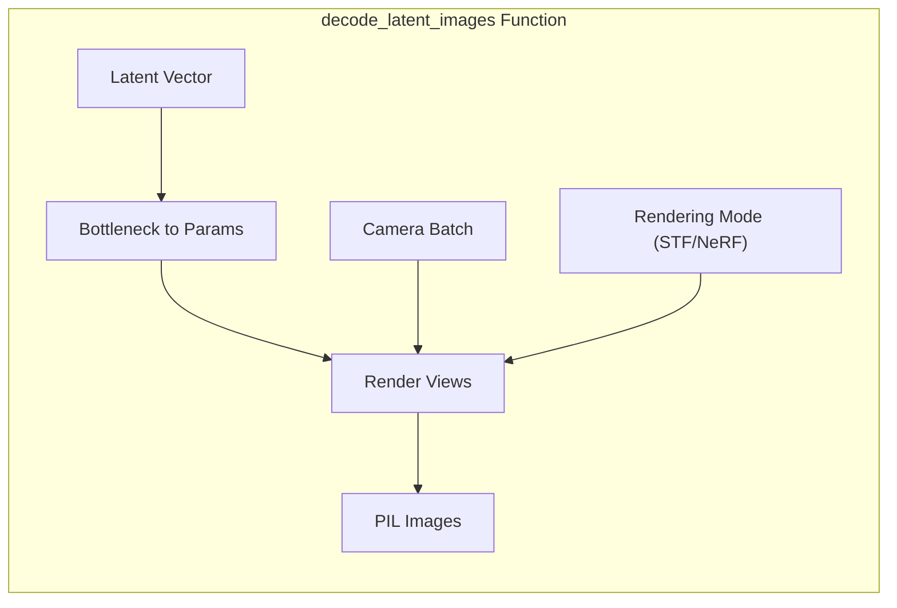
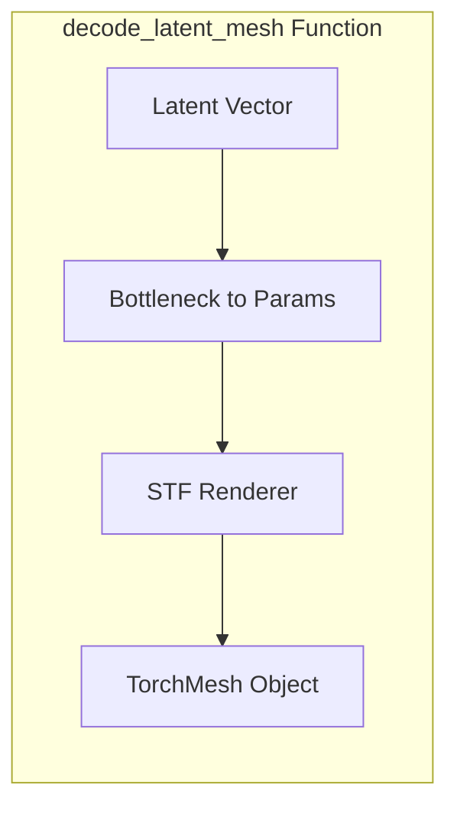
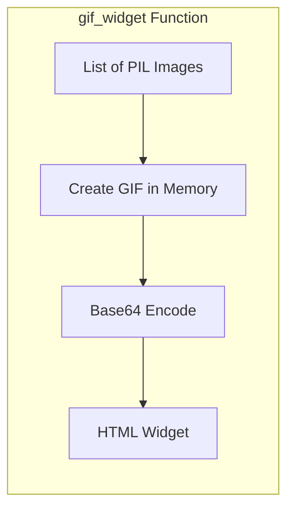
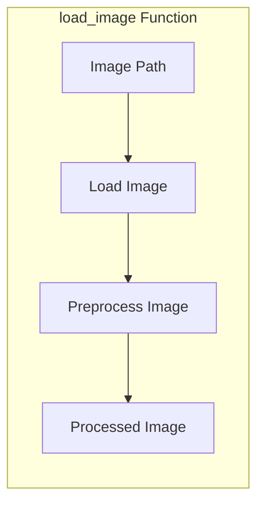
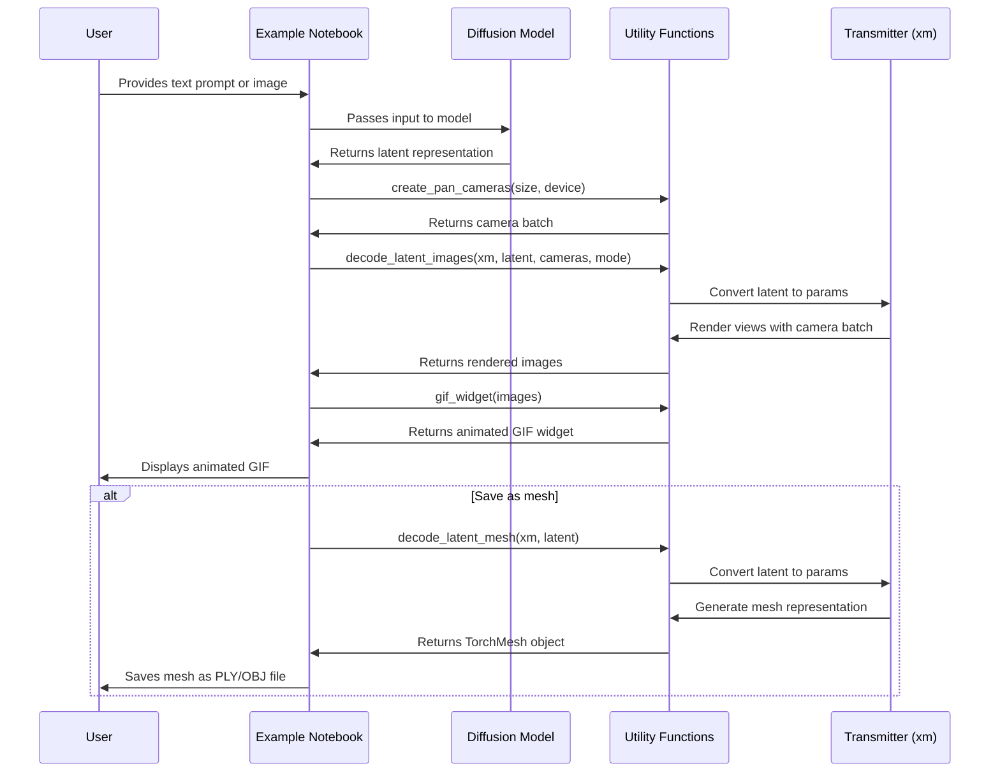
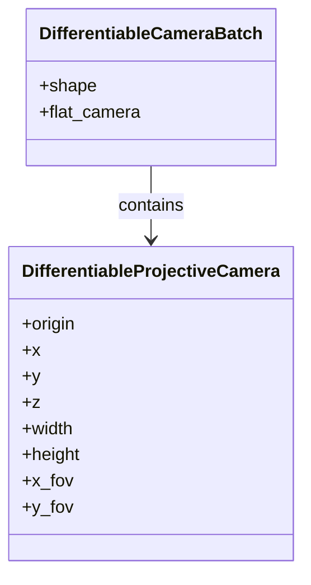
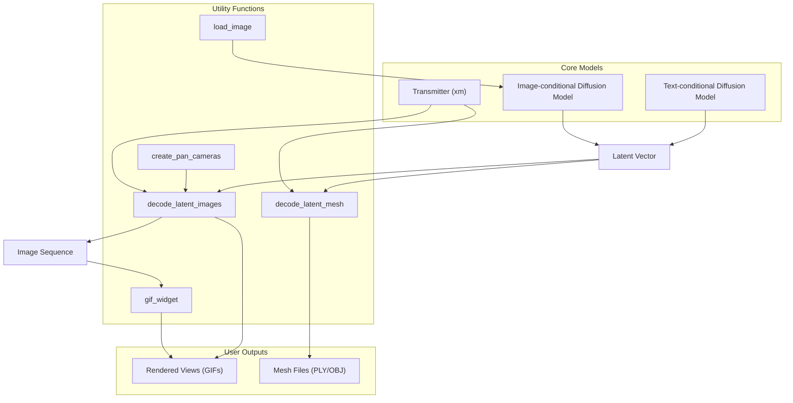

<!-- source: DeepWiki mcp.deepwiki.com · repo openai/shap-e · page 5 Utility Functions · fetched 2026-10-26 -->

# Utility Functions

<details>
<summary>Relevant source files</summary>

The following files were used as context for generating this wiki page:

- [shap_e/examples/sample_image_to_3d.ipynb](shap_e/examples/sample_image_to_3d.ipynb)
- [shap_e/examples/sample_text_to_3d.ipynb](shap_e/examples/sample_text_to_3d.ipynb)
- [shap_e/util/notebooks.py](shap_e/util/notebooks.py)

</details>


This page documents the utility functions used throughout the Shap-E system for rendering 3D models, setting up cameras, processing images, and visualizing results. These utilities serve as the supporting infrastructure that enables the main text-to-3D and image-to-3D generation workflows.

## Overview of Utility Functions

Shap-E provides several utility functions that handle common tasks required across different components of the system. These include camera positioning, latent space conversion, mesh processing, and visualization tools.



Sources: [shap_e/util/notebooks.py:1-87]()

## Camera Utilities

The camera utilities provide functionality for creating camera positions that can be used to render 3D models from different viewpoints.

### create_pan_cameras Function

The `create_pan_cameras` function creates a batch of cameras arranged in a circle around the 3D model. These cameras are used to generate multi-view renders of the model.



Example usage:
```python
cameras = create_pan_cameras(size=64, device=torch.device('cuda'))
```

The function:
1. Creates a series of camera positions in a circle around the origin
2. Defines the orientation vectors (x, y, z) for each camera
3. Returns a `DifferentiableCameraBatch` object that can be used with the renderer

Sources: [shap_e/util/notebooks.py:16-43](), [shap_e/examples/sample_text_to_3d.ipynb:78-78](), [shap_e/examples/sample_image_to_3d.ipynb:81-81]()

## Rendering and Visualization Utilities

These utilities convert latent representations into visual outputs, either as images or 3D meshes.

### decode_latent_images Function

The `decode_latent_images` function renders multiple views of a 3D model represented by a latent vector.



This function:
1. Takes a latent vector and converts it to model parameters
2. Renders the model from multiple camera angles
3. Returns a list of PIL images

Example:
```python
images = decode_latent_images(xm, latent, cameras, rendering_mode='nerf')
```

Sources: [shap_e/util/notebooks.py:46-61](), [shap_e/examples/sample_text_to_3d.ipynb:80-80](), [shap_e/examples/sample_image_to_3d.ipynb:83-83]()

### decode_latent_mesh Function

The `decode_latent_mesh` function converts a latent vector into a triangular mesh representation.



This function:
1. Takes a latent vector and converts it to model parameters
2. Uses the STF renderer to generate a mesh
3. Returns a `TorchMesh` object

Example:
```python
mesh = decode_latent_mesh(xm, latent)
```

Sources: [shap_e/util/notebooks.py:64-76](), [shap_e/examples/sample_text_to_3d.ipynb:95-95]()

### gif_widget Function

The `gif_widget` function creates an animated GIF widget for displaying a sequence of images in Jupyter notebooks.



This function:
1. Takes a list of PIL images
2. Creates an animated GIF
3. Encodes it as a base64 string
4. Returns an HTML widget that can be displayed in a Jupyter notebook

Example:
```python
display(gif_widget(images))
```

Sources: [shap_e/util/notebooks.py:79-86](), [shap_e/examples/sample_text_to_3d.ipynb:81-81](), [shap_e/examples/sample_image_to_3d.ipynb:84-84]()

## Image Utilities

### load_image Function

The `load_image` function loads and preprocesses images for use with the image-to-3D generation pipeline.



Example:
```python
image = load_image("example_data/corgi.png")
```

Sources: [shap_e/examples/sample_image_to_3d.ipynb:52-52]()

## Integration with Main Workflows

The utility functions are integrated into the main Shap-E workflows as shown in the following diagram:



This diagram illustrates how the utility functions support the main text-to-3D and image-to-3D generation processes, handling the camera setup, rendering, and visualization aspects of the workflow.

Sources: [shap_e/examples/sample_text_to_3d.ipynb:75-99](), [shap_e/examples/sample_image_to_3d.ipynb:78-84]()

## Camera Model

The camera model used in Shap-E is based on the `DifferentiableCameraBatch` and `DifferentiableProjectiveCamera` classes.



The `DifferentiableProjectiveCamera` defines:
- Camera position (origin)
- Camera orientation (x, y, z axes)
- View dimensions (width, height)
- Field of view angles (x_fov, y_fov)

The `create_pan_cameras` function creates a batch of these cameras positioned in a circle around the model, allowing for consistent multi-view rendering.

Sources: [shap_e/util/notebooks.py:10-10](), [shap_e/util/notebooks.py:16-43]()

## Relationship to Main Components

The utility functions bridge the gap between the diffusion models that generate latent representations and the final outputs that users interact with.



This diagram illustrates how the utility functions connect the core diffusion models to the outputs that users interact with, handling the conversion from latent representations to visual outputs.

Sources: [shap_e/examples/sample_text_to_3d.ipynb:10-100](), [shap_e/examples/sample_image_to_3d.ipynb:10-84](), [shap_e/util/notebooks.py:1-87]()