# Page: Overview

# Overview

<details>
<summary>Relevant source files</summary>

The following files were used as context for generating this wiki page:

- [README.md](README.md)
- [model-card.md](model-card.md)

</details>


This document provides an introduction to Shap-E, a system for generating 3D models from text prompts or images, and encoding existing 3D models into a latent representation. Shap-E implements the methods described in the research paper "Shap-E: Generating Conditional 3D Implicit Functions." For detailed information about specific components, refer to the [System Architecture](#2) page.

## What is Shap-E?

Shap-E is a deep learning framework that allows for the creation of 3D assets through multiple conditioning approaches. The system can:

1. Generate 3D models from text descriptions
2. Convert single-view images into complete 3D models
3. Encode existing 3D assets into a compact latent representation

The generated 3D models are represented as implicit neural functions that can be rendered from arbitrary viewpoints or exported as triangle meshes for use in downstream applications.

Sources: [model-card.md:1-14](), [README.md:1-4]()

## Core Components

Shap-E consists of two primary types of models:

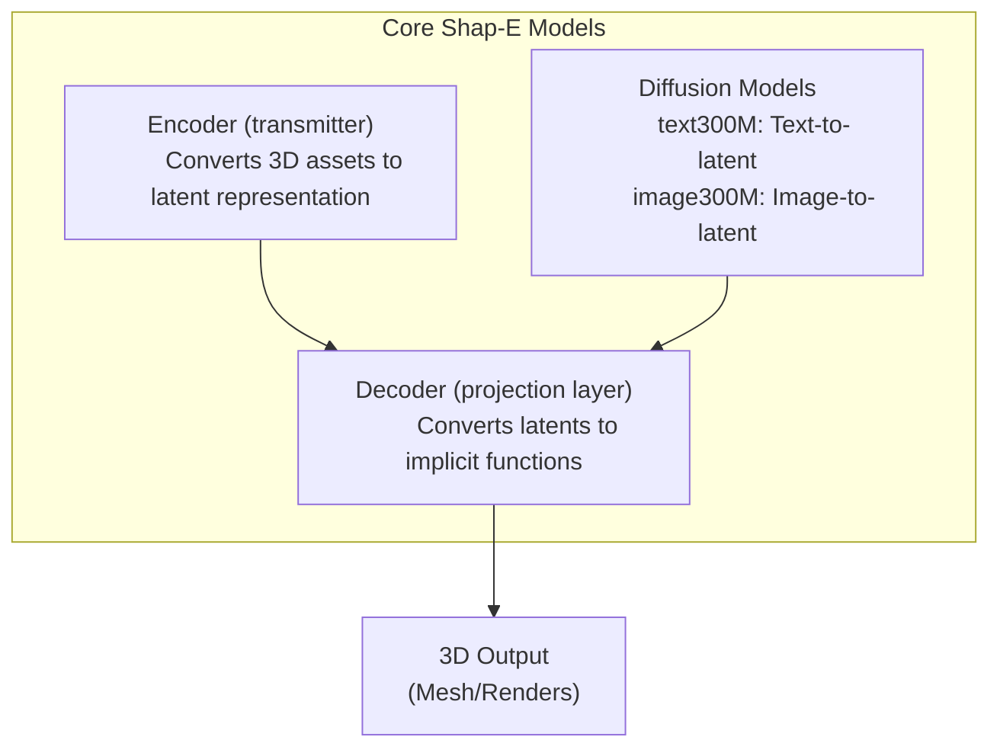

| Model | Description | Purpose |
|-------|-------------|---------|
| `transmitter` | Encoder and projection layers | Converts 3D assets into parameters of neural networks representing 3D shapes |
| `decoder` | Final projection layer | Converts diffusion model outputs into implicit neural representations |
| `text300M` | Text-conditional diffusion | Generates latent representations from text prompts |
| `image300M` | Image-conditional diffusion | Generates latent representations from images |

Sources: [model-card.md:7-11](), [model-card.md:22-27]()

## System Architecture

The following diagram shows how the different components of Shap-E interact with each other:

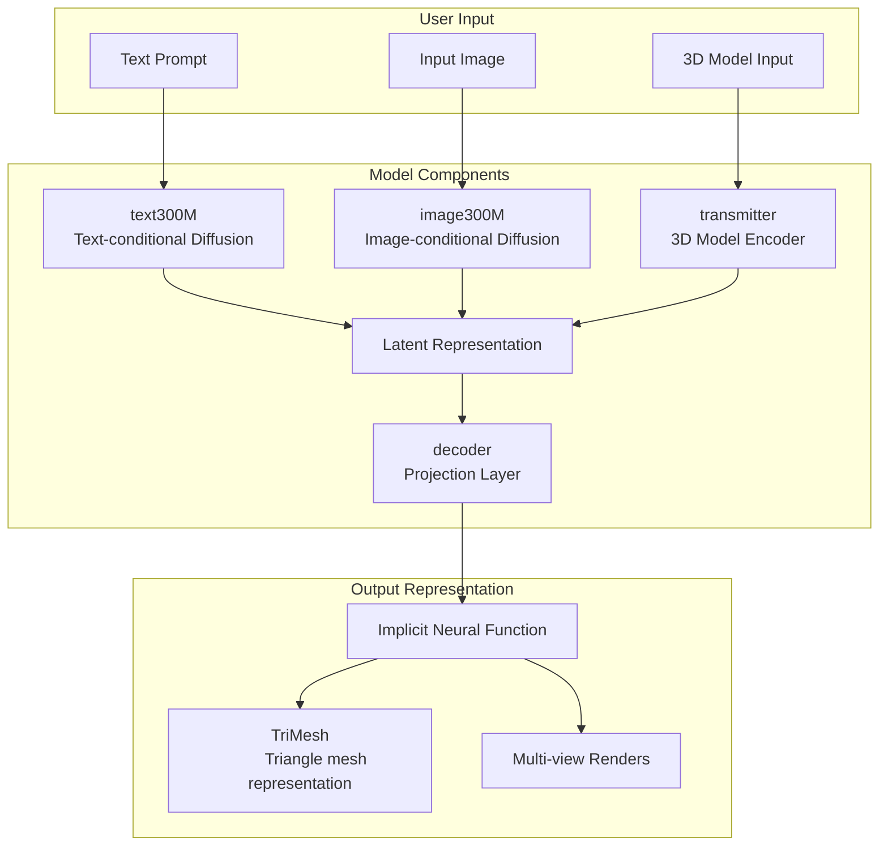

In this architecture:
1. User inputs (text, image, or 3D model) are processed by the appropriate model
2. All paths converge to produce a latent representation
3. The decoder converts the latent representation into an implicit neural function
4. The implicit function can be rendered or converted to a mesh

Sources: [model-card.md:7-11]()

## Main Workflows

Shap-E supports three primary workflows:

### 1. Text-to-3D Generation

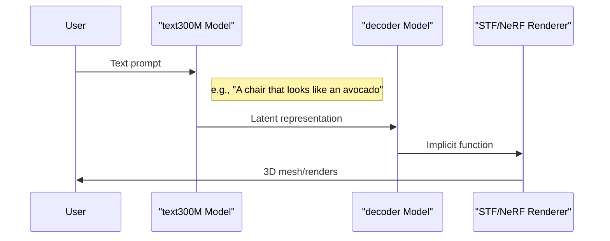

### 2. Image-to-3D Generation

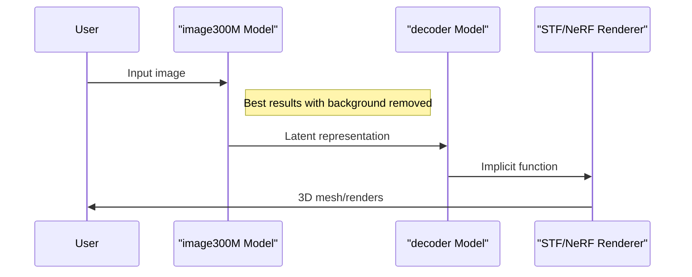

### 3. 3D Model Encoding

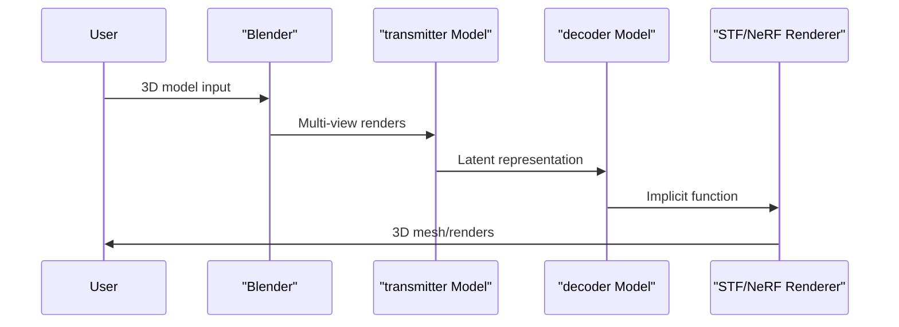

Sources: [README.md:66-73]()

## Code Structure and Implementation

The following diagram shows the key code entities and their relationships:

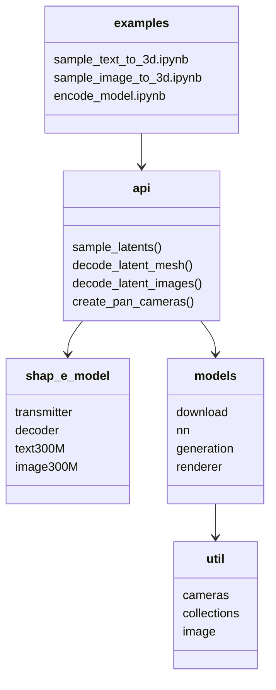

The repository provides three example notebooks to demonstrate the main workflows:

1. `sample_text_to_3d.ipynb` - Generate 3D models from text prompts
2. `sample_image_to_3d.ipynb` - Generate 3D models from images 
3. `encode_model.ipynb` - Encode existing 3D models into latent space

Sources: [README.md:69-73]()

## Getting Started

To use Shap-E:

1. Install the package: `pip install -e .`
2. For 3D model encoding, install Blender 3.3.1+ and set the `BLENDER_PATH` environment variable
3. Run the example notebooks to understand the workflows:
   - Text-to-3D generation
   - Image-to-3D generation  
   - 3D model encoding

Each notebook demonstrates how to load the appropriate models, generate samples, and visualize or export the results.

Sources: [README.md:66-73]()

## Limitations and Considerations

Shap-E has several known limitations:

- Generated 3D assets often have rough edges, holes, or blurry surface textures
- The text-conditional model may struggle with complex prompts that combine multiple objects
- The image-conditional model works best with synthetic renderings with removed backgrounds
- The models reflect the style of the training data, which includes many simple, cartoonish 3D assets

For research purposes, these models have been evaluated on:
- Generating 3D renderings or meshes conditioned on single, synthetic images
- Generating 3D renderings or meshes conditioned on text descriptions

Sources: [model-card.md:52-66]()

---

# Page: System Architecture

# System Architecture

<details>
<summary>Relevant source files</summary>

The following files were used as context for generating this wiki page:

- [model-card.md](model-card.md)

</details>


## Purpose and Scope

This document describes the core architecture of the Shap-E system, explaining the fundamental components and their relationships. It covers the encoder (transmitter), diffusion models, latent space representation, and how these components interact to generate 3D content. For detailed information about specific model components, see [Model Components](#2.1). For rendering specifics, see [Rendering System](#2.2).

## High-Level Architecture Overview

Shap-E provides a generative AI system for creating 3D models from text prompts or images, as well as encoding existing 3D models. The system is built around a latent diffusion approach where conditional inputs are used to generate implicit neural functions that represent 3D shapes and textures.

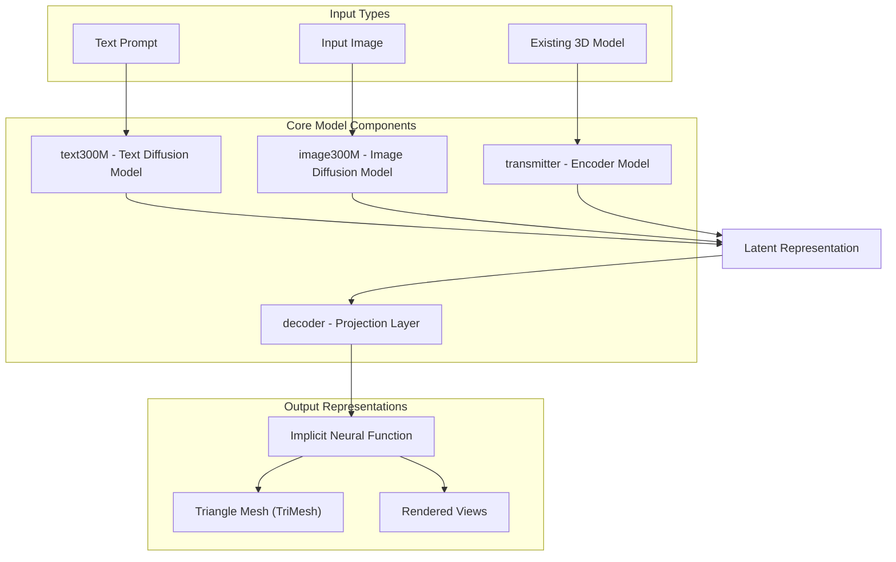

Sources: model-card.md:7-11

## Model Types and Functions

Shap-E consists of two main types of models, both focused on creating and manipulating implicit neural representations of 3D objects:

1. **Encoder (transmitter)**: Converts existing 3D assets into parameters of neural networks that represent 3D shapes and textures as implicit functions
2. **Latent Diffusion Models**: Generate novel implicit functions conditioned on either:
   - Text descriptions (text300M)
   - Images (image300M)

The system also includes a **decoder** (projection layer) that transforms latent representations into the final implicit neural function parameters.

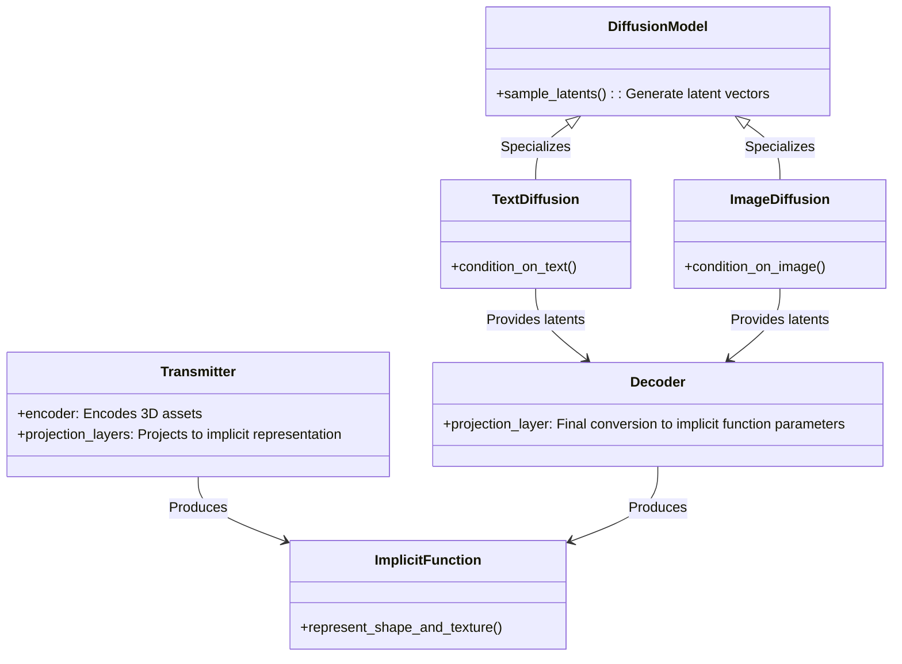

Sources: model-card.md:22-27

## Data Flow Pipelines

The system supports three main workflows: text-to-3D, image-to-3D, and 3D model encoding. Each follows a different data flow path through the system components.

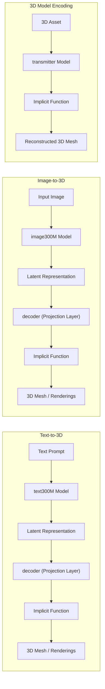

Sources: model-card.md:9-11, model-card.md:47-51

## Key System Components

The system integrates several specialized components to handle different aspects of 3D generation and processing:

### Model Components

| Component | Purpose | Key Characteristics |
|-----------|---------|---------------------|
| `transmitter` | Encoder model | Converts 3D assets into parameters of neural networks that represent shapes as implicit functions |
| `decoder` | Projection layer | Final layer that converts latent representations into implicit function parameters |
| `text300M` | Text diffusion model | Generates latent vectors conditioned on text descriptions |
| `image300M` | Image diffusion model | Generates latent vectors conditioned on input images |

Sources: model-card.md:22-27

### Rendering System

The system supports multiple rendering approaches to visualize and export the generated 3D content:

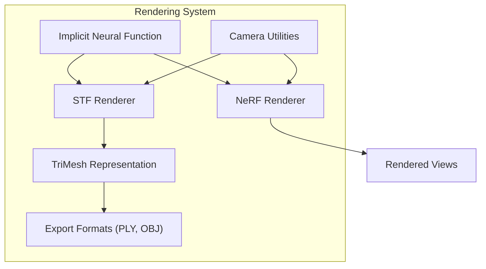

The system uses two primary rendering approaches:
1. STF (Signed Texture Field) rendering for generating meshes
2. NeRF-style rendering for creating image renderings from different viewpoints

Sources: model-card.md:9-11

## Code Structure and Implementation

The repository implements this architecture through several interconnected modules that handle different parts of the pipeline:

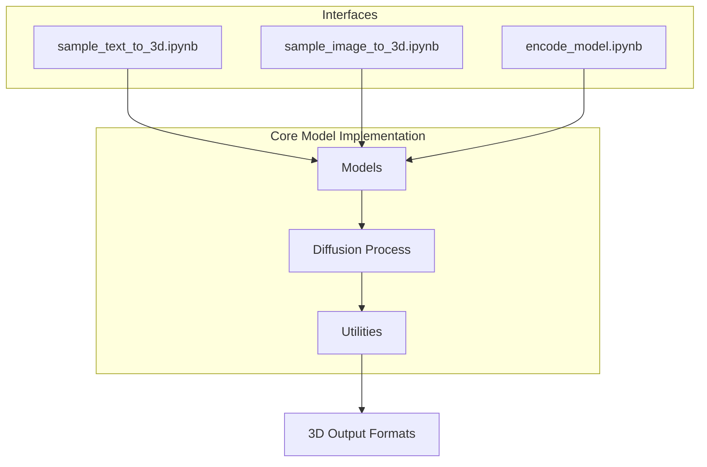

The system is exposed to users primarily through three Jupyter notebooks that demonstrate the different workflows (text-to-3D, image-to-3D, and 3D model encoding).

Sources: model-card.md:22-27, model-card.md:47-51

## Performance and Constraints

The architecture has specific performance characteristics and limitations that affect its usage:

- Image-conditional models work best with synthetic renderings but may struggle with occluded parts
- Text-conditional models can generate diverse objects but have difficulty with complex scenes or multiple objects
- Output quality typically has some imperfections such as rough edges, holes, or blurry textures
- Models tend to produce somewhat cartoonish 3D assets, reflecting the training data characteristics

Sources: model-card.md:52-65

## Conclusion

The Shap-E system architecture represents a complete pipeline for 3D content generation and processing through latent diffusion models. By combining specialized models for different input modalities with efficient representation and rendering systems, it enables the creation of 3D content from text descriptions, images, or existing 3D assets.

For more detailed information about specific components, please refer to the linked wiki pages for [Model Components](#2.1) and [Rendering System](#2.2).

---

# Page: Model Components

# Model Components

<details>
<summary>Relevant source files</summary>

The following files were used as context for generating this wiki page:

- [README.md](README.md)
- [model-card.md](model-card.md)

</details>


This document provides a detailed technical breakdown of the core model components in the Shap-E system. We focus on explaining the four primary model components: the transmitter (encoder), decoder, and the text and image conditional diffusion models, along with their interactions and roles in the 3D generation pipeline. For information about the rendering system and how these models produce 3D outputs, see [Rendering System](#2.2).

## Overview of Model Components

Shap-E's architecture consists of two primary types of models that work together to generate and encode 3D content:

1. **Encoder Model**: The transmitter which converts 3D assets into neural network parameters
2. **Latent Diffusion Models**: Generate parameters for implicit functions based on text or image inputs

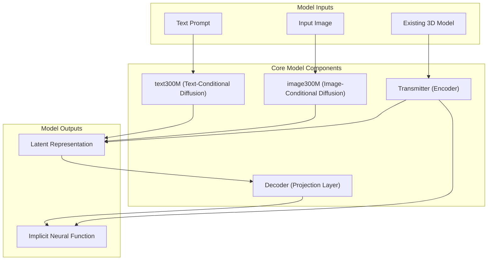

Sources: [model-card.md:7-10]()

## Available Model Checkpoints

Shap-E provides four pre-trained model checkpoints that implement the core components:

| Model Name | Description | Purpose |
|------------|-------------|---------|
| `transmitter` | Encoder + projection layers | Converts 3D assets into implicit neural representations |
| `decoder` | Final projection layer | Converts diffusion outputs into implicit neural representations |
| `text300M` | Text-conditional latent diffusion | Generates 3D content from text descriptions |
| `image300M` | Image-conditional latent diffusion | Generates 3D content from input images |

Sources: [model-card.md:22-27]()

## Component Relationships and Data Flow

The following diagram illustrates how data flows through the model components during generation and encoding:

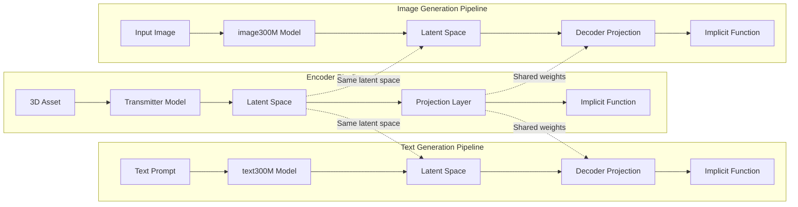

Sources: [model-card.md:7-10](), [README.md:70-73]()

## Transmitter (Encoder) Component

The transmitter is a comprehensive encoder model that converts existing 3D assets into the parameters of small neural networks which represent the 3D shape and texture as an implicit function.

### Architecture and Purpose

The transmitter consists of two main parts:
- An encoder that processes 3D inputs
- Projection layers that convert encoder outputs into implicit neural function parameters

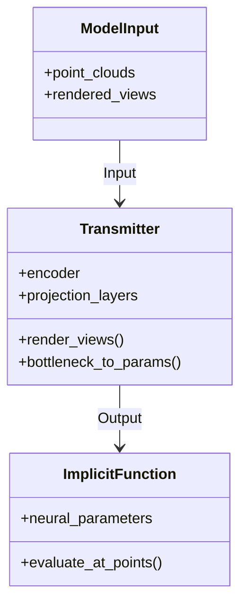

Sources: [model-card.md:9](), [model-card.md:24-25]()

### Usage Context

The transmitter is primarily used in the 3D encoding workflow, where existing 3D models are converted into the Shap-E latent representation. The encoder first processes multi-view renders and point clouds of the input 3D model, then projects this representation to the parameters of an implicit neural function.

Sources: [README.md:73]()

## Decoder Component

The decoder is a specialized component that serves as the final projection layer used to convert latent representations into implicit neural functions.

### Architecture and Purpose

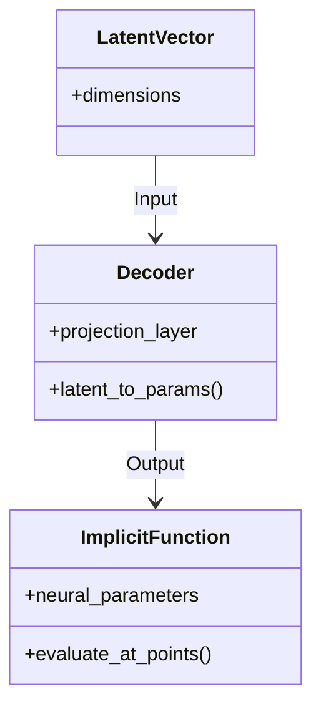

Sources: [model-card.md:25-26]()

### Key Characteristics

- The decoder is a subset of the transmitter, containing only the final projection layer
- It's a smaller checkpoint than the full transmitter since it doesn't include parameters for encoding 3D assets
- The decoder is the minimum required model to convert diffusion outputs into implicit neural representations
- It shares the same projection layer weights as the transmitter component

Sources: [model-card.md:25-26]()

## Diffusion Models

Shap-E includes two conditional latent diffusion models that generate 3D content based on different types of prompts.

### Text-conditional Diffusion Model (text300M)

The text300M model generates implicit functions conditioned on text descriptions. It was trained on an expanded dataset with roughly a million 3D assets and 120K human-annotated captions.

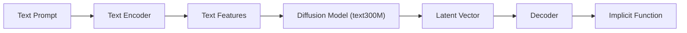

Sources: [model-card.md:10](), [model-card.md:41-42]()

### Image-conditional Diffusion Model (image300M)

The image300M model generates implicit functions conditioned on single view images. It was trained on the same dataset as Point-E but with improved post-processing.

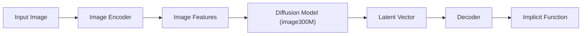

Sources: [model-card.md:10](), [model-card.md:35-40]()

### Training Dataset Information

Both diffusion models were trained on specialized datasets:

- **image300M**: Trained on the same dataset as Point-E, with improvements:
  - 60 views rendered per model (instead of 20)
  - 16K points in each point cloud (instead of 4K)
  - Simplified lighting and material setup with only diffuse materials

- **text300M**: Used an expanded dataset with:
  - Approximately one million more 3D assets
  - 120K human-annotated captions for a high-quality subset of assets

Sources: [model-card.md:34-42]()

## End-to-End Generation Flow

The following diagram shows the complete end-to-end flow when generating 3D content with Shap-E models:

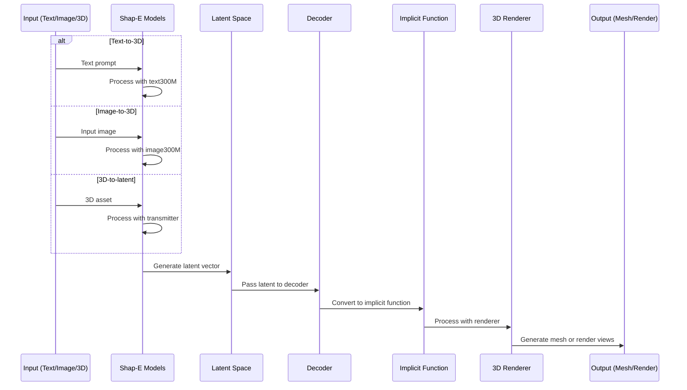

Sources: [README.md:70-73](), [model-card.md:7-10]()

## Model Component Implementation

The model components are implemented as neural networks with specific architectures designed for 3D generation. Each component plays a distinct role in the pipeline:

1. **Transmitter**: Full encoder architecture that processes 3D inputs and produces both latent representations and implicit functions
2. **Decoder**: Lightweight network that only contains the final projection layer from the transmitter
3. **text300M**: Conditional diffusion model that maps text descriptions to latent vectors
4. **image300M**: Conditional diffusion model that maps image inputs to latent vectors

The strength of the system comes from how these components interact with each other in a unified latent space, allowing for flexible generation of 3D content from multiple modalities.

Sources: [model-card.md:22-27]()

## Technical Limitations

The model components have several technical limitations that affect their performance:

- The image-conditional model can sometimes fail to infer the correct occluded parts of an object
- The text-conditional model often fails with complex prompts that require placing multiple objects in a scene
- Generated 3D assets often have rough edges, holes, or blurry surface textures
- The models tend to imitate the simple, cartoonish style of many of the training assets

Sources: [model-card.md:53-60]()

---

# Page: Rendering System

# Rendering System

<details>
<summary>Relevant source files</summary>

The following files were used as context for generating this wiki page:

- [model-card.md](model-card.md)
- [shap_e/models/stf/renderer.py](shap_e/models/stf/renderer.py)
- [shap_e/util/notebooks.py](shap_e/util/notebooks.py)

</details>


The Rendering System in Shap-E is responsible for generating visual representations of 3D models from latent vectors. It converts implicit neural function representations into both mesh-based 3D models and 2D renderings from different viewpoints. This component bridges the gap between the abstract latent space generated by the diffusion models and the final visual outputs.

## Core Components

The rendering system consists of two primary renderers and supporting utilities for camera positioning and mesh processing:

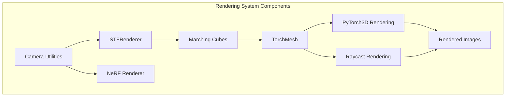

Sources: [shap_e/models/stf/renderer.py:45-129](). [shap_e/util/notebooks.py:16-43]()

### STF Renderer

The STF (Signed Distance Function and Texture Function) Renderer is the primary rendering system in Shap-E. It represents 3D shapes implicitly using:

1. **Signed Distance Function (SDF)** - Defines the geometry of the shape
2. **Texture Function (TF)** - Defines the surface properties (color, etc.)

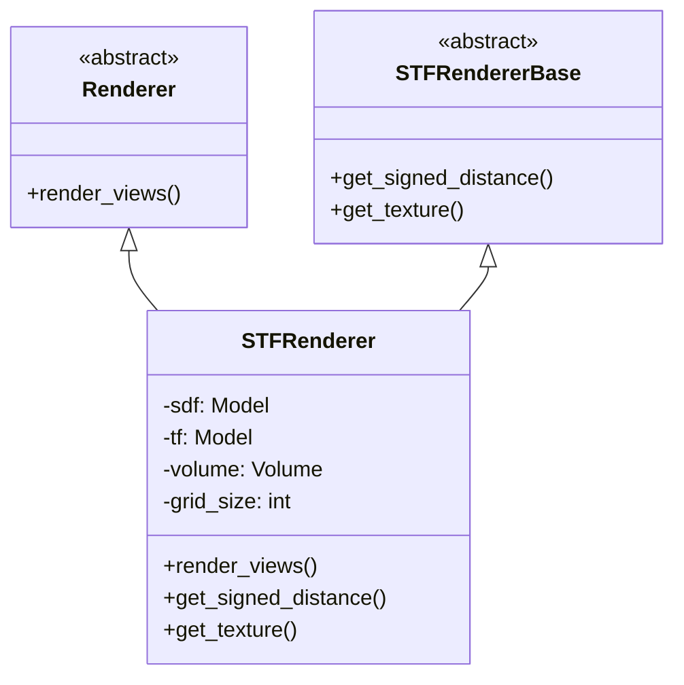

The `STFRenderer` class implements two key methods from `STFRendererBase`:

- `get_signed_distance`: Evaluates the signed distance function at given positions
- `get_texture`: Evaluates the texture function at given positions

Sources: [shap_e/models/stf/renderer.py:25-128]()

### Rendering Process

The STF rendering process involves several steps:

```mermaid
sequenceDiagram
    participant L as "Latent Vector"
    participant P as "Neural Network Parameters"
    participant S as "SDF Evaluation"
    participant M as "Marching Cubes"
    participant T as "Texture Evaluation"
    participant R as "Rendering"
    participant I as "Images"
    
    L->>P: decode via bottleneck_to_params
    P->>S: evaluate SDF at grid points
    S->>M: extract mesh using marching cubes
    M->>T: evaluate texture at mesh vertices
    T->>R: render with lighting (PyTorch3D/Raycast)
    R->>I: output rendered views
```

The key function implementing this workflow is `render_views_from_stf` [shap_e/models/stf/renderer.py:131-311](), which:

1. Samples points in a 3D grid and evaluates the SDF at these points
2. Uses marching cubes to extract a mesh from the SDF
3. Evaluates the texture function at mesh vertices
4. Renders the textured mesh from different viewpoints

Sources: [shap_e/models/stf/renderer.py:131-311]()

### Rendering Backends

The system supports two rendering backends:

1. **PyTorch3D**: Primary renderer for high-quality output with full gradient support
2. **Raycast**: Fallback renderer with more limited gradient support

The system automatically falls back to the raycast renderer if PyTorch3D is not available.

Sources: [shap_e/models/stf/renderer.py:315-455]()

## Camera System

The rendering system uses a sophisticated camera system to create multi-view renderings:

```mermaid
classDiagram
    class DifferentiableCameraBatch {
        +shape: tuple
        +flat_camera: DifferentiableCamera
    }
    
    class DifferentiableProjectiveCamera {
        +origin: Tensor
        +x: Tensor
        +y: Tensor
        +z: Tensor
        +width: int
        +height: int
        +x_fov: float
        +y_fov: float
    }
    
    DifferentiableCameraBatch o-- DifferentiableProjectiveCamera
```

The utility function `create_pan_cameras` [shap_e/util/notebooks.py:16-43]() creates a batch of cameras that orbit around a central point, which is useful for generating 360-degree views of objects.

Sources: [shap_e/util/notebooks.py:16-43]()

## NeRF Renderer

While the STF renderer is the primary rendering system, Shap-E also supports Neural Radiance Fields (NeRF) rendering as mentioned in the architecture diagrams. The NeRF rendering approach represents scenes as continuous volumetric functions rather than explicit meshes, allowing for novel view synthesis with smooth interpolation between viewpoints.

## Implicit Function Representation

At the core of the rendering system is the representation of 3D objects as implicit neural functions:

```mermaid
flowchart TD
    subgraph "Implicit Function Representation"
        Latent["Latent Vector"] --> Decoder["Projection Layer (decoder)"]
        Decoder --> Params["Neural Network Parameters"]
        Params --> SDF["Signed Distance Function"]
        Params --> TF["Texture Function"]
        SDF --> G["Geometry Information"]
        TF --> C["Color Information"]
    end
```

This representation allows for:
- Compact storage of 3D information
- Differentiable operations for end-to-end training
- Conversion to explicit mesh representations for visualization and export

Sources: [model-card.md:7-10]()

## Usage Workflow

The rendering system provides two primary functions for working with latent vectors:

1. `decode_latent_images`: Converts a latent vector into rendered images from multiple viewpoints
2. `decode_latent_mesh`: Converts a latent vector into a triangle mesh

```mermaid
flowchart LR
    subgraph "Rendering API"
        L["Latent Vector"] --> DLI["decode_latent_images()"]
        L --> DLM["decode_latent_mesh()"]
        DLI --> Images["2D Rendered Views"]
        DLM --> Mesh["3D Triangle Mesh"]
    end
```

These functions provide a clean interface for applications to convert latent vectors into visual representations.

Sources: [shap_e/util/notebooks.py:46-76]()

## Key Objects and Data Structures

| Object | Description | Key Properties |
|--------|-------------|----------------|
| `TorchMesh` | Represents a 3D mesh | `verts`, `faces`, `vertex_channels` |
| `DifferentiableCameraBatch` | Collection of cameras | `flat_camera` |
| `DifferentiableProjectiveCamera` | Single camera | `origin`, `x`, `y`, `z`, `width`, `height`, `x_fov`, `y_fov` |
| `AttrDict` | Dictionary with attribute access | Various parameters for rendering |

Sources: [shap_e/models/stf/renderer.py:45-76](), [shap_e/util/notebooks.py:16-43]()

## Integration with Generation Pipeline

The rendering system is the final stage in both the text-to-3D and image-to-3D pipelines:

```mermaid
flowchart LR
    subgraph "Generation to Rendering Pipeline"
        Text["Text Prompt"] --> TDiff["Text Diffusion"]
        Image["Input Image"] --> IDiff["Image Diffusion"]
        TDiff --> Latent["Latent Vector"]
        IDiff --> Latent
        Latent --> Decoder["Projection Layer"]
        Decoder --> STF["STF Renderer"]
        STF --> Output["Rendered Output / Mesh"]
    end
```

The rendering system is responsible for converting the abstract latent representations produced by the diffusion models into visible 3D content that can be viewed or exported.

Sources: [model-card.md:7-10]()

---

# Page: Generation Workflows

# Generation Workflows

<details>
<summary>Relevant source files</summary>

The following files were used as context for generating this wiki page:

- [README.md](README.md)
- [model-card.md](model-card.md)

</details>


This document provides an overview of the three main workflows in Shap-E for generating and encoding 3D content. It explains the overall process flow, key components, and relationships between different models in each workflow. For detailed instructions on using specific workflows, see the dedicated pages for [Text-to-3D Generation](#3.1), [Image-to-3D Generation](#3.2), and [3D Model Encoding](#3.3).

## Generation Workflow Architecture

Shap-E supports three primary workflows that leverage different models but share a common architectural pattern of generating or encoding content through a latent representation, which is then decoded into an implicit neural representation of 3D objects.

```mermaid
flowchart LR
    subgraph "Common Architectural Pattern"
        input["Input\n(Text/Image/3D Model)"] --> model["Model\n(text300M/image300M/transmitter)"]
        model --> latent["Latent Representation"]
        latent --> decoder["Decoder\n(projection_layer)"]
        decoder --> implicit["Implicit Neural Function"]
        implicit --> output["Output\n(3D Mesh/Rendered Views)"]
    end
```

Sources: model-card.md

## Workflow Types and Models

Each workflow uses different models from the Shap-E library but follows the same general pattern of transforming input into a latent representation and then decoding it to produce 3D content.

### Available Models

Shap-E provides four pre-trained model checkpoints that work together to enable the different generation workflows:

```mermaid
classDiagram
    class TransmitterModel {
        +encoder
        +projection_layers
        +Used for: 3D model encoding
    }
    
    class DecoderModel {
        +projection_layer
        +Used for: Converting latents to 3D
    }
    
    class Text300MModel {
        +text_conditional
        +diffusion_model
        +Used for: Text-to-3D generation
    }
    
    class Image300MModel {
        +image_conditional
        +diffusion_model
        +Used for: Image-to-3D generation
    }
    
    TransmitterModel --> DecoderModel : includes
    Text300MModel ..> DecoderModel : outputs to
    Image300MModel ..> DecoderModel : outputs to
```

Sources: model-card.md:23-27

## Generation Workflow Diagram

The following diagram illustrates how the three main generation workflows operate from input to output, highlighting the key components and data transformations:

```mermaid
flowchart TD
    subgraph "Text-to-3D Workflow"
        textPrompt["Text Prompt"] --> text300M["text300M Model"]
        text300M --> textLatent["Latent Vector"]
        textLatent --> textDecoder["decoder (projection_layer)"]
        textDecoder --> textImplicit["Implicit Function"]
        textImplicit --> textMesh["3D Mesh/Renders"]
    end
    
    subgraph "Image-to-3D Workflow"
        imageInput["Input Image"] --> image300M["image300M Model"]
        image300M --> imageLatent["Latent Vector"]
        imageLatent --> imageDecoder["decoder (projection_layer)"]
        imageDecoder --> imageImplicit["Implicit Function"]
        imageImplicit --> imageMesh["3D Mesh/Renders"]
    end
    
    subgraph "3D Encoding Workflow"
        modelInput["3D Model Input"] --> transmitter["transmitter Model"]
        transmitter --> modelLatent["Latent Vector"]
        modelLatent --> modelDecoder["projection_layer (part of transmitter)"]
        modelDecoder --> modelImplicit["Implicit Function"]
        modelImplicit --> modelMesh["3D Mesh/Renders"]
    end
```

Sources: README.md:69-73, model-card.md:7-11

## Common Functions Across Workflows

All three workflows share key functions for sampling, decoding, and rendering content:

| Function | Purpose | Used In |
|----------|---------|---------|
| `sample_latents()` | Generate latent representation from inputs | Text-to-3D, Image-to-3D |
| `decode_latent_mesh()` | Convert latent to triangle mesh | All workflows |
| `decode_latent_images()` | Render the latent from specified camera viewpoints | All workflows |
| `create_pan_cameras()` | Create camera positions for rendering multiple views | All workflows |

Sources: model-card.md

## Text-to-3D Generation Workflow

The text-to-3D workflow transforms natural language prompts into 3D models using a diffusion model trained on text-3D pairs.

```mermaid
sequenceDiagram
    participant User
    participant Notebook as sample_text_to_3d.ipynb
    participant TextModel as text300M
    participant DecoderModel as decoder
    participant Renderer
    
    User->>Notebook: Provide text prompt
    Notebook->>TextModel: Forward text prompt
    TextModel->>Notebook: Return latent representation
    Notebook->>DecoderModel: Forward latent
    DecoderModel->>Notebook: Return implicit function
    Notebook->>Renderer: Generate mesh/render views
    Renderer->>User: Return 3D mesh or rendered images
```

Key components in the text-to-3D workflow:
- **Input**: Text prompt describing the desired 3D object
- **Model**: `text300M` text-conditional diffusion model 
- **Output**: Implicit neural representation that can be rendered or exported as a mesh

Sources: README.md:71, model-card.md:26

## Image-to-3D Generation Workflow

The image-to-3D workflow takes a 2D image and generates a corresponding 3D model that matches the appearance from the input view while inferring the object's complete 3D structure.

```mermaid
sequenceDiagram
    participant User
    participant Notebook as sample_image_to_3d.ipynb
    participant ImageModel as image300M
    participant DecoderModel as decoder
    participant Renderer
    
    User->>Notebook: Provide input image
    Note right of User: Background removal recommended
    Notebook->>ImageModel: Forward processed image
    ImageModel->>Notebook: Return latent representation
    Notebook->>DecoderModel: Forward latent
    DecoderModel->>Notebook: Return implicit function
    Notebook->>Renderer: Generate mesh/render views
    Renderer->>User: Return 3D mesh or rendered images
```

Key components in the image-to-3D workflow:
- **Input**: 2D image (ideally with background removed)
- **Model**: `image300M` image-conditional diffusion model
- **Output**: Implicit neural representation that can be rendered or exported as a mesh

Sources: README.md:72, model-card.md:27

## 3D Model Encoding Workflow

The 3D model encoding workflow converts existing 3D assets into the latent space representation used by Shap-E, allowing for manipulation, reconstruction, or transfer of 3D content.

```mermaid
sequenceDiagram
    participant User
    participant Notebook as encode_model.ipynb
    participant Blender
    participant Transmitter as transmitter
    participant Renderer
    
    User->>Notebook: Provide 3D model
    Notebook->>Blender: Generate multiview renders
    Blender->>Notebook: Return rendered views
    Notebook->>Transmitter: Encode views/point cloud
    Transmitter->>Notebook: Return latent representation
    Notebook->>Transmitter: Decode latent (via projection_layer)
    Transmitter->>Renderer: Generate mesh/render views
    Renderer->>User: Return reconstructed 3D mesh
```

Key components in the 3D encoding workflow:
- **Input**: Existing 3D model or mesh
- **Dependencies**: Requires Blender 3.3.1+ (`BLENDER_PATH` environment variable)
- **Model**: `transmitter` encoder model
- **Output**: Implicit neural representation that can be rendered or exported as a mesh

Sources: README.md:73, model-card.md:24-25

## Common Output Methods

All workflows support the same output methods for visualizing and exporting the generated 3D content:

| Output Method | Description | Function |
|---------------|-------------|----------|
| Rendered Views | 2D renders from different camera angles | `decode_latent_images()` |
| Triangle Mesh | Exportable 3D mesh | `decode_latent_mesh()` |
| PLY/OBJ Export | Save 3D model to standard file formats | `write_ply()` / `write_obj()` |

Sources: model-card.md, README.md

## Workflow Implementation Details

The implementation of these workflows is demonstrated in example notebooks, each focusing on one of the three main workflows:

```mermaid
graph TD
    subgraph "Notebook Implementations"
        text["sample_text_to_3d.ipynb"]
        image["sample_image_to_3d.ipynb"]
        encode["encode_model.ipynb"]
    end
    
    subgraph "Core Functions"
        sample["sample_latents()"]
        decode_mesh["decode_latent_mesh()"]
        decode_images["decode_latent_images()"]
        cameras["create_pan_cameras()"]
    end
    
    text --> sample
    text --> decode_mesh
    text --> decode_images
    text --> cameras
    
    image --> sample
    image --> decode_mesh
    image --> decode_images
    image --> cameras
    
    encode --> decode_mesh
    encode --> decode_images
    encode --> cameras
```

Sources: README.md:69-73

The notebooks provide practical examples of how to use the Shap-E models for various 3D generation tasks, with each workflow utilizing the same core functions but different initial models and inputs.

---

# Page: Text-to-3D Generation

# Text-to-3D Generation

<details>
<summary>Relevant source files</summary>

The following files were used as context for generating this wiki page:

- [README.md](README.md)
- [shap_e/examples/sample_text_to_3d.ipynb](shap_e/examples/sample_text_to_3d.ipynb)

</details>


This document explains the Text-to-3D generation workflow in Shap-E, which allows users to create 3D models from text prompts. The system uses a text-conditional diffusion model to generate high-quality 3D shapes that match the provided text description. For information about generating 3D models from images, see [Image-to-3D Generation](#3.2), and for encoding existing 3D models, see [3D Model Encoding](#3.3).

## Overview

The Text-to-3D generation pipeline transforms a text prompt into a 3D model through a diffusion-based process. It uses pre-trained models to generate latent representations which are then decoded into renderable 3D content.

```mermaid
flowchart LR
    subgraph "Text-to-3D Pipeline"
        text["Text Prompt"] --> textModel["text300M Model"]
        textModel --> diffusion["Diffusion Process"]
        diffusion --> latent["Latent Vector"]
        latent --> transmitter["Transmitter (xm)"]
        transmitter --> representation["3D Representation"]
        representation --> rendering["Rendering (NeRF/STF)"]
        representation --> mesh["Mesh Export (.ply/.obj)"]
    end
```

Sources: [shap_e/examples/sample_text_to_3d.ipynb:9-15](), [shap_e/examples/sample_text_to_3d.ipynb:35-37](), [shap_e/examples/sample_text_to_3d.ipynb:51-65]()

## Components and Process

### Core Components

The Text-to-3D generation system consists of three main components:

1. **text300M Model** - A text-conditional diffusion model trained to generate 3D latent representations from text descriptions
2. **Transmitter (xm)** - A model that decodes latent representations into renderable 3D representations
3. **Diffusion Process** - The sampling process used to generate coherent latent representations

```mermaid
classDiagram
    class text300M {
        +Process text prompts
        +Generate latent representations
    }
    
    class Transmitter {
        +Decode latents
        +Convert to 3D representation
    }
    
    class DiffusionProcess {
        +Sampling parameters
        +Guidance scale
        +Denoising steps
    }
    
    class Output {
        +NeRF rendering
        +STF rendering
        +Mesh export
    }
    
    text300M --> DiffusionProcess: Produces latents through
    DiffusionProcess --> Transmitter: Provides latents to
    Transmitter --> Output: Generates
```

Sources: [shap_e/examples/sample_text_to_3d.ipynb:35-37](), [shap_e/examples/sample_text_to_3d.ipynb:75-81](), [shap_e/examples/sample_text_to_3d.ipynb:91-99]()

### Generation Workflow

The Text-to-3D generation process follows these steps:

1. **Load Models**: Load the required pre-trained models (transmitter and text300M)
2. **Create Text Prompt**: Define the text description of the desired 3D object
3. **Generate Latents**: Sample latent representations using the diffusion model
4. **Decode Latents**: Convert latents to 3D representations using the transmitter
5. **Render or Export**: Either visualize the 3D model or export it as a mesh file

```mermaid
sequenceDiagram
    participant User
    participant Models as Pre-trained Models
    participant Sampler as Latent Sampler
    participant Decoder as Latent Decoder
    participant Output as Rendering/Export
    
    User->>Models: Load text300M and transmitter
    User->>Sampler: Provide text prompt
    Sampler->>Models: Request latent generation
    Models->>Sampler: Return diffusion parameters
    Sampler->>Decoder: Send generated latents
    Decoder->>Output: Decode to 3D representation
    Output->>User: Display rendered object
    Output->>User: Export mesh files
```

Sources: [shap_e/examples/sample_text_to_3d.ipynb:35-37](), [shap_e/examples/sample_text_to_3d.ipynb:47-65](), [shap_e/examples/sample_text_to_3d.ipynb:75-81](), [shap_e/examples/sample_text_to_3d.ipynb:91-99]()

## Implementation Details

### Required Models

The Text-to-3D generation pipeline requires two pre-trained models:

| Model Name | Variable | Purpose |
|------------|----------|---------|
| 'transmitter' | `xm` | Decodes latent vectors into 3D representations |
| 'text300M' | `model` | Text-conditional diffusion model that generates latent vectors |

Additionally, a diffusion configuration is loaded to define the diffusion process parameters.

Sources: [shap_e/examples/sample_text_to_3d.ipynb:35-37]()

### Latent Sampling

The core of the generation process is the `sample_latents` function, which takes the text prompt and applies the diffusion process to generate latent representations:

```python
latents = sample_latents(
    batch_size=batch_size,
    model=model,
    diffusion=diffusion,
    guidance_scale=guidance_scale,
    model_kwargs=dict(texts=[prompt] * batch_size),
    progress=True,
    clip_denoised=True,
    use_fp16=True,
    use_karras=True,
    karras_steps=64,
    sigma_min=1e-3,
    sigma_max=160,
    s_churn=0,
)
```

Key parameters include:

| Parameter | Description |
|-----------|-------------|
| `batch_size` | Number of samples to generate |
| `guidance_scale` | Controls how strongly the generation follows the text prompt |
| `use_karras` | Whether to use Karras sampling schedule |
| `karras_steps` | Number of denoising steps |
| `sigma_min/max` | Range of noise levels in the diffusion process |

Sources: [shap_e/examples/sample_text_to_3d.ipynb:47-65]()

### Rendering and Visualization

The generated latents can be visualized using two rendering methods:

1. **NeRF Rendering** - Neural Radiance Fields rendering (default)
2. **STF Rendering** - Signed distance functions and texture fields rendering

The visualization process uses camera positioning to create rotating views of the object:

```python
cameras = create_pan_cameras(size, device)
images = decode_latent_images(xm, latent, cameras, rendering_mode=render_mode)
```

Sources: [shap_e/examples/sample_text_to_3d.ipynb:75-81]()

### Exporting Meshes

Generated 3D models can be exported as mesh files in PLY or OBJ formats:

```python
t = decode_latent_mesh(xm, latent).tri_mesh()
with open(f'example_mesh_{i}.ply', 'wb') as f:
    t.write_ply(f)
with open(f'example_mesh_{i}.obj', 'w') as f:
    t.write_obj(f)
```

The exported meshes can be imported into standard 3D modeling software for further editing or use.

Sources: [shap_e/examples/sample_text_to_3d.ipynb:91-99]()

## Code Implementation

The following diagram shows how the components in the text-to-3D generation system map to specific code entities:

```mermaid
graph TD
    subgraph "User Input"
        prompt["Text Prompt (String)"]
    end
    
    subgraph "Model Loading"
        load_model["load_model()"]
        load_config["load_config()"]
        diffusion_from_config["diffusion_from_config()"]
    end
    
    subgraph "Generation"
        sample_latents["sample_latents()"]
    end
    
    subgraph "Rendering/Export"
        create_pan_cameras["create_pan_cameras()"]
        decode_latent_images["decode_latent_images()"]
        decode_latent_mesh["decode_latent_mesh()"]
        tri_mesh["tri_mesh()"]
        write_ply["write_ply()"]
        write_obj["write_obj()"]
    end
    
    prompt --> sample_latents
    load_model --> sample_latents
    load_config --> diffusion_from_config
    diffusion_from_config --> sample_latents
    
    sample_latents --> decode_latent_images
    sample_latents --> decode_latent_mesh
    create_pan_cameras --> decode_latent_images
    decode_latent_mesh --> tri_mesh
    tri_mesh --> write_ply
    tri_mesh --> write_obj
```

Sources: [shap_e/examples/sample_text_to_3d.ipynb:10-15](), [shap_e/examples/sample_text_to_3d.ipynb:35-37](), [shap_e/examples/sample_text_to_3d.ipynb:51-65](), [shap_e/examples/sample_text_to_3d.ipynb:78-80](), [shap_e/examples/sample_text_to_3d.ipynb:92-99]()

## Sample Usage Walkthrough

Here's a step-by-step walkthrough of the text-to-3D generation process using the sample notebook:

1. **Import dependencies and setup device**:
   ```python
   import torch
   from shap_e.diffusion.sample import sample_latents
   from shap_e.diffusion.gaussian_diffusion import diffusion_from_config
   from shap_e.models.download import load_model, load_config
   from shap_e.util.notebooks import create_pan_cameras, decode_latent_images, gif_widget
   
   device = torch.device('cuda' if torch.cuda.is_available() else 'cpu')
   ```

2. **Load models**:
   ```python
   xm = load_model('transmitter', device=device)
   model = load_model('text300M', device=device)
   diffusion = diffusion_from_config(load_config('diffusion'))
   ```

3. **Set generation parameters and create latents**:
   ```python
   batch_size = 4
   guidance_scale = 15.0
   prompt = "a shark"
   
   latents = sample_latents(
       batch_size=batch_size,
       model=model,
       diffusion=diffusion,
       guidance_scale=guidance_scale,
       model_kwargs=dict(texts=[prompt] * batch_size),
       # ... additional parameters
   )
   ```

4. **Render and visualize the results**:
   ```python
   render_mode = 'nerf'  # or 'stf'
   size = 64  # render size, higher values take longer
   
   cameras = create_pan_cameras(size, device)
   for i, latent in enumerate(latents):
       images = decode_latent_images(xm, latent, cameras, rendering_mode=render_mode)
       display(gif_widget(images))
   ```

5. **Export meshes**:
   ```python
   for i, latent in enumerate(latents):
       t = decode_latent_mesh(xm, latent).tri_mesh()
       with open(f'example_mesh_{i}.ply', 'wb') as f:
           t.write_ply(f)
       with open(f'example_mesh_{i}.obj', 'w') as f:
           t.write_obj(f)
   ```

Sources: [shap_e/examples/sample_text_to_3d.ipynb:10-99]()

## Best Practices and Tips

1. **Prompt Engineering**:
   - Be specific in text descriptions
   - Simple, clear descriptions often work better than complex ones
   - Single objects tend to generate better than complex scenes

2. **Parameter Tuning**:
   - Higher `guidance_scale` values (15-20) produce results that more closely match the text prompt
   - Increasing `batch_size` generates multiple variations of the same prompt
   - The default `karras_steps=64` provides a good balance between quality and speed

3. **Rendering Options**:
   - `nerf` rendering typically produces smoother results but may be slower
   - `stf` rendering can be faster but may produce more artifacts
   - Increase `size` parameter for higher quality renders (at the cost of speed)

4. **Hardware Considerations**:
   - GPU acceleration is highly recommended for reasonable generation times
   - Generating with CPU only will be significantly slower
   - Higher batch sizes and render sizes require more VRAM

Sources: [shap_e/examples/sample_text_to_3d.ipynb:47-65](), [shap_e/examples/sample_text_to_3d.ipynb:75-81]()

---

# Page: Image-to-3D Generation

# Image-to-3D Generation

<details>
<summary>Relevant source files</summary>

The following files were used as context for generating this wiki page:

- [README.md](README.md)
- [shap_e/examples/sample_image_to_3d.ipynb](shap_e/examples/sample_image_to_3d.ipynb)

</details>


## Purpose and Scope

This document details the Image-to-3D generation capability of the Shap-E system, which converts 2D images into 3D models. This workflow enables the creation of detailed 3D representations from single image inputs. For text-based 3D generation, see [Text-to-3D Generation](#3.1), and for encoding existing 3D models, see [3D Model Encoding](#3.3).

Sources: [README.md:72-73]()

## System Overview

Image-to-3D generation represents one of the three primary workflows in Shap-E. The process uses a pre-trained diffusion model (`image300M`) to convert a 2D image into a latent representation, which is then decoded using a transmitter model to create a 3D model that can be rendered in different ways.

### Image-to-3D Pipeline Diagram

```mermaid
graph LR
    inputImage["Input Image"] --> imageModel["image300M Model"]
    imageModel --> latentSpace["Latent Representation"]
    latentSpace --> transmitter["Transmitter (xm)"]
    transmitter --> rendering["Rendering (NeRF/STF)"]
    rendering --> finalOutput["3D Model Output"]
```

Sources: [shap_e/examples/sample_image_to_3d.ipynb:10-16](), [shap_e/examples/sample_image_to_3d.ipynb:36-38]()

## Detailed Workflow

The Image-to-3D generation process consists of these key steps:

1. **Image Loading**: Input image is loaded and preprocessed via `load_image()`
2. **Latent Sampling**: Image is processed through the `image300M` diffusion model to generate latent vectors using `sample_latents()`
3. **3D Decoding**: Latent vectors are processed through the transmitter model (xm)
4. **Rendering**: The 3D representation is rendered using either NeRF or STF methods
5. **Visualization**: The 3D model is visualized from multiple camera angles

### Detailed Code Components Workflow

```mermaid
graph TD
    inputImage["Input Image"] --> loadImage["load_image()"]
    loadImage --> sampleLatents["sample_latents()"]
    
    subgraph "Diffusion Process"
        sampleLatents --> diffusionModel["image300M Model"]
        diffusionModel --> guidanceScale["Guidance Scale Control"]
        guidanceScale --> latentVectors["Latent Vectors"]
    end
    
    latentVectors --> transmitterModel["Transmitter Model (xm)"]
    
    subgraph "Rendering"
        transmitterModel --> decodeLatentImages["decode_latent_images()"]
        panCameras["create_pan_cameras()"] --> decodeLatentImages
        decodeLatentImages --> renderingMode["Rendering Mode (NeRF/STF)"]
        renderingMode --> finalImages["Rendered Images"]
    end
    
    finalImages --> gifWidget["gif_widget()"]
    gifWidget --> display["Display 3D Model"]
```

Sources: [shap_e/examples/sample_image_to_3d.ipynb:10-16](), [shap_e/examples/sample_image_to_3d.ipynb:48-68](), [shap_e/examples/sample_image_to_3d.ipynb:78-84]()

### Pipeline Components and Roles

```mermaid
classDiagram
    class ImageToModelPipeline {
        +InputProcessing
        +LatentGeneration
        +ModelDecoding
        +Visualization
    }
    
    class InputProcessing {
        +load_image()
    }
    
    class LatentGeneration {
        +sample_latents()
        +image300M
        +diffusion_from_config()
        +guidance_scale
    }
    
    class ModelDecoding {
        +transmitter(xm)
        +decode_latent_images()
        +create_pan_cameras()
    }
    
    class Visualization {
        +gif_widget()
        +display()
    }
    
    ImageToModelPipeline --> InputProcessing
    ImageToModelPipeline --> LatentGeneration
    ImageToModelPipeline --> ModelDecoding
    ImageToModelPipeline --> Visualization
```

Sources: [shap_e/examples/sample_image_to_3d.ipynb]()

## Implementation Guide

The Shap-E repository provides a sample notebook, `sample_image_to_3d.ipynb`, that demonstrates the Image-to-3D generation process.

### Setup and Model Loading

First, the required modules are imported and the pre-trained models loaded:

```python
import torch
from shap_e.diffusion.sample import sample_latents
from shap_e.diffusion.gaussian_diffusion import diffusion_from_config
from shap_e.models.download import load_model, load_config
from shap_e.util.notebooks import create_pan_cameras, decode_latent_images, gif_widget
from shap_e.util.image_util import load_image

device = torch.device('cuda' if torch.cuda.is_available() else 'cpu')

xm = load_model('transmitter', device=device)
model = load_model('image300M', device=device)
diffusion = diffusion_from_config(load_config('diffusion'))
```

Sources: [shap_e/examples/sample_image_to_3d.ipynb:10-38]()

### Generate Latent Vectors

Next, parameters are defined and latent vectors are generated from the input image:

```python
batch_size = 4
guidance_scale = 3.0

# Load the input image
image = load_image("example_data/corgi.png")

latents = sample_latents(
    batch_size=batch_size,
    model=model,
    diffusion=diffusion,
    guidance_scale=guidance_scale,
    model_kwargs=dict(images=[image] * batch_size),
    progress=True,
    clip_denoised=True,
    use_fp16=True,
    use_karras=True,
    karras_steps=64,
    sigma_min=1e-3,
    sigma_max=160,
    s_churn=0,
)
```

Sources: [shap_e/examples/sample_image_to_3d.ipynb:48-68]()

### Render and Visualize the 3D Model

Finally, the 3D model is rendered from different camera angles and visualized:

```python
render_mode = 'nerf'  # Options: 'nerf' or 'stf'
size = 64  # Size of rendered images

cameras = create_pan_cameras(size, device)
for i, latent in enumerate(latents):
    images = decode_latent_images(xm, latent, cameras, rendering_mode=render_mode)
    display(gif_widget(images))
```

Sources: [shap_e/examples/sample_image_to_3d.ipynb:78-84]()

## Parameters and Options

### Key Parameters

The Image-to-3D generation process is controlled by these important parameters:

| Parameter | Description | Typical Values |
|-----------|-------------|----------------|
| `batch_size` | Number of 3D models to generate from the input image | 1-4 |
| `guidance_scale` | Controls how closely the generation follows the input image | 3.0 |
| `use_karras` | Whether to use Karras sampling for improved quality | `True` |
| `karras_steps` | Number of steps for Karras sampling | 64 |
| `sigma_min` | Minimum noise level for sampling | 1e-3 |
| `sigma_max` | Maximum noise level for sampling | 160 |
| `s_churn` | Stochasticity parameter | 0 |
| `render_mode` | Method for rendering the 3D model | 'nerf' or 'stf' |
| `size` | Size of the rendered images in pixels | 64 |

Sources: [shap_e/examples/sample_image_to_3d.ipynb:48-68](), [shap_e/examples/sample_image_to_3d.ipynb:78-84]()

### Rendering Modes

Shap-E supports two rendering modes for visualizing the generated 3D models:

1. **NeRF (Neural Radiance Fields)**: A volumetric rendering approach that produces high-quality results but may be slower.
2. **STF (Surface Texture Fields)**: A mesh-based rendering approach that is faster but may have lower quality in some cases.

Sources: [shap_e/examples/sample_image_to_3d.ipynb:78]()

## Limitations and Best Practices

### Input Image Preparation

For optimal results with Image-to-3D generation:

- **Remove backgrounds**: The model performs best when the input image has a clean background with only the object of interest visible.
- **Center the object**: Position the target object in the center of the image.
- **Use clear, well-lit images**: Ensure the object is clearly visible and well-lit.
- **Avoid complex scenes**: Images with multiple objects or complex backgrounds may produce unpredictable results.

As noted in the sample notebook: *"To get the best result, you should remove the background and show only the object of interest to the model."*

Sources: [shap_e/examples/sample_image_to_3d.ipynb:51-52](), [README.md:72]()

### Performance Considerations

- **Hardware Requirements**: The generation process is computationally intensive and benefits from GPU acceleration (the code automatically uses CUDA if available).
- **Render Size**: Larger render sizes (`size` parameter) produce higher quality visualizations but require more computational resources.
- **Batch Size**: Larger batch sizes generate more variations but require more memory.

Sources: [shap_e/examples/sample_image_to_3d.ipynb:26](), [shap_e/examples/sample_image_to_3d.ipynb:79](), [shap_e/examples/sample_image_to_3d.ipynb:48]()

---

# Page: 3D Model Encoding

# 3D Model Encoding

<details>
<summary>Relevant source files</summary>

The following files were used as context for generating this wiki page:

- [README.md](README.md)
- [model-card.md](model-card.md)

</details>


## Purpose and Scope

This document explains how to encode existing 3D models into Shap-E's latent space using the transmitter model. This process allows you to convert 3D assets into a compact neural representation that can be manipulated and rendered back as 3D meshes. For information about generating new 3D models from text or images, see [Text-to-3D Generation](#3.1) and [Image-to-3D Generation](#3.2).

## System Architecture

The 3D model encoding system uses the transmitter model to convert existing 3D assets into the parameters of small neural networks that represent shape and texture as an implicit function.

### Components and Data Flow

```mermaid
flowchart TD
    subgraph "Input"
        model3D["3D Model"]
    end
    
    subgraph "Preprocessing"
        blender["Blender Rendering"]
        model3D --> blender
        blender --> renders["Multi-view Renders"]
        blender --> pointcloud["Point Cloud"]
    end
    
    subgraph "Encoding"
        transmitter["Transmitter Model"]
        renders --> transmitter
        pointcloud --> transmitter
        transmitter --> latent["Latent Representation"]
    end
    
    subgraph "Decoding"
        projectionLayer["Projection Layer"]
        latent --> projectionLayer
        projectionLayer --> implicitFunction["Implicit Neural Function"]
    end
    
    subgraph "Output"
        stfRenderer["STF Renderer"]
        nerfRenderer["NeRF Renderer"]
        implicitFunction --> stfRenderer
        implicitFunction --> nerfRenderer
        stfRenderer --> mesh["3D Mesh"]
        nerfRenderer --> renders2["Rendered Views"]
    end
```

Sources: [model-card.md:7-10](), [README.md:72-73]()

### Code Components to Encoding Process Mapping

```mermaid
classDiagram
    class encode_model_notebook{
        "Main encoding workflow"
    }
    
    class Transmitter{
        "encoder"
        "projection_layers"
        "Encodes 3D assets to latent"
    }
    
    class BlenderInterface{
        "Creates renders and point clouds"
    }
    
    class ImplicitFunction{
        "Neural representation of 3D shape"
    }
    
    class STFRenderer{
        "Renders implicit function to mesh"
    }
    
    encode_model_notebook --> BlenderInterface: Uses for preprocessing
    encode_model_notebook --> Transmitter: Loads and runs
    Transmitter --> ImplicitFunction: Outputs
    ImplicitFunction --> STFRenderer: Rendered by
```

Sources: [model-card.md:24-25](), [README.md:73]()

## Encoding Process

The 3D model encoding process involves these key steps:

1. **Input Preparation**: Load a 3D model (mesh) into the system
2. **Multi-view Rendering**: Use Blender to create multiple views of the model from different camera angles
3. **Point Cloud Generation**: Create a point cloud representation of the 3D model
4. **Encoding**: Process the renders and point cloud through the transmitter's encoder to produce a latent representation
5. **Projection**: Convert the latent representation to the parameters of an implicit neural function using projection layers
6. **Output Generation**: Render the implicit function or convert it to a mesh for visualization or export

### Detailed Workflow

```mermaid
sequenceDiagram
    participant User
    participant Notebook as encode_model.ipynb
    participant Blender
    participant Transmitter
    participant Renderer
    
    User->>Notebook: Provide 3D model
    Notebook->>Blender: Generate multi-view renders
    Notebook->>Blender: Generate point cloud (16K points)
    Blender->>Notebook: Return renders and point cloud
    Notebook->>Transmitter: Load transmitter model
    Notebook->>Transmitter: Encode views and point cloud
    Transmitter->>Notebook: Return latent representation
    Notebook->>Transmitter: Project latent to implicit function
    Transmitter->>Notebook: Return implicit function parameters
    Notebook->>Renderer: Render or export to mesh
    Renderer->>User: Display/save output
```

Sources: [model-card.md:9](), [README.md:73](), [model-card.md:37-38]()

## Technical Details

### Transmitter Model

The transmitter is a two-part model consisting of:

1. **Encoder**: Processes multi-view renders and point clouds to produce a latent representation
2. **Projection Layers**: Transform the latent representation into parameters for neural networks that represent the 3D shape

The model checkpoint `transmitter` contains both the encoder and projection layers, while the smaller `decoder` checkpoint only contains the projection layers. For the encoding process, the full `transmitter` checkpoint is required.

Sources: [model-card.md:24-25]()

### Input Processing

When encoding a 3D model, the system:

- Creates 60 views of each model from different angles
- Generates a point cloud with 16K points
- Uses simplified lighting and diffuse materials for rendering

These parameters were optimized to avoid small cracks and improve quality over previous systems.

Sources: [model-card.md:37-39]()

## Using the encode_model.ipynb Notebook

The `encode_model.ipynb` notebook provides a complete example of how to encode a 3D model:

1. **Setup Requirements**:
   - Install the Shap-E package: `pip install -e .`
   - Install Blender version 3.3.1 or higher
   - Set the `BLENDER_PATH` environment variable to the path of the Blender executable

2. **Notebook Workflow**:
   - Load a 3D model or trimesh
   - Create batch of multiview renders and a point cloud
   - Encode them into a latent representation
   - Render the result back as a 3D model

Sources: [README.md:73]()

## Requirements and Limitations

### Requirements
- Blender 3.3.1 or higher for preprocessing operations
- The `transmitter` model checkpoint

### Limitations
- Encoded 3D assets often have rough edges, holes, or blurry surface textures
- The quality of results depends on the quality and complexity of the input model
- The encoding process is computationally intensive, particularly the rendering steps

Sources: [model-card.md:14](), [README.md:73]()

## Applications

The 3D model encoding functionality can be used for:

- Converting existing 3D assets into Shap-E's neural representation
- Creating variants of existing 3D models
- Preparing 3D assets for applications that use Shap-E's implicit function representation

Sources: [model-card.md:9]()

---

# Page: 3D Representation

# 3D Representation

<details>
<summary>Relevant source files</summary>

The following files were used as context for generating this wiki page:

- [model-card.md](model-card.md)
- [shap_e/rendering/mesh.py](shap_e/rendering/mesh.py)

</details>


This document explains how 3D models are represented, stored, and manipulated within the Shap-E system. It covers the internal representation formats, conversion processes, and export capabilities used throughout the system. For details about specific mesh operations and file formats, see [TriMesh Class](#4.1) and [File Import/Export](#4.2).

## Overview of 3D Representations

Shap-E uses multiple representations of 3D assets at different stages of its pipeline. Understanding these representations is essential for working with the system effectively.

```mermaid
flowchart TD
    subgraph "Representation Types"
        latent["Latent Vectors"]
        implicit["Implicit Neural Functions"]
        mesh["Triangle Meshes (TriMesh)"]
    end
    
    subgraph "Representation Converters"
        projLayer["Projection Layer"]
        renderer["STF/NeRF Renderer"]
    end
    
    latent --> projLayer
    projLayer --> implicit
    implicit --> renderer
    renderer --> mesh
```

Sources: [model-card.md:9-10]()

## Internal Representation

The core 3D representation in Shap-E uses two primary formats:

1. **Implicit Neural Functions**: These are compact neural network parameters that define a 3D shape and its texture. This representation allows for:
   - Efficient storage of complex 3D shapes
   - Rendering from arbitrary viewpoints
   - Smooth latent space operations

2. **Triangle Meshes (TriMesh)**: A concrete representation that consists of vertices, faces, and optional attributes like normals and color information.

```mermaid
classDiagram
    class TriMesh {
        +np.ndarray verts[N,3]
        +np.ndarray faces[M,3]
        +np.ndarray normals[P,3]
        +Dict vertex_channels
        +Dict face_channels
        +load(file)
        +save(file)
        +write_ply(file)
        +write_obj(file)
        +has_vertex_colors()
    }
```

Sources: [shap_e/rendering/mesh.py:10-27]()

### Implicit Function Representation

Implicit functions are a core concept in Shap-E. They represent 3D shapes as functions that map 3D coordinates to properties like signed distance (for shape) and RGB values (for texture). 

Key characteristics:
- Generated by the diffusion models or encoder
- Represented as neural network parameters
- Allow for continuous representation of surfaces
- Can be evaluated at arbitrary resolution
- Require rendering to visualize or convert to explicit formats

```mermaid
flowchart LR
    subgraph "Model Generation Pipeline"
        text["Text Prompt"] --> diffModel["Diffusion Model"]
        image["Input Image"] --> diffModel
        diffModel --> latent["Latent Vector"]
        latent --> projection["Projection Layer"]
        projection --> implicit["Implicit Function Parameters"]
    end
    
    subgraph "3D Representation Pipeline"
        implicit --> renderStep["Rendering Step"]
        renderStep --> mesh["TriMesh"]
        mesh --> export["Export (PLY/OBJ/NPZ)"]
    end
```

Sources: [model-card.md:7-10]()

## TriMesh Structure

The `TriMesh` class is the primary explicit representation of 3D models in Shap-E. It contains the following key components:

| Component | Description | Data Type |
|-----------|-------------|-----------|
| `verts` | Vertex coordinates in 3D space | Numpy array [N×3] |
| `faces` | Triangle indices (pointing to vertices) | Numpy array [M×3] |
| `normals` | Normal vectors for faces (optional) | Numpy array [P×3] |
| `vertex_channels` | Additional per-vertex data (e.g., RGB colors) | Dictionary of arrays |
| `face_channels` | Additional per-face data | Dictionary of arrays |

A typical mesh with vertex colors stores RGB values in the `vertex_channels` dictionary with keys 'R', 'G', and 'B'.

Sources: [shap_e/rendering/mesh.py:10-27]()

## Conversion Between Representations

Shap-E provides several mechanisms to convert between different 3D representations:

```mermaid
flowchart TD
    subgraph "Representation Conversion"
        direction LR
        latent["Latent Vectors"] -->|"Projection Layer"| implicit["Implicit Neural Functions"]
        implicit -->|"STF/NeRF Rendering"| mesh["Triangle Mesh (TriMesh)"]
        mesh -->|"save()"| npz["NPZ File"]
        mesh -->|"write_ply()"| ply["PLY File"]
        mesh -->|"write_obj()"| obj["OBJ File"]
    end
```

The key conversion processes are:

1. **Latent to Implicit**: The projection layer (decoder) converts latent vectors from the diffusion model into implicit function parameters.
2. **Implicit to Mesh**: The rendering system (STF or NeRF renderer) evaluates the implicit function to produce a triangle mesh.
3. **Mesh to Files**: The `TriMesh` class provides methods to export meshes to standard formats:
   - `.npz` (internal format with full metadata)
   - `.ply` (standard format supporting vertex colors)
   - `.obj` (widespread format for 3D modeling)

Sources: [shap_e/rendering/mesh.py:58-107](), [model-card.md:23-27]()

## Working with TriMesh Instances

The `TriMesh` class provides methods for working with 3D meshes:

1. **Loading and Saving**:
   ```python
   # Load a mesh from an NPZ file
   mesh = TriMesh.load("path/to/mesh.npz")
   
   # Save a mesh to an NPZ file
   mesh.save("output_mesh.npz")
   ```

2. **Exporting to Standard Formats**:
   ```python
   # Export to PLY format
   with open("output.ply", "wb") as f:
       mesh.write_ply(f)
   
   # Export to OBJ format
   with open("output.obj", "w") as f:
       mesh.write_obj(f)
   ```

3. **Checking for Vertex Colors**:
   ```python
   if mesh.has_vertex_colors():
       # Process colored mesh
   ```

Sources: [shap_e/rendering/mesh.py:30-107]()

## Relationship to System Architecture

The 3D representation components fit into the broader Shap-E architecture as follows:

```mermaid
flowchart TD
    subgraph "Input/Conditioning"
        text["Text Prompt"]
        image["Image Input"]
    end
    
    subgraph "Model Processing"
        text --> textModel["text300M"]
        image --> imageModel["image300M"]
        textModel --> latent["Latent Vector"]
        imageModel --> latent
    end
    
    subgraph "3D Representation"
        latent --> decoder["Decoder/Projection Layer"]
        decoder --> implicit["Implicit Function"]
        implicit --> stfRenderer["STF Renderer"]
        implicit --> nerfRenderer["NeRF Renderer"]
        stfRenderer --> triMesh["TriMesh"]
        nerfRenderer --> triMesh
    end
    
    subgraph "Output Formats"
        triMesh --> npz["NPZ (Internal)"]
        triMesh --> ply["PLY (Standard)"]
        triMesh --> obj["OBJ (Standard)"]
    end
```

The 3D representation layer acts as a bridge between the generative models (diffusion models or encoder) and the final output formats. It enables conversion between abstract mathematical representations (latent vectors, implicit functions) and concrete 3D formats that can be visualized or exported to other software.

Sources: [model-card.md:7-11](), [shap_e/rendering/mesh.py:10-107]()

## Limitations and Characteristics

As noted in the model card, Shap-E's 3D representations have certain characteristics and limitations:

- Samples often have rough edges, holes, or blurry surface textures
- Lower fidelity than professional 3D assets
- Many generated assets follow a simple, cartoonish style (reflecting the training data)
- Text-conditional generation may struggle with complex scenes or specific quantities

These limitations are inherent to the current generation capabilities and representation techniques used in the system.

Sources: [model-card.md:14](), [model-card.md:54-56]()

---

# Page: TriMesh Class

# TriMesh Class

<details>
<summary>Relevant source files</summary>

The following files were used as context for generating this wiki page:

- [shap_e/rendering/mesh.py](shap_e/rendering/mesh.py)

</details>


## Purpose and Overview

The TriMesh class is a core data structure in Shap-E that represents 3D triangle meshes. It provides functionality for storing, manipulating, and exporting 3D mesh data generated by the Shap-E system. This page documents the TriMesh class structure, its attributes, and methods for working with 3D meshes. For information about importing and exporting 3D models in various formats, see [File Import/Export](#4.2).

Sources: [shap_e/rendering/mesh.py:10-14]()

## Class Structure

The TriMesh class is implemented as a Python dataclass with several core attributes and methods for handling 3D mesh data.

```mermaid
classDiagram
    class TriMesh {
        +np.ndarray verts
        +np.ndarray faces
        +np.ndarray normals
        +Dict vertex_channels
        +Dict face_channels
        +load(f)$ TriMesh
        +save(f) None
        +has_vertex_colors() bool
        +write_ply(raw_f) None
        +write_obj(raw_f) None
    }
```

Sources: [shap_e/rendering/mesh.py:10-108]()

## Attributes

The TriMesh class contains the following core attributes:

| Attribute | Type | Description |
|-----------|------|-------------|
| `verts` | np.ndarray | An N×3 array of vertex coordinates in 3D space |
| `faces` | np.ndarray | An M×3 array of triangular faces, where each value is an index into the `verts` array |
| `normals` | Optional[np.ndarray] | A P×3 array of normal vectors per face (optional) |
| `vertex_channels` | Dict[str, np.ndarray] | Additional per-vertex data (e.g., RGB color information) |
| `face_channels` | Dict[str, np.ndarray] | Additional per-face data |

Sources: [shap_e/rendering/mesh.py:16-27]()

## Methods

### Loading and Saving

TriMesh provides methods for serialization and deserialization of mesh data to/from .npz files:

1. **load**: Class method that loads a TriMesh from a .npz file
2. **save**: Instance method that saves a TriMesh to a .npz file

These methods handle both file paths and file-like objects, making them flexible for various I/O scenarios.

Sources: [shap_e/rendering/mesh.py:29-73]()

### Export Functionality

TriMesh supports exporting to common 3D file formats:

1. **write_ply**: Exports the mesh to PLY format
2. **write_obj**: Exports the mesh to OBJ format

Both methods handle vertex colors if present in the vertex_channels.

Sources: [shap_e/rendering/mesh.py:78-107]()

### Utility Methods

1. **has_vertex_colors**: Checks if the mesh has RGB color information in its vertex channels

Sources: [shap_e/rendering/mesh.py:75-76]()

## TriMesh in the Shap-E System

TriMesh serves as the primary output representation format in the Shap-E 3D generation pipeline:

```mermaid
flowchart LR
    subgraph "Generation Models"
        textDiff["Text-conditional Diffusion"]
        imgDiff["Image-conditional Diffusion"]
        encoder["Encoder (transmitter)"]
    end
    
    subgraph "3D Representation"
        latent["Latent Vector"]
        decoder["Decoder"]
        stfRender["STF Renderer"]
        nerfRender["NeRF Renderer"]
        implicitFunc["Implicit Function"]
        trimesh["TriMesh"]
    end
    
    textDiff --> latent
    imgDiff --> latent
    encoder --> latent
    
    latent --> decoder
    decoder --> implicitFunc
    implicitFunc --> stfRender
    implicitFunc --> nerfRender
    stfRender --> trimesh
    nerfRender --> trimesh
    
    trimesh --> export["Export (PLY/OBJ/NPZ)"]
```

Sources: [shap_e/rendering/mesh.py:10-108]()

## Data Flow for TriMesh Operations

The following diagram illustrates how data flows through the TriMesh class during typical operations:

```mermaid
sequenceDiagram
    participant Generation as "Generation Process"
    participant Mesh as "TriMesh"
    participant Storage as "Storage (.npz)"
    participant Export as "Export Formats"
    
    Generation->>Mesh: Create with vertices and faces
    Note over Mesh: Populate vertex_channels<br>and face_channels
    
    alt Save for later use
        Mesh->>Storage: save()
        Storage-->>Mesh: load()
    end
    
    alt Export as PLY
        Mesh->>Export: write_ply()
        Note over Export: PLY file with<br>vertices, faces, colors
    else Export as OBJ
        Mesh->>Export: write_obj()
        Note over Export: OBJ file with<br>vertices, faces, colors
    end
```

Sources: [shap_e/rendering/mesh.py:29-107]()

## Implementation Details

### Vertex and Face Channels

The `vertex_channels` and `face_channels` dictionaries allow for flexible storage of additional per-vertex and per-face attributes. For example, RGB color information is stored as separate channels:

- `vertex_channels["R"]`: Red component for each vertex
- `vertex_channels["G"]`: Green component for each vertex 
- `vertex_channels["B"]`: Blue component for each vertex

When saving to .npz files, these channels are prefixed with "v_" and "f_" respectively.

Sources: [shap_e/rendering/mesh.py:44-55](), [shap_e/rendering/mesh.py:69-72]()

### Color Handling

The class provides convenience methods for working with vertex colors:

- `has_vertex_colors()` checks if 'R', 'G', and 'B' channels all exist
- When exporting to PLY or OBJ, these colors are automatically included if present

Sources: [shap_e/rendering/mesh.py:75-96]()

## Usage in Workflows

The TriMesh class is typically the final output representation in the Shap-E generation pipeline:

1. Text or image inputs are processed through diffusion models
2. Latent representations are decoded into implicit functions
3. Implicit functions are rendered into TriMesh objects
4. TriMesh objects can be saved (.npz) or exported (PLY/OBJ)

The TriMesh class provides a standardized way to handle and export the 3D models generated by Shap-E, making it a crucial component in the overall system architecture.

Sources: [shap_e/rendering/mesh.py:10-108]()

---

# Page: File Import/Export

# File Import/Export

<details>
<summary>Relevant source files</summary>

The following files were used as context for generating this wiki page:

- [README.md](README.md)
- [shap_e/rendering/mesh.py](shap_e/rendering/mesh.py)

</details>


This document details the file import and export capabilities in Shap-E, explaining how to load existing 3D models and save generated models in various formats. For information about the internal TriMesh representation used by Shap-E, see [TriMesh Class](#4.1).

## Overview of Supported Formats

Shap-E provides functionality to work with several 3D file formats through the `TriMesh` class, allowing users to:

1. **Import** 3D models from:
   - `.npz` files (NumPy compressed format)

2. **Export** 3D models to:
   - `.npz` files (NumPy compressed format)
   - `.ply` files (Polygon File Format / Stanford Triangle Format)
   - `.obj` files (Wavefront OBJ)

```mermaid
flowchart LR
    subgraph "Import Formats"
        npz_in["NPZ Files (.npz)"]
    end
    
    subgraph "TriMesh Object"
        tm["TriMesh Class"]
    end
    
    subgraph "Export Formats"
        npz_out["NPZ Files (.npz)"]
        ply["PLY Files (.ply)"]
        obj["OBJ Files (.obj)"]
    end
    
    npz_in -->|"load()"| tm
    tm -->|"save()"| npz_out
    tm -->|"write_ply()"| ply
    tm -->|"write_obj()"| obj
```

Sources: [shap_e/rendering/mesh.py:11-108]()

## TriMesh Data Model for Import/Export

The `TriMesh` class serves as the central data model for all import and export operations. Understanding its structure is essential for working with the file import/export functionality.

```mermaid
classDiagram
    class TriMesh {
        +verts: np.ndarray [N×3]
        +faces: np.ndarray [M×3]
        +normals: np.ndarray [P×3]
        +vertex_channels: Dict[str, np.ndarray]
        +face_channels: Dict[str, np.ndarray]
        +load(f): TriMesh
        +save(f): void
        +write_ply(f): void
        +write_obj(f): void
        +has_vertex_colors(): bool
    }
```

Sources: [shap_e/rendering/mesh.py:11-28]()

## Importing 3D Models

### Loading from NPZ Files

The `load` class method imports a mesh from a NumPy compressed (.npz) file. This method can accept either a filename or a file-like object.

```mermaid
flowchart TD
    start["Start load()"]
    check_input["Check input type"]
    open_file["Open file if string"]
    load_npz["Load NPZ file"]
    extract_data["Extract data from loaded object"]
    create_trimesh["Create new TriMesh instance"]
    end_load["Return TriMesh"]
    
    start --> check_input
    check_input -->|"String (path)"| open_file
    check_input -->|"File-like object"| load_npz
    open_file --> load_npz
    load_npz --> extract_data
    extract_data --> create_trimesh
    create_trimesh --> end_load
```

The loading process:
1. Accepts a path string or file-like object
2. Loads the NumPy compressed data
3. Extracts the vertices and faces (required)
4. Extracts normals (optional)
5. Extracts additional vertex and face data with prefixes "v_" and "f_"
6. Returns a new `TriMesh` instance

Sources: [shap_e/rendering/mesh.py:30-56]()

## Exporting 3D Models

Shap-E provides three methods to export 3D models from the `TriMesh` representation:

### 1. Saving to NPZ Files

The `save` method exports a mesh to a NumPy compressed (.npz) file, which can later be loaded using the `load` method.

```python
# Saving a TriMesh to an NPZ file
mesh.save("my_model.npz")
```

This format preserves all mesh data, including vertices, faces, normals, and all additional vertex and face channels.

Sources: [shap_e/rendering/mesh.py:58-73]()

### 2. Exporting to PLY Files

The `write_ply` method exports a mesh to the PLY (Polygon File Format) format, which is widely supported by 3D software.

```python
# Exporting a TriMesh to a PLY file
with open("my_model.ply", "wb") as f:
    mesh.write_ply(f)
```

Note that when exporting to PLY format:
- Vertex colors are included if available (RGB channels in vertex_channels)
- The method requires a binary file-like object

Sources: [shap_e/rendering/mesh.py:78-88]()

### 3. Exporting to OBJ Files

The `write_obj` method exports a mesh to the Wavefront OBJ format, which is another widely supported 3D file format.

```python
# Exporting a TriMesh to an OBJ file
with open("my_model.obj", "w") as f:
    mesh.write_obj(f)
```

When exporting to OBJ format:
- Vertex colors are included if available (RGB channels in vertex_channels)
- Face indices are adjusted to be 1-indexed (as required by the OBJ format)
- The method writes text data, not binary

Sources: [shap_e/rendering/mesh.py:90-107]()

## File Format Data Preservation

Different export formats preserve different aspects of the 3D model data:

| Feature | NPZ | PLY | OBJ |
|---------|-----|-----|-----|
| Vertices | ✓ | ✓ | ✓ |
| Faces | ✓ | ✓ | ✓ |
| Normals | ✓ | ✗ | ✗ |
| Vertex Colors | ✓ | ✓ (RGB) | ✓ (RGB) |
| Custom Vertex Data | ✓ | ✗ | ✗ |
| Custom Face Data | ✓ | ✗ | ✗ |

Sources: [shap_e/rendering/mesh.py:58-107]()

## Import/Export Data Flow

The following diagram illustrates the data flow during file import and export operations:

```mermaid
flowchart TD
    subgraph "NPZ Import"
        npz["NPZ File"] --> load["load()"]
        load --> tm1["TriMesh Instance"]
    end
    
    subgraph "TriMesh Data"
        tm1 -.-> tm2["TriMesh with\nverts, faces, normals\nvertex_channels, face_channels"]
        tm2 -.-> tm3["TriMesh Instance"]
    end
    
    subgraph "NPZ Export"
        tm3 --> save["save()"]
        save --> npz_out["NPZ File"]
    end
    
    subgraph "PLY Export"
        tm3 --> has_colors1{"has_vertex_colors()?"}
        has_colors1 -->|"Yes"| extract_rgb1["Extract RGB"]
        has_colors1 -->|"No"| no_rgb1["No color data"]
        extract_rgb1 --> write_ply["write_ply()"]
        no_rgb1 --> write_ply
        write_ply --> ply["PLY File"]
    end
    
    subgraph "OBJ Export"
        tm3 --> has_colors2{"has_vertex_colors()?"}
        has_colors2 -->|"Yes"| extract_rgb2["Format vertices with colors"]
        has_colors2 -->|"No"| no_rgb2["Format vertices without colors"]
        extract_rgb2 --> format_faces["Format faces (1-indexed)"]
        no_rgb2 --> format_faces
        format_faces --> write_obj["write_obj()"]
        write_obj --> obj["OBJ File"]
    end
```

Sources: [shap_e/rendering/mesh.py:30-107]()

## Example Usage

Below are examples of how to use the import/export functionality in Shap-E:

### Loading a Model from NPZ

```python
from shap_e.rendering.mesh import TriMesh

# Load a mesh from an NPZ file
mesh = TriMesh.load("path/to/model.npz")
```

### Saving a Model to Various Formats

```python
# Save in NPZ format (preserves all data)
mesh.save("model.npz")

# Export to PLY format
with open("model.ply", "wb") as f:
    mesh.write_ply(f)

# Export to OBJ format
with open("model.obj", "w") as f:
    mesh.write_obj(f)
```

Sources: [README.md:65-73]()

## Working with Generated Models

When generating 3D models using Shap-E's text-to-3D or image-to-3D capabilities, you'll typically want to export the resulting models. The example notebooks demonstrate this process:

- In `sample_text_to_3d.ipynb` and `sample_image_to_3d.ipynb`, models are generated and can be exported to various formats
- The `encode_model.ipynb` notebook shows how to load external models, encode them, and then export them again

Sources: [README.md:69-73]()

## Limitations and Considerations

When working with the import/export functionality, be aware of these considerations:

1. **Selective Format Support**: Import is currently limited to NPZ files, while export supports NPZ, PLY, and OBJ.

2. **Data Preservation**: Only NPZ format preserves all mesh data. PLY and OBJ exports may lose some information.

3. **Vertex Colors**: The system checks for RGB channels in `vertex_channels` when exporting to PLY and OBJ. If these channels exist, vertex colors will be included in the export.

4. **Binary vs. Text**: PLY export requires a binary file object, while OBJ uses text format.

5. **Indexing Differences**: OBJ format uses 1-indexed faces, while the internal representation uses 0-indexed faces. The conversion is handled automatically.

Sources: [shap_e/rendering/mesh.py:75-107]()

---

# Page: Utility Functions

# Utility Functions

<details>
<summary>Relevant source files</summary>

The following files were used as context for generating this wiki page:

- [shap_e/examples/sample_image_to_3d.ipynb](shap_e/examples/sample_image_to_3d.ipynb)
- [shap_e/examples/sample_text_to_3d.ipynb](shap_e/examples/sample_text_to_3d.ipynb)
- [shap_e/util/notebooks.py](shap_e/util/notebooks.py)

</details>


This page documents the utility functions used throughout the Shap-E system for rendering 3D models, setting up cameras, processing images, and visualizing results. These utilities serve as the supporting infrastructure that enables the main text-to-3D and image-to-3D generation workflows.

## Overview of Utility Functions

Shap-E provides several utility functions that handle common tasks required across different components of the system. These include camera positioning, latent space conversion, mesh processing, and visualization tools.

```mermaid
flowchart TD
    subgraph "Utility Functions"
        direction TB
        cameraUtils["Camera Utilities"]
        renderUtils["Rendering Utilities"]
        visualizationUtils["Visualization Utilities"]
        meshUtils["Mesh Utilities"]
        imageUtils["Image Utilities"]
    end
    
    subgraph "Main Components"
        textDiff["Text-conditional Diffusion"]
        imgDiff["Image-conditional Diffusion"]
        projLayer["Projection Layer"]
    end
    
    subgraph "User Interfaces"
        notebooks["Example Notebooks"]
    end
    
    cameraUtils --> renderUtils
    textDiff --> projLayer
    imgDiff --> projLayer
    projLayer --> renderUtils
    renderUtils --> meshUtils
    renderUtils --> visualizationUtils
    imageUtils --> imgDiff
    notebooks --> cameraUtils
    notebooks --> renderUtils
    notebooks --> visualizationUtils
    notebooks --> imageUtils
```

Sources: [shap_e/util/notebooks.py:1-87]()

## Camera Utilities

The camera utilities provide functionality for creating camera positions that can be used to render 3D models from different viewpoints.

### create_pan_cameras Function

The `create_pan_cameras` function creates a batch of cameras arranged in a circle around the 3D model. These cameras are used to generate multi-view renders of the model.

```mermaid
graph TD
    subgraph "create_pan_cameras Function"
        direction TB
        input["Input: size, device"]
        process["Create cameras in circle around origin"]
        output["Output: DifferentiableCameraBatch"]
    end
    
    input --> process
    process --> output

    subgraph "Camera Properties"
        position["Origin positions"]
        orientation["X, Y, Z axes"]
        params["Width, Height, FOV"]
    end

    process --> position
    process --> orientation
    process --> params
```

Example usage:
```python
cameras = create_pan_cameras(size=64, device=torch.device('cuda'))
```

The function:
1. Creates a series of camera positions in a circle around the origin
2. Defines the orientation vectors (x, y, z) for each camera
3. Returns a `DifferentiableCameraBatch` object that can be used with the renderer

Sources: [shap_e/util/notebooks.py:16-43](), [shap_e/examples/sample_text_to_3d.ipynb:78-78](), [shap_e/examples/sample_image_to_3d.ipynb:81-81]()

## Rendering and Visualization Utilities

These utilities convert latent representations into visual outputs, either as images or 3D meshes.

### decode_latent_images Function

The `decode_latent_images` function renders multiple views of a 3D model represented by a latent vector.

```mermaid
flowchart LR
    subgraph "decode_latent_images Function"
        latent["Latent Vector"] --> bottleneck["Bottleneck to Params"]
        bottleneck --> renderer["Render Views"]
        renderer --> images["PIL Images"]
        
        cameras["Camera Batch"] --> renderer
        renderMode["Rendering Mode (STF/NeRF)"] --> renderer
    end
```

This function:
1. Takes a latent vector and converts it to model parameters
2. Renders the model from multiple camera angles
3. Returns a list of PIL images

Example:
```python
images = decode_latent_images(xm, latent, cameras, rendering_mode='nerf')
```

Sources: [shap_e/util/notebooks.py:46-61](), [shap_e/examples/sample_text_to_3d.ipynb:80-80](), [shap_e/examples/sample_image_to_3d.ipynb:83-83]()

### decode_latent_mesh Function

The `decode_latent_mesh` function converts a latent vector into a triangular mesh representation.

```mermaid
flowchart LR
    subgraph "decode_latent_mesh Function"
        latent["Latent Vector"] --> bottleneck["Bottleneck to Params"]
        bottleneck --> renderer["STF Renderer"]
        renderer --> mesh["TorchMesh Object"]
    end
```

This function:
1. Takes a latent vector and converts it to model parameters
2. Uses the STF renderer to generate a mesh
3. Returns a `TorchMesh` object

Example:
```python
mesh = decode_latent_mesh(xm, latent)
```

Sources: [shap_e/util/notebooks.py:64-76](), [shap_e/examples/sample_text_to_3d.ipynb:95-95]()

### gif_widget Function

The `gif_widget` function creates an animated GIF widget for displaying a sequence of images in Jupyter notebooks.

```mermaid
flowchart LR
    subgraph "gif_widget Function"
        images["List of PIL Images"] --> createGif["Create GIF in Memory"]
        createGif --> encode["Base64 Encode"]
        encode --> widget["HTML Widget"]
    end
```

This function:
1. Takes a list of PIL images
2. Creates an animated GIF
3. Encodes it as a base64 string
4. Returns an HTML widget that can be displayed in a Jupyter notebook

Example:
```python
display(gif_widget(images))
```

Sources: [shap_e/util/notebooks.py:79-86](), [shap_e/examples/sample_text_to_3d.ipynb:81-81](), [shap_e/examples/sample_image_to_3d.ipynb:84-84]()

## Image Utilities

### load_image Function

The `load_image` function loads and preprocesses images for use with the image-to-3D generation pipeline.

```mermaid
flowchart LR
    subgraph "load_image Function"
        path["Image Path"] --> load["Load Image"]
        load --> preprocess["Preprocess Image"]
        preprocess --> output["Processed Image"]
    end
```

Example:
```python
image = load_image("example_data/corgi.png")
```

Sources: [shap_e/examples/sample_image_to_3d.ipynb:52-52]()

## Integration with Main Workflows

The utility functions are integrated into the main Shap-E workflows as shown in the following diagram:

```mermaid
sequenceDiagram
    participant User
    participant Notebook as Example Notebook
    participant DiffModel as Diffusion Model
    participant Utils as Utility Functions
    participant Transmitter as Transmitter (xm)
    
    User->>Notebook: Provides text prompt or image
    Notebook->>DiffModel: Passes input to model
    DiffModel->>Notebook: Returns latent representation
    
    Notebook->>Utils: create_pan_cameras(size, device)
    Utils->>Notebook: Returns camera batch
    
    Notebook->>Utils: decode_latent_images(xm, latent, cameras, mode)
    Utils->>Transmitter: Convert latent to params
    Transmitter->>Utils: Render views with camera batch
    Utils->>Notebook: Returns rendered images
    
    Notebook->>Utils: gif_widget(images)
    Utils->>Notebook: Returns animated GIF widget
    Notebook->>User: Displays animated GIF
    
    alt Save as mesh
        Notebook->>Utils: decode_latent_mesh(xm, latent)
        Utils->>Transmitter: Convert latent to params
        Transmitter->>Utils: Generate mesh representation
        Utils->>Notebook: Returns TorchMesh object
        Notebook->>User: Saves mesh as PLY/OBJ file
    end
```

This diagram illustrates how the utility functions support the main text-to-3D and image-to-3D generation processes, handling the camera setup, rendering, and visualization aspects of the workflow.

Sources: [shap_e/examples/sample_text_to_3d.ipynb:75-99](), [shap_e/examples/sample_image_to_3d.ipynb:78-84]()

## Camera Model

The camera model used in Shap-E is based on the `DifferentiableCameraBatch` and `DifferentiableProjectiveCamera` classes.

```mermaid
classDiagram
    class DifferentiableCameraBatch {
        +shape
        +flat_camera
    }
    
    class DifferentiableProjectiveCamera {
        +origin
        +x
        +y
        +z
        +width
        +height
        +x_fov
        +y_fov
    }
    
    DifferentiableCameraBatch --> DifferentiableProjectiveCamera : contains
```

The `DifferentiableProjectiveCamera` defines:
- Camera position (origin)
- Camera orientation (x, y, z axes)
- View dimensions (width, height)
- Field of view angles (x_fov, y_fov)

The `create_pan_cameras` function creates a batch of these cameras positioned in a circle around the model, allowing for consistent multi-view rendering.

Sources: [shap_e/util/notebooks.py:10-10](), [shap_e/util/notebooks.py:16-43]()

## Relationship to Main Components

The utility functions bridge the gap between the diffusion models that generate latent representations and the final outputs that users interact with.

```mermaid
graph TD
    subgraph "Core Models"
        textModel["Text-conditional Diffusion Model"]
        imageModel["Image-conditional Diffusion Model"]
        transmitter["Transmitter (xm)"]
    end
    
    subgraph "Utility Functions"
        createCameras["create_pan_cameras"]
        decodeImages["decode_latent_images"]
        decodeMesh["decode_latent_mesh"]
        gifWidget["gif_widget"]
        loadImage["load_image"]
    end
    
    subgraph "User Outputs"
        renderedViews["Rendered Views (GIFs)"]
        meshFiles["Mesh Files (PLY/OBJ)"]
    end
    
    loadImage --> imageModel
    textModel --> latent["Latent Vector"]
    imageModel --> latent
    latent --> decodeImages
    latent --> decodeMesh
    createCameras --> decodeImages
    transmitter --> decodeImages
    transmitter --> decodeMesh
    decodeImages --> renderedViews
    decodeMesh --> meshFiles
    decodeImages --> images["Image Sequence"]
    images --> gifWidget
    gifWidget --> renderedViews
```

This diagram illustrates how the utility functions connect the core diffusion models to the outputs that users interact with, handling the conversion from latent representations to visual outputs.

Sources: [shap_e/examples/sample_text_to_3d.ipynb:10-100](), [shap_e/examples/sample_image_to_3d.ipynb:10-84](), [shap_e/util/notebooks.py:1-87]()