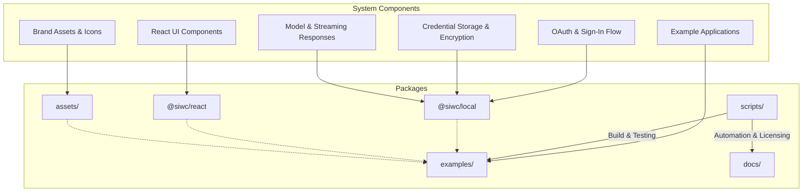

<!-- source: DeepWiki mcp.deepwiki.com · repo openai/sign-in-with-chatgpt-devkit · page 1 Overview · fetched 2026-10-26 -->

# Overview

<details>
<summary>Relevant source files</summary>

The following files were used as context for generating this wiki page:

- [LICENSE](LICENSE)
- [README.md](README.md)
- [examples/component-gallery/LICENSE](examples/component-gallery/LICENSE)
- [examples/paste-perfect/LICENSE](examples/paste-perfect/LICENSE)
- [package.json](package.json)

</details>


The **Sign in with ChatGPT DevKit** is a comprehensive development toolkit that enables developers to integrate ChatGPT account-based sign-in functionality into their applications. This integration allows users to authenticate using their existing ChatGPT account and opt to utilize their ChatGPT subscription plan to power AI features within the app, without requiring a separate API key. The DevKit targets open-source desktop applications running on the user's local machine, providing a seamless blend of authentication, usage monitoring, and UI components consistent with the ChatGPT ecosystem.

## Purpose and Scope

This DevKit is designed to simplify the development of apps that leverage Sign in with ChatGPT. It supplies:

- A local Node.js SDK for OAuth handling, session management, and ChatGPT API interactions.
- A React component library for UI elements such as sign-in buttons, connection cards, and usage indicators.
- Design assets including icons, branded buttons, and fonts to ensure branding consistency.
- Example applications to demonstrate common usage patterns and working integrations.
- Security-focused features and repo-wide tooling to streamline development and compliance.

This page provides a high-level overview of the monorepo structure, key components, and how they interoperate. For more detailed instructions and development practices, see the child pages such as [Getting Started](#1.1) and [Licensing and Contributing](#1.2).

---

## Monorepo Topology

The DevKit repository is organized as a monorepo using npm workspaces. It contains multiple logically separated packages and example applications along with shared assets and scripts. The main folders and their contents include:

| Folder                       | Contents                                                                                         |
|------------------------------|-------------------------------------------------------------------------------------------------|
| `packages/local`             | Local Node.js SDK with OAuth flows, credential storage, profile management, and response streaming. |
| `packages/react`             | React UI component library providing ready-to-use sign-in and usage components, plus styling.    |
| `assets`                    | Branded ChatGPT marks, icons, sign-in buttons, and font files for integration and UI theming.    |
| `examples/component-gallery` | A gallery app showcasing the React components with various design examples and usage scenarios.  |
| `examples/paste-perfect`     | A native macOS reference app combining a Swift helper, Electron main process, and React dashboard that demonstrates clipboard transformation with ChatGPT sign-in integration. |
| `scripts`                   | Automation scripts for license generation, dependency inventories, and other repo maintenance tasks. |
| `docs`                      | Developer documentation, including security, dependency inventory, and contributing guides.      |

This monorepo layout allows for independent versioning, building, and testing of each package while enabling coordinated releases and shared code between parts.

---

## How the Pieces Fit Together

At a high level, the DevKit packages and examples work together to provide a complete sign-in and AI usage experience:

### 1. Authentication and API Client (`@siwc/local`)

The `@siwc/local` package implements the OAuth 2.0 flow with PKCE, manages user sessions and profiles, handles token refresh and revocation, and wraps ChatGPT API calls. This Node.js SDK runs locally within your application's backend or electron main process to securely manage sign-in state and provide authenticated API requests.

### 2. React UI Components (`@siwc/react`)

The `@siwc/react` package exports React components such as `ContinueWithChatGPTButton`, `ChatGPTConnectionCard`, and usage indicators (`ChatGPTUsageIndicator`) that simplify embedding sign-in UI and plan usage controls in your application's renderer process. It includes styling files (`styles.css` and `tokens.css`) and supports theming aligned with ChatGPT branding.

### 3. Design Assets (`assets`)

Branding and design assets like SVG icons, sign-in button artwork, and fonts (e.g. Inter and Open Sans) are centrally maintained in the `assets` folder for consistent UI implementation. These assets adhere to the ChatGPT UI/UX guidelines ensuring a familiar user experience.

### 4. Example Applications (`examples`)

Two core example apps showcase the use of the SDK and components:

- **Paste Perfect** (`examples/paste-perfect`): A macOS native app that demonstrates clipboard text transformation based on user recipes with ChatGPT API calls, combining native Swift code, Electron main process orchestration, and React-based UI.

- **Component Gallery** (`examples/component-gallery`): An interactive React app displaying all UI components and design variants in a gallery format for rapid prototyping and visual testing.

### 5. Security and Tooling (`docs`, `scripts`)

Documentation provides deep dives into security topics like credential encryption and OAuth hardening. The `scripts` folder contains automation for third-party license generation and verification, ensuring compliance and repo hygiene.

---

## Diagram: Mapping System Names to Code Entities



**Sources:** `README.md:3-50`, `package.json:1-29`

---

## Diagram: Monorepo Folder Hierarchy and Role

```mermaid
graph TD
  Root["Root: sign-in-with-chatgpt-devkit/"]
  Packages["packages/"]
  Local["local/"]
  React["react/"]
  Examples["examples/"]
  Assets["assets/"]
  Scripts["scripts/"]
  Docs["docs/"]

  Root --> Packages
  Packages --> Local
  Packages --> React
  Root --> Examples
  Root --> Assets
  Root --> Scripts
  Root --> Docs

  Local[label="OAuth, credential storage,\nsession/profile model, streaming\n(@siwc/local)"]
  React[label="React components, styling, packaging\n(@siwc/react)"]
  Examples[label="Paste Perfect native macOS app\nComponent Gallery React app"]
  Assets[label="Brand assets: icons, buttons, fonts"]
  Scripts[label="License scripts,\nbuild and test automation"]
  Docs[label="Developer docs:\nsecurity, licensing, dependency inventory"]

  %% Packages content
  Local -->|Node.js SDK| "OAuth & Identity"
  React -->|UI Library| "React Sign-In + Usage Components"
  Examples -->|Demo Apps| "Paste Perfect & Component Gallery"
```

**Sources:** `README.md:22-48`, `package.json:6-9`

---

## Relationship Overview

- The **local Node.js SDK** (`@siwc/local`) is the core engine that manages authentication flows, token handling, and API interaction. It is intended for usage in the backend parts of your app or native hosts (e.g., Electron main process).

- The **React components** (`@siwc/react`) consume the SDK to render sign-in buttons, connection states, and usage indicators in the UI layer, typical in renderer processes or web fronts.

- The **example apps** demonstrate how to wire the SDK and components together effectively to achieve end-to-end solutions: authentication, usage display, and invoking ChatGPT-powered features.

- **Assets** and **docs** provide support for branding adherence, developer guidance, and security best practices.

- **Scripts** automate building, license compliance, and testing workflows across the monorepo.

Together, these parts enable a streamlined developer experience for embedding ChatGPT sign-in and usage monitoring within native and web applications.

---

## Links to Child Pages for More Details

- For developer setup instructions, environment requirements, and workspace commands, see [Getting Started](#1.1).

- For licensing terms, contribution workflows, third-party notices, and repo hygiene, see [Licensing and Contributing](#1.2).

---

**Sources:**  
`README.md:1-70`  
`package.json:1-29`

---

