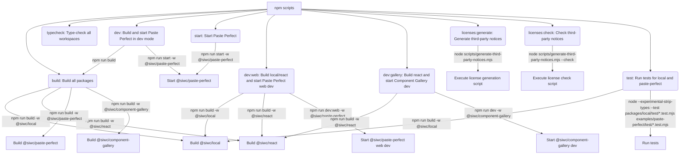

<!-- source: DeepWiki mcp.deepwiki.com · repo openai/sign-in-with-chatgpt-devkit · page 1.1 Getting Started · fetched 2026-10-26 -->

# 1.1. Getting Started

<details>
<summary>Relevant source files</summary>

The following files were used as context for generating this wiki page:

- [README.md](README.md)
- [package-lock.json](package-lock.json)
- [package.json](package.json)

</details>


This page provides instructions for setting up and running the Sign in with ChatGPT DevKit. It covers prerequisites, installation, build, and execution commands for the example applications, along with an overview of the workspace layout and available npm scripts.

## Prerequisites

To run the DevKit, ensure your system meets the following requirements:

*   **macOS 14 or later**: The `Paste Perfect` example application is a native macOS app [README.md:28]().
*   **Node.js 22.12 or later**: The project specifies `node: ">=22.12.0"` in its `package.json` [package.json:25-27]() and `package-lock.json` [package-lock.json:67-69]().
*   **Xcode Command Line Tools**: Required for building native components of the `Paste Perfect` example.

## Installation and Running the DevKit

Follow these steps to get the DevKit up and running:

1.  **Clone the repository**:
    ```sh
    git clone https://github.com/openai/sign-in-with-chatgpt-devkit.git
    cd sign-in-with-chatgpt-devkit
    ```
2.  **Install dependencies**: This command installs all project dependencies defined in `package.json` and `package-lock.json` across all workspaces.
    ```sh
    npm ci
    ```
3.  **Build the project**: This command builds all necessary packages, including `@siwc/local`, `@siwc/react`, `@siwc/paste-perfect`, and `@siwc/component-gallery` [package.json:11]().
    ```sh
    npm run build
    ```
4.  **Start the Paste Perfect example app**: This command launches the `Paste Perfect` application [package.json:14]().
    ```sh
    npm start
    ```

Once `Paste Perfect` is running, you can:
1.  Sign in with ChatGPT from its dashboard.
2.  Enable native paste and grant Accessibility access to the native helper.
3.  Copy text, focus an editable field in another app, press **⌘⇧Space**, then right-click within eight seconds.
4.  Choose a transformation option (e.g., Spreadsheet, Message, Translate, Checklist, Clean up, or a saved recipe).
The transformed text will be pasted into the destination app [README.md:42-47]().

Sources:
*   [README.md:32-47]()
*   [package.json:11]()
*   [package.json:14]()
*   [package.json:25-27]()
*   [package-lock.json:67-69]()

## Component Gallery

The DevKit includes a component gallery for previewing and testing the `@siwc/react` components.

To run the component gallery:

1.  Ensure dependencies are installed (`npm ci`) and the `@siwc/react` package is built (`npm run build -w @siwc/react`).
2.  Execute the following command:
    ```sh
    npm run dev:gallery
    ```
    This command builds the `@siwc/react` package and then starts the development server for the `@siwc/component-gallery` example [package.json:16]().
3.  Open the local URL printed in your terminal to view the gallery [README.md:59]().

The gallery allows you to try out designs with your app's name and layout, check connection states, and place usage indicators [README.md:51-52]().

Sources:
*   [README.md:51-52]()
*   [README.md:59]()
*   [package.json:16]()

## Workspace Layout

The DevKit is structured as a monorepo using npm workspaces [package.json:6-9](). This organizes the codebase into several distinct packages and examples:

```mermaid
graph TD
    A[sign-in-with-chatgpt-devkit] --> B(packages/)
    A --> C(examples/)
    A --> D(assets/)
    A --> E(scripts/)
    A --> F(docs/)

    B --> B1(@siwc/local)
    B --> B2(@siwc/react)

    C --> C1(component-gallery)
    C --> C2(paste-perfect)

    subgraph packages
        B1["packages/local: Node.js SDK"]
        B2["packages/react: React components"]
    end

    subgraph examples
        C1["examples/component-gallery: UI preview"]
        C2["examples/paste-perfect: macOS example app"]
    end

    D["assets/: Brand assets, icons, fonts"]
    E["scripts/: Automation scripts"]
    F["docs/: Documentation"]
```
**Diagram 1: DevKit Monorepo Structure**

*   `packages/local`: Contains the local Node.js SDK for OAuth, credential storage, account profiles, model discovery, and streaming responses [README.md:24]().
*   `packages/react`: Provides React components for sign-in, connection status, and ChatGPT plan usage [README.md:25]().
*   `assets`: Stores ChatGPT marks, icons, sign-in buttons, and fonts [README.md:26]().
*   `examples/component-gallery`: A design example application for sign-in, account connections, and ChatGPT plan usage controls [README.md:27]().
*   `examples/paste-perfect`: An example native macOS app demonstrating Sign in with ChatGPT integration, featuring an Electron settings dashboard [README.md:28]().

Sources:
*   [README.md:24-28]()
*   [package.json:6-9]()

## npm Scripts

The root `package.json` defines several npm scripts to streamline development and build processes:


**Diagram 2: Root npm Scripts and Their Actions**

*   `build`: Executes the `build` script for `@siwc/local`, `@siwc/react`, `@siwc/paste-perfect`, and `@siwc/component-gallery` workspaces [package.json:11]().
*   `typecheck`: Runs `typecheck` in all workspaces where it's defined [package.json:12]().
*   `dev`: First runs the `build` script, then starts the `@siwc/paste-perfect` application in development mode [package.json:13]().
*   `start`: Starts the `@siwc/paste-perfect` application [package.json:14]().
*   `dev:web`: Builds `@siwc/local` and `@siwc/react`, then starts the web development server for `@siwc/paste-perfect` [package.json:15]().
*   `dev:gallery`: Builds `@siwc/react` and then starts the development server for the `@siwc/component-gallery` [package.json:16]().
*   `licenses:generate`: Executes the `generate-third-party-notices.mjs` script to generate license information [package.json:17]().
*   `licenses:check`: Executes the `generate-third-party-notices.mjs` script with the `--check` flag to verify license information [package.json:18]().
*   `test`: Builds `@siwc/local` and then runs tests for `packages/local` and `examples/paste-perfect` [package.json:19]().

Sources:
*   [package.json:10-20]()

---

