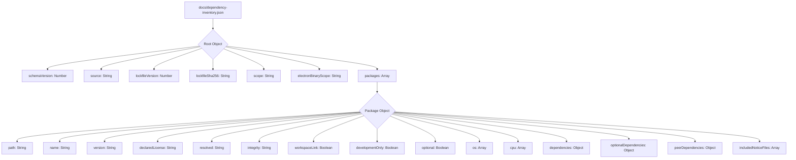
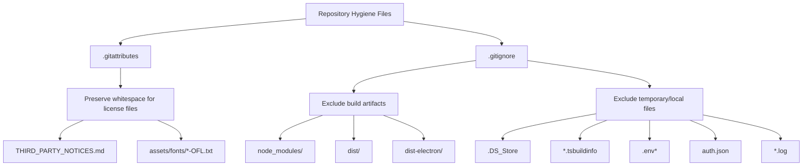

<!-- source: DeepWiki mcp.deepwiki.com · repo openai/sign-in-with-chatgpt-devkit · page 1.2 Licensing and Contributing · fetched 2026-10-26 -->

# Licensing and Contributing

Relevant source files

The following files were used as context for generating this wiki page:

- [.gitattributes](.gitattributes)
- [.gitignore](.gitignore)
- [CONTRIBUTING.md](CONTRIBUTING.md)
- [LICENSE](LICENSE)
- [THIRD_PARTY_NOTICES.md](THIRD_PARTY_NOTICES.md)
- [docs/dependency-inventory.json](docs/dependency-inventory.json)
- [examples/component-gallery/LICENSE](examples/component-gallery/LICENSE)
- [examples/paste-perfect/LICENSE](examples/paste-perfect/LICENSE)

This page details the licensing terms for the Sign-in with ChatGPT DevKit, including its noncommercial use restrictions, third-party notices, and a comprehensive dependency inventory. It also outlines the contribution workflow and the purpose of repository hygiene files.

## Noncommercial License Terms

The Sign-in with ChatGPT DevKit is distributed under a specific Noncommercial License, Version 1.0 [LICENSE:1-54](). This license explicitly defines "Noncommercial Purpose" as personal learning, experimentation, or development without an intended or reasonably anticipated commercial application [LICENSE:16-17](). It strictly excludes development, testing, distribution, or operation of a product or service by or for a business, employer, or client for commercial advantage [LICENSE:16-17]().

Under this license, contributors grant a perpetual, worldwide, nonexclusive, no-charge, royalty-free license to use, reproduce, modify, publicly display, publicly perform, and distribute their contributions, including in Modified Works, solely for Noncommercial Purposes [LICENSE:19-22](). The license explicitly states that it grants no commercial-use rights in any contribution, and commercial use of OpenAI's contribution requires a separate written agreement [LICENSE:22-23]().

Redistribution of the Work or Modified Work is permitted only for a Noncommercial Purpose, provided recipients receive a copy of the license, changed files are marked, applicable notices are preserved, and all modifications are licensed under the same terms [LICENSE:33-43](). The license also clarifies that it grants no rights to OpenAI names, trademarks, logos, or branded visual assets, nor does it grant access to ChatGPT, the OpenAI API, or any other OpenAI service [LICENSE:46-49]().

Sources:
- [LICENSE:1-54]()
- [examples/component-gallery/LICENSE:1-54]()
- [examples/paste-perfect/LICENSE:1-54]()

## Third-Party Notices

Third-party notices are compiled into `THIRD_PARTY_NOTICES.md` [THIRD_PARTY_NOTICES.md:1-2926](). This file is generated by the `scripts/generate-third-party-notices.mjs` script [THIRD_PARTY_NOTICES.md:3](). It includes full top-level license and notice text for the runtime npm dependency closure, Vite, the Electron npm package, and bundled fonts [THIRD_PARTY_NOTICES.md:5]().

The `THIRD_PARTY_NOTICES.md` file also contains specific details regarding the Electron distribution scope. It clarifies that the MIT license of the Electron npm package does not cover all code in an Electron/Chromium binary, and advises retaining the license files shipped with the exact Electron distribution (e.g., `LICENSE` and `LICENSES.chromium.html`) before distributing a desktop binary [THIRD_PARTY_NOTICES.md:11-14]().

The `THIRD_PARTY_NOTICES.md` file also notes that the Inter and Open Sans fonts remain under SIL OFL 1.1, and their provenance (SHA-256 hashes, download dates, internal versions, and license sources) is pinned to a Google Fonts Git commit [THIRD_PARTY_NOTICES.md:6-8]().

Sources:
- [THIRD_PARTY_NOTICES.md:1-2926]()

## Dependency Inventory

A comprehensive dependency inventory is maintained in `docs/dependency-inventory.json` [docs/dependency-inventory.json:1-3097](). This JSON file provides a detailed record of all lockfile entries, including development tools and platform-specific optional dependencies [docs/dependency-inventory.json:6]().

The inventory includes:
*   `schemaVersion`: The version of the schema used [docs/dependency-inventory.json:2]().
*   `source`: Indicates that the data is sourced from `package-lock.json` [docs/dependency-inventory.json:3]().
*   `lockfileVersion`: The version of the lockfile [docs/dependency-inventory.json:4]().
*   `lockfileSha256`: A SHA-256 hash of the lockfile [docs/dependency-inventory.json:5]().
*   `scope`: A description of the inventory's coverage [docs/dependency-inventory.json:6]().
*   `electronBinaryScope`: Specific notes regarding the Electron npm package license and its limitations for binary distributions [docs/dependency-inventory.json:7]().
*   `packages`: An array of objects, each representing a package. Each package entry includes:
    *   `path`: The path to the package within the monorepo or `node_modules` [docs/dependency-inventory.json:10]().
    *   `name`: The package name [docs/dependency-inventory.json:11]().
    *   `version`: The package version [docs/dependency-inventory.json:12]().
    *   `declaredLicense`: The license declared by the package [docs/dependency-inventory.json:13]().
    *   `resolved`: The URL from which the package was resolved [docs/dependency-inventory.json:14]().
    *   `integrity`: The integrity hash of the package [docs/dependency-inventory.json:15]().
    *   `workspaceLink`: Indicates if it's a workspace link [docs/dependency-inventory.json:16]().
    *   `developmentOnly`: Indicates if the package is for development only [docs/dependency-inventory.json:17]().
    *   `optional`: Indicates if the package is optional [docs/dependency-inventory.json:18]().
    *   `os`: Supported operating systems [docs/dependency-inventory.json:19]().
    *   `cpu`: Supported CPU architectures [docs/dependency-inventory.json:20]().
    *   `dependencies`: A list of direct dependencies [docs/dependency-inventory.json:21]().
    *   `optionalDependencies`: A list of optional dependencies [docs/dependency-inventory.json:22]().
    *   `peerDependencies`: A list of peer dependencies [docs/dependency-inventory.json:23]().
    *   `includedNoticeFiles`: A list of included notice files [docs/dependency-inventory.json:24]().

### Dependency Inventory Structure

Sources:
- [docs/dependency-inventory.json:1-3097]()

## Contribution Workflow

The repository explicitly states that it does not accept external pull requests or code contributions [CONTRIBUTING.md:3]().

Sources:
- [CONTRIBUTING.md:1-3]()

## Repository Hygiene Files

Several files are maintained in the repository for hygiene and consistency:

*   `.gitattributes`: This file is used to define attributes for paths in the repository. Specifically, it ensures that the `THIRD_PARTY_NOTICES.md` file and font license files (`assets/fonts/*-OFL.txt`) preserve their whitespace [.gitattributes:2-3](). This is crucial for maintaining the integrity of license texts.
*   `.gitignore`: This file specifies intentionally untracked files that Git should ignore. It includes common build artifacts (`node_modules/`, `dist/`, `dist-electron/`), macOS-specific files (`.DS_Store`), TypeScript build info (`*.tsbuildinfo`), environment files (`.env`, `.env.*`, `!.env.example`), authentication-related files (`auth.json`, `chatgpt-auth*.json`, `chatgpt-host*.json`, `.chatgpt-auth*`), preferences (`preferences.json`), log files (`*.log`), and specific build outputs for examples (`examples/component-gallery/public/references/`) [.gitignore:1-16]().

### Repository Hygiene File Purpose

Sources:
- [.gitattributes:1-3]()
- [.gitignore:1-16]()

---

