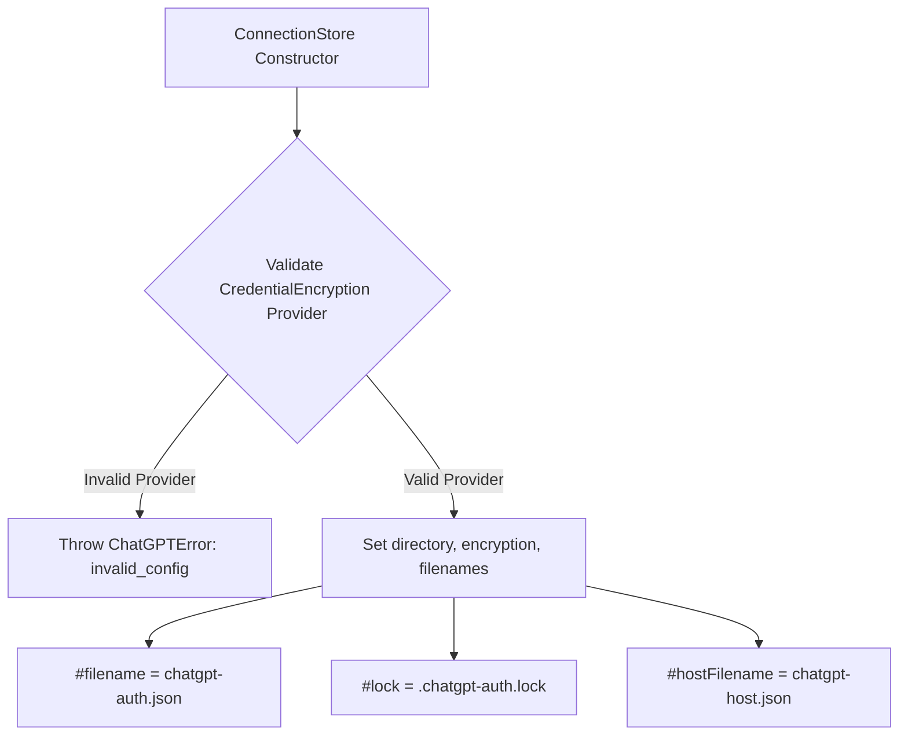

<!-- source: DeepWiki mcp.deepwiki.com · repo openai/sign-in-with-chatgpt-devkit · page 2.2 Credential Storage and Encryption · fetched 2026-10-26 -->

# Credential Storage and Encryption

<details>
<summary>Relevant source files</summary>

The following files were used as context for generating this wiki page:

- [docs/security.md](docs/security.md)
- [packages/local/src/storage.ts](packages/local/src/storage.ts)
- [packages/local/test/storage.test.mjs](packages/local/test/storage.test.mjs)

</details>


This page details the mechanisms for secure credential storage within the `@siwc/local` Node.js SDK. It covers the `ConnectionStore` class, the `CredentialEncryption` provider contract, atomic file operations, handling of pending refresh states, and the migration process for legacy plaintext credentials. The primary goal is to ensure that sensitive user data, such as access tokens and ID tokens, is stored securely and protected against unauthorized access.

## ConnectionStore

The `ConnectionStore` class [packages/local/src/storage.ts:77-77]() is responsible for managing the persistent storage of ChatGPT connection profiles and related state. It ensures that credentials are encrypted at rest and that file operations are atomic and secure.

### Core Responsibilities

*   **Secure Directory Management**: The `ConnectionStore` ensures that its storage directory is created with appropriate permissions (`0o700` on Unix-like systems) and verifies that it is not a symbolic link and belongs to the current user [packages/local/src/storage.ts:97-106](). This prevents unauthorized access or manipulation of the stored data.
*   **Interprocess Locking**: All read and write operations on the credential store are protected by an interprocess lock [packages/local/src/storage.ts:109-110](). This prevents race conditions and data corruption when multiple processes or threads attempt to access the store simultaneously. The lock file is located at `.chatgpt-auth.lock` within the storage directory [packages/local/src/storage.ts:93-93]().
*   **Atomic File Operations**: When writing encrypted data, the `ConnectionStore` uses atomic file replacement [docs/security.md:9-9](). This involves writing to a temporary file and then renaming it, ensuring that the main credential file is always in a consistent state, even if a write operation is interrupted.
*   **Credential Encryption**: The store relies on an application-supplied `CredentialEncryption` provider to encrypt and decrypt sensitive data. There is no plaintext fallback [docs/security.md:5-5]().
*   **Host Identifier Storage**: A separate file, `chatgpt-host.json`, stores a non-secret runtime identifier [docs/security.md:9-9](). This file is not encrypted.

### Data Structure

The `ConnectionStore` manages two primary types of data:

*   **`StoredConnection`**: Represents a single ChatGPT connection profile, including its status, scopes, saved timestamp, identity information, and credentials (access token, refresh token, expiry) [packages/local/src/storage.ts:17-50]().
*   **`StoredState`**: Represents the overall state of the stored profiles, including a list of `StoredConnection` objects, pending registrations, and the active profile ID [packages/local/src/storage.ts:54-74]().

### ConnectionStore Initialization


**Diagram: ConnectionStore Initialization Flow**

The `ConnectionStore` constructor takes a `directory` path and a `CredentialEncryption` instance [packages/local/src/storage.ts:85-85](). It performs strict validation on the provided `CredentialEncryption` object, ensuring it has a valid `id`, `isAvailable`, `encrypt`, and `decrypt` methods [packages/local/src/storage.ts:86-89](). If the provider is invalid, it throws a `ChatGPTError` with code `invalid_config` [packages/local/src/storage.ts:88-89]().

Sources:
* [packages/local/src/storage.ts:77-95]()
* [docs/security.md:5-5]()

## CredentialEncryption Provider Contract

The `CredentialEncryption` interface defines the contract for an application-supplied encryption provider [docs/security.md:7-7](). This provider is crucial for securing sensitive credentials at rest.

### Interface Definition

```typescript
interface CredentialEncryption {
  id: string;
  isAvailable: () => boolean;
  encrypt: (plaintext: string) => Buffer | Promise<Buffer>;
  decrypt: (ciphertext: Buffer) => string | Promise<string>;
}
```

*   **`id`**: A unique string identifier for the encryption provider [packages/local/src/storage.ts:86-86](). This ID is stored alongside the encrypted data to identify which provider was used for encryption [packages/local/src/storage.ts:86-86]().
*   **`isAvailable()`**: A method that returns `true` if the encryption provider is currently available and ready to perform encryption/decryption operations [packages/local/src/storage.ts:87-87](). If `false`, operations requiring encryption will fail [packages/local/src/storage.ts:111-117]().
*   **`encrypt(plaintext: string)`**: Takes a plaintext string and returns a `Buffer` containing the encrypted data [packages/local/src/storage.ts:87-87]().
*   **`decrypt(ciphertext: Buffer)`**: Takes a `Buffer` containing ciphertext and returns the original plaintext string [packages/local/src/storage.ts:87-87]().

### Example Implementation (Test)

The test suite provides a basic `encryption` function that implements the `CredentialEncryption` interface using AES-256-GCM for ephemeral, authenticated encryption [packages/local/test/storage.test.mjs:11-30](). This is for testing purposes and not intended for production use.

```mermaid
graph TD
    A[Application] --> B{createChatGPT(config)};
    B --> C{config.credentialEncryption};
    C -- "Must implement" --> D[CredentialEncryption Interface];
    D --> D1{id: string};
    D --> D2{isAvailable(): boolean};
    D --> D3{encrypt(plaintext): Buffer};
    D --> D4{decrypt(ciphertext): string};
    D1 -- "Example: 'test-aes-gcm'" --> E[Test Encryption Provider];
    D2 -- "Example: () => true" --> E;
    D3 -- "Example: AES-256-GCM" --> E;
    D4 -- "Example: AES-256-GCM" --> E;
```
**Diagram: CredentialEncryption Provider Contract**

Sources:
* [docs/security.md:7-7]()
* [packages/local/src/storage.ts:86-87]()
* [packages/local/test/storage.test.mjs:11-30]()

## Locking and Atomic Writes

The `ConnectionStore` employs robust mechanisms to ensure data integrity and prevent corruption, especially in environments where multiple processes might try to access the credential file.

### Interprocess Locking

The `withLock` method [packages/local/src/storage.ts:109-110]() is the primary entry point for any operation that reads or modifies the stored state. It acquires an interprocess lock using the `proper-lockfile` library [packages/local/src/storage.ts:6-6](). This lock prevents concurrent access to the `chatgpt-auth.json` file, ensuring that only one process can operate on it at a time.

```mermaid
graph TD
    A[Application Call] --> B{ConnectionStore.withLock(operation)};
    B --> C[Acquire Interprocess Lock];
    C -- "Lock Acquired" --> D[Execute operation()];
    D -- "Operation Complete" --> E[Release Lock];
    C -- "Lock Unavailable" --> F[Wait or Throw Error];
```
**Diagram: Interprocess Locking with `withLock`**

### Atomic File Replacement

When writing data to `chatgpt-auth.json`, the `ConnectionStore` uses an atomic write strategy [docs/security.md:9-9](). This involves:

1.  Writing the new, encrypted content to a temporary file.
2.  Ensuring the temporary file has the correct permissions.
3.  Atomically renaming the temporary file to replace the original `chatgpt-auth.json`.

This approach guarantees that the credential file is never in a partially written or corrupted state. If the write operation fails at any point before the rename, the original file remains intact [packages/local/test/storage.test.mjs:129-135]().

Sources:
* [packages/local/src/storage.ts:6-6]()
* [packages/local/src/storage.ts:109-110]()
* [packages/local/test/storage.test.mjs:129-135]()
* [docs/security.md:9-9]()

## Pending Refresh State

The SDK handles token refreshes carefully to maintain security and resilience, especially in scenarios where the identity verification service might be temporarily unavailable.

When a refresh operation returns new credentials (access token, refresh token, ID token), the SDK does not immediately make them active. Instead, it saves these new credentials in an encrypted "pending refresh" state [docs/security.md:11-11](). This state includes the new ID token, received timestamp, scopes, and credentials [packages/local/src/storage.ts:38-47]().

The `pendingRefresh` state is validated to ensure its integrity [packages/local/src/storage.ts:38-50](). These pending credentials become usable only after the new ID token has been successfully verified [docs/security.md:11-11](). If verification fails or the signing-key service is unavailable, the SDK continues to use the old, still-valid credentials (if any) or returns a retryable error [docs/security.md:11-11](). This prevents the use of unverified or potentially compromised credentials.

This mechanism also allows for recovery across application restarts. If the application restarts while credentials are in a pending refresh state, the SDK can resume verification from this saved state without reusing the consumed refresh token [docs/security.md:11-11]().

Sources:
* [packages/local/src/storage.ts:38-50]()
* [docs/security.md:11-11]()

## Legacy Plaintext Migration

The `ConnectionStore` supports in-place migration of older plaintext credential files to the current encrypted format [docs/security.md:13-13](). This ensures backward compatibility while enforcing modern security standards.

### Migration Process

1.  **Detection**: When the `ConnectionStore` attempts to read the `chatgpt-auth.json` file, it first checks if the file is in a legacy plaintext format (versions 1 or 2) [packages/local/test/storage.test.mjs:87-101]().
2.  **Decryption (Implicit)**: If the file is plaintext, it's parsed directly.
3.  **Encryption and Atomic Write**: The parsed plaintext data is then encrypted using the configured `CredentialEncryption` provider and written back to `chatgpt-auth.json` using the atomic file replacement mechanism [packages/local/test/storage.test.mjs:93-94](). This overwrites the plaintext file with its encrypted equivalent.
4.  **No Plaintext Backup**: The migration process does not create a plaintext backup [docs/security.md:13-13]().
5.  **Error Handling**: If encryption is unavailable, the provider does not match, or the saved state cannot be decrypted or validated during migration, the SDK preserves the original file and returns an error [docs/security.md:13-13](). This prevents data loss in case of encryption failures.

```mermaid
graph TD
    A[Read chatgpt-auth.json] --> B{Is file encrypted (version 3)?};
    B -- "Yes" --> C[Decrypt with CredentialEncryption];
    B -- "No (Legacy v1/v2)" --> D[Parse Plaintext];
    D --> E[Encrypt with CredentialEncryption];
    E --> F[Atomic Write to chatgpt-auth.json];
    F -- "Success" --> G[Return Decrypted State];
    F -- "Failure (e.g., encryption unavailable)" --> H[Preserve Original File, Return Error];
```
**Diagram: Legacy Plaintext Migration Flow**

Sources:
* [docs/security.md:13-13]()
* [packages/local/test/storage.test.mjs:87-101]()

---

