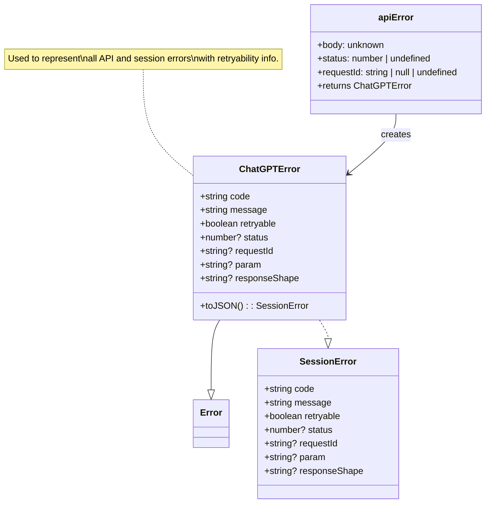

<!-- source: DeepWiki mcp.deepwiki.com · repo openai/sign-in-with-chatgpt-devkit · page 2.4 Error Model and Types · fetched 2026-10-26 -->

# Error Model and Types

<details>
<summary>Relevant source files</summary>

The following files were used as context for generating this wiki page:

- [packages/local/src/errors.ts](packages/local/src/errors.ts)
- [packages/local/src/types.ts](packages/local/src/types.ts)
- [packages/local/test/errors.test.mjs](packages/local/test/errors.test.mjs)
- [packages/local/tsconfig.json](packages/local/tsconfig.json)

</details>


This section documents the error handling model, core error types, retry and reauthentication semantics, and TypeScript types related to errors in the `@siwc/local` Node.js SDK package of the Sign in with ChatGPT DevKit. It also covers the build configuration aspects and the tests ensuring robust error behavior.

---

## 1. Overview

The error model in the DevKit centers around the `ChatGPTError` class, which implements the `SessionError` interface. Errors surfaced during session operations, API calls, or authentication flows are represented as `ChatGPTError` instances. The error model distinguishes between retryable errors (transient, safe to retry) and those requiring reauthentication (such as token expiration or invalid credentials).

Key points:
- `ChatGPTError` encapsulates an error code, human-readable message, retryability flag, and optional diagnostic metadata such as HTTP status, request ID, related parameter, and error response shape.
- There is a defined set of known API error codes (e.g., token sharing errors, invalid grants, expired refresh tokens) each with default messages and retry semantics.
- Legacy error codes are mapped internally to current ones to preserve backward compatibility.
- Request validation errors are processed to show context-sensitive messages based on the failing request parameter.
- The TypeScript types, defined in `types.ts`, export session error and state types to describe and enforce error handling contracts.
- Tests simulate error scenarios including cancellation, malformed API responses, and HTTP failures, validating error codes, diagnostics, and retry behavior.

Sources: `packages/local/src/errors.ts:1-126`(), `packages/local/src/types.ts:6-14`(), `packages/local/test/errors.test.mjs:1-61`()

---

## 2. The `ChatGPTError` Class

The `ChatGPTError` is a specialized error extending the native `Error` class and implements the `SessionError` interface. It enriches the error information with:

- `code: string` — a machine-readable error identifier.
- `retryable: boolean` — signals whether the error is transient and safe to retry.
- `status?: number` — optional HTTP status code from the API response.
- `requestId?: string` — opaque request tracing ID from API headers.
- `param?: string` — related request parameter involved in the error.
- `responseShape?: string` — a summary string describing the shape of the error response body for diagnostics.

### Constructor and Properties

```typescript
constructor(
  code: string,
  message: string,
  retryable = false,
  status?: number,
  diagnostics: ErrorDiagnostics = {}
)
```

- `retryable` defaults to `false` unless explicitly stated.
- Diagnostic fields (`requestId`, `param`, `responseShape`) are optional but helpful for debugging.

### Method: `toJSON()`

Returns a plain object adhering to `SessionError`, stripping sensitive data and allowing safe serialization for UI or IPC:

```typescript
toJSON(): SessionError {
  return {
    code: this.code,
    message: this.message,
    retryable: this.retryable,
    ...(this.status !== undefined ? { status: this.status } : {}),
    ...(this.requestId !== undefined ? { requestId: this.requestId } : {}),
    ...(this.param !== undefined ? { param: this.param } : {}),
    ...(this.responseShape !== undefined ? { responseShape: this.responseShape } : {}),
  };
}
```

Sources: `packages/local/src/errors.ts:9-38`()

---

## 3. Known API Error Codes and Semantics

The error codes recognized by the SDK include those related to subscription sharing, token validity, OAuth grant and client errors, permission denials, and specific ChatGPT model availability. Each code maps to a default error message and a retry flag, for example:

| Error Code                            | Message                                                                                 | Retryable |
|-------------------------------------|-----------------------------------------------------------------------------------------|-----------|
| `subscription_sharing_user_not_eligible`  | Token sharing is not available for this ChatGPT account or workspace.                   | false     |
| `subscription_sharing_usage_limit_exceeded` | ChatGPT sharing limit reached. Check usage and app limits.                            | false     |
| `subscription_sharing_usage_unavailable`   | ChatGPT usage could not be checked. Try again shortly.                                | true      |
| `invalid_refresh_token`               | Your ChatGPT connection can no longer be renewed. Sign in again.                      | false     |
| `token_expired`                      | Your ChatGPT connection can no longer be renewed. Sign in again.                      | false     |
| `chatpass_v2_scope_not_authorized`  | ChatGPT permissions do not authorize this request. Check app and grant configuration.  | false     |
| `model_not_found`                    | The requested model is not available. Choose a supported model.                        | false     |

This mapping supports consistent UI feedback and guides decision making on whether to retry a request or prompt user reauthentication.

Legacy error codes are normalized to their newer counterparts internally to maintain compatibility.

Sources: `packages/local/src/errors.ts:41-62`(), `packages/local/src/errors.ts:65-70`()

---

## 4. Request Validation and Error Response Shape

To provide detailed error messages from ChatGPT API validation failures, the SDK analyzes error details to identify which request field caused rejection. Recognized fields include `input`, `model`, `instructions`, `store`, `stream`, `tools`, `background`, and `conversation`.

A helper function, `invalidRequest`, examines reported error locations and types, returning user-friendly messages:

- If the `input` parameter fails with a list type error, it signals that input must be a list of messages.
- Otherwise, it identifies the particular field and indicates to check the request format and supported values.
- Generic fallback: "ChatGPT rejected this request."

The helper function `shapeOf` produces a diagnostic string representing the shape of the error response JSON, useful for debugging unexpected error payloads.

Sources: `packages/local/src/errors.ts:72-116`()

---

## 5. Error Processing Workflow

The main error construction occurs in `apiError(body, status?, requestId?)`, which:

1. Extracts the nested error or detail object from responses (unwrapping multiple levels).
2. Resolves the error code string or falls back to a generic `api_error`.
3. Checks against a known error list to assign default messages and retry flags.
4. Detects legacy codes and maps them to current equivalents.
5. Generates a `ChatGPTError` including diagnostic info like status and request ID.
6. If error code is unrecognized and response is malformed, marks as retryable to allow transient failure recovery.

This workflow allows robust handling of a variety of API errors and malformed responses.

### Mermaid Diagram: Error Model Entity Mapping



Sources: `packages/local/src/errors.ts:103-126`()

---

## 6. Exported TypeScript Types Related to Errors

The error model integrates deeply with TypeScript types that define session and error behavior in the SDK. Key types include:

- `SessionError`: Interface defining error data passed throughout the SDK and exposed for UI/IPC. Matches the `toJSON()` output of `ChatGPTError`.
- `SessionState`: Represents the sign-in session state, including a possible `error` property of type `SessionError`.
- `LoginProfile`: Represents an OAuth login profile with status and error-induced states like `"reauth_required"`.
- `ChatGPTClient`: Exposes methods like `signIn()`, `getSession()`, and `listProfiles()` which surface `SessionState` with error info.

These types are declared in `packages/local/src/types.ts` and provide strict contracts for error propagation.

### Selected TypeScript Type Example

```typescript
export interface SessionError {
  code: string;
  message: string;
  retryable: boolean;
  status?: number;
  requestId?: string;
  param?: string;
  responseShape?: string;
}

export interface SessionState {
  status: "disconnected" | "connecting" | "connected" | "reauth_required";
  sharing: boolean;
  profileId?: string;
  profileLabel?: string;
  identity?: SessionIdentity;
  error?: SessionError;
}
```

Sources: `packages/local/src/types.ts:6-24`()

---

## 7. Build Configuration for TypeScript and Testing

The `@siwc/local` package uses a dedicated TypeScript configuration (`tsconfig.json`) specifying:

- Extends from the workspace base config.
- Root directory set to `src`.
- Output directory `dist`.
- Included types: `node`.
- Enables declaration files, declaration maps, and source maps for rich IDE support.

### `tsconfig.json` Highlights

```json
{
  "extends": "../../tsconfig.base.json",
  "compilerOptions": {
    "types": ["node"],
    "rootDir": "src",
    "outDir": "dist",
    "declaration": true,
    "declarationMap": true,
    "sourceMap": true
  },
  "include": ["src/**/*.ts"]
}
```

### Tests for Error Handling

The test suite (`errors.test.mjs`) includes:

- Simulated cancellations (`AbortError`, `TimeoutError`) during JSON responses, ensuring these remain cancellation errors rather than turning into API errors.
- Testing malformed JSON responses produce `invalid_response` errors with retryable flags.
- Verification that HTTP failure codes and malformed bodies yield `api_error` with correct diagnostics.
- Confirmations that well-formed JSON responses pass through without throwing.

These tests are critical for robust error behavior especially in network-bound scenarios.

Sources: `packages/local/tsconfig.json`(), `packages/local/test/errors.test.mjs:1-61`()

---

## 8. Diagram: From Natural Language Concepts to Code Entities

```mermaid
flowchart TB
  subgraph "Natural Language"
    NL1["Retryable Error"]
    NL2["Reauth Required Error"]
    NL3["API Response Error Code"]
    NL4["Error Message for User"]
    NL5["Session State Error Property"]
  end

  subgraph "Code Entities"
    CE1["ChatGPTError class"]
    CE2["apiError() factory"]
    CE3["SessionError interface"]
    CE4["SessionState.type with error?: SessionError"]
    CE5["Known API error code map (API_ERRORS)"]
  end

  NL1 --> CE1
  NL2 --> CE1
  NL3 --> CE2
  NL4 --> CE1
  NL5 --> CE4
  CE2 --> CE1
  CE1 ..> CE3
  CE4 ..> CE3
  CE2 -- looks up --> CE5
```

This diagram maps how user-facing notions of errors correspond to code artifacts: errors from API responses are decoded by `apiError()`, instantiated as `ChatGPTError`s carrying retry and reauth flags, linked with `SessionError` type properties surfaced on session state.

---

# Summary

The error model in the Sign in with ChatGPT DevKit’s local SDK provides a structured, extensible way to capture and relay errors with rich metadata, guiding application flow control around retries or user reauthentication. The TypeScript typing ensures consistency and safe transmission of error data, and the comprehensive test coverage secures reliability in API and network error conditions.

This detailed error modeling enables higher-level components and UIs to respond appropriately, showing meaningful messages and acting according to error semantics, thus enhancing user and developer experience.

---

# References

- `packages/local/src/errors.ts:1-126`()
- `packages/local/src/types.ts:6-24`()
- `packages/local/test/errors.test.mjs:1-61`()
- `packages/local/tsconfig.json`()

---

