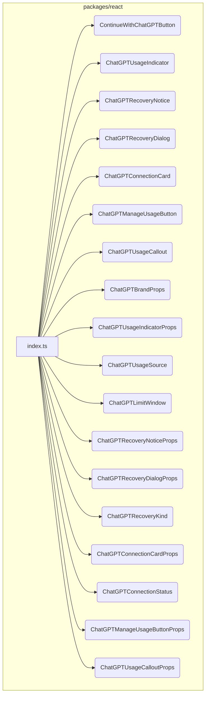
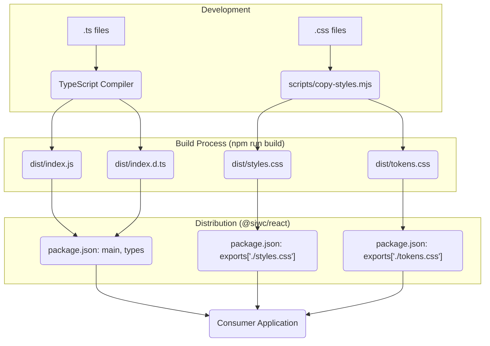

<!-- source: DeepWiki mcp.deepwiki.com · repo openai/sign-in-with-chatgpt-devkit · page 3 @siwc/react — Component Library · fetched 2026-10-26 -->

# @siwc/react — Component Library

Relevant source files

The following files were used as context for generating this wiki page:

- [packages/react/package.json](packages/react/package.json)
- [packages/react/src/index.ts](packages/react/src/index.ts)

The `@siwc/react` package provides a set of React components designed to integrate "Sign in with ChatGPT" functionality into web applications. This page offers a high-level overview of the package's structure, its exported components, styling strategy, and packaging. Detailed information on specific component families, styling, and distribution can be found in the linked child pages.

Sources:
- [packages/react/package.json:1-22]()
- [packages/react/src/index.ts:1-11]()

## Exported Components

The `@siwc/react` package exports a collection of React components and their associated TypeScript types, facilitating the integration of ChatGPT sign-in, connection management, and usage display within a React application. These components are categorized into sign-in/connection and usage-related functionalities.

The primary entry point for consuming these components is `packages/react/src/index.ts` [packages/react/src/index.ts:1-11]().

### Diagram: `@siwc/react` Component Exports

Sources:
- [packages/react/src/index.ts:1-11]()

### Sign-In and Connection Components

This category includes components for initiating the sign-in process and displaying the current connection status. These components handle various states, including successful connections and recovery scenarios.

For details, see [Sign-In and Connection Components](#3.1).

Sources:
- [packages/react/src/index.ts:1-2]()
- [packages/react/src/index.ts:5-8]()

### Usage Components

These components are designed to display information about ChatGPT usage, such as current limits and consumption. They also provide mechanisms for users to manage their usage settings.

For details, see [Usage Components](#3.2).

Sources:
- [packages/react/src/index.ts:3-4]()
- [packages/react/src/index.ts:10-11]()

## Styling Strategy and Packaging

The `@siwc/react` package employs a specific strategy for styling its components, utilizing CSS files for both core styles and design tokens. The build process ensures these styles are correctly packaged and made available for consumption by applications.

The `package.json` [packages/react/package.json:10-14]() defines the main entry points for JavaScript and TypeScript types, as well as explicit exports for `styles.css` and `tokens.css`. The `build` script [packages/react/package.json:17]() compiles TypeScript and then copies the necessary style files.

For details, see [Styling, Tokens and Packaging](#3.3).

Sources:
- [packages/react/package.json:10-14]()
- [packages/react/package.json:17]()

### Diagram: `@siwc/react` Build and Packaging

Sources:
- [packages/react/package.json:7-14]()
- [packages/react/package.json:17]()

---

