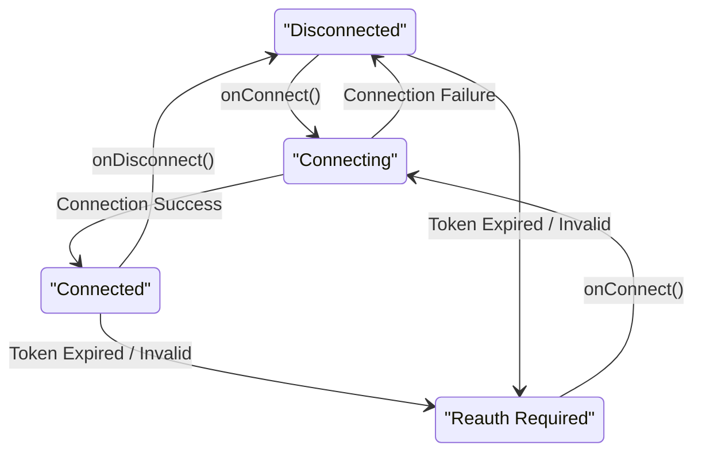

<!-- source: DeepWiki mcp.deepwiki.com · repo openai/sign-in-with-chatgpt-devkit · page 3.1 Sign-In and Connection Components · fetched 2026-10-26 -->

# Sign-In and Connection Components

<details>
<summary>Relevant source files</summary>

The following files were used as context for generating this wiki page:

- [packages/react/src/connection-card.tsx](packages/react/src/connection-card.tsx)
- [packages/react/src/continue-button.tsx](packages/react/src/continue-button.tsx)
- [packages/react/src/recovery.tsx](packages/react/src/recovery.tsx)
- [packages/react/src/shared.tsx](packages/react/src/shared.tsx)

</details>


This page details the core React components within the `@siwc/react` package responsible for managing user sign-in, displaying connection status, and handling recovery states. These components provide a consistent UI for interacting with the Sign-In with ChatGPT DevKit.

## ContinueWithChatGPTButton

The `ContinueWithChatGPTButton` component provides a standardized button for initiating the Sign-In with ChatGPT flow. It handles visual states like loading and different appearances.

```tsx
export const ContinueWithChatGPTButton = forwardRef<HTMLButtonElement, ContinueWithChatGPTButtonProps>(
  function ContinueWithChatGPTButton({ logoSrc, loading = false, appearance, label = 'continue', variant, className, disabled, type = 'button', ...props }, ref) {
    const color = appearance ?? (variant === 'outline' ? 'white' : 'black');
    return (
      <button {...props} ref={ref} type={type} className={classes('siwc', 'siwc-continue', `siwc-continue--${color}`, className)} disabled={disabled || loading} aria-busy={loading || undefined}>
        <ChatGPTMark src={logoSrc} kind={color === 'black' ? 'button-white' : 'button-black'} />
        <span>{loading ? 'Opening ChatGPT…' : label === 'sign-in' ? 'Sign-in with ChatGPT' : 'Continue with ChatGPT'}</span>
      </button>
    );
  },
);
```
[packages/react/src/continue-button.tsx:14-24]()

### Props

The `ContinueWithChatGPTButtonProps` interface defines the available properties for the component:
- `loading`: A boolean indicating if the button should display a loading state.
- `appearance`: Specifies the button's color theme, either `'black'` or `'white'`.
- `label`: Determines the text displayed on the button, either `'continue'` or `'sign-in'`.
- `variant`: A compatibility alias for `appearance`, with `'solid'` mapping to `'black'` and `'outline'` to `'white'`.
- `logoSrc`: An optional URL to override the default ChatGPT logo.
- `className`: Additional CSS classes to apply to the button.
- `disabled`: Standard HTML button disabled attribute.
- `type`: Standard HTML button type attribute, defaults to `'button'`.

### Implementation Details

The component uses `forwardRef` to allow parent components to get a ref to the underlying HTML button element [packages/react/src/continue-button.tsx:14-24](). It dynamically sets the button's class names based on `appearance` or `variant` to apply the correct styling [packages/react/src/continue-button.tsx:17-18](). The `ChatGPTMark` component is used to display the ChatGPT logo, with its `kind` prop adjusted based on the button's color [packages/react/src/continue-button.tsx:19](). The button's text changes based on the `loading` and `label` props [packages/react/src/continue-button.tsx:20]().

### Diagram: `ContinueWithChatGPTButton` Data Flow

```mermaid
graph TD
    subgraph "ContinueWithChatGPTButton Component"
        A[ContinueWithChatGPTButtonProps] --> B{Determine Color: appearance ?? variant};
        B -- "color = 'black'" --> C[ChatGPTMark kind="button-white"];
        B -- "color = 'white'" --> D[ChatGPTMark kind="button-black"];
        A -- "loading" --> E{Display Text: "Opening ChatGPT..."};
        A -- "label='sign-in'" --> F{Display Text: "Sign-in with ChatGPT"};
        A -- "label='continue'" --> G{Display Text: "Continue with ChatGPT"};
        A -- "disabled" --> H[HTML Button disabled attribute];
        A -- "className" --> I[HTML Button className];
        C & D & E & F & G & H & I --> J[Render HTML <button>];
    end
```
Sources:
- [packages/react/src/continue-button.tsx:6-12]()
- [packages/react/src/continue-button.tsx:14-24]()
- [packages/react/src/shared.tsx:22-25]()

## ChatGPTConnectionCard

The `ChatGPTConnectionCard` component displays the current connection status to ChatGPT and provides actions based on that status. It can show states like disconnected, connecting, connected, or reauthentication required.

```tsx
export function ChatGPTConnectionCard({ logoSrc, status, sharing, identity, onConnect, onDisconnect, onManageUsage, appName = 'this app', onConnectCodex, context = 'default', className }: ChatGPTConnectionCardProps) {
  const connected = status === 'connected';
  if (!connected) {
    // ... disconnected/connecting/reauth UI ...
  }
  return (
    // ... connected UI ...
  );
}
```
[packages/react/src/connection-card.tsx:20-64]()

### Props

The `ChatGPTConnectionCardProps` interface defines the properties:
- `status`: A `ChatGPTConnectionStatus` enum (`'disconnected'`, `'connecting'`, `'connected'`, `'reauth_required'`) indicating the current state [packages/react/src/connection-card.tsx:6-9]().
- `sharing`: A boolean indicating if usage sharing is enabled [packages/react/src/connection-card.tsx:10]().
- `identity`: An optional object `{ name?: string; email?: string }` for displaying user information when connected [packages/react/src/connection-card.tsx:11]().
- `onConnect`: Callback function to initiate the connection process [packages/react/src/connection-card.tsx:12]().
- `onDisconnect`: Optional callback to handle disconnection [packages/react/src/connection-card.tsx:13]().
- `onManageUsage`: Optional callback to navigate to usage management [packages/react/src/connection-card.tsx:14]().
- `appName`: The name of the application, defaults to `'this app'` [packages/react/src/connection-card.tsx:15]().
- `onConnectCodex`: Optional callback for connecting via Codex [packages/react/src/connection-card.tsx:16]().
- `context`: Determines the display context, either `'default'` or `'setup'` [packages/react/src/connection-card.tsx:17]().
- `logoSrc`: Optional URL to override the default ChatGPT logo.
- `className`: Additional CSS classes.

### Implementation Details

The component renders different UI based on the `status` prop [packages/react/src/connection-card.tsx:21]().

#### Disconnected/Connecting/Reauth States

When not connected, it displays a title and description relevant to the `status` and `context` [packages/react/src/connection-card.tsx:22-30](). It uses the `ContinueWithChatGPTButton` to initiate connection, passing the `loading` state if `status` is `'connecting'` [packages/react/src/connection-card.tsx:38](). An optional "Connect through Codex" button is also available [packages/react/src/connection-card.tsx:40]().

#### Connected State

When `status` is `'connected'`, it shows the ChatGPT logo, the user's identity (name and email), and a "Connected" status label [packages/react/src/connection-card.tsx:45-53](). It also informs the user about usage sharing status [packages/react/src/connection-card.tsx:55-56](). Action buttons are provided for enabling usage sharing (if off), managing usage (via `ChatGPTManageUsageButton`), and disconnecting [packages/react/src/connection-card.tsx:57-60]().

### Diagram: `ChatGPTConnectionCard` State Machine


Sources:
- [packages/react/src/connection-card.tsx:6-9]()
- [packages/react/src/connection-card.tsx:20-64]()

## Recovery States

The DevKit provides components to inform users about various recovery scenarios, such as usage limits, declined sharing, reauthentication needs, or connection errors. These are handled by `ChatGPTRecoveryNotice` (inline display) and `ChatGPTRecoveryDialog` (modal display).

### `ChatGPTRecoveryKind`

The `ChatGPTRecoveryKind` type defines the possible recovery scenarios:
- `'usage_limit'`: User has hit a usage limit.
- `'sharing_declined'`: User declined usage sharing.
- `'reauth_required'`: Reauthentication is needed.
- `'connection_error'`: A general connection error occurred.
[packages/react/src/recovery.tsx:7]()

### `recoveryCopy` Function

The `recoveryCopy` function generates appropriate titles, descriptions, and primary action labels based on the `ChatGPTRecoveryKind`, application name, and `limitWindow` (for usage limits) [packages/react/src/recovery.tsx:26-53]().

### `RecoveryContent` Component

This internal component renders the common content for both `ChatGPTRecoveryNotice` and `ChatGPTRecoveryDialog`. It displays a title, description, and action buttons [packages/react/src/recovery.tsx:55-75](). It uses `ChatGPTMark` for branding and `ActionButton` for interactive elements.

### `ChatGPTRecoveryNotice`

This component displays recovery information inline within the application UI.

```tsx
export function ChatGPTRecoveryNotice({ className, ...props }: ChatGPTRecoveryNoticeProps) {
  const id = useId();
  return (
    <section className={classes('siwc', 'siwc-recovery', 'siwc-recovery--inline', props.kind !== 'usage_limit' && 'siwc-recovery--integration', className)} aria-labelledby={`${id}-title`} aria-describedby={`${id}-description`} aria-busy={props.busy || undefined}>
      <RecoveryContent {...props} titleId={`${id}-title`} descriptionId={`${id}-description`} />
    </section>
  );
}
```
[packages/react/src/recovery.tsx:77-84]()

It renders a `<section>` element with specific CSS classes for inline display [packages/react/src/recovery.tsx:80-81](). It uses `useId` for accessibility attributes [packages/react/src/recovery.tsx:78]().

### `ChatGPTRecoveryDialog`

This component displays recovery information in a modal dialog.

```tsx
export function ChatGPTRecoveryDialog({ open, onDismiss, className, ...props }: ChatGPTRecoveryDialogProps) {
  const ref = useRef<HTMLDialogElement>(null);
  const id = useId();

  useEffect(() => {
    const dialog = ref.current;
    if (!dialog) return;
    if (!open) {
      if (dialog.open) dialog.close();
      return;
    }
    const previousFocus = document.activeElement;
    if (!dialog.open) dialog.showModal();
    return () => {
      if (dialog.open) dialog.close();
      if (previousFocus instanceof HTMLElement && previousFocus.isConnected && (document.activeElement === document.body || dialog.contains(document.activeElement))) {
        previousFocus.focus();
      }
    };
  }, [open]);

  return (
    <dialog ref={ref} className={classes('siwc', 'siwc-recovery', 'siwc-recovery--dialog', props.kind !== 'usage_limit' && 'siwc-recovery--integration', className)} aria-labelledby={`${id}-title`} aria-describedby={`${id}-description`} aria-busy={props.busy || undefined} onCancel={(event) => { event.preventDefault(); onDismiss(); }} onClose={() => { if (open && !ref.current?.open) onDismiss(); }} onClick={(event) => {
      if (event.target !== event.currentTarget) return;
      const rect = event.currentTarget.getBoundingClientRect();
      if (event.clientX < rect.left || event.clientX > rect.right || event.clientY < rect.top || event.clientY > rect.bottom) onDismiss();
    }}>
      <RecoveryContent {...props} onDismiss={onDismiss} titleId={`${id}-title`} descriptionId={`${id}-description`} modal />
    </dialog>
  );
}
```
[packages/react/src/recovery.tsx:86-116]()

It uses a `<dialog>` HTML element and manages its open/close state with `useEffect` and `showModal()` [packages/react/src/recovery.tsx:90-105](). It also handles focus management when the dialog opens and closes [packages/react/src/recovery.tsx:97-104](). The `onCancel` and `onClose` handlers ensure `onDismiss` is called appropriately [packages/react/src/recovery.tsx:108]().

### Diagram: Recovery Component Flow

```mermaid
graph TD
    A[User Action / System Event] --> B{Recovery Kind?};

    subgraph "Recovery Kind Determination"
        B -- "Usage Limit" --> R1[ChatGPTRecoveryKind: 'usage_limit'];
        B -- "Sharing Declined" --> R2[ChatGPTRecoveryKind: 'sharing_declined'];
        B -- "Reauth Required" --> R3[ChatGPTRecoveryKind: 'reauth_required'];
        B -- "Connection Error" --> R4[ChatGPTRecoveryKind: 'connection_error'];
    end

    R1 --> C{recoveryCopy(kind, appName, limitWindow)};
    R2 --> C;
    R3 --> C;
    R4 --> C;

    C --> D[RecoveryContent Props: title, description, action];

    subgraph "Recovery Display"
        D -- "Inline Display" --> E[ChatGPTRecoveryNotice];
        D -- "Modal Display" --> F[ChatGPTRecoveryDialog];
    end

    E --> G[Render <section> with RecoveryContent];
    F --> H[Render <dialog> with RecoveryContent];

    G -- "onPrimaryAction" --> I[Execute Primary Action];
    G -- "onSecondaryAction" --> J[Execute Secondary Action];
    G -- "onDismiss" --> K[Dismiss Notice];

    H -- "onPrimaryAction" --> I;
    H -- "onSecondaryAction" --> J;
    H -- "onDismiss" --> K;

    style R1 fill:#fff,stroke:#333,stroke-width:2px
    style R2 fill:#fff,stroke:#333,stroke-width:2px
    style R3 fill:#fff,stroke:#333,stroke-width:2px
    style R4 fill:#fff,stroke:#333,stroke-width:2px
```
Sources:
- [packages/react/src/recovery.tsx:7]()
- [packages/react/src/recovery.tsx:26-53]()
- [packages/react/src/recovery.tsx:55-75]()
- [packages/react/src/recovery.tsx:77-84]()
- [packages/react/src/recovery.tsx:86-116]()

## Shared Primitives

Several utility components and functions are shared across the `@siwc/react` package to maintain consistency.

### `ChatGPTBrandProps`

An interface defining common branding properties, primarily `logoSrc` for overriding the default ChatGPT logo and `className` for additional styling [packages/react/src/shared.tsx:3-6]().

### `classes` Function

A utility function that takes an array of strings (or falsy values) and returns a space-separated string of truthy values. This is used for conditionally applying CSS classes [packages/react/src/shared.tsx:9-11]().

### `ChatGPTMark` Component

This component renders the ChatGPT logo in various sizes and contexts (e.g., button, card, dialog).

```tsx
export function ChatGPTMark({ src, kind = 'card' }: { src?: string; kind?: keyof typeof marks }) {
  const [bundled, size] = marks[kind];
  return ;
}
```
[packages/react/src/shared.tsx:22-25]()

It uses a `marks` object to map `kind` values to bundled SVG assets and their dimensions [packages/react/src/shared.tsx:13-20](). The `src` prop can override the bundled asset [packages/react/src/shared.tsx:24]().

### `ExternalLinkIcon` Component

Renders an external link icon, with different variants for black/white and sizes [packages/react/src/shared.tsx:38](). Similar to `ChatGPTMark`, it uses a `externalIcons` object to manage bundled SVG assets [packages/react/src/shared.tsx:27-31]().

### `ActionButton` Component

A generic button component used for various actions, supporting primary and secondary styles, disabled states, and an optional external link icon.

```tsx
export function ActionButton({ children, onClick, secondary = false, disabled = false, external = false }: {
  children: ReactNode;
  onClick: () => void;
  secondary?: boolean;
  disabled?: boolean;
  external?: boolean;
}) {
  return (
    <button className={classes('siwc-action', secondary && 'siwc-action--secondary')} type="button" onClick={onClick} disabled={disabled}>
      <span>{children}</span>
      {external && <ExternalLinkIcon kind="white-20" />}
    </button>
  );
}
```
[packages/react/src/shared.tsx:38-51]()

It uses the `classes` utility for styling and conditionally renders an `ExternalLinkIcon` [packages/react/src/shared.tsx:46-48]().

Sources:
- [packages/react/src/shared.tsx:3-6]()
- [packages/react/src/shared.tsx:9-11]()
- [packages/react/src/shared.tsx:13-20]()
- [packages/react/src/shared.tsx:22-25]()
- [packages/react/src/shared.tsx:27-31]()
- [packages/react/src/shared.tsx:33-36]()
- [packages/react/src/shared.tsx:38-51]()

---

