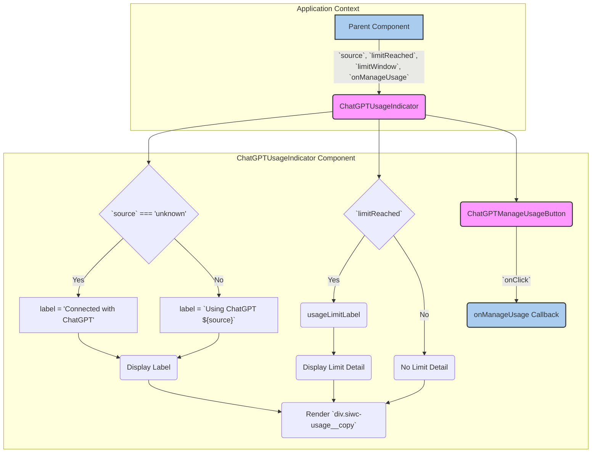
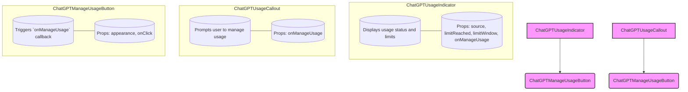

<!-- source: DeepWiki mcp.deepwiki.com · repo openai/sign-in-with-chatgpt-devkit · page 3.2 Usage Components · fetched 2026-10-26 -->

# Usage Components

<details>
<summary>Relevant source files</summary>

The following files were used as context for generating this wiki page:

- [packages/react/src/manage-usage.tsx](packages/react/src/manage-usage.tsx)
- [packages/react/src/usage-indicator.tsx](packages/react/src/usage-indicator.tsx)

</details>


This page details the React components provided by the `@siwc/react` package for displaying and managing ChatGPT usage information. These components include `ChatGPTUsageIndicator`, `ChatGPTUsageCallout`, and `ChatGPTManageUsageButton`. They are designed to inform users about their current usage status, indicate when limits are reached, and provide a clear path to manage their usage. The components also handle different "limit windows" and "usage sources" as defined by the ChatGPT API.

Sources:
- [packages/react/src/manage-usage.tsx:1-36]()
- [packages/react/src/usage-indicator.tsx:1-35]()

## ChatGPTUsageIndicator

The `ChatGPTUsageIndicator` component displays the user's current connection status and, optionally, whether a usage limit has been reached. It is designed to be a persistent visual cue within an application.

The component accepts the following props:
*   `logoSrc`: (Optional) Source for the ChatGPT logo.
*   `source`: A `ChatGPTUsageSource` indicating how the user is consuming ChatGPT (e.g., 'plan', 'credits', 'unknown'). This should only be passed if confirmed by the runtime.
*   `onManageUsage`: A callback function triggered when the "Manage usage" button is clicked.
*   `limitReached`: A boolean indicating if a usage limit has been reached. Defaults to `false`.
*   `limitWindow`: A `ChatGPTLimitWindow` specifying the type of limit reached (e.g., 'five_hour', 'weekly', 'unknown').
*   `disabled`: A boolean to disable the "Manage usage" button. Defaults to `false`.
*   `className`: Additional CSS classes for styling.

When `limitReached` is `true`, the indicator displays a detailed message using the `usageLimitLabel` helper function, which provides context based on the `limitWindow` prop [packages/react/src/usage-indicator.tsx:17-21]().

```typescript
export type ChatGPTUsageSource = 'plan' | 'credits' | 'unknown';
export type ChatGPTLimitWindow = 'five_hour' | 'weekly' | 'unknown';

export function ChatGPTUsageIndicator({ logoSrc, source, onManageUsage, limitReached = false, limitWindow, disabled = false, className }: ChatGPTUsageIndicatorProps) {
  const label = source === 'unknown' ? 'Connected with ChatGPT' : `Using ChatGPT ${source}`;
  return (
    <div className={classes('siwc', 'siwc-usage', limitReached && 'siwc-usage--with-detail', source === 'unknown' && 'siwc-usage--unknown', className)}>
      <ChatGPTMark src={logoSrc} kind="usage" />
      <div className="siwc-usage__copy" aria-live="polite" aria-atomic="true">
        <span>{label}</span>
        {limitReached && <span className="siwc-usage__detail">{usageLimitLabel(limitWindow)}</span>}
      </div>
      <ChatGPTManageUsageButton onClick={onManageUsage} disabled={disabled} />
    </div>
  );
}
```
Sources:
- [packages/react/src/usage-indicator.tsx:5-35]()

### ChatGPTUsageIndicator Data Flow

The following diagram illustrates the data flow and component interactions within the `ChatGPTUsageIndicator`.


**Diagram: ChatGPTUsageIndicator Data Flow**

Sources:
- [packages/react/src/usage-indicator.tsx:23-35]()

## ChatGPTUsageCallout

The `ChatGPTUsageCallout` component is a more prominent display, typically used to draw attention to usage information or prompt the user to manage their usage. It includes a message and a primary "Manage usage" button.

The component accepts the following props:
*   `logoSrc`: (Optional) Source for the ChatGPT logo.
*   `onManageUsage`: A callback function triggered when the "Manage usage" button is clicked.
*   `disabled`: A boolean to disable the "Manage usage" button.
*   `className`: Additional CSS classes for styling.

```typescript
export function ChatGPTUsageCallout({ logoSrc, onManageUsage, disabled, className }: ChatGPTUsageCalloutProps) {
  return (
    <div className={classes('siwc', 'siwc-usage-callout', className)}>
      <div className="siwc-usage-callout__message">
        <ChatGPTMark src={logoSrc} kind="callout" />
        <span>View and manage your ChatGPT usage</span>
      </div>
      <ChatGPTManageUsageButton appearance="primary" onClick={onManageUsage} disabled={disabled} />
    </div>
  );
}
```
Sources:
- [packages/react/src/manage-usage.tsx:21-36]()

## ChatGPTManageUsageButton

The `ChatGPTManageUsageButton` is a standalone button component that, when clicked, is intended to navigate the user to a page or external link where they can manage their ChatGPT usage. It includes an external link icon to signify that it typically leads outside the current application context.

The component accepts standard HTML button attributes, with an additional `appearance` prop:
*   `appearance`: Can be `'primary'` or `'secondary'`, affecting its visual styling. Defaults to `'secondary'`.

```typescript
export const ChatGPTManageUsageButton = forwardRef<HTMLButtonElement, ChatGPTManageUsageButtonProps>(
  function ChatGPTManageUsageButton({ appearance = 'secondary', type = 'button', className, ...props }, ref) {
    return (
      <button aria-label="Manage ChatGPT usage (opens in browser)" {...props} ref={ref} type={type} className={classes('siwc', 'siwc-manage', `siwc-manage--${appearance}`, className)}>
        <span>Manage usage</span>
        <ExternalLinkIcon kind={appearance === 'primary' ? 'white-16' : 'black-16'} />
      </button>
    );
  },
);
```
Sources:
- [packages/react/src/manage-usage.tsx:6-19]()

### Component Relationships

The following diagram illustrates how the usage components relate to each other and their primary functions.


**Diagram: Usage Component Relationships**

Sources:
- [packages/react/src/manage-usage.tsx:10-19]()
- [packages/react/src/manage-usage.tsx:33-33]()
- [packages/react/src/usage-indicator.tsx:32-32]()

## Limit Windows and Usage Sources

The DevKit defines specific types for `ChatGPTUsageSource` and `ChatGPTLimitWindow` to standardize how usage information is communicated.

### `ChatGPTUsageSource`

This type indicates the mechanism through which a user is consuming ChatGPT.
*   `'plan'`: Usage is tied to a subscription plan.
*   `'credits'`: Usage is consumed from purchased credits.
*   `'unknown'`: The source of usage cannot be determined.

Sources:
- [packages/react/src/usage-indicator.tsx:5-5]()

### `ChatGPTLimitWindow`

This type specifies the time frame over which a usage limit applies.
*   `'five_hour'`: A limit that resets every five hours.
*   `'weekly'`: A limit that resets weekly.
*   `'unknown'`: The limit window is not specified or known.

The `usageLimitLabel` function [packages/react/src/usage-indicator.tsx:17-21]() provides user-friendly strings for these limit windows.

Sources:
- [packages/react/src/usage-indicator.tsx:6-6]()
- [packages/react/src/usage-indicator.tsx:17-21]()

---

