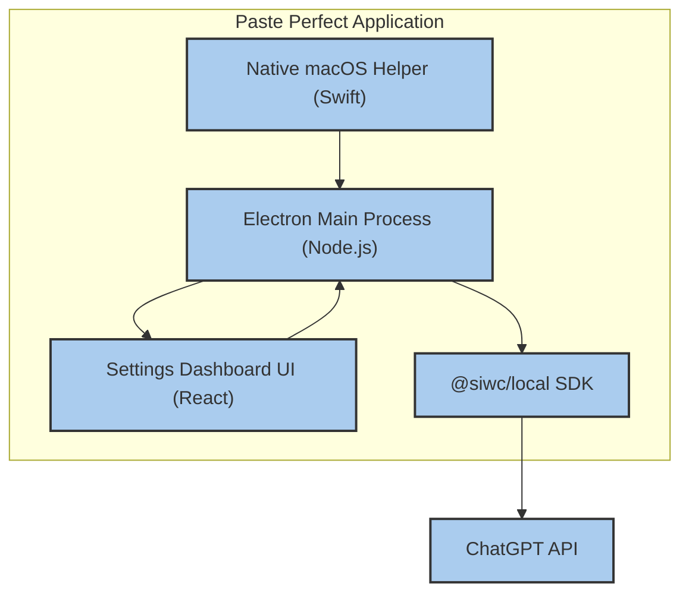
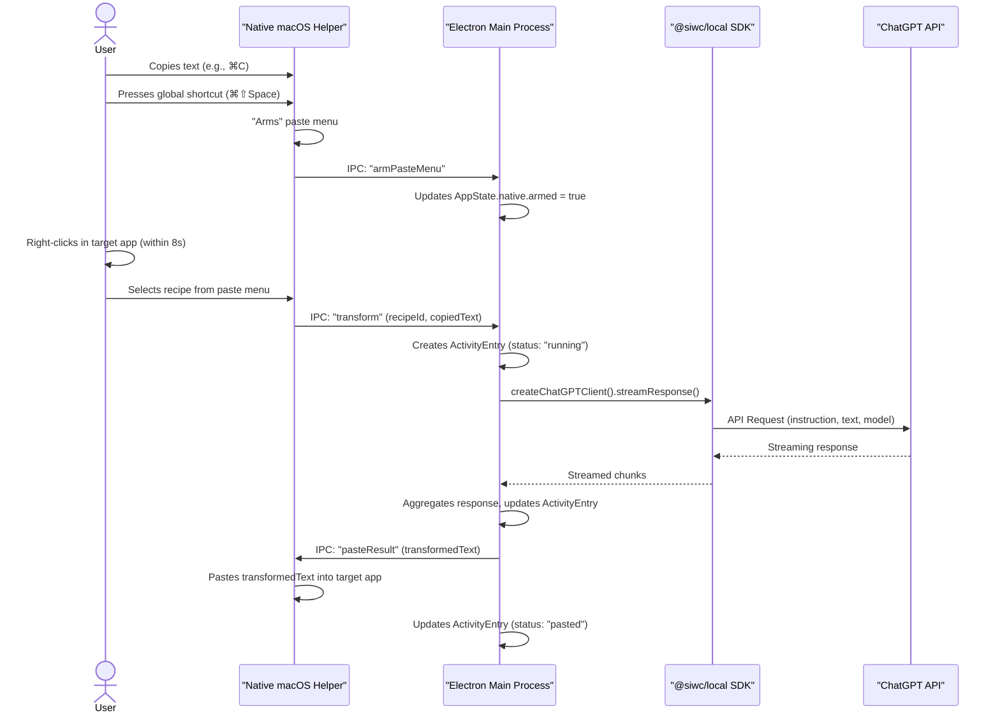

<!-- source: DeepWiki mcp.deepwiki.com · repo openai/sign-in-with-chatgpt-devkit · page 4 Paste Perfect Example App · fetched 2026-10-26 -->

# Paste Perfect Example App

Relevant source files

The following files were used as context for generating this wiki page:

- [README.md](README.md)
- [examples/paste-perfect/package.json](examples/paste-perfect/package.json)
- [examples/paste-perfect/shared.ts](examples/paste-perfect/shared.ts)

The Paste Perfect application is a reference macOS application that demonstrates how to integrate Sign in with ChatGPT into a desktop environment. It showcases a common architecture for native desktop applications, combining a native helper, an Electron main process, and a React-based dashboard UI. The core functionality revolves around transforming copied text using ChatGPT recipes and pasting the result into other applications.

This page provides a high-level overview of the Paste Perfect application's architecture and its clipboard transformation flow. For detailed information on specific components, please refer to the linked child pages.

## Architecture Overview

Paste Perfect is a hybrid application designed for macOS, leveraging different technologies for optimal performance and user experience.

Sources: [README.md:28]()

The application consists of three main parts:

*   **Native macOS Helper**: A Swift-based helper application responsible for macOS-specific functionalities like accessibility permissions, arming the paste menu, and handling subprocess communication. For details, see [Native macOS Helper](#4.2).
*   **Electron Main Process**: The central Node.js process that manages the application's lifecycle, handles inter-process communication (IPC), integrates with the `@siwc/local` SDK for ChatGPT interactions, and manages application state, preferences, and credential encryption. For details, see [Electron Main Process](#4.1).
*   **Settings Dashboard UI**: A React-based user interface rendered within Electron, providing a dashboard for managing ChatGPT connections, recipes, application settings, and activity. For details, see [Settings Dashboard UI](#4.3).

The application also utilizes the `@siwc/local` SDK for OAuth, credential storage, model discovery, and streaming responses from the ChatGPT API, and `@siwc/react` for UI components.
Sources: [README.md:18-19](), [examples/paste-perfect/package.json:14-15]()

## Clipboard Transformation Flow

The core functionality of Paste Perfect involves transforming copied text using a selected recipe and then pasting the result. This process is initiated by a global keyboard shortcut and involves coordination between the native helper, the Electron main process, and the ChatGPT API.

Sources: [README.md:43-46](), [examples/paste-perfect/shared.ts:21-22](), [examples/paste-perfect/shared.ts:61-65](), [examples/paste-perfect/shared.ts:67-68]()

The flow can be summarized as follows:

1.  **Copy Text**: The user copies text from any application.
2.  **Activate Paste Menu**: The user presses the global shortcut (⌘⇧Space) [README.md:44](). This triggers the native helper to "arm" the paste menu, making the Paste Perfect recipes available in the context menu of the target application.
3.  **Select Recipe**: The user right-clicks in the target application and selects a desired recipe (e.g., "Spreadsheet", "Message", "Translate", "Checklist", "Clean up", or a custom recipe) from the paste menu [README.md:45-46]().
4.  **Transform Text**: The native helper sends the copied text and the selected `recipeId` to the Electron main process via IPC. The Electron main process then uses the `@siwc/local` SDK to send the text and the recipe's `instruction` to the ChatGPT API for transformation.
5.  **Paste Result**: Once the transformed text is received from the ChatGPT API, the Electron main process sends it back to the native helper via IPC. The native helper then pastes the transformed text into the currently focused application.

The application maintains an `AppState` [examples/paste-perfect/shared.ts:39-53]() that includes `ActivityEntry` [examples/paste-perfect/shared.ts:26-37]() objects to track the status of transformations.

## Build, Packaging and Tests

The Paste Perfect application includes a comprehensive build and packaging process, along with a test suite to ensure functionality and security. This involves native build scripts, Electron-specific packaging, and various testing methodologies. For details, see [Build, Packaging and Tests](#4.4).
Sources: [examples/paste-perfect/package.json:8]()

---

