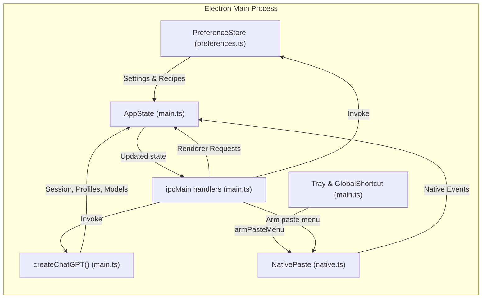
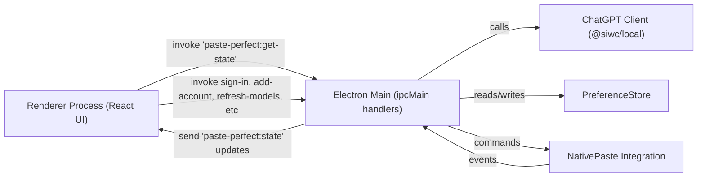

<!-- source: DeepWiki mcp.deepwiki.com · repo openai/sign-in-with-chatgpt-devkit · page 4.1 Electron Main Process · fetched 2026-10-26 -->

# Electron Main Process

<details>
<summary>Relevant source files</summary>

The following files were used as context for generating this wiki page:

- [examples/paste-perfect/electron/credential-encryption.ts](examples/paste-perfect/electron/credential-encryption.ts)
- [examples/paste-perfect/electron/main.ts](examples/paste-perfect/electron/main.ts)
- [examples/paste-perfect/electron/preferences.ts](examples/paste-perfect/electron/preferences.ts)
- [examples/paste-perfect/electron/preload.ts](examples/paste-perfect/electron/preload.ts)

</details>


This page documents the implementation and architecture of the Electron main process for the **Paste Perfect** example app included in the Sign in with ChatGPT DevKit. The main process is responsible for managing the application lifecycle, maintaining the app state, handling IPC (Inter-Process Communication) with renderer processes, orchestrating the ChatGPT client interactions, configuring the native macOS helper integration, managing the system tray and global shortcuts, and securely storing user preferences with encrypted credentials.

---

## Overview

The main process implementation is contained primarily in the file:
- `examples/paste-perfect/electron/main.ts`

Key responsibilities covered include:

- Application lifecycle and window management
- Maintaining a comprehensive application state (`AppState`), including session, user profiles, model catalog, settings, and native integration status
- IPC handlers exposing functions asynchronously to the renderer via `ipcMain`
- Wiring and wrapping the ChatGPT client SDK from `@siwc/local` to communicate with OpenAI services
- Configuring the macOS native helper integration for accessibility and paste menu arming
- System tray icon and global shortcut for quick "arm paste menu" operation
- PreferenceStore for loading/saving app preferences and recipes with atomic, concurrent-safe file writes
- Secure encryption of saved credentials through Electron's `safeStorage` API adapter

---

## Application State and Lifecycle

The app state (`AppState` interface) maintained in-memory tracks:

- `session` — current ChatGPT session connection status and sharing mode
- `profiles` — list of user profiles associated with the session
- `accountBusy` — flag to prevent concurrent account-changing operations
- `modelCatalog` — currently available ChatGPT models and currently selected model
- `recipes` — transformation recipes loaded from preferences (merges built-in and user-defined)
- `settings` — user settings including model choice and shortcut key
- `native` — state and permissions for the native helper integration
- `activity` — recent user or system activities (e.g., transformations performed)

The state is initially constructed by merging stored preferences with default values, along with the native integration's initial state from the `NativePaste` class.

```ts
let state: AppState = {
  session: { status: 'disconnected', sharing: false },
  profiles: [],
  accountBusy: false,
  modelCatalog: { status: 'idle', models: [] },
  recipes: preferences.recipes,
  settings: preferences.settings,
  native: NativePaste.initialState(),
  activity: [],
};
```

`state` is updated reactively, with every modification triggering a `publish()` call that sends the new state snapshot to the renderer via IPC.

Lifecycle events include:

- `app.setName`, `app.setPath` for custom data directory initialization
- Registering the custom protocol "paste-perfect" for app URL routing
- Creating and managing the single main BrowserWindow renderer instance
- Graceful quitting handling with `quitting` flag and prompt dialogs
- Global shortcut registration and tray menu provisioning

Sources: `examples/paste-perfect/electron/main.ts:13-56, 143-149`()

---

## ChatGPT Client Wiring

The main process initializes the ChatGPT client from the `@siwc/local` package:

```ts
const chatgpt = createChatGPT({
  appName: 'Paste Perfect',
  appId: 'paste-perfect',
  redirectPort: Number(process.env.PASTE_PERFECT_REDIRECT_PORT ?? 8787),
  storageDir: join(app.getPath('userData'), 'chatgpt'),
  credentialEncryption: createElectronCredentialEncryption(safeStorage, () => app.isReady()),
  openBrowser: async (url: string) => {
    const target = new URL(url);
    if (target.origin !== 'https://auth.openai.com') throw new Error('Unexpected sign-in destination.');
    await shell.openExternal(target.href);
  },
});
```

This client supports OAuth flows, session management, and model discovery. It uses a custom `credentialEncryption` adapter built on Electron's `safeStorage` API to securely persist tokens and credentials locally.

Operations performed:

- Listing user profiles with `chatgpt.listProfiles()`
- Fetching and updating session information `chatgpt.getSession()`
- Listing available model catalog with `chatgpt.listModels()`
  
Account state changes are wrapped in `changeAccount()` which manages concurrency guards and consistent UI states.

Sources: `examples/paste-perfect/electron/main.ts:8,31-42,79-140`  
Credential encryption: `examples/paste-perfect/electron/credential-encryption.ts`()

---

## IPC Handlers

The main process exposes a set of asynchronous IPC handlers via `ipcMain.handle` responding to renderer requests for:

- Getting current application state snapshot
- Starting / resuming sign-in
- Profile selection
- Model refresh
- Adding or disconnecting accounts
- Canceling ongoing transformations
- Arming the native paste menu
- Updating preferences (recipes, settings)
- Opening usage dashboards

A helper `validateSender(event)` is called in most handlers to strictly verify the sender's identity against the main window's web contents, ensuring IPC calls only come from the loaded renderer page.

Example snippet:

```ts
ipcMain.handle('paste-perfect:get-state', () => state);

ipcMain.handle('paste-perfect:arm-menu', () => {
  armPasteMenu();
});
```

These handlers call into the appropriate local functions managing state transitions, ChatGPT client calls, and native integration.

Sources: `examples/paste-perfect/electron/main.ts:175-445` (not fully shown)  
IPC bridge definitions: `examples/paste-perfect/electron/preload.ts:1-29`()

---

## Tray and Global Shortcut

The app installs a system tray icon and menu to allow quick user access, including:

- Opening the dashboard window
- Exiting the app gracefully
- Status indicators reflecting connection state

It registers a global shortcut based on user settings (default: `CommandOrControl+Shift+Space`) that triggers the `armPasteMenu()` action. This shortcut can be changed safely at runtime, unregistering the previous one.

Shortcut registration handles exceptions and prevents duplicate registrations. The current shortcut string is tracked in `registeredShortcut`.

On shortcut or tray activation, the system attempts to arm the native paste menu integration, handling permission errors gracefully by showing user notifications and the dashboard.

```ts
function registerShortcut(shortcut: string): boolean {
  if (shortcut === registeredShortcut) return true;
  let registered = false;
  try { registered = globalShortcut.register(shortcut, armPasteMenu); } catch { return false; }
  if (!registered) return false;
  if (registeredShortcut) globalShortcut.unregister(registeredShortcut);
  registeredShortcut = shortcut;
  return true;
}
```

Sources: `examples/paste-perfect/electron/main.ts:24-30, 155-173`()

---

## Preferences Storage and Credential Encryption

### Preferences

User preferences — including application settings and user-defined transformation recipes — are persisted atomically to disk using a `PreferenceStore`:

- Uses structured JSON files, backed by file system atomic rename and temporary files to prevent corruption
- Enforces data schema, field length limits, and restrictions on built-in recipes
- Supports adding, updating, and deleting recipes with validation

Preference updates use a promise chain `writes` to serialize concurrent write operations safely.

Calls from the main process to update preferences are proxied to the `PreferenceStore` instance which lives in the main process context.

```ts
const preferences = new PreferenceStore(app.getPath('userData'));
```

### Credential Encryption

Credential encryption is implemented using the Electron `safeStorage` API to access OS-level encryption mechanisms:

- Adapter `createElectronCredentialEncryption()` implements the `CredentialEncryption` interface required by `@siwc/local`
- Performs encryption and decryption of stored tokens with OS-level keys, respecting Linux restrictions
- Ensures that encryption availability is checked only after the app is ready

This mechanism prevents key material from ever being exposed over IPC or to renderer processes, securing user credentials locally.

Sources:  
- Preferences: `examples/paste-perfect/electron/preferences.ts`  
- Credential encryption: `examples/paste-perfect/electron/credential-encryption.ts`  
- Main setup: `examples/paste-perfect/electron/main.ts:30-42`()

---

## Native macOS Helper Integration

The process manages integration with a Swift-based native macOS helper that handles:

- Accessibility permissions and paste-menu arming
- Command authenticator and subprocess pipe communication
- Coordinating native events forwarded to Electron main for state synchronization

The main process initializes `NativePaste` with callbacks for event handling and readiness signaling.

```ts
const native = new NativePaste(receiveNativeEvent, () => app.quit(), reportReadiness);
```

The native helper is configured with the current recipes and session sharing status, which controls whether the paste menu is armed.

If native paste is unsupported or permissions are missing, suitable notices are displayed and dashboard UI shown.

Sources: `examples/paste-perfect/electron/main.ts:10, 57, 151-163`()

---

## Data Flow Diagram: High-Level Main Process Components



Sources: `examples/paste-perfect/electron/main.ts:1-175`, `preferences.ts:31-123`, `credential-encryption.ts:7-32`()

---

## Data Flow Diagram: IPC Communication Bridge and Renderer Interaction



Sources: `examples/paste-perfect/electron/preload.ts`, `examples/paste-perfect/electron/main.ts`()

---

## Key Functions and Classes

| Symbol/Function                         | Role and Description                                                                                       | Location                    |
|---------------------------------------|-----------------------------------------------------------------------------------------------------------|-----------------------------|
| `PreferenceStore`                     | Manages loading, validating, persisting app settings and recipes atomically with concurrency safety        | `preferences.ts:31-123`      |
| `createElectronCredentialEncryption` | Provides encryption adapter over Electron's native `safeStorage` API for secure credential storage        | `credential-encryption.ts:7-32` |
| `createChatGPT`                       | Constructs ChatGPT client object exposing session/profile/model management and OAuth                        | `main.ts:31-42`              |
| `publish()`                          | Pushes app state updates asynchronously to renderer process                                                | `main.ts:65-69`              |
| `changeAccount()`                     | Wrapper for safely performing account-related actions with concurrency lock, error handling               | `main.ts:128-141`            |
| `registerShortcut()`                  | Dynamically registers/unregisters global shortcut for "arm paste menu"                                   | `main.ts:165-173`            |
| `armPasteMenu()`                     | Commands native helper to arm the custom paste menu, verifying prerequisites                              | `main.ts:155-163`            |
| `NativePaste`                        | Class wrapping macOS native helper's integration including event delivery and readiness callbacks          | `native.ts` (implied)        |

---

## Summary

The Electron main process serves as the backbone of the Paste Perfect app, bridging native OS capabilities, secure credential management, ChatGPT authentication and interaction, and the React renderer UI. By managing the comprehensive app state, wiring IPC handlers, and handling global system features like trays and shortcuts, it enables seamless and secure user experiences of Sign in with ChatGPT flows combined with native clipboard transformation actions.

---

# References

- `examples/paste-perfect/electron/main.ts:1-175`  
- `examples/paste-perfect/electron/main.ts:31-140`  
- `examples/paste-perfect/electron/credential-encryption.ts:7-32`  
- `examples/paste-perfect/electron/preferences.ts:31-123`  
- `examples/paste-perfect/electron/preload.ts:1-29`

---

