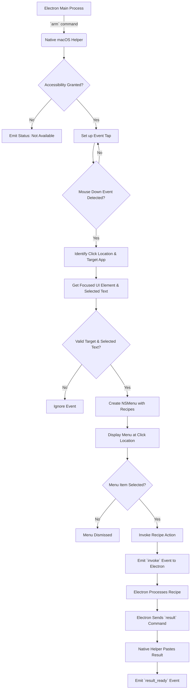

<!-- source: DeepWiki mcp.deepwiki.com · repo openai/sign-in-with-chatgpt-devkit · page 4.2 Native macOS Helper · fetched 2026-10-26 -->

# Native macOS Helper

<details>
<summary>Relevant source files</summary>

The following files were used as context for generating this wiki page:

- [examples/paste-perfect/electron/native.ts](examples/paste-perfect/electron/native.ts)
- [examples/paste-perfect/native/Info.plist](examples/paste-perfect/native/Info.plist)
- [examples/paste-perfect/native/PastePerfectNative.swift](examples/paste-perfect/native/PastePerfectNative.swift)
- [examples/paste-perfect/native/README.md](examples/paste-perfect/native/README.md)
- [examples/paste-perfect/native/desktop.entitlements.plist](examples/paste-perfect/native/desktop.entitlements.plist)

</details>


The Native macOS Helper is a Swift application that provides core macOS integration for the Paste Perfect example app. Its primary responsibilities include managing accessibility permissions, arming the paste menu for contextual ChatGPT interactions, facilitating secure inter-process communication with the Electron main process, and handling command authentication. This helper is crucial for enabling a seamless and secure native user experience on macOS.

## Architecture and Communication

The Native macOS Helper (`PastePerfectNative.swift`) runs as a separate process from the Electron main process. Communication between the two is established through anonymous pipes, ensuring a secure and controlled channel. The native helper initiates these pipes and generates a unique command authenticator for each launch, which is then shared with the Electron main process. This authenticator is essential for validating commands sent from Electron to the native helper.

### Diagram: Native Helper Communication Flow

```mermaid
graph TD
    subgraph "macOS Environment"
        A[Native macOS Helper] -->|Spawns and manages pipes| B(Electron Main Process)
        B -->|Sends authenticated commands| A
        A -->|Emits events (status, invocation, results)| B
    end

    subgraph "Native macOS Helper"
        A_init[Initialization] --> A_auth[Generate Command Authenticator]
        A_auth --> A_pipe[Establish Anonymous Pipes]
        A_pipe --> A_send_auth[Send Authenticator to Electron]
        A_send_auth --> A_listen[Listen for Authenticated Commands]
        A_listen --> A_process[Process Commands]
        A_process --> A_emit[Emit Events]
    end

    subgraph "Electron Main Process"
        B_start[Start Electron] --> B_spawn[Spawn Native Helper]
        B_spawn --> B_receive_auth[Receive Authenticator]
        B_receive_auth --> B_send_config[Send Configuration (authenticated)]
        B_send_config --> B_handle_events[Handle Native Events]
        B_handle_events --> B_invoke[Invoke Native Actions]
    end

    A_send_auth -- "transport-auth event with token" --> B_receive_auth
    B_send_config -- "configure command with token" --> A_listen
    A_emit -- "status, invoke, result_ready events" --> B_handle_events
```
Sources:
- [examples/paste-perfect/electron/native.ts:38-95]()
- [examples/paste-perfect/native/PastePerfectNative.swift:18-27]()
- [examples/paste-perfect/native/README.md:4-7]()

### Command Authenticator

A critical security feature is the command authenticator. The native app generates a random 256-bit token at startup [examples/paste-perfect/native/README.md:7](). This token is sent to the Electron main process via a private event pipe [examples/paste-perfect/electron/native.ts:75-85](). All subsequent commands from Electron to the native helper must include this token for validation. This prevents unauthorized processes from interacting with the native helper. The token is kept out of renderer state, environment variables, and other insecure locations [examples/paste-perfect/native/README.md:7]().

The `NativePaste` class in the Electron main process manages this authentication. Upon receiving a `transport-auth` event with a token, it stores the `commandToken` [examples/paste-perfect/electron/native.ts:75-85](). Any commands sent to the native helper are then augmented with this token [examples/paste-perfect/electron/native.ts:104-106]().

Sources:
- [examples/paste-perfect/electron/native.ts:75-85]()
- [examples/paste-perfect/electron/native.ts:104-106]()
- [examples/paste-perfect/native/README.md:7]()

## Accessibility Permissions

The native helper requires macOS Accessibility permissions to interact with other applications, specifically to read selected text and paste transformed content. The `AXIsProcessTrusted()` function is used to check if these permissions have been granted [examples/paste-perfect/native/PastePerfectNative.swift:119](). A `permissionTimer` periodically checks the accessibility status and updates the Electron main process if there's a change [examples/paste-perfect/native/PastePerfectNative.swift:121-131](). If permissions are revoked, the native helper disarms itself and cancels any active menus [examples/paste-perfect/native/PastePerfectNative.swift:128]().

The `status()` function emits an event to the Electron process, indicating whether the native integration is `available`, if `accessibilityGranted`, and if the paste menu is `armed` [examples/paste-perfect/native/PastePerfectNative.swift:133-138]().

Sources:
- [examples/paste-perfect/native/PastePerfectNative.swift:119]()
- [examples/paste-perfect/native/PastePerfectNative.swift:121-131]()
- [examples/paste-perfect/native/PastePerfectNative.swift:133-138]()

## Paste Menu Arming

The core functionality of the native helper involves "arming" the paste menu. This means intercepting mouse events to detect a right-click (or control-click) and then presenting a custom menu with ChatGPT recipes.

### Event Tapping

The `arm(timeout:)` function sets up an `eventTap` to monitor mouse events [examples/paste-perfect/native/PastePerfectNative.swift:155-156, 200-201](). Specifically, it listens for `kCGEventLeftMouseDown`, `kCGEventRightMouseDown`, and `kCGEventOtherMouseDown` events. When a mouse down event occurs, the `eventTapCallback` is invoked [examples/paste-perfect/native/PastePerfectNative.swift:200-201]().

The `eventTapCallback` determines if the click is a right-click and captures the click location and the process ID (`pid`) of the application under the cursor [examples/paste-perfect/native/PastePerfectNative.swift:209-217](). If a right-click is detected, it attempts to identify the focused UI element and extract any selected text [examples/paste-perfect/native/PastePerfectNative.swift:220-239](). This information is then used to construct a `Target` object [examples/paste-perfect/native/PastePerfectNative.swift:80-86]().

### Menu Presentation

If a valid `Target` is identified, the `presentMenu(point:expectedPid:)` function is called [examples/paste-perfect/native/PastePerfectNative.swift:240](). This function creates an `NSMenu` and populates it with the available ChatGPT recipes [examples/paste-perfect/native/PastePerfectNative.swift:300-320](). The menu is then displayed at the click location. When a menu item is selected, the `menuAction(_:)` method is triggered [examples/paste-perfect/native/PastePerfectNative.swift:322-337]().

### Diagram: Paste Menu Arming Flow


Sources:
- [examples/paste-perfect/native/PastePerfectNative.swift:155-156]()
- [examples/paste-perfect/native/PastePerfectNative.swift:200-201]()
- [examples/paste-perfect/native/PastePerfectNative.swift:209-217]()
- [examples/paste-perfect/native/PastePerfectNative.swift:220-239]()
- [examples/paste-perfect/native/PastePerfectNative.swift:240]()
- [examples/paste-perfect/native/PastePerfectNative.swift:300-320]()
- [examples/paste-perfect/native/PastePerfectNative.swift:322-337]()
- [examples/paste-perfect/native/PastePerfectNative.swift:80-86]()

## Subprocess Pipes

The `NativePaste` class in `electron/native.ts` is responsible for managing the communication pipes from the Electron side. It reads data from `process.stdin` and writes to `process.stdout` [examples/paste-perfect/electron/native.ts:66-95, 104-106](). The native helper, on the other hand, uses `FileHandle.standardOutput` (for tests) or a private `desktopInput` file handle to write events, and reads from its own `stdin` (which is the `stdout` of the Electron process) [examples/paste-perfect/native/PastePerfectNative.swift:18-27](). This setup ensures that the Electron process is the parent and controls the communication channels.

Sources:
- [examples/paste-perfect/electron/native.ts:66-95]()
- [examples/paste-perfect/electron/native.ts:104-106]()
- [examples/paste-perfect/native/PastePerfectNative.swift:18-27]()

## Info.plist and Entitlements

The `Info.plist` file [examples/paste-perfect/native/Info.plist]() defines metadata for the native helper application. Key entries include:
- `CFBundleIdentifier`: `com.openai.siwc.paste-perfect.native` [examples/paste-perfect/native/Info.plist:5]()
- `CFBundleName`: `Paste Perfect Native` [examples/paste-perfect/native/Info.plist:6]()
- `CFBundleExecutable`: `PastePerfectNative` [examples/paste-perfect/native/Info.plist:8]()
- `LSMinimumSystemVersion`: `14.0` (requiring macOS 14 or later) [examples/paste-perfect/native/Info.plist:12]()
- `LSUIElement`: `<true/>` which makes the application a background agent, not appearing in the Dock or Force Quit window [examples/paste-perfect/native/Info.plist:13]()

The `desktop.entitlements.plist` file [examples/paste-perfect/native/desktop.entitlements.plist]() specifies entitlements for the Electron processes launched by the native helper.
- `com.apple.security.cs.allow-jit`: `<true/>` allows Just-In-Time compilation, necessary for Electron's JavaScript engine [examples/paste-perfect/native/desktop.entitlements.plist:4]().
- `com.apple.security.cs.disable-library-validation`: `<true/>` is used to allow Electron to load its bundled libraries. This is replaced by a more specific CDHash library constraint during the build process for enhanced security [examples/paste-perfect/native/desktop.entitlements.plist:6]().

Sources:
- [examples/paste-perfect/native/Info.plist:5]()
- [examples/paste-perfect/native/Info.plist:6]()
- [examples/paste-perfect/native/Info.plist:8]()
- [examples/paste-perfect/native/Info.plist:12]()
- [examples/paste-perfect/native/Info.plist:13]()
- [examples/paste-perfect/native/desktop.entitlements.plist:4]()
- [examples/paste-perfect/native/desktop.entitlements.plist:6]()
- [examples/paste-perfect/native/README.md:11]()

---

