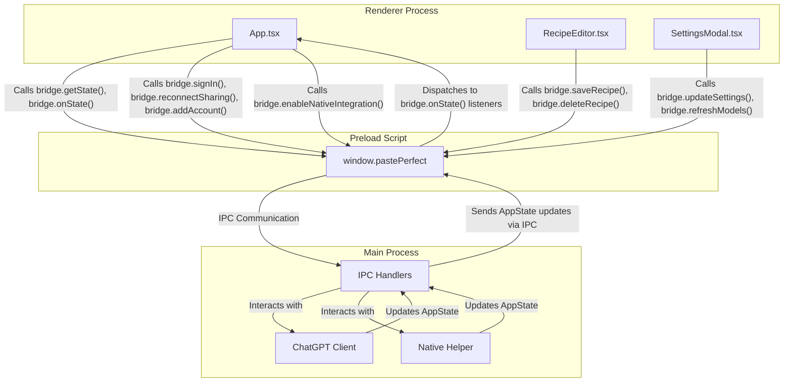

<!-- source: DeepWiki mcp.deepwiki.com · repo openai/sign-in-with-chatgpt-devkit · page 4.3 Settings Dashboard UI · fetched 2026-10-26 -->

# Settings Dashboard UI

<details>
<summary>Relevant source files</summary>

The following files were used as context for generating this wiki page:

- [examples/paste-perfect/src/App.tsx](examples/paste-perfect/src/App.tsx)
- [examples/paste-perfect/src/Dashboard.tsx](examples/paste-perfect/src/Dashboard.tsx)
- [examples/paste-perfect/src/Modal.tsx](examples/paste-perfect/src/Modal.tsx)
- [examples/paste-perfect/src/RecipeEditor.tsx](examples/paste-perfect/src/RecipeEditor.tsx)
- [examples/paste-perfect/src/SettingsModal.tsx](examples/paste-perfect/src/SettingsModal.tsx)
- [examples/paste-perfect/src/bridge.ts](examples/paste-perfect/src/bridge.ts)
- [examples/paste-perfect/src/main.tsx](examples/paste-perfect/src/main.tsx)
- [examples/paste-perfect/src/styles.css](examples/paste-perfect/src/styles.css)

</details>


This page details the React renderer components that form the user interface of the Paste Perfect example application. It covers the main application shell (`App`), the dashboard views (`Dashboard`), the recipe editing interface (`RecipeEditor`), and the settings and generic modal components (`SettingsModal`, `Modal`). It also explains the `bridge` mechanism for communication between the renderer and the Electron main process, and how styles are applied.

Sources:
- [examples/paste-perfect/src/App.tsx:1-169]()
- [examples/paste-perfect/src/Dashboard.tsx:1-62]()
- [examples/paste-perfect/src/Modal.tsx:1-17]()
- [examples/paste-perfect/src/RecipeEditor.tsx:1-47]()
- [examples/paste-perfect/src/SettingsModal.tsx:1-39]()
- [examples/paste-perfect/src/bridge.ts:1-63]()
- [examples/paste-perfect/src/main.tsx:1-7]()
- [examples/paste-perfect/src/styles.css:1-79]()

## Application Structure (`App.tsx`)
The `App` component [examples/paste-perfect/src/App.tsx:41-169]() is the root of the Paste Perfect renderer process. It manages the overall application state, navigation between different dashboard pages, and the display of modals for editing recipes and settings.

### State Management
The `App` component uses React's `useState` hook to manage several pieces of local UI state:
- `state`: Holds the global application state, typed as `AppState`, which is synchronized with the Electron main process via the `bridge`. [examples/paste-perfect/src/App.tsx:42]()
- `page`: Controls the currently displayed dashboard page (`'home'`, `'recipes'`, `'activity'`, `'account'`). [examples/paste-perfect/src/App.tsx:43]()
- `editor`: Manages the state of the `RecipeEditor` modal, indicating if a recipe is being edited or a new one created. [examples/paste-perfect/src/App.tsx:44]()
- `settingsOpen`: A boolean indicating whether the `SettingsModal` is open. [examples/paste-perfect/src/App.tsx:45]()
- `dismissedUsageLimits`: A `Set` to track usage limit warnings that have been dismissed by the user. [examples/paste-perfect/src/App.tsx:46]()
- `actionError`: Stores any error messages resulting from user actions. [examples/paste-perfect/src/App.tsx:47]()
- `enabling`: A boolean indicating if the native integration enabling process is active. [examples/paste-perfect/src/App.tsx:48]()

### Data Flow and Bridge Communication
The `App` component establishes a one-way data flow from the Electron main process to the renderer via the `bridge` object [examples/paste-perfect/src/bridge.ts:63]().
- **Initialization**: On mount, `useEffect` [examples/paste-perfect/src/App.tsx:50-58]() sets up a listener for state changes from the main process using `bridge.onState()` [examples/paste-perfect/src/App.tsx:53](). It also fetches the initial state using `bridge.getState()` [examples/paste-perfect/src/App.tsx:54]().
- **Actions**: User interactions that require communication with the main process (e.g., saving settings, enabling native integration, signing in) are handled by asynchronous functions like `perform()` [examples/paste-perfect/src/App.tsx:61-64](), `enableNative()` [examples/paste-perfect/src/App.tsx:65-69](), `connectAccount()` [examples/paste-perfect/src/App.tsx:95-97](), which call corresponding methods on the `bridge` object.

### Recovery and Usage Limits
The `recoveryKind()` [examples/paste-perfect/src/App.tsx:18-26]() and `usageLimitKey()` [examples/paste-perfect/src/App.tsx:28-39]() functions determine the type of recovery needed (e.g., reauthentication, sharing declined, usage limit exceeded) and generate a unique key for usage limit messages, respectively. These are used to display appropriate UI elements like `ChatGPTRecoveryDialog` and `ChatGPTUsageCallout` from `@siwc/react`.

### UI Layout
The `App` component renders a two-column layout: a `sidebar` for navigation and account information, and a `dashboard` for the main content.
- **Sidebar**: Contains navigation buttons for different pages, a brand display, a tip section, and an account status display. [examples/paste-perfect/src/App.tsx:100-109]()
- **Dashboard**: Displays the content of the selected page (`Overview`, `RecipeLibrary`, `ActivityList`, `Account`) and includes a top bar with the current page title and status indicators. [examples/paste-perfect/src/App.tsx:112-113]()

```mermaid
graph TD
    A[App.tsx] --> B{useState<AppState>}
    A --> C{useEffect: bridge.onState, bridge.getState}
    A --> D[Sidebar Navigation]
    A --> E[Dashboard Content]
    E --> F{page === 'home' ? Overview : ...}
    E --> G{page === 'recipes' ? RecipeLibrary : ...}
    E --> H{page === 'activity' ? ActivityList : ...}
    E --> I{page === 'account' ? Account : ...}
    A --> J{SettingsModal (if settingsOpen)}
    A --> K{RecipeEditor (if editor)}
    C -- "Updates state" --> B
    B -- "Renders UI" --> D
    B -- "Renders UI" --> E
    B -- "Renders UI" --> J
    B -- "Renders UI" --> K
    J -- "Calls bridge.updateSettings" --> L[bridge.ts]
    K -- "Calls bridge.saveRecipe/deleteRecipe" --> L
    D -- "Calls bridge.signIn/reconnectSharing/addAccount" --> L
    F -- "Calls bridge.enableNativeIntegration" --> L
    L -- "Sends state updates" --> C
```
**Figure 1: App Component Data Flow**

Sources:
- [examples/paste-perfect/src/App.tsx:1-169]()
- [examples/paste-perfect/src/bridge.ts:63]()

## Dashboard Views (`Dashboard.tsx`)
The `Dashboard.tsx` file [examples/paste-perfect/src/Dashboard.tsx:1-62]() exports several components used within the `App`'s dashboard content area: `Overview`, `NativeSetup`, `ActivityList`, and `RecipeLibrary`.

### `Overview`
The `Overview` component [examples/paste-perfect/src/Dashboard.tsx:12-34]() provides a high-level summary of Paste Perfect's functionality and recent activity.
- It displays a "How to use Paste Perfect" section with a visual workflow of copying, focusing, pressing a shortcut, right-clicking, and choosing a recipe.
- It shows summary cards for "Pastes sent this session", "Recipes", and "Native Integration" status.
- It uses `shortcutLabel()` [examples/paste-perfect/src/Dashboard.tsx:8-10]() to format keyboard shortcuts for display.

### `NativeSetup`
The `NativeSetup` component [examples/paste-perfect/src/Dashboard.tsx:37-42]() guides the user through enabling native integration.
- It checks `native.available` and `native.accessibilityGranted` from the `AppState` to determine if native paste is ready.
- If not ready, it displays instructions and a button to `onEnable()` native paste, which calls `bridge.enableNativeIntegration()` [examples/paste-perfect/src/App.tsx:67]().
- It handles cases where native paste is unavailable (e.g., in browser preview or non-macOS).

### `ActivityList`
The `ActivityList` component [examples/paste-perfect/src/Dashboard.tsx:44-49]() displays a chronological list of paste activities.
- It iterates through the `activity` array from `AppState` [examples/paste-perfect/src/Dashboard.tsx:46]().
- Each activity entry shows the recipe name, target application, status (e.g., "Transforming", "Paste sent", "Failed"), and timestamp.

### `RecipeLibrary`
The `RecipeLibrary` component [examples/paste-perfect/src/Dashboard.tsx:52-62]() lists available recipes.
- It separates built-in recipes from user-created ones.
- It provides buttons to `onEdit()` existing recipes and `onCreate()` new ones, which trigger the `RecipeEditor` modal in `App.tsx`.

Sources:
- [examples/paste-perfect/src/Dashboard.tsx:1-62]()
- [examples/paste-perfect/src/App.tsx:67]()

## Recipe Editor (`RecipeEditor.tsx`)
The `RecipeEditor` component [examples/paste-perfect/src/RecipeEditor.tsx:1-47]() is a modal form for creating or modifying recipes.

### Functionality
- It takes an optional `recipe` prop; if provided, it's in "edit" mode, otherwise "new" mode.
- Users can input a `name` and `instruction` for the recipe.
- It includes validation for required fields and displays inline errors.
- It provides "Save recipe", "Cancel", and "Delete recipe" actions. The "Delete recipe" button includes a confirmation step.

### Interaction with `bridge`
- `onSave()`: Calls `bridge.saveRecipe()` [examples/paste-perfect/src/RecipeEditor.tsx:19]() with the recipe data.
- `onDelete()`: Calls `bridge.deleteRecipe()` [examples/paste-perfect/src/RecipeEditor.tsx:26]() with the recipe ID.
- After a successful save or delete, it calls `onClose()` to dismiss the modal.

Sources:
- [examples/paste-perfect/src/RecipeEditor.tsx:1-47]()
- [examples/paste-perfect/src/RecipeEditor.tsx:19]()
- [examples/paste-perfect/src/RecipeEditor.tsx:26]()

## Settings Modal (`SettingsModal.tsx`)
The `SettingsModal` component [examples/paste-perfect/src/SettingsModal.tsx:1-39]() allows users to configure application settings.

### Functionality
- It displays the current `model` and `shortcut` settings from `AppState`.
- Users can change the global keyboard shortcut for arming the paste menu.
- Users can select a ChatGPT model from the `modelCatalog` provided by the `AppState`.
- It handles loading states and errors for the model catalog.
- A "Refresh models" button allows users to re-fetch available models from ChatGPT. [examples/paste-perfect/src/SettingsModal.tsx:35]()

### Interaction with `bridge`
- `save()`: Calls `bridge.updateSettings()` [examples/paste-perfect/src/SettingsModal.tsx:16]() with the updated settings.
- `reloadModels()`: Calls `bridge.refreshModels()` [examples/paste-perfect/src/SettingsModal.tsx:22]() to update the model catalog.
- It uses `isBrowserPreview` [examples/paste-perfect/src/bridge.ts:8]() to display a note about desktop app requirements for certain features.

Sources:
- [examples/paste-perfect/src/SettingsModal.tsx:1-39]()
- [examples/paste-perfect/src/SettingsModal.tsx:16]()
- [examples/paste-perfect/src/SettingsModal.tsx:22]()
- [examples/paste-perfect/src/bridge.ts:8]()

## Generic Modal Component (`Modal.tsx`)
The `Modal` component [examples/paste-perfect/src/Modal.tsx:1-17]() is a reusable React component for displaying dialogs.

### Implementation
- It uses a native `<dialog>` HTML element [examples/paste-perfect/src/Modal.tsx:11]().
- `useEffect` [examples/paste-perfect/src/Modal.tsx:6-10]() ensures the dialog is shown when the component mounts and closed when it unmounts.
- It handles `onCancel` events (e.g., pressing Escape) and clicks outside the modal content to trigger the `onClose` callback. [examples/paste-perfect/src/Modal.tsx:11]()
- It accepts `title`, `children`, `onClose`, and `wide` props for customization.

Sources:
- [examples/paste-perfect/src/Modal.tsx:1-17]()

## Preload Bridge (`bridge.ts`)
The `bridge.ts` file [examples/paste-perfect/src/bridge.ts:1-63]() defines the interface for communication between the Electron renderer process and the main process.

### `PastePerfectBridge` Interface
This interface defines all the methods that the renderer can call on the main process, such as `getState()`, `signIn()`, `saveRecipe()`, `updateSettings()`, and `onState()` for listening to state changes. [examples/paste-perfect/src/bridge.ts:2]()

### `isBrowserPreview`
A boolean `isBrowserPreview` [examples/paste-perfect/src/bridge.ts:8]() is exported, which is `true` if `window.pastePerfect` is undefined. This allows the UI to adapt its behavior when running outside the Electron environment (e.g., in a Storybook or browser preview).

### `previewBridge()`
When `isBrowserPreview` is true, a mock `previewBridge()` [examples/paste-perfect/src/bridge.ts:10-61]() is used.
- This mock implementation stores recipes in `localStorage` [examples/paste-perfect/src/bridge.ts:13-16]() and simulates state updates.
- Methods that require Electron's native capabilities (e.g., `signIn`, `enableNativeIntegration`) throw an error indicating they are "desktop app only". [examples/paste-perfect/src/bridge.ts:35]()

### `bridge` Export
The `bridge` constant [examples/paste-perfect/src/bridge.ts:63]() is exported, which is either `window.pastePerfect` (provided by the Electron preload script) or the `previewBridge()` mock.


**Figure 2: Renderer-Main Process Communication via Bridge**

Sources:
- [examples/paste-perfect/src/bridge.ts:1-63]()

## Styles
The Paste Perfect UI uses a combination of global styles and component-specific styling.

### Global Styles
- `examples/paste-perfect/src/main.tsx` [examples/paste-perfect/src/main.tsx:4-5]() imports two CSS files:
    - `@siwc/react/styles.css`: Provides base styles and design tokens for the `@siwc/react` component library.
    - `./styles.css`: Contains application-specific styles for Paste Perfect. [examples/paste-perfect/src/styles.css:1-79]()

### `styles.css`
This file defines the visual appearance of the Paste Perfect application, including:
- **Root variables**: Font family, base colors, and text rendering properties. [examples/paste-perfect/src/styles.css:1-8]()
- **Global resets**: `box-sizing`, `margin` for body, font inheritance for form elements. [examples/paste-perfect/src/styles.css:9-11]()
- **Electron-specific styles**: `-webkit-app-region` for drag regions and disabling tap highlights. [examples/paste-perfect/src/styles.css:13]()
- **Layout**: Styles for the `.app-shell` (grid layout), `.sidebar`, and `.dashboard`. [examples/paste-perfect/src/styles.css:17-18]()
- **Component styling**: Detailed styles for navigation buttons, brand elements, summary cards, workflow steps, and various dashboard sections. [examples/paste-perfect/src/styles.css:19-79]()

Sources:
- [examples/paste-perfect/src/main.tsx:4-5]()
- [examples/paste-perfect/src/styles.css:1-79]()

---

