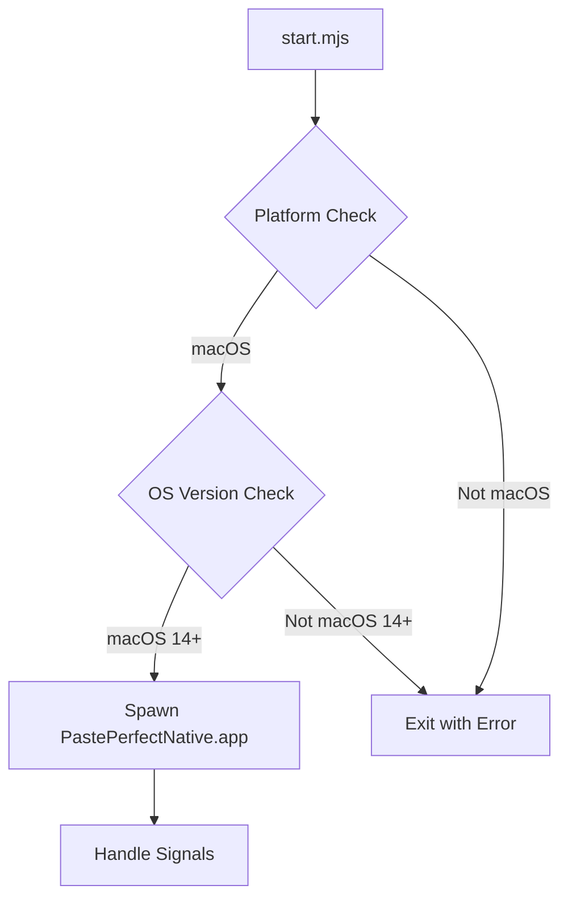

<!-- source: DeepWiki mcp.deepwiki.com · repo openai/sign-in-with-chatgpt-devkit · page 4.4 Build, Packaging and Tests · fetched 2026-10-26 -->

# Build, Packaging and Tests

<details>
<summary>Relevant source files</summary>

The following files were used as context for generating this wiki page:

- [examples/paste-perfect/native/asar-integrity.mjs](examples/paste-perfect/native/asar-integrity.mjs)
- [examples/paste-perfect/native/build-desktop.mjs](examples/paste-perfect/native/build-desktop.mjs)
- [examples/paste-perfect/native/build.mjs](examples/paste-perfect/native/build.mjs)
- [examples/paste-perfect/native/start.mjs](examples/paste-perfect/native/start.mjs)
- [examples/paste-perfect/test/asar-integrity.test.mjs](examples/paste-perfect/test/asar-integrity.test.mjs)
- [examples/paste-perfect/test/credential-encryption.test.mjs](examples/paste-perfect/test/credential-encryption.test.mjs)
- [examples/paste-perfect/test/credential-storage-runtime.mjs](examples/paste-perfect/test/credential-storage-runtime.mjs)
- [examples/paste-perfect/test/native-bundle.test.mjs](examples/paste-perfect/test/native-bundle.test.mjs)
- [examples/paste-perfect/test/native-command-auth.test.mjs](examples/paste-perfect/test/native-command-auth.test.mjs)
- [examples/paste-perfect/test/native-library-constraints.test.mjs](examples/paste-perfect/test/native-library-constraints.test.mjs)
- [examples/paste-perfect/test/native-regressions.swift](examples/paste-perfect/test/native-regressions.swift)
- [examples/paste-perfect/test/native-regressions.test.mjs](examples/paste-perfect/test/native-regressions.test.mjs)
- [examples/paste-perfect/tsconfig.json](examples/paste-perfect/tsconfig.json)
- [examples/paste-perfect/vite.config.ts](examples/paste-perfect/vite.config.ts)

</details>


This page details the build, packaging, and testing processes for the Paste Perfect example application. It covers the native macOS helper build, Electron desktop application packaging, ASAR integrity mechanisms, Vite configuration for the renderer process, and the comprehensive test suite including native regressions, command authentication, and credential storage runtime tests.

## Native macOS Helper Build

The native macOS helper application, `PastePerfectNative`, is built using Swift. The build process is orchestrated by `native/build.mjs` [examples/paste-perfect/native/build.mjs:1-180](). This script handles compilation, code signing, and embedding the Electron desktop application.

### Build Process Overview

The `build.mjs` script performs the following steps:
1.  **Platform and OS Version Check**: Ensures the build is running on macOS 14 or later [examples/paste-perfect/native/build.mjs:11-18]().
2.  **Architecture Detection**: Determines the target architecture (arm64 or x86_64) [examples/paste-perfect/native/build.mjs:19]().
3.  **Change Detection**: Calculates a SHA256 hash of relevant source files and build artifacts. If the hash matches a previous build and `--force` is not specified, the build is skipped to preserve ad-hoc identity and Accessibility consent [examples/paste-perfect/native/build.mjs:31-49]().
4.  **Cleanup**: Removes previous build artifacts [examples/paste-perfect/native/build.mjs:50]().
5.  **Directory Setup**: Creates necessary directories for the `.app` bundle [examples/paste-perfect/native/build.mjs:51]().
6.  **Info.plist and Third-Party Notices**: Copies `Info.plist` and third-party license notices into the app bundle [examples/paste-perfect/native/build.mjs:52-56]().
7.  **Swift Compilation**: Compiles `PastePerfectNative.swift` using `xcrun swiftc` targeting macOS 14.0, linking necessary frameworks like AppKit, ApplicationServices, CoreGraphics, and Security [examples/paste-perfect/native/build.mjs:57-59]().
8.  **Electron Desktop Application Embedding**:
    *   Copies the Electron application into the native app bundle [examples/paste-perfect/native/build.mjs:61-63]().
    *   Removes the `Squirrel.framework` installer tool [examples/paste-perfect/native/build.mjs:64-65]().
    *   Removes `default_app.asar` [examples/paste-perfect/native/build.mjs:68]().
    *   Stages the Electron app's `dist` and `dist-electron` directories [examples/paste-perfect/native/build.mjs:69-73]().
    *   Creates `app.asar` from the staged files [examples/paste-perfect/native/build.mjs:75-76]().
    *   Updates the Electron app's `Info.plist` with a unique bundle identifier and product name [examples/paste-perfect/native/build.mjs:78-80]().
    *   Embeds ASAR integrity information into the Electron app's `Info.plist` [examples/paste-perfect/native/build.mjs:81-82]().
    *   Flips Electron Fuses to harden the runtime environment, disabling features like `RunAsNode` and enabling `EmbeddedAsarIntegrityValidation` [examples/paste-perfect/native/build.mjs:83-95]().
    *   Patches the Electron Framework binary with ASAR integrity information [examples/paste-perfect/native/build.mjs:96]().
9.  **Code Signing and Library Constraints**: Applies ad-hoc code signing and enforces library constraints using `codesign` and `plutil` [examples/paste-perfect/native/build.mjs:100-180](). This ensures that only explicitly allowed libraries can be loaded by the application, enhancing security.

### Starting the Native App

The `native/start.mjs` script [examples/paste-perfect/native/start.mjs:1-18]() is used to launch the built native macOS application. It performs platform and OS version checks, then spawns the `PastePerfectNative.app` executable. It also handles signals to gracefully terminate the child process.


**Diagram: Native App Startup Flow**

Sources:
- [examples/paste-perfect/native/build.mjs:1-180]()
- [examples/paste-perfect/native/start.mjs:1-18]()

## Electron Desktop Application Build

The Electron desktop application's main and preload scripts are bundled using `esbuild`. This process is defined in `native/build-desktop.mjs` [examples/paste-perfect/native/build-desktop.mjs:1-9]().

### Bundling Process

1.  **Main Process**: `electron/main.ts` is bundled into `dist-electron/main.js`. It targets Node.js, uses ESM format, and externalizes `electron`. A `createRequire` banner is added to support CommonJS dependencies [examples/paste-perfect/native/build-desktop.mjs:5-7]().
2.  **Preload Script**: `electron/preload.ts` is bundled into `dist-electron/preload.cjs`. It also targets Node.js but uses CommonJS format and externalizes `electron` [examples/paste-perfect/native/build-desktop.mjs:8-9]().

Sources:
- [examples/paste-perfect/native/build-desktop.mjs:1-9]()

## ASAR Integrity

ASAR integrity is a critical security feature that ensures the Electron application's resources have not been tampered with. The `native/asar-integrity.mjs` script [examples/paste-perfect/native/asar-integrity.mjs:1-78]() handles embedding a cryptographic hash of the `app.asar` archive into the Electron Framework binary.

### Integrity Mechanism

1.  **`integrityDigest(integrity)`**: This function calculates a SHA256 hash of the ASAR integrity metadata. It validates the format of the integrity object, ensuring paths are relative to `Resources/` and hashes are valid SHA256 strings [examples/paste-perfect/native/asar-integrity.mjs:12-30]().
2.  **`asarIntegrityPatch(binary, integrity)`**: This function finds a specific sentinel (`AGbevlPCksUGKNL8TSn7wGmJEuJsXb2A`) within the Electron Framework binary. It then calculates a payload containing the integrity digest and returns the offset and payload for patching. It includes checks to ensure the binary is a valid Mach-O framework and that the integrity slot is not already occupied by a different digest [examples/paste-perfect/native/asar-integrity.mjs:33-53]().
3.  **`embedAsarIntegrity(appPath, integrity)`**: This function orchestrates the patching process. It opens the Electron Framework binary within the application bundle, calls `asarIntegrityPatch` to get the patch details, and then writes the payload into the binary. It also verifies that the write operation was successful [examples/paste-perfect/native/asar-integrity.mjs:56-78]().

```mermaid
graph TD
    A[ASAR Integrity Metadata] --> B{integrityDigest(integrity)}
    B -- SHA256 Digest --> C[Electron Framework Binary]
    C --> D{asarIntegrityPatch(binary, integrity)}
    D -- Offset + Payload --> E[embedAsarIntegrity(appPath, integrity)]
    E -- Writes Payload --> F[Patched Electron Framework Binary]
```
**Diagram: ASAR Integrity Embedding Flow**

Sources:
- [examples/paste-perfect/native/asar-integrity.mjs:1-78]()

## Vite Configuration

The Paste Perfect example application uses Vite for its renderer process. The configuration is defined in `vite.config.ts` [examples/paste-perfect/vite.config.ts]().

### Key Configuration Aspects

*   **Plugins**: Uses the React plugin for React support.
*   **Build Output**: Configures the build output directory to `dist`.
*   **Base Path**: Sets the base path to `./` for relative asset paths.
*   **Server**: Configures the development server to listen on `localhost:3000`.
*   **`THIRD_PARTY_NOTICES.md`**: The `vite-plugin-copy-third-party-notices` plugin is used to copy `THIRD_PARTY_NOTICES.md` to the build output.

Sources:
- [examples/paste-perfect/vite.config.ts]()

## Test Suite

The Paste Perfect example application includes a comprehensive test suite to ensure correctness and security.

### Native Regressions

The `native-regressions.test.mjs` [examples/paste-perfect/test/native-regressions.test.mjs:1-49]() script tests various regression cases for the native macOS helper. It compiles a modified version of `PastePerfectNative.swift` that includes test harnesses from `native-regressions.swift` [examples/paste-perfect/test/native-regressions.swift:1-101]().

**Key Regression Cases**:
*   **Launcher Environment**: Verifies that the native helper rejects untrusted launcher environment variables like `DYLD_INSERT_LIBRARIES` or `NODE_OPTIONS` [examples/paste-perfect/test/native-regressions.swift:8-18]().
*   **Data Directory Validation**: Tests validation of the `PASTE_PERFECT_DATA_DIR` environment variable, ensuring it's a valid, non-symlinked directory [examples/paste-perfect/test/native-regressions.swift:19-38]().
*   **Redirect Port Validation**: Ensures `PASTE_PERFECT_REDIRECT_PORT` is a valid port number [examples/paste-perfect/test/native-regressions.swift:39-43]().
*   **Recipe Filtering**: Verifies that the native controller correctly filters and limits custom recipes, rejecting invalid or duplicate entries [examples/paste-perfect/test/native-regressions.swift:44-56]().
*   **Cancellation Logic**: Tests various scenarios for cancelling pending operations, including running requests, ready results, stale cancellations, and late results [examples/paste-perfect/test/native-regressions.swift:58-87]().

Sources:
- [examples/paste-perfect/test/native-regressions.test.mjs:1-49]()
- [examples/paste-perfect/test/native-regressions.swift:1-101]()

### Command Authentication

The `native-command-auth.test.mjs` [examples/paste-perfect/test/native-command-auth.test.mjs:1-132]() script verifies the secure command authentication mechanism between the Electron main process and the native macOS helper.

**Authentication Flow**:
1.  **`transport()` function**: Sets up a mock IPC transport using `EventEmitter` for stdin/stdout. It loads the `electron/native.ts` module [examples/paste-perfect/test/native-command-auth.test.mjs:15-33]() and initializes `NativePaste`.
2.  **Token Exchange**: Commands cannot be sent until a private `transport-auth` message with a valid token is received via stdin [examples/paste-perfect/test/native-command-auth.test.mjs:41-44]().
3.  **Token Persistence**: Once authenticated, all subsequent commands automatically carry the established token, and callers cannot override it [examples/paste-perfect/test/native-command-auth.test.mjs:66-73]().
4.  **Invalid Tokens**: Malformed or incorrect authentication messages are rejected [examples/paste-perfect/test/native-command-auth.test.mjs:75-81]().
5.  **Token Rotation Prevention**: A second authentication message cannot replace an already established credential [examples/paste-perfect/test/native-command-auth.test.mjs:85-91]().
6.  **Channel Closure**: Native channel closure prevents further authenticated commands from being sent [examples/paste-perfect/test/native-command-auth.test.mjs:93-100]().
7.  **Compiled Native Guard**: A Swift-level test ensures that the native helper itself rejects commands with missing, malformed, or cross-launch credentials [examples/paste-perfect/test/native-command-auth.test.mjs:102-132]().

```mermaid
graph TD
    A[Electron Main Process] --> B{NativePaste.send(command)}
    B -- No Token Yet --> C[Command Blocked]
    A -- "transport-auth" + Token --> D[NativePaste.start()]
    D --> E{Command Authenticated?}
    E -- Yes --> F[Command Sent to Native Helper]
    E -- No (Invalid Token/Channel Closed) --> C
    F --> G[Native Helper]
    G -- Validates Token --> H[Execute Command]
```
**Diagram: Command Authentication Flow**

Sources:
- [examples/paste-perfect/test/native-command-auth.test.mjs:1-132]()

### Credential Storage Runtime

The `credential-storage-runtime.mjs` [examples/paste-perfect/test/credential-storage-runtime.mjs:1-76]() script performs a smoke test of the credential encryption provider at runtime using Electron's `safeStorage` API. This test is designed to be run with an actual Electron executable.

**Test Phases**:
The test runs through several phases to simulate real-world usage:
1.  **`prepare`**: Initializes the credential store.
2.  **`restart-and-failures`**: Tests persistence across restarts and handles potential failures.
3.  **`sign-out`**: Simulates a sign-out event.
4.  **`restart-after-sign-out`**: Verifies the state after a sign-out and restart.

The test uses a worker script (`credential-storage-runtime-worker.mjs`) bundled by `esbuild` [examples/paste-perfect/test/credential-storage-runtime.mjs:60-63]() to interact with Electron's `safeStorage`. It captures results and logs them, ensuring that the OS credential store functions as expected without user interaction for approval.

The `credential-encryption.test.mjs` [examples/paste-perfect/test/credential-encryption.test.mjs:1-43]() provides unit tests for the `createElectronCredentialEncryption` adapter. It verifies:
*   Availability checks for Electron readiness and OS encryption [examples/paste-perfect/test/credential-encryption.test.mjs:14-20]().
*   Linux-specific backend requirements, ensuring only recognized OS secret stores are allowed [examples/paste-perfect/test/credential-encryption.test.mjs:22-30]().
*   Delegation to `safeStorage` and re-checking availability on each operation [examples/paste-perfect/test/credential-encryption.test.mjs:32-43]().

Sources:
- [examples/paste-perfect/test/credential-storage-runtime.mjs:1-76]()
- [examples/paste-perfect/test/credential-encryption.test.mjs:1-43]()

### Native Bundle Tests

The `native-bundle.test.mjs` [examples/paste-perfect/test/native-bundle.test.mjs:1-111]() script performs end-to-end tests on the sealed native app package. It verifies the integrity of the bundled application and the security hardening applied during the build process.

**Key Tests**:
*   **Resource Seal and Native Code Identity**: Verifies that the app's resources and native code identity are valid and untampered [examples/paste-perfect/test/native-bundle.test.mjs:27-30]().
*   **Electron Fuse Wire**: Asserts that Electron Fuses are correctly set to disable potentially insecure features (e.g., `RunAsNode`, `EnableNodeOptionsEnvironmentVariable`) and enable security features (e.g., `EnableEmbeddedAsarIntegrityValidation`, `OnlyLoadAppFromAsar`) [examples/paste-perfect/test/native-bundle.test.mjs:31-40]().
*   **Tampering Detection**: Tests that tampering with critical files like `app.asar`, `Info.plist`, or the Electron executable itself causes the application to fail before startup [examples/paste-perfect/test/native-bundle.test.mjs:41-54]().
*   **Child Process Management**: Verifies that the native parent app correctly launches and manages the Electron child process, and that the child process terminates when the parent exits [examples/paste-perfect/test/native-bundle.test.mjs:55-111](). It also confirms that untrusted environment variables or command-line arguments are not forwarded to the privileged Electron process.

Sources:
- [examples/paste-perfect/test/native-bundle.test.mjs:1-111]()

### Native Library Constraints

The `native-library-constraints.test.mjs` [examples/paste-perfect/test/native-library-constraints.test.mjs:1-98]() script specifically tests macOS library constraints. This ensures that the application only loads explicitly allowed dynamic libraries, preventing injection of malicious code.

**Test Procedure**:
1.  **Dynamic Library Creation**: Creates several dynamic libraries (`allowed.dylib`, `different.dylib`, `resigned.dylib`) with distinct content and code signatures [examples/paste-perfect/test/native-library-constraints.test.mjs:31-42]().
2.  **Code Directory Hashes**: Extracts the `CDHash` for each library [examples/paste-perfect/test/native-library-constraints.test.mjs:24-28]().
3.  **Loader Creation**: Compiles a C loader program that attempts to `dlopen` these libraries [examples/paste-perfect/test/native-library-constraints.test.mjs:50-62]().
4.  **Constraint Application**: Signs the loader with specific entitlements (`com.apple.security.cs.disable-library-validation`) and a `library-constraint` that explicitly lists the `CDHash` of `allowed.dylib` [examples/paste-perfect/test/native-library-constraints.test.mjs:64-72]().
5.  **Runtime Verification**:
    *   Confirms the loader has the hardened runtime and the explicit validation exception [examples/paste-perfect/test/native-library-constraints.test.mjs:74-81]().
    *   Verifies that `allowed.dylib` loads successfully [examples/paste-perfect/test/native-library-constraints.test.mjs:82-85]().
    *   Asserts that `different.dylib` and `resigned.dylib` are rejected by the library constraint, even though they are validly signed, because their `CDHash` does not match the allowed list [examples/paste-perfect/test/native-library-constraints.test.mjs:86-97]().

Sources:
- [examples/paste-perfect/test/native-library-constraints.test.mjs:1-98]()

---

