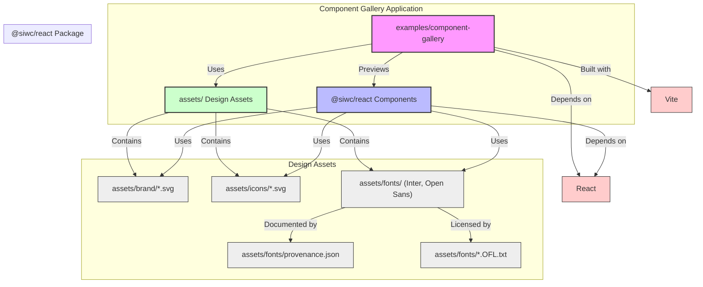

<!-- source: DeepWiki mcp.deepwiki.com · repo openai/sign-in-with-chatgpt-devkit · page 5 Component Gallery and Design Assets · fetched 2026-10-26 -->

# Component Gallery and Design Assets

Relevant source files

The following files were used as context for generating this wiki page:

- [assets/README.md](assets/README.md)
- [examples/component-gallery/package.json](examples/component-gallery/package.json)

This page provides a high-level overview of the design and preview tooling available in the DevKit, along with the shared asset library. It introduces the component gallery application, the brand assets and icons used across the project, and the bundled fonts and their provenance. Each section links to a child page for more detailed information.

The DevKit includes a dedicated component gallery application that serves as a living style guide and testing ground for the `@siwc/react` components. This gallery allows developers to preview components in various states and configurations, ensuring consistency and facilitating design iteration. Alongside the gallery, a centralized `assets/` directory [assets/README.md:3-3]() houses all shared design resources, including brand-specific SVGs, general icons, and fonts. These assets are crucial for maintaining the visual identity and user experience across all DevKit components and example applications.

## Gallery Application

The component gallery is a standalone application built with Vite [examples/component-gallery/package.json:21]() that showcases all the UI components from the `@siwc/react` package. It provides an interactive environment to inspect component behavior, styling, and responsiveness. Developers can use it to quickly iterate on UI changes without needing to integrate them into a full application. The gallery is structured to display different "specimen kinds" and allows for toggling viewports and reference states.

For details on the gallery's structure, component families, specimen kinds, viewport/reference toggles, activity bar, and Vite setup, see [Gallery Application](#5.1).

Sources:
* [examples/component-gallery/package.json:21]()

## Brand Assets and Icons

The `assets/` directory [assets/README.md:3-3]() is the central repository for all design assets used throughout the DevKit. This includes various SVG variants for the "Sign in with ChatGPT" buttons, connection cards, callouts, and other UI elements, all adhering to OpenAI's brand guidelines [assets/README.md:7-7](). Additionally, it contains general icons, such as external link indicators [assets/README.md:8-8](), and specific assets used in the repository's README, like black and white Sign in with ChatGPT SVG buttons and composer design examples [assets/README.md:9-9](). These assets are critical for maintaining a consistent and branded user experience.

For details on the `assets/brand` SVG variants, icons, README screenshots, sign-in button artwork, and brand guideline constraints, see [Brand Assets and Icons](#5.2).

Sources:
* [assets/README.md:3-3]()
* [assets/README.md:7-7]()
* [assets/README.md:8-8]()
* [assets/README.md:9-9]()

## Fonts and Provenance

The DevKit bundles specific fonts, namely Inter and Open Sans, in WOFF2 format [assets/README.md:10-10](). These fonts are distributed under the SIL Open Font License (OFL) [assets/README.md:10-10](). To ensure transparency and compliance, the project maintains a detailed `provenance.json` record [assets/README.md:16-16]() that includes exact download URLs, SHA-256 hashes, internal font versions, and download dates. A `google-fonts-latin.css` file [assets/README.md:16-16]() records the corresponding font-face rules. The repository also includes a workflow to verify and generate license information, ensuring that all bundled fonts and their licenses are correctly accounted for.

For details on the bundled Inter/Open Sans WOFF2 files, OFL licenses, `provenance.json` hashes, `google-fonts-latin.css`, and the `licenses:check`/`generate` workflow, see [Fonts and Provenance](#5.3).

Sources:
* [assets/README.md:10-10]()
* [assets/README.md:16-16]()

### Design Assets Overview

The following diagram illustrates the relationship between the component gallery, the `@siwc/react` package, and the shared design assets.

Sources:
* [examples/component-gallery/package.json:21]()
* [assets/README.md:3-3]()
* [assets/README.md:7-7]()
* [assets/README.md:8-8]()
* [assets/README.md:10-10]()
* [assets/README.md:16-16]()

---

