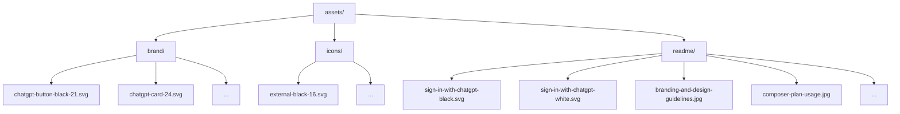

<!-- source: DeepWiki mcp.deepwiki.com · repo openai/sign-in-with-chatgpt-devkit · page 5.2 Brand Assets and Icons · fetched 2026-10-26 -->

# 5.2. Brand Assets and Icons

<details>
<summary>Relevant source files</summary>

The following files were used as context for generating this wiki page:

- [assets/brand/chatgpt-button-black-21.svg](assets/brand/chatgpt-button-black-21.svg)
- [assets/brand/chatgpt-card-24.svg](assets/brand/chatgpt-card-24.svg)
- [assets/icons/external-black-16.svg](assets/icons/external-black-16.svg)
- [assets/readme/branding-and-design-guidelines.jpg](assets/readme/branding-and-design-guidelines.jpg)
- [assets/readme/composer-plan-usage.jpg](assets/readme/composer-plan-usage.jpg)
- [assets/readme/sign-in-with-chatgpt-black.svg](assets/readme/sign-in-with-chatgpt-black.svg)
- [assets/readme/sign-in-with-chatgpt-white.svg](assets/readme/sign-in-with-chatgpt-white.svg)

</details>


This page details the brand assets and icons used within the Sign in with ChatGPT DevKit, covering SVG variants for the "Sign in with ChatGPT" button, general icons, and the brand guidelines that inform their design. The assets are primarily located in the `assets/` directory.

## Sign-in Button Artwork

The "Sign in with ChatGPT" button is provided in two primary color variants: black and white. These are SVG files designed for scalability and consistent rendering across different platforms and resolutions.

### Black Variant
The black variant of the button features a black background with white text and a white ChatGPT logo.
The SVG structure includes a `rect` element for the button's background and `path` elements for the ChatGPT logo and text.

```xml
<svg xmlns="http://www.w3.org/2000/svg" width="726" height="135" viewBox="0 0 242 45" fill="none" role="img" aria-label="Sign in with ChatGPT">
  <title>Sign in with ChatGPT</title>
  <g id="ChatGPT sign-in buttons">
    <g id="Sign in with ChatGPT">
      <g id="Sign in with ChatGPT / Black">
        <rect width="242" height="45" rx="12" fill="black" />
        <g id="ChatGPT logo - original vector" transform="translate(1.75 0)">
          <path id="Vector" d="..." fill="white" />
        </g>
        <g id="Button label" transform="translate(1.75 0)">
          <!-- Text elements for "Sign in with ChatGPT" -->
        </g>
      </g>
    </g>
  </g>
</svg>
```
[assets/readme/sign-in-with-chatgpt-black.svg:1-10]()

### White Variant
The white variant of the button features a white background with black text and a black ChatGPT logo.
Similar to the black variant, it uses a `rect` for the background and `path` elements for the logo and text.

```xml
<svg xmlns="http://www.w3.org/2000/svg" width="726" height="135" viewBox="0 0 242 45" fill="none" role="img" aria-label="Sign in with ChatGPT">
  <title>Sign in with ChatGPT</title>
  <g id="ChatGPT sign-in buttons">
    <g id="Sign in with ChatGPT">
      <g id="Sign in with ChatGPT / White">
        <rect width="242" height="45" rx="12" fill="white" />
        <g id="ChatGPT logo - original vector" transform="translate(1.75 0)">
          <path id="Vector" d="..." fill="black" />
        </g>
        <g id="Button label" transform="translate(1.75 0)">
          <!-- Text elements for "Sign in with ChatGPT" -->
        </g>
      </g>
    </g>
  </g>
</svg>
```
[assets/readme/sign-in-with-chatgpt-white.svg:1-10]()

These SVG files are intended for direct use in applications or for generating raster images at various sizes.

## General Icons

The DevKit includes a set of general-purpose icons, also provided as SVG files. These icons are designed to complement the overall UI and brand aesthetic.

### ChatGPT Logo Icon
A standalone ChatGPT logo icon is available in various sizes and colors for use in different contexts, such as application cards or smaller UI elements. For example, a black variant at 21x21 pixels is provided:

```xml
<svg preserveAspectRatio="none" overflow="visible" style="display: block;" width="21" height="21" viewBox="0 0 21 21" fill="none" xmlns="http://www.w3.org/2000/svg">
<g id="ChatGPT logo &#226;&#128;&#148; original vector">
<path id="Vector" d="..." fill="black"/>
</g>
</svg>
```
[assets/brand/chatgpt-button-black-21.svg:1-5]()

Another variant, `chatgpt-card-24.svg`, is a 24x24 pixel icon, also filled with `#0D0D0D` (a dark grey, almost black) [assets/brand/chatgpt-card-24.svg:1-3](). This icon is suitable for displaying on connection cards or similar UI components.

### External Link Icon
An icon for indicating external links is also included, such as `external-black-16.svg`. This icon is a 16x16 pixel SVG with a black fill (`#0D0D0D`) [assets/icons/external-black-16.svg:1-3]().

## Brand Guideline Constraints

The design of these assets adheres to specific brand guidelines to ensure consistency and proper representation of the ChatGPT brand. These guidelines dictate aspects such as:

*   **Color Palette**: Specific colors for backgrounds, text, and logo elements. For instance, the black button uses `black` for the background and `white` for the logo and text, while the white button reverses these.
*   **Typography**: The font used for the "Sign in with ChatGPT" text is part of the brand guidelines, although the text itself is rendered as paths within the SVG for consistent display without font dependencies.
*   **Spacing and Proportions**: The `viewBox` and `width`/`height` attributes in the SVG files define the intrinsic size and aspect ratio, ensuring correct scaling. The `transform` attributes on the logo and label groups (`translate(1.75 0)`) indicate precise positioning within the button's canvas [assets/readme/sign-in-with-chatgpt-black.svg:7, 10]().
*   **Logo Integrity**: The ChatGPT logo is used in its original vector form, ensuring clarity and sharpness at any scale. The `path` data (`d="..."`) defines the exact geometry of the logo [assets/readme/sign-in-with-chatgpt-black.svg:8]().

These guidelines are implicitly enforced by the provided SVG assets, which are pre-designed to meet these requirements. Developers should use these assets as provided to maintain brand consistency.

## README Screenshots

The `assets/readme/` directory also contains various JPEG images used for documentation and promotional purposes, such as screenshots for the project's README. These images visually demonstrate the application's features and UI, including how the brand assets are integrated. Examples include `branding-and-design-guidelines.jpg` [assets/readme/branding-and-design-guidelines.jpg:1-21]() and `composer-plan-usage.jpg` [assets/readme/composer-plan-usage.jpg:1-25](). While these are raster images and not directly used in the application's UI, they serve to illustrate the intended usage and appearance of the DevKit.

## Asset Structure

The following diagram illustrates the organization of brand assets and icons within the repository:


**Diagram: Asset Directory Structure**

Sources:
- [assets/readme/branding-and-design-guidelines.jpg:1-21]()
- [assets/readme/composer-plan-usage.jpg:1-25]()
- [assets/readme/sign-in-with-chatgpt-white.svg:1-10]()
- [assets/readme/sign-in-with-chatgpt-black.svg:1-10]()
- [assets/brand/chatgpt-button-black-21.svg:1-5]()
- [assets/brand/chatgpt-card-24.svg:1-3]()
- [assets/icons/external-black-16.svg:1-3]()

---

