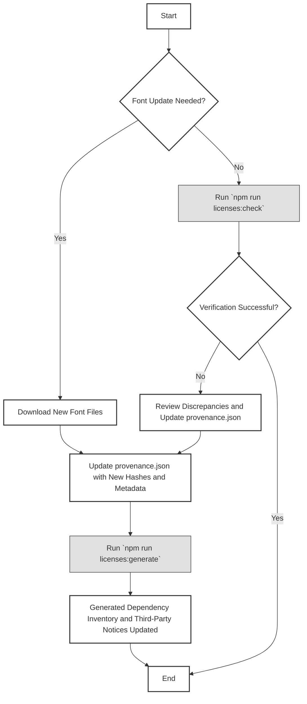

<!-- source: DeepWiki mcp.deepwiki.com · repo openai/sign-in-with-chatgpt-devkit · page 5.3 Fonts and Provenance · fetched 2026-10-26 -->

# Fonts and Provenance

Relevant source files

The following files were used as context for generating this wiki page:

- [assets/README.md](assets/README.md)
- [assets/fonts/google-fonts-latin.css](assets/fonts/google-fonts-latin.css)
- [assets/fonts/inter-OFL.txt](assets/fonts/inter-OFL.txt)
- [assets/fonts/open-sans-OFL.txt](assets/fonts/open-sans-OFL.txt)
- [assets/fonts/provenance.json](assets/fonts/provenance.json)

This page details the bundled fonts used in the Sign in with ChatGPT DevKit, their licensing, and the provenance tracking system. It covers the inclusion of Inter and Open Sans WOFF2 fonts, their Open Font License (OFL) files, the `provenance.json` record, the `google-fonts-latin.css` file, and the `licenses:check`/`licenses:generate` workflow for verification and updates.

## Bundled Fonts and Licensing

The DevKit bundles two WOFF2 font families: Inter and Open Sans [assets/README.md:10-10](). These fonts are located in the `assets/fonts/` directory [assets/README.md:10-10]().

*   **Inter**: Version 4.001 (`git-66647c0bb`), covering weights 100–900 [assets/README.md:14-14](). The bundled file is `inter-latin.woff2` [assets/fonts/provenance.json:11-11]().
*   **Open Sans**: Version 3.003, covering weights 300–800 [assets/README.md:14-14](). The bundled file is `open-sans-latin.woff2` [assets/fonts/provenance.json:45-45]().

Both fonts are licensed under the SIL Open Font License, Version 1.1 (OFL) [assets/fonts/inter-OFL.txt:3-3](), [assets/fonts/open-sans-OFL.txt:3-3](). The corresponding OFL license files (`inter-OFL.txt` and `open-sans-OFL.txt`) are included alongside the font files [assets/README.md:10-10](). When distributing these fonts, the corresponding OFL files must be preserved [assets/README.md:10-10]().

The OFL permits the use, study, modification, and redistribution of the licensed fonts, including bundling and embedding with other software, provided they are not sold by themselves and remain under the OFL [assets/fonts/inter-OFL.txt:19-26](), [assets/fonts/open-sans-OFL.txt:19-26]().

Sources:
* [assets/README.md:10-10]()
* [assets/README.md:14-14]()
* [assets/fonts/inter-OFL.txt:3-3]()
* [assets/fonts/inter-OFL.txt:19-26]()
* [assets/fonts/open-sans-OFL.txt:3-3]()
* [assets/fonts/open-sans-OFL.txt:19-26]()
* [assets/fonts/provenance.json:11-11]()
* [assets/fonts/provenance.json:45-45]()

## Font Provenance Record

The `assets/fonts/provenance.json` file serves as a detailed record of the bundled fonts' origin and integrity [assets/README.md:16-16](). This JSON file contains critical information for each font, ensuring traceability and verification.

### Provenance.json Structure

The `provenance.json` file [assets/fonts/provenance.json:1-77]() includes:
*   `schemaVersion`: The version of the provenance schema [assets/fonts/provenance.json:2-2]().
*   `source`: Indicates the origin of the fonts, in this case, "Google Fonts CSS API and Google Fonts versioned CDN" [assets/fonts/provenance.json:3-3]().
*   `cssRequestUrl`: The URL used to request the CSS from Google Fonts [assets/fonts/provenance.json:4-4]().
*   `cssRequestUserAgent`: The user agent string used during the CSS request [assets/fonts/provenance.json:5-5]().
*   `cssSelectionSnapshot`: A reference to the local file `assets/fonts/google-fonts-latin.css`, which contains the exact CSS rules selected [assets/fonts/provenance.json:6-6]().
*   `verification`: A descriptive string outlining the verification process and requirements for future updates [assets/fonts/provenance.json:7-7]().
*   `fonts`: An array of objects, each describing a bundled font [assets/fonts/provenance.json:8-74]().
    *   `name`: The font family name (e.g., "Inter", "Open Sans") [assets/fonts/provenance.json:10-10]().
    *   `path`: The local path to the WOFF2 font file [assets/fonts/provenance.json:11-11]().
    *   `sha256`: The SHA-256 hash of the font file, used for integrity verification [assets/fonts/provenance.json:12-12]().
    *   `bytes`: The size of the font file in bytes [assets/fonts/provenance.json:13-13]().
    *   `downloadUrl`: The exact URL from which the font was downloaded [assets/fonts/provenance.json:14-14]().
    *   `distributionVersion`: The version number from the Google Fonts CDN (e.g., "v20", "v44") [assets/fonts/provenance.json:15-15]().
    *   `fontVersion`: The internal version string of the font [assets/fonts/provenance.json:16-16]().
    *   `postScriptName`: The PostScript name of the font [assets/fonts/provenance.json:17-17]().
    *   `copyrightFromFont`: The copyright statement embedded within the font file [assets/fonts/provenance.json:18-18]().
    *   `subset`: The Unicode subset included (e.g., "latin") [assets/fonts/provenance.json:19-19]().
    *   `unicodeRangeFromCss`: The Unicode range specified in the CSS [assets/fonts/provenance.json:20-20]().
    *   `unicodeCodepointCount`: The number of Unicode codepoints covered [assets/fonts/provenance.json:21-21]().
    *   `style`: The font style (e.g., "normal") [assets/fonts/provenance.json:22-22]().
    *   `axes`: An array describing font variation axes (e.g., `wght` for weight) [assets/fonts/provenance.json:23-30]().
    *   `declaredLicense`: The declared license of the font (e.g., "OFL-1.1") [assets/fonts/provenance.json:31-31]().
    *   `licensePath`: The local path to the font's license file [assets/fonts/provenance.json:32-32]().
    *   `licenseSha256`: The SHA-256 hash of the license file [assets/fonts/provenance.json:33-33]().
    *   `licenseUrl`: The URL to the license file in the Google Fonts GitHub repository [assets/fonts/provenance.json:34-34]().
    *   `googleFontsRevision`: The specific Git commit hash of the Google Fonts repository from which the license and metadata were sourced [assets/fonts/provenance.json:35-35]().
    *   `googleFontsMetadataUrl`: The URL to the font's metadata file in the Google Fonts GitHub repository [assets/fonts/provenance.json:36-36]().
    *   `upstreamRepositoryFromGoogleFontsMetadata`: The upstream repository URL for the font [assets/fonts/provenance.json:37-37]().
    *   `upstreamCommitFromGoogleFontsMetadata`: The upstream Git commit hash for the font [assets/fonts/provenance.json:38-38]().
    *   `modifications`: A description of any modifications made to the font files (currently "None") [assets/fonts/provenance.json:39-39]().
    *   `downloadedOn`: The date the font was downloaded [assets/fonts/provenance.json:40-40]().
*   `cssSelectionSha256`: The SHA-256 hash of the `google-fonts-latin.css` file [assets/fonts/provenance.json:76-76]().

The `google-fonts-latin.css` file [assets/fonts/google-fonts-latin.css:1-22]() contains the `@font-face` rules for Inter and Open Sans, specifically for the Latin subset, as recorded from the Google Fonts API [assets/README.md:16-16](). These rules specify the `font-family`, `font-style`, `font-weight`, `font-display`, `src` URL, and `unicode-range` for each font [assets/fonts/google-fonts-latin.css:4-11](), [assets/fonts/google-fonts-latin.css:14-21]().

Sources:
* [assets/README.md:16-16]()
* [assets/fonts/google-fonts-latin.css:1-22]()
* [assets/fonts/google-fonts-latin.css:4-11]()
* [assets/fonts/google-fonts-latin.css:14-21]()
* [assets/fonts/provenance.json:1-77]()
* [assets/fonts/provenance.json:2-2]()
* [assets/fonts/provenance.json:3-3]()
* [assets/fonts/provenance.json:4-4]()
* [assets/fonts/provenance.json:5-5]()
* [assets/fonts/provenance.json:6-6]()
* [assets/fonts/provenance.json:7-7]()
* [assets/fonts/provenance.json:8-74]()
* [assets/fonts/provenance.json:10-10]()
* [assets/fonts/provenance.json:11-11]()
* [assets/fonts/provenance.json:12-12]()
* [assets/fonts/provenance.json:13-13]()
* [assets/fonts/provenance.json:14-14]()
* [assets/fonts/provenance.json:15-15]()
* [assets/fonts/provenance.json:16-16]()
* [assets/fonts/provenance.json:17-17]()
* [assets/fonts/provenance.json:18-18]()
* [assets/fonts/provenance.json:19-19]()
* [assets/fonts/provenance.json:20-20]()
* [assets/fonts/provenance.json:21-21]()
* [assets/fonts/provenance.json:22-22]()
* [assets/fonts/provenance.json:23-30]()
* [assets/fonts/provenance.json:31-31]()
* [assets/fonts/provenance.json:32-32]()
* [assets/fonts/provenance.json:33-33]()
* [assets/fonts/provenance.json:34-34]()
* [assets/fonts/provenance.json:35-35]()
* [assets/fonts/provenance.json:36-36]()
* [assets/fonts/provenance.json:37-37]()
* [assets/fonts/provenance.json:38-38]()
* [assets/fonts/provenance.json:39-39]()
* [assets/fonts/provenance.json:40-40]()
* [assets/fonts/provenance.json:76-76]()

## Verification and Update Workflow

The DevKit includes a workflow to verify the integrity of the bundled fonts and their associated license files against the `provenance.json` record.

### `licenses:check`

The `npm run licenses:check` command is used to verify the committed fonts, license files, CSS selection, and generated notices against the recorded hashes in `provenance.json` [assets/README.md:18-18](). This command ensures that the local files match their recorded provenance, preventing accidental modifications or corruption.

### `licenses:generate`

If a font needs to be replaced or updated, the following steps should be taken:
1.  Verify the new upstream bytes of the font.
2.  Update the `provenance.json` record with the new details, including SHA-256 hashes and any other relevant information [assets/README.md:18-18]().
3.  Run `npm run licenses:generate` [assets/README.md:18-18](). This command will update the generated dependency inventory and third-party notices, retaining the source URLs and hashes in builds [assets/README.md:18-18]().

This process establishes the source of the bundled files and maintains a clear audit trail for all font assets [assets/README.md:18-18]().

### Font Provenance Workflow

**Figure 1: Font Provenance Workflow**

Sources:
* [assets/README.md:18-18]()

---

