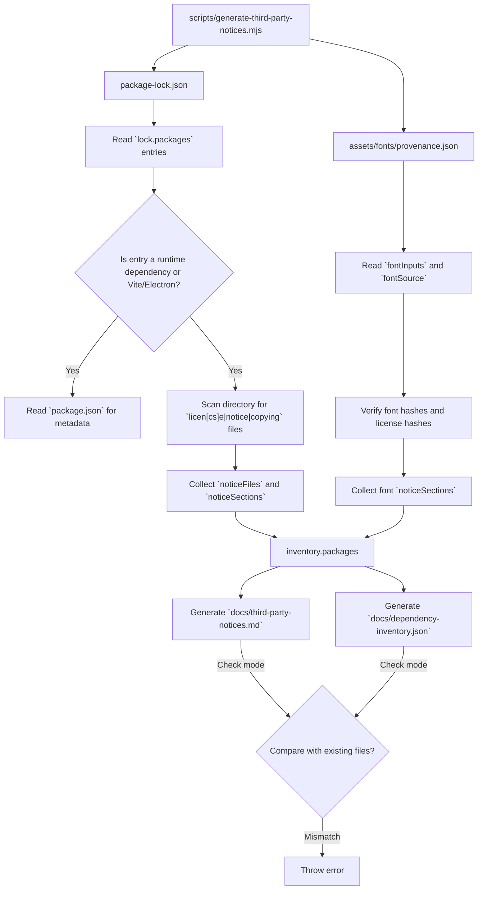

<!-- source: DeepWiki mcp.deepwiki.com · repo openai/sign-in-with-chatgpt-devkit · page 6 Security and Repo Tooling · fetched 2026-10-26 -->

# Security and Repo Tooling

Relevant source files

The following files were used as context for generating this wiki page:

- [docs/security.md](docs/security.md)
- [scripts/generate-third-party-notices.mjs](scripts/generate-third-party-notices.mjs)

This page provides a high-level overview of the security model implemented in the Sign in with ChatGPT DevKit and the automated tooling used for repository maintenance, particularly concerning licensing and third-party notices. It serves as a parent page, linking to more detailed child pages for in-depth information on each topic.

The security model focuses on protecting user credentials, ensuring application integrity, and handling sensitive data like clipboard contents securely. This involves careful consideration of application boundaries, robust OAuth flows, and verification mechanisms for code and assets. The repository tooling, on the other hand, automates the generation of crucial legal and compliance documents, such as third-party notices and dependency inventories, ensuring that the project adheres to licensing requirements.

## Security Model

The DevKit's security model is designed to safeguard user data and maintain the integrity of the application across various components, including the local SDK, Electron application, and native macOS helper. A core aspect is the requirement for application-supplied credential encryption, with no plaintext fallback for sensitive information. This ensures that access and refresh tokens, ID tokens, and other registration data are always encrypted at rest. Application boundaries are strictly enforced, separating sensitive operations and data from less trusted components like renderer processes. OAuth flows are hardened with PKCE and OIDC nonces, and identity tokens are verified before credentials can be used. For details, see [Security Model](#6.1).

Sources: [docs/security.md:1-45]()

## License and Notice Automation

The repository includes a pipeline of scripts designed to automate the generation and verification of license and third-party notices. This automation is critical for maintaining compliance with the licenses of all included dependencies and bundled assets. The primary script, `generate-third-party-notices.mjs`, scans the `package-lock.json` file and bundled fonts to compile a comprehensive list of third-party components and their associated licenses. This process ensures that all required notices are present and up-to-date, and it also generates a detailed dependency inventory. For details, see [License and Notice Automation](#6.2).

### Third-Party Notice Generation Flow

Sources: [scripts/generate-third-party-notices.mjs:1-102]()

---

