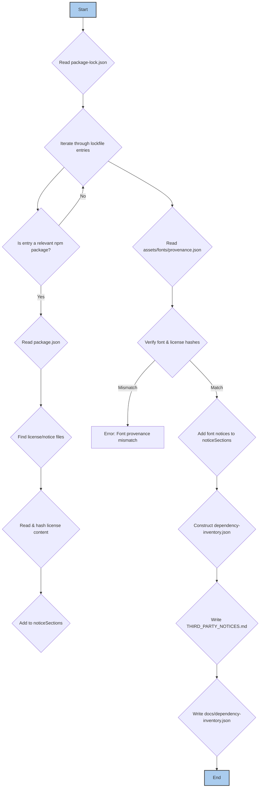
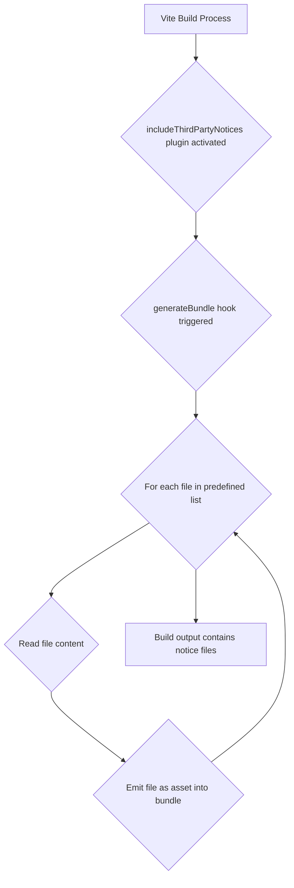

<!-- source: DeepWiki mcp.deepwiki.com · repo openai/sign-in-with-chatgpt-devkit · page 6.2 License and Notice Automation · fetched 2026-10-26 -->

# License and Notice Automation

<details>
<summary>Relevant source files</summary>

The following files were used as context for generating this wiki page:

- [docs/dependency-inventory.json](docs/dependency-inventory.json)
- [scripts/copy-package-notices.mjs](scripts/copy-package-notices.mjs)
- [scripts/generate-third-party-notices.mjs](scripts/generate-third-party-notices.mjs)
- [scripts/vite-notices.mjs](scripts/vite-notices.mjs)

</details>


This page details the automated processes and scripts used to manage and generate license and third-party notices within the Sign in with ChatGPT DevKit. The primary goal is to ensure compliance by accurately identifying and documenting the licenses of all dependencies, including npm packages and bundled fonts. This involves generating a comprehensive `THIRD_PARTY_NOTICES.md` file, a `docs/dependency-inventory.json` file, and integrating these notices into build artifacts.

## Dependency Inventory Generation

The `scripts/generate-third-party-notices.mjs` script is responsible for creating the `THIRD_PARTY_NOTICES.md` and `docs/dependency-inventory.json` files. It analyzes the `package-lock.json` to identify all dependencies and their declared licenses. It also incorporates information about bundled fonts from `assets/fonts/provenance.json`.

The script performs the following key steps:
1.  **Read `package-lock.json`**: It reads and parses the `package-lock.json` file to get a list of all installed packages and their metadata [scripts/generate-third-party-notices.mjs:8-9]().
2.  **Filter Dependencies**: It iterates through the lockfile entries, focusing on packages within `node_modules/` that are not workspace links. It includes runtime dependencies, `vite`, and `electron` even if they are marked as development dependencies, as they can emit runtime helpers or have specific licensing requirements [scripts/generate-third-party-notices.mjs:18-20]().
3.  **Extract Package Information**: For each relevant package, it reads its `package.json` to verify the version and extracts repository information [scripts/generate-third-party-notices.mjs:23-44]().
4.  **Locate License Files**: It searches for common license and notice filenames (e.g., `LICENSE`, `NOTICE`, `COPYING`) within each package's directory [scripts/generate-third-party-notices.mjs:33-34](). If no such files are found, it throws an error, requiring manual review [scripts/generate-third-party-notices.mjs:35]().
5.  **Generate Notice Sections**: The content of identified license files is read, hashed (SHA-256), and formatted into Markdown sections for `THIRD_PARTY_NOTICES.md` [scripts/generate-third-party-notices.mjs:38-44]().
6.  **Process Fonts**: It reads `assets/fonts/provenance.json` to get details about bundled fonts. It verifies the SHA-256 hashes of the font files and their associated license files against the recorded provenance data [scripts/generate-third-party-notices.mjs:50-62](). Any mismatch results in an error, ensuring font provenance integrity [scripts/generate-third-party-notices.mjs:51-53, scripts/generate-third-party-notices.mjs:57-59, scripts/generate-third-party-notices.mjs:60-62]().
7.  **Construct Inventory**: It builds a `dependency-inventory.json` object containing detailed information for each package and font, including paths, names, versions, declared licenses, resolved URLs, integrity hashes, and included notice files [scripts/generate-third-party-notices.mjs:67-93]().
8.  **Write Output Files**: Finally, it writes the generated `THIRD_PARTY_NOTICES.md` and `docs/dependency-inventory.json` files to disk [scripts/generate-third-party-notices.mjs:104-105]().


**Figure 1: `generate-third-party-notices.mjs` Data Flow**
Sources: [scripts/generate-third-party-notices.mjs:1-124]()

The `docs/dependency-inventory.json` file provides a machine-readable record of all dependencies. It includes:
*   `schemaVersion`: Version of the inventory schema [docs/dependency-inventory.json:2]().
*   `source`: Origin of the dependency data, e.g., `package-lock.json` [docs/dependency-inventory.json:3]().
*   `lockfileVersion`: Version of the `package-lock.json` [docs/dependency-inventory.json:4]().
*   `lockfileSha256`: SHA-256 hash of the `package-lock.json` [docs/dependency-inventory.json:5]().
*   `scope`: A description of what the inventory covers [docs/dependency-inventory.json:6]().
*   `electronBinaryScope`: Specific notes regarding Electron's binary licenses [docs/dependency-inventory.json:7]().
*   `packages`: An array of objects, each representing a package dependency. Each package entry contains:
    *   `path`: The path to the package in `node_modules` or workspace [docs/dependency-inventory.json:10]().
    *   `name`: Package name [docs/dependency-inventory.json:11]().
    *   `version`: Package version [docs/dependency-inventory.json:12]().
    *   `declaredLicense`: The license declared in `package.json` [docs/dependency-inventory.json:13]().
    *   `resolved`: The resolved URL for the package [docs/dependency-inventory.json:14]().
    *   `integrity`: Subresource Integrity hash [docs/dependency-inventory.json:15]().
    *   `workspaceLink`: Boolean indicating if it's a workspace link [docs/dependency-inventory.json:16]().
    *   `developmentOnly`: Boolean indicating if it's a dev dependency [docs/dependency-inventory.json:17]().
    *   `optional`: Boolean indicating if it's an optional dependency [docs/dependency-inventory.json:18]().
    *   `os`, `cpu`: Platform-specific constraints [docs/dependency-inventory.json:19-20]().
    *   `dependencies`, `optionalDependencies`, `peerDependencies`: Lists of dependencies [docs/dependency-inventory.json:21-23]().
    *   `includedNoticeFiles`: An array of objects, each detailing a found license file (path and SHA-256 hash) [docs/dependency-inventory.json:24]().
*   `fontSource`: Metadata about the font source [scripts/generate-third-party-notices.mjs:91]().
*   `fonts`: An array of objects, each describing a bundled font, including its path, SHA-256 hash, license path, and other provenance details [scripts/generate-third-party-notices.mjs:92]().

Sources: [docs/dependency-inventory.json:1-197](), [scripts/generate-third-party-notices.mjs:67-93]()

## Copying Package Notices

The `scripts/copy-package-notices.mjs` script is a utility to copy essential license and notice files to a specified output directory. This is crucial for ensuring that distributed packages or applications include the necessary legal documentation.

The `copyPackageNotices` function takes an `output` URL as an argument [scripts/copy-package-notices.mjs:5](). It then iterates through a predefined list of filenames: `LICENSE`, `THIRD_PARTY_NOTICES.md`, and `docs/dependency-inventory.json` [scripts/copy-package-notices.mjs:6](). For each file, it constructs the destination path, creates the necessary directories if they don't exist [scripts/copy-package-notices.mjs:8](), and copies the file from its source location relative to the script to the destination [scripts/copy-package-notices.mjs:9]().

```mermaid
graph TD
    A[Call copyPackageNotices(outputDir)] --> B{For each file in ['LICENSE', 'THIRD_PARTY_NOTICES.md', 'docs/dependency-inventory.json']};
    B --> C{Construct destination path};
    C --> D{Create output directory if not exists};
    D --> E{Copy file from source to destination};
    E --> B;
    B --> F[End];
```
**Figure 2: `copy-package-notices.mjs` Workflow**
Sources: [scripts/copy-package-notices.mjs:1-16]()

## Vite Notices Plugin

The `scripts/vite-notices.mjs` script provides a Vite plugin, `includeThirdPartyNotices`, designed to embed critical license and notice files directly into the build output of Vite-powered applications. This ensures that web-based components or applications, such as the Component Gallery or the Paste Perfect dashboard, include their legal documentation.

The `includeThirdPartyNotices` function returns a Vite plugin object [scripts/vite-notices.mjs:5-6](). The plugin's `generateBundle` hook is executed during the build process [scripts/vite-notices.mjs:9](). Inside this hook, it iterates over a list of filenames: `LICENSE`, `THIRD_PARTY_NOTICES.md`, `docs/dependency-inventory.json`, and the OFL license files for Inter and Open Sans fonts [scripts/vite-notices.mjs:10-15](). For each file, it reads its content [scripts/vite-notices.mjs:17]() and then uses `this.emitFile` to add it as an asset to the generated bundle [scripts/vite-notices.mjs:18-22]().


**Figure 3: `vite-notices.mjs` Plugin Integration**
Sources: [scripts/vite-notices.mjs:1-26]()

---

