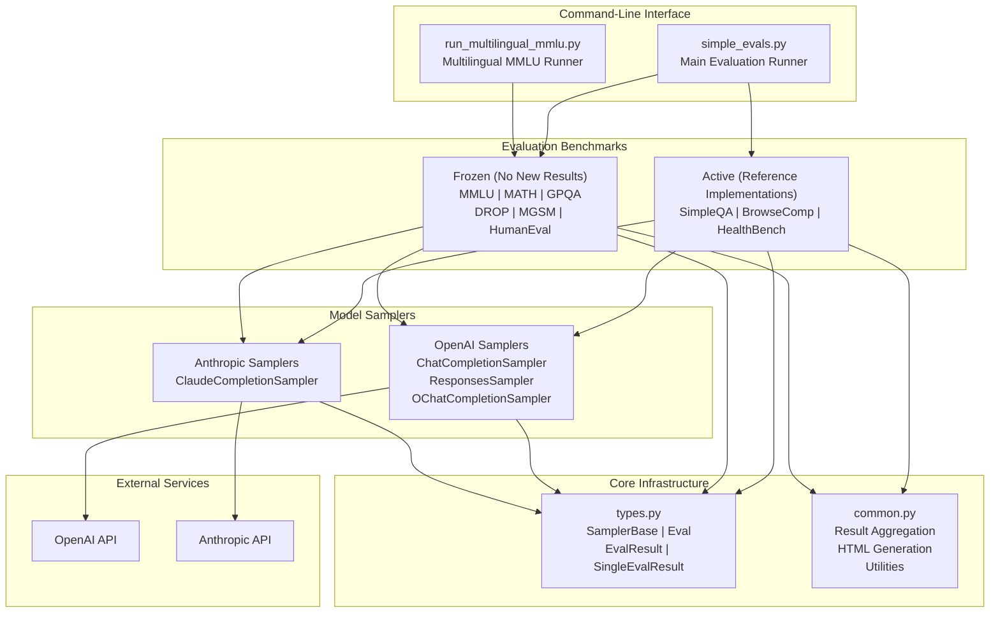
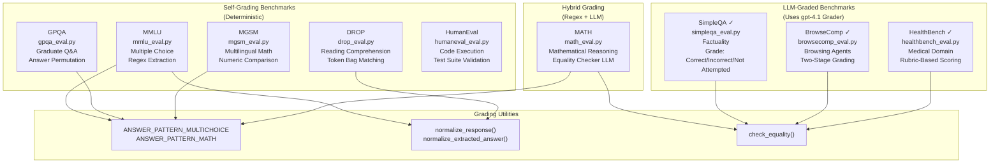
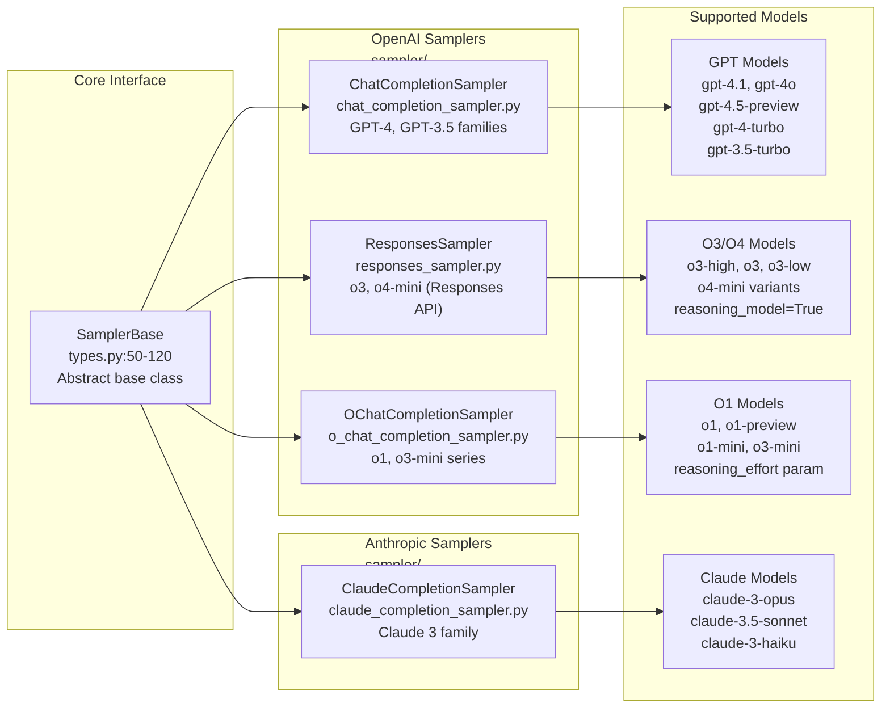
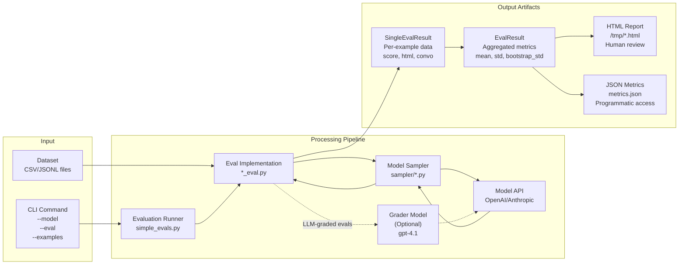

<!-- source: DeepWiki mcp.deepwiki.com · repo openai/simple-evals · page 1 Overview · fetched 2026-10-26 -->

# Overview

Relevant source files

The following files were used as context for generating this wiki page:

- [README.md](README.md)

This document provides an introduction to the simple-evals repository, a lightweight framework for evaluating large language models (LLMs). It covers the system's purpose, deprecation status, architecture, and the three actively maintained reference implementations.

For detailed installation and usage instructions, see [Getting Started](#2). For architectural details about samplers, evaluations, and result aggregation, see [Architecture](#3). For comprehensive documentation of individual benchmarks, see [Evaluation Benchmarks](#4).

---

## ⚠️ Deprecation Status

**As of July 2025, simple-evals is frozen and will no longer receive updates for new models or benchmark results.** The main evaluation runner [`simple_evals.py`](simple-evals/simple_evals.py:1-400)() and most benchmark implementations are in maintenance mode only.

The repository continues to serve as the **canonical reference implementation** for three actively maintained evaluation benchmarks:

| Benchmark | Purpose | Documentation |
|-----------|---------|---------------|
| **SimpleQA** | Short-form factuality evaluation | [SimpleQA: Factuality Evaluation](#4.1.1) |
| **BrowseComp** | Browsing agent capability assessment | [BrowseComp: Browsing Agent Evaluation](#4.1.2) |
| **HealthBench** | Medical domain language understanding | [HealthBench: Medical Domain Evaluation](#4.1.3) |

The core infrastructure (`common.py`, `types.py`, sampler implementations) remains available for reuse in derivative work.

**Sources:** [README.md:1-6]()

---

## What is simple-evals?

simple-evals is a lightweight library for evaluating language models across multiple benchmarks. It was open-sourced to provide transparency about the accuracy numbers published alongside OpenAI's latest models.

### Purpose

The framework serves three primary purposes:

1. **Transparent Benchmarking**: Publish reproducible evaluation methodologies for OpenAI model releases
2. **Reference Implementations**: Maintain canonical implementations of key evaluation benchmarks (SimpleQA, BrowseComp, HealthBench)
3. **Reusable Infrastructure**: Provide modular components (samplers, utilities, type definitions) for building custom evaluations

### Design Philosophy

simple-evals emphasizes **zero-shot, chain-of-thought evaluation** with simple instructions like "Solve the following multiple choice problem" [README.md:64](). This contrasts with approaches that use few-shot prompts or role-playing prompts, which were designed for base models rather than instruction-tuned models.

The framework is intentionally lightweight and focused, not designed as a comprehensive collection of evaluations (for that, see [openai/evals](https://github.com/openai/evals)).

**Sources:** [README.md:7-72]()

---

## System Architecture

simple-evals follows a modular three-tier architecture that separates model APIs, evaluation logic, and result aggregation:

### High-Level Component Organization

### Key Architectural Components

| Component | File(s) | Purpose |
|-----------|---------|---------|
| **CLI Runners** | `simple_evals.py`, `run_multilingual_mmlu.py` | Orchestrate evaluation execution, handle command-line arguments |
| **Evaluation Benchmarks** | `*_eval.py` files | Implement specific evaluation tasks (MMLU, MATH, etc.) |
| **Model Samplers** | `sampler/*.py` | Abstract API differences for OpenAI and Anthropic models |
| **Type System** | `types.py` | Define core interfaces (`SamplerBase`, `Eval`) |
| **Common Utilities** | `common.py` | Shared result aggregation, HTML rendering, normalization |

The architecture enables **any benchmark to work with any model** through the `SamplerBase` interface. For details on the type system and interfaces, see [Type System and Interfaces](#3.1). For sampler implementations, see [Model Samplers](#3.2).

**Sources:** [README.md:87-95](), Diagram 1 from provided high-level architecture

---

## Evaluation Benchmark Portfolio

simple-evals includes nine evaluation benchmarks covering language understanding, mathematical reasoning, code generation, and domain-specific tasks:

### Benchmark Categories and Grading Strategies

### Benchmark Summary

| Benchmark | Status | Task Type | Grading Method | Docs |
|-----------|--------|-----------|----------------|------|
| **SimpleQA** | ✓ Active | Factuality | LLM (gpt-4.1) | [#4.1.1](#4.1.1) |
| **BrowseComp** | ✓ Active | Browsing agents | LLM (gpt-4.1) | [#4.1.2](#4.1.2) |
| **HealthBench** | ✓ Active | Medical domain | LLM (gpt-4.1) rubric | [#4.1.3](#4.1.3) |
| MMLU | Frozen | Multiple choice | Regex + normalization | [#4.2.1](#4.2.1) |
| GPQA | Frozen | Graduate Q&A | Regex + normalization | [#4.2.2](#4.2.2) |
| MATH | Frozen | Math problems | Regex + LLM equality | [#4.3.1](#4.3.1) |
| MGSM | Frozen | Multilingual math | Regex + normalization | [#4.3.2](#4.3.2) |
| DROP | Frozen | Reading comp. | Token bag matching | [#4.4.1](#4.4.1) |
| HumanEval | Frozen | Code generation | Test execution | [#4.4.2](#4.4.2) |

**Grading Strategy Implications:**
- **Self-grading**: Fast, deterministic, but may miss semantically correct variations
- **LLM-graded**: Handles nuance and open-ended responses, but introduces grader model dependencies
- **Hybrid**: Combines extraction reliability with semantic equivalence checking

For comprehensive documentation of each benchmark, see [Evaluation Benchmarks](#4).

**Sources:** [README.md:75-85](), Diagram 4 from provided high-level architecture

---

## Model Support

simple-evals supports multiple model families through specialized sampler implementations:

### Sampler Implementations and Model Coverage

### Key Differences Between Samplers

| Sampler | API | System Prompt Support | Special Parameters |
|---------|-----|----------------------|-------------------|
| `ChatCompletionSampler` | OpenAI Chat Completions | ✓ Yes (role: "assistant") | Standard temperature, max_tokens |
| `ResponsesSampler` | OpenAI Responses | ✗ No | `reasoning_model=True` for o3/o4-mini |
| `OChatCompletionSampler` | OpenAI Chat Completions | ✗ No | `reasoning_effort` for o1 series |
| `ClaudeCompletionSampler` | Anthropic Messages | ✓ Configurable | Empty or LMSYS system messages |

The sampler abstraction enables evaluations to remain agnostic to model API differences. For detailed documentation, see [Model Samplers](#3.2).

**Sources:** [README.md:87-94](), [README.md:130-139](), Diagram 3 from provided high-level architecture

---

## Evaluation Workflow

The evaluation pipeline transforms user inputs through prompt construction, model sampling, grading, and result aggregation:

### End-to-End Evaluation Pipeline

### Result Structure

The framework produces a two-level result hierarchy:

1. **`SingleEvalResult`** ([types.py:23-32]()): Per-example results containing:
   - `score`: Numeric score (0.0 or 1.0 for binary grading)
   - `html`: Human-readable HTML snippet for debugging
   - `convo`: Full conversation history (prompts + responses)
   - `metrics`: Optional task-specific metrics dictionary

2. **`EvalResult`** ([types.py:35-44]()): Aggregated results containing:
   - `score`: Mean score across all examples
   - `metrics`: Statistical summaries (mean, std, bootstrap_std) and categorical breakdowns
   - `htmls`: List of all SingleEvalResult HTML snippets
   - `convos`: List of all conversation histories

For details on result aggregation and output formats, see [Common Utilities and Result Aggregation](#3.4) and [Output Files and Reports](#6.2).

**Sources:** Diagram 2 from provided high-level architecture, Diagram 5 from provided high-level architecture

---

## Key Features

### Zero-Shot Chain-of-Thought Prompting

All evaluations use simple, direct instructions without few-shot examples or role-playing prompts. This reflects realistic usage patterns for instruction-tuned models [README.md:64]().

### Model-Agnostic Design

The `SamplerBase` interface ([types.py:50-120]()) enables any evaluation to work with any supported model API without modification. Evaluations call `sampler(messages)` without knowing the underlying model family.

### Flexible Grading Strategies

The framework supports three grading approaches:
- **Deterministic**: Regex patterns and normalization functions for exact matching
- **LLM-based**: Separate grader model evaluates response quality
- **Hybrid**: Combines extraction with semantic equivalence checking

See [Benchmark Specializations and Grading Strategies](#4) for details.

### Comprehensive Result Artifacts

Each evaluation produces:
- **HTML reports**: Visual review of model responses with correct/incorrect annotations
- **JSON metrics**: Machine-readable performance statistics
- **Full conversation logs**: Complete prompt/response traces for debugging

For output format details, see [Output Files and Reports](#6.2).

### Multilingual Support

The framework includes multilingual evaluation capabilities:
- **Multilingual MMLU**: Human-translated MMLU questions in 14 languages
- **MGSM**: Grade school math problems in 11 languages

See [Multilingual Evaluation](#5) for comprehensive documentation.

**Sources:** [README.md:60-72](), Diagram 2 and Diagram 5 from provided high-level architecture

---

## Relationship to Other Frameworks

simple-evals is **not** a replacement for [openai/evals](https://github.com/openai/evals), which provides a comprehensive collection of evaluation benchmarks. Instead, simple-evals focuses on:

1. **Transparency**: Publishing exact evaluation methodologies used for OpenAI model releases
2. **Simplicity**: Lightweight implementation emphasizing zero-shot prompting
3. **Reference Implementations**: Canonical versions of key benchmarks (SimpleQA, BrowseComp, HealthBench)

The framework accepts contributions for:
- Bug fixes
- New model adapters (implementing `SamplerBase` for additional APIs)
- New result rows with eval results for existing benchmarks

The framework **does not accept** new evaluation benchmarks [README.md:66-69]().

**Sources:** [README.md:66-72]()

---

## Getting Started

To begin using simple-evals:

1. **Installation**: See [Getting Started](#2) for dependency installation instructions
2. **List Available Models**: Run `python -m simple-evals.simple_evals --list-models`
3. **Run Evaluations**: Execute `python -m simple-evals.simple_evals --model <model_name> --examples <num>`
4. **Review Results**: Check `/tmp/` directory for HTML reports and JSON metrics files

For comprehensive usage documentation, see [Running Evaluations](#6).

**Sources:** [README.md:96-127]()

---

