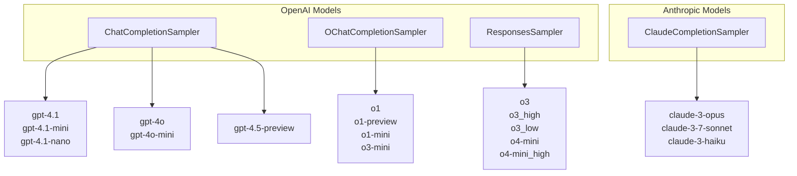
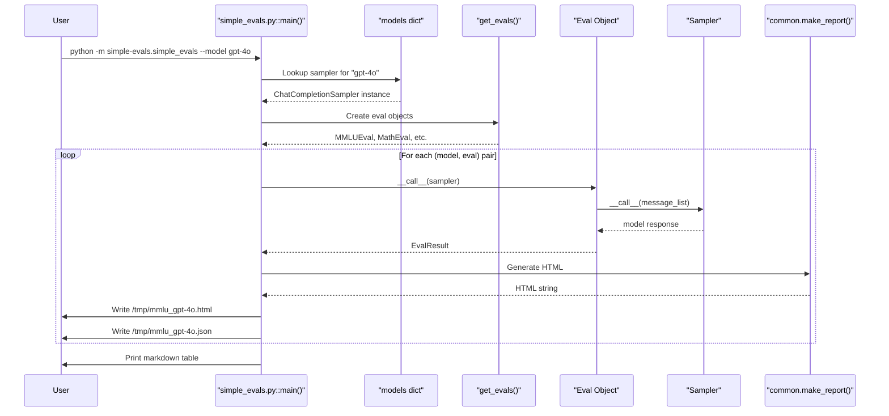
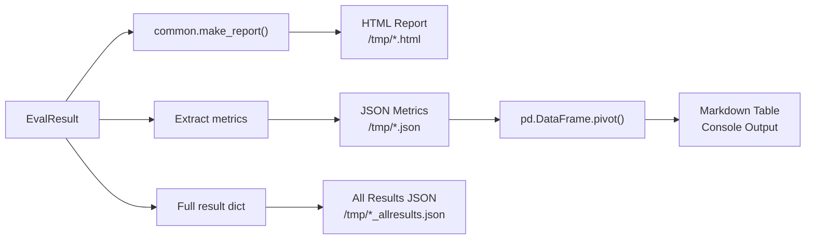
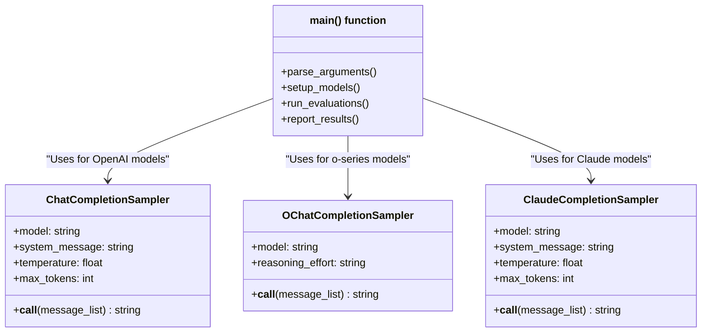

<!-- source: DeepWiki mcp.deepwiki.com · repo openai/simple-evals · page 2 Getting Started · fetched 2026-10-26 -->

# Getting Started

<details>
<summary>Relevant source files</summary>

The following files were used as context for generating this wiki page:

- [README.md](README.md)
- [run_multilingual_mmlu.py](run_multilingual_mmlu.py)
- [simple_evals.py](simple_evals.py)

</details>


This guide covers the basic setup and usage of simple-evals, including installation, running your first evaluation, and understanding the output.

**Note**: As of July 2025, simple-evals is no longer actively maintained. New models and benchmark results will not be added. The repository continues to host reference implementations for HealthBench, BrowseComp, and SimpleQA.

## Prerequisites

Before using simple-evals, you need:

- Python 3.10 or higher
- API keys for the model providers you want to evaluate:
  - OpenAI API key (for GPT models and o-series models)
  - Anthropic API key (for Claude models)

## Installation

Simple-evals does not provide a unified setup mechanism due to optional dependencies. Install only the components you need:

### OpenAI API

For evaluating OpenAI models (GPT-4, GPT-4o, o1, o3-mini, etc.):

```bash
pip install openai
export OPENAI_API_KEY='your-api-key-here'
```

### Anthropic API

For evaluating Claude models:

```bash
pip install anthropic
export ANTHROPIC_API_KEY='your-api-key-here'
```

### HumanEval (Code Generation)

For running the HumanEval code generation benchmark:

```bash
git clone https://github.com/openai/human-eval
pip install -e human-eval
```

Sources: [README.md:96-114]()

## Quick Start

The simplest way to get started is to run an evaluation with debug mode, which uses fewer examples and completes quickly:

```bash
python -m simple-evals.simple_evals --model gpt-4o --debug
```

This command will:
1. Use the `gpt-4o` model
2. Run all available evaluations (MMLU, MATH, GPQA, etc.)
3. Use only 5-10 examples per evaluation (debug mode)
4. Generate HTML and JSON reports in `/tmp/`

Sources: [simple_evals.py:29-63](), [simple_evals.py:262-265]()

## Listing Available Models

To see all available models:

```bash
python -m simple-evals.simple_evals --list-models
```

This displays all configured models, including:
- GPT-4.1 family: `gpt-4.1`, `gpt-4.1-mini`, `gpt-4.1-nano`
- GPT-4o family: `gpt-4o`, `gpt-4o-mini`
- o-series models: `o1`, `o1-preview`, `o1-mini`, `o3-mini`, `o3`, `o4-mini`
- Claude models: `claude-3-opus-20240229_empty`, `claude-3-7-sonnet-20250219`

**Model Name Diagram**



Sources: [simple_evals.py:34-42](), [simple_evals.py:65-236](), [simple_evals.py:238-242]()

## Command Line Options

The CLI supports the following arguments:

| Argument | Type | Default | Description |
|----------|------|---------|-------------|
| `--list-models` | Flag | - | Lists all available models and exits |
| `--model` | String | All models | Model name(s) to evaluate. Accepts comma-separated list |
| `--eval` | String | All evals | Evaluation(s) to run. Accepts comma-separated list |
| `--examples` | Integer | Varies by eval | Number of examples to use (overrides default) |
| `--n-repeats` | Integer | Varies by eval | Number of times to repeat each evaluation |
| `--n-threads` | Integer | 120 | Number of threads (for HealthBench only) |
| `--debug` | Flag | False | Runs in debug mode with minimal examples |

Sources: [simple_evals.py:29-63]()

## Running Evaluations

### Running All Evaluations with Default Settings

To run all evaluations for a specific model with full datasets:

```bash
python -m simple-evals.simple_evals --model gpt-4o
```

This will run all benchmarks (MMLU, MATH, GPQA, DROP, MGSM, HumanEval, SimpleQA, BrowseComp, HealthBench) with their default number of examples.

### Selecting Specific Evaluations

To run only specific evaluations:

```bash
python -m simple-evals.simple_evals --model gpt-4o --eval mmlu,math
```

Available evaluations:
- `mmlu` - Massive Multitask Language Understanding
- `math` - Mathematical problem solving
- `gpqa` - Graduate-level Q&A
- `drop` - Reading comprehension
- `mgsm` - Multilingual grade school math
- `humaneval` - Code generation
- `simpleqa` - Factuality (active reference implementation)
- `browsecomp` - Browsing agents (active reference implementation)
- `healthbench` - Medical domain (active reference implementation)

Sources: [simple_evals.py:267-362]()

### Evaluating Multiple Models

Evaluate multiple models in one run using comma-separated model names:

```bash
python -m simple-evals.simple_evals --model gpt-4o,gpt-4.1,o3-mini --eval mmlu
```

### Controlling Number of Examples

Override the default number of examples:

```bash
python -m simple-evals.simple_evals --model gpt-4o --examples 100
```

This is useful for:
- Quick testing (use small number like 10)
- Reproducibility (use same number across runs)
- Budget control (fewer examples = lower API costs)

### Debug Mode

For rapid testing and development:

```bash
python -m simple-evals.simple_evals --model gpt-4o --debug
```

Debug mode:
- Uses 5-10 examples per evaluation
- Completes in minutes instead of hours
- Useful for verifying setup and code changes

Sources: [simple_evals.py:59-61](), [simple_evals.py:262-265]()

## Evaluation Execution Flow

**Execution Sequence Diagram**



Sources: [simple_evals.py:373-424]()

## Understanding Output Files

Each evaluation run generates three types of output files in the `/tmp/` directory:

### File Naming Convention

Files follow this pattern:
```
/tmp/{eval_name}_{model_name}_{timestamp}[_DEBUG].{extension}
```

For example:
```
/tmp/mmlu_gpt-4o_20250115_143022.html
/tmp/mmlu_gpt-4o_20250115_143022.json
/tmp/mmlu_gpt-4o_20250115_143022_allresults.json
```

### HTML Reports

**Location**: `/tmp/{eval_name}_{model_name}_{timestamp}.html`

HTML reports provide human-readable evaluation results with:
- Overall score and metrics
- Per-example results showing:
  - Original question
  - Model response
  - Expected answer
  - Whether the response was correct
  - Full conversation history

These reports are useful for:
- Debugging model failures
- Understanding error patterns
- Manual inspection of results

**Output Generation Diagram**



Sources: [simple_evals.py:376-404]()

### JSON Metrics

**Location**: `/tmp/{eval_name}_{model_name}_{timestamp}.json`

Compact JSON file containing aggregated metrics:

```json
{
  "score": 0.873,
  "accuracy": 0.873,
  "num_examples": 100,
  "bootstrap_std": 0.033
}
```

Metrics vary by evaluation type:
- MMLU: `score` (accuracy)
- MATH: `score` (accuracy), `num_samples`
- DROP: `score` (F1), `exact_match`
- SimpleQA: `accuracy_given_attempted`, `f1_score`, `correct`, `incorrect`, `not_attempted`

Sources: [simple_evals.py:384-392]()

### Full Results JSON

**Location**: `/tmp/{eval_name}_{model_name}_{timestamp}_allresults.json`

Complete evaluation results including per-example data:

```json
{
  "score": 0.873,
  "metrics": { ... },
  "htmls": ["<per-example HTML>", ...],
  "convos": [[{"role": "user", "content": "..."}, ...], ...],
  "metadata": { ... }
}
```

This file contains:
- `score`: Overall score
- `metrics`: All computed metrics
- `htmls`: HTML snippets for each example
- `convos`: Full conversation history for each example
- `metadata`: Additional evaluation metadata

Use this for:
- Detailed analysis
- Reproducing specific examples
- Custom metric computation

Sources: [simple_evals.py:394-404]()

### Console Output

After all evaluations complete, a markdown table is printed to the console showing results across all model-evaluation pairs:

```
|                       |   ('metric', 'mmlu') |   ('metric', 'math') |
|:----------------------|---------------------:|---------------------:|
| ('model_name', '')    |                      |                      |
| gpt-4o_20250115_143022|                0.873 |                0.685 |
```

Sources: [simple_evals.py:407-424]()

## Usage Examples

### Listing Available Models

To see all available models that can be evaluated:

```bash
python -m simple-evals.simple_evals --list-models
```

This will display a list of all models configured in the system.

### Running Evaluations with a Specific Model

To run evaluations using a specific model:

```bash
python -m simple-evals.simple_evals --model gpt-4o
```

This will run all evaluations using the gpt-4o model.

### Running in Debug Mode

For testing or development purposes, you can run in debug mode to use fewer examples:

```bash
python -m simple-evals.simple_evals --model gpt-4o --debug
```

### Specifying Number of Examples

To override the default number of examples for each evaluation:

```bash
python -m simple-evals.simple_evals --model gpt-4o --examples 10
```

This will run all evaluations with 10 examples each (where applicable).

Sources: [README.md:101-110](), [simple_evals.py:115-126]()

## Implementation Details

The CLI is implemented in the `simple_evals.py` file, which serves as the main entry point for the evaluation framework. The file defines:

1. The argument parser for processing command line arguments
2. The available models and their corresponding samplers
3. The evaluation factory function that creates evaluation objects
4. The main execution loop that runs evaluations and generates reports

The actual evaluation logic is implemented in separate modules, each focused on a specific benchmark. The CLI orchestrates the evaluation process by selecting models and evaluations based on user input, running the evaluations, and aggregating the results.

Sources: [simple_evals.py:1-12](), [simple_evals.py:22-213]()

## Integration with Model Samplers

The CLI integrates with different model samplers to support various language model APIs:



Sources: [simple_evals.py:13-19](), [simple_evals.py:37-113]()

## Summary

The Command Line Interface provides a flexible and straightforward way to evaluate language models across multiple benchmarks. By providing command line arguments, users can customize the evaluation process to meet their specific needs. The CLI handles the complexity of model selection, evaluation execution, and result reporting, providing a unified interface to the simple-evals framework.

---

