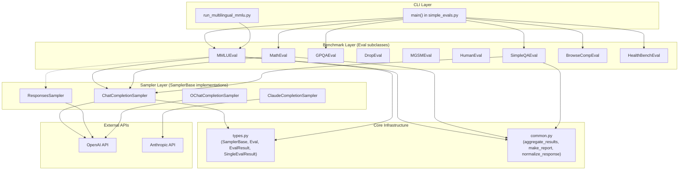
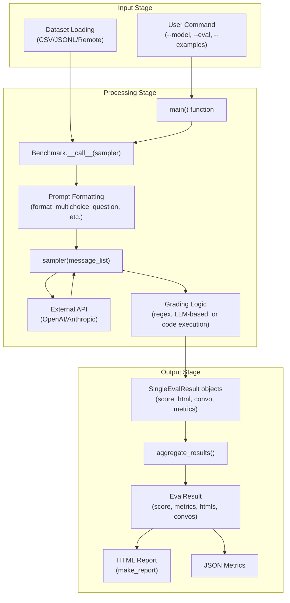
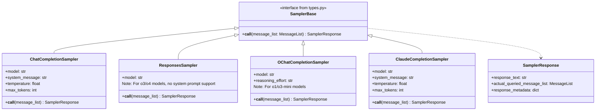
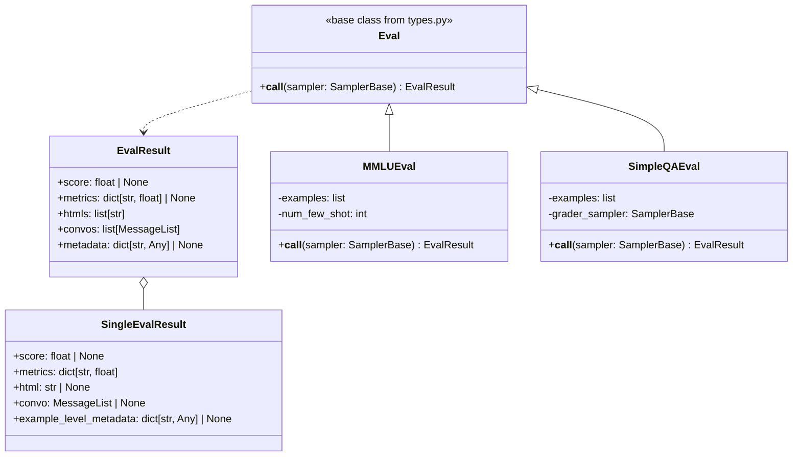
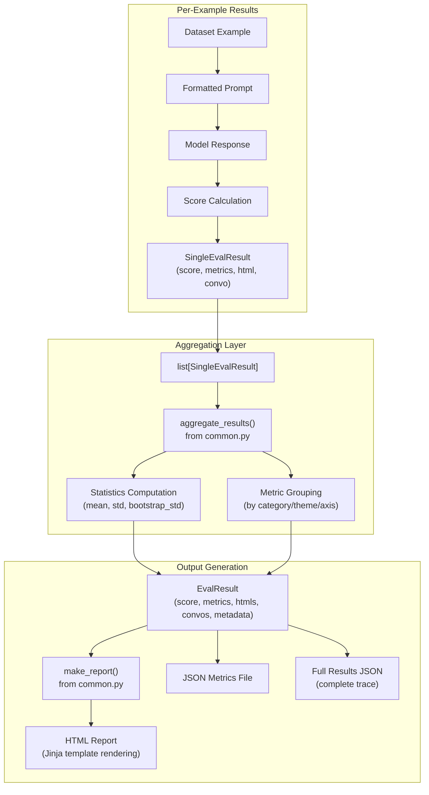
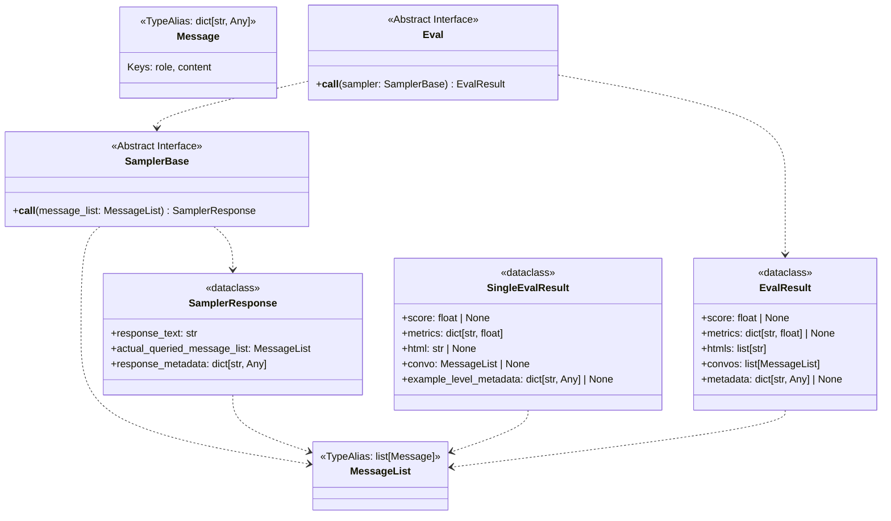

<!-- source: DeepWiki mcp.deepwiki.com · repo openai/simple-evals · page 3 Architecture · fetched 2026-10-26 -->

# Architecture

Relevant source files

The following files were used as context for generating this wiki page:

- [README.md](README.md)
- [common.py](common.py)
- [types.py](types.py)

## Purpose and Scope

This document describes the high-level architecture of the simple-evals framework, a lightweight system for evaluating language models across diverse benchmarks. The framework follows a three-tier architecture: command-line interface entrypoints that orchestrate evaluation runs, specialized benchmark implementations that encode evaluation logic, and model samplers that abstract different API interfaces.

**Deprecation Status**: As of July 2025, simple-evals is frozen for new models and results. Only three benchmarks (SimpleQA, BrowseComp, HealthBench) remain actively maintained as reference implementations. However, the core infrastructure (types, samplers, utilities) remains available for reuse.

For detailed information about type definitions and interfaces, see page 3.1. For model samplers, see page 3.2. For the evaluation framework, see page 3.3. For common utilities and result aggregation, see page 3.4.

## High-Level Architecture Overview

The framework is organized into three primary layers:

1. **Entry Points**: Command-line interfaces that orchestrate evaluation runs
2. **Benchmarks**: Specialized evaluation implementations that encode task-specific logic
3. **Samplers**: Model interface abstractions that handle different API patterns

### Three-Tier Architecture Diagram

**Sources**: [types.py:1-67](), [common.py:183-216](), [README.md:1-143]()

The system is centered around the `main()` function in `simple_evals.py`, which orchestrates evaluation runs. Benchmarks implement the `Eval` interface from `types.py` and use `SamplerBase` implementations to query models. All benchmarks can work with any sampler through this common interface, enabling flexible model-benchmark combinations.

## Core Execution Flow

The evaluation pipeline processes data from user commands through model APIs to aggregated results:

### Evaluation Pipeline Data Flow

**Sources**: [simple_evals.py:22-213](), [common.py:183-216](), [types.py:31-66]()

The `main()` function orchestrates the following steps:
1. Parse command-line arguments (model selection, eval selection, parameters)
2. Initialize `SamplerBase` implementations for specified models
3. Instantiate `Eval` subclasses for benchmarks with configuration
4. For each model-benchmark pair, call `eval_object(sampler)` which returns `EvalResult`
5. Use `make_report()` to generate HTML reports from `EvalResult.htmls`
6. Write metrics to JSON files
7. Aggregate all results into combined output table

## Model Sampler Architecture

The sampler layer provides a uniform interface (`SamplerBase`) to diverse language model APIs, enabling any benchmark to work with any model.

### Sampler Class Hierarchy

**Sources**: [types.py:4-28](), [README.md:87-94]()

### Sampler Implementations

| Sampler Class | Purpose | Key Characteristics | Location |
|---------------|---------|---------------------|----------|
| `ChatCompletionSampler` | GPT-4 family, GPT-3.5 | Supports system messages, standard chat API | sampler/chat_completion_sampler.py |
| `ResponsesSampler` | o3, o4-mini models | Uses Responses API, no system prompt support, `reasoning_model=True` | sampler/responses_sampler.py |
| `OChatCompletionSampler` | o1 series, o3-mini | No system prompt, supports `reasoning_effort` parameter | sampler/o_chat_completion_sampler.py |
| `ClaudeCompletionSampler` | Claude models | Configurable system messages (empty or LMSYS template) | sampler/claude_completion_sampler.py |

All samplers implement `SamplerBase.__call__(message_list: MessageList) -> SamplerResponse` where `MessageList = list[Message]` and `Message = dict[str, Any]` (with keys `role`, `content`).

For detailed sampler documentation, see page 3.2 (Model Samplers), with subsections 3.2.1 (OpenAI Samplers) and 3.2.2 (Claude Sampler).

## Evaluation Framework

Benchmarks implement the `Eval` interface and follow a standardized execution pattern:

### Evaluation Interface Contract

**Sources**: [types.py:59-66](), [types.py:31-56]()

### Standard Evaluation Process

All `Eval` implementations follow this pattern:

1. **Dataset Loading**: Load examples from CSV, JSONL, or remote sources
2. **Prompt Construction**: Format prompts using templates (e.g., `QUERY_TEMPLATE_MULTICHOICE`)
3. **Model Sampling**: Call `sampler(message_list)` which returns `SamplerResponse`
4. **Answer Extraction**: Parse responses using regex patterns (e.g., `ANSWER_PATTERN_MULTICHOICE`)
5. **Grading**: Score responses via:
   - **Self-grading**: Direct comparison to ground truth (MMLU, GPQA, MATH)
   - **LLM-grading**: Use grader model to assess quality (SimpleQA, BrowseComp, HealthBench)
   - **Code execution**: Run test suites (HumanEval)
6. **Result Creation**: Build `SingleEvalResult` for each example
7. **Aggregation**: Combine via `aggregate_results()` into final `EvalResult`

See page 3.3 (Evaluation Framework) for detailed implementation patterns. See page 4 for specific benchmark implementations.

## Results Aggregation and Reporting

The result aggregation pipeline transforms per-example results into comprehensive evaluation reports:

### Aggregation Pipeline

**Sources**: [common.py:183-216](), [common.py:335-343](), [types.py:31-56]()

### Aggregation Functions

The `aggregate_results()` function in `common.py` performs the following:

1. **Metric Collection**: Extract all metrics from each `SingleEvalResult.metrics` dict
2. **Score Aggregation**: Collect `SingleEvalResult.score` values
3. **Statistical Computation**: Calculate statistics via `_compute_stat()`:
   - `mean`: Average score across examples
   - `std`: Standard deviation
   - `bootstrap_std`: Bootstrap confidence intervals
   - `min`, `max`: Range statistics
   - `n_samples`: Number of examples
4. **HTML Consolidation**: Combine `SingleEvalResult.html` snippets
5. **Conversation Logging**: Preserve all `SingleEvalResult.convo` message lists

### Output Formats

| Format | Function | Purpose | File Location |
|--------|----------|---------|---------------|
| HTML Report | `make_report()` | Human-readable results with example-level detail | `/tmp/<model>_<eval>_report.html` |
| JSON Metrics | Direct serialization | Lightweight metrics for programmatic access | `/tmp/<model>_<eval>.json` |
| Full Results JSON | Complete `EvalResult` | Reproducibility, includes all conversations | `/tmp/<model>_<eval>_full.json` |

See page 3.4 (Common Utilities and Result Aggregation) for detailed utility documentation. See page 6.2 (Output Files and Reports) for output file specifications.

## Type System and Data Structures

The framework is built around a core set of type definitions that ensure modularity:

### Core Type Definitions

**Sources**: [types.py:1-67]()

All types are defined in `types.py`. The key abstractions are:

- **`Message`**: Dictionary with `role` and `content` keys, representing a single message
- **`MessageList`**: List of messages forming a conversation
- **`SamplerBase`**: Abstract interface for model APIs
- **`SamplerResponse`**: Model output wrapper with response text and metadata
- **`SingleEvalResult`**: Per-example evaluation results
- **`EvalResult`**: Aggregated results across all examples
- **`Eval`**: Abstract interface for benchmark implementations

This type system enables any benchmark (`Eval`) to work with any model (`SamplerBase`) through a uniform interface.

See page 3.1 (Type System and Interfaces) for comprehensive type documentation.

## Common Utilities

The `common.py` module provides shared utilities used across all benchmarks:

### Utility Functions

| Function | Signature | Purpose | Location |
|----------|-----------|---------|----------|
| `format_multichoice_question()` | `(row: dict) -> str` | Format multiple choice questions using template | [common.py:153-154]() |
| `check_equality()` | `(sampler, expr1, expr2) -> bool` | Compare mathematical expressions via LLM | [common.py:157-161]() |
| `aggregate_results()` | `(list[SingleEvalResult], ...) -> EvalResult` | Aggregate per-example results with statistics | [common.py:183-216]() |
| `map_with_progress()` | `(f, xs, num_threads, pbar) -> list` | Parallel processing with progress bar | [common.py:219-234]() |
| `make_report()` | `(eval_result: EvalResult) -> str` | Generate HTML report using Jinja templates | [common.py:335-343]() |
| `normalize_response()` | `(response: str) -> str` | Strip markdown/LaTeX formatting | [common.py:355-374]() |
| `normalize_extracted_answer()` | `(extracted_answer: str) -> str` | Normalize multilingual answer characters | [common.py:377-395]() |

### Prompt Templates

- **`QUERY_TEMPLATE_MULTICHOICE`**: Standard multiple choice question format [common.py:15-24]()
- **`EQUALITY_TEMPLATE`**: Template for mathematical expression comparison [common.py:78-136]()

### Answer Extraction Patterns

- **`ANSWER_PATTERN_MULTICHOICE`**: Regex for "Answer: $LETTER" format [common.py:26]()
- **`ANSWER_PATTERN`**: General answer extraction regex [common.py:27]()
- **`MULTILINGUAL_ANSWER_REGEXES`**: Answer patterns in 15+ languages [common.py:32-75]()

See page 3.4 (Common Utilities and Result Aggregation) for detailed utility documentation.

## Summary

The Simple-Evals architecture provides a modular, extensible framework for evaluating language model performance across diverse tasks. Its key strengths include:

1. A unified interface for interacting with different language models
2. Standardized evaluation processes across tasks
3. Flexible result aggregation and reporting
4. Support for parallel processing of evaluations
5. Easy extension to new models and evaluation tasks

To learn more about specific evaluation tasks, see [Evaluation Tasks](#3), and for details on adding new models, see [Adding New Models](#6.1).

---

