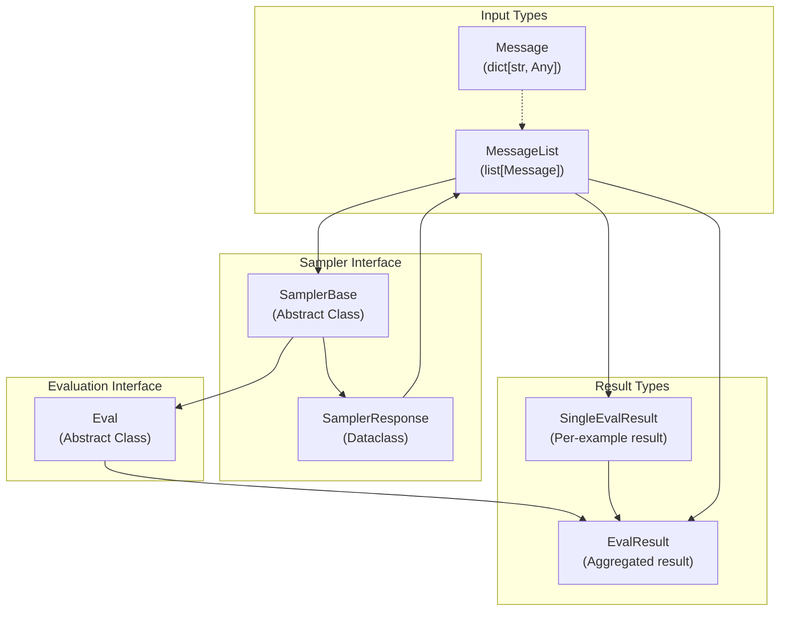
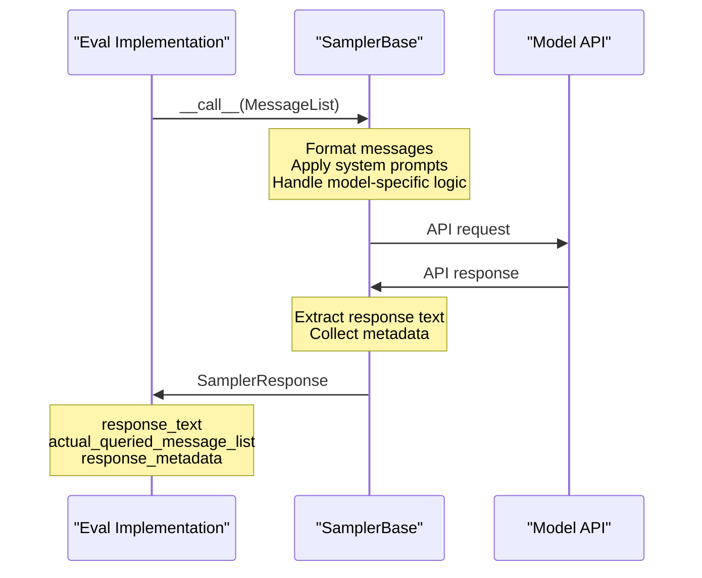
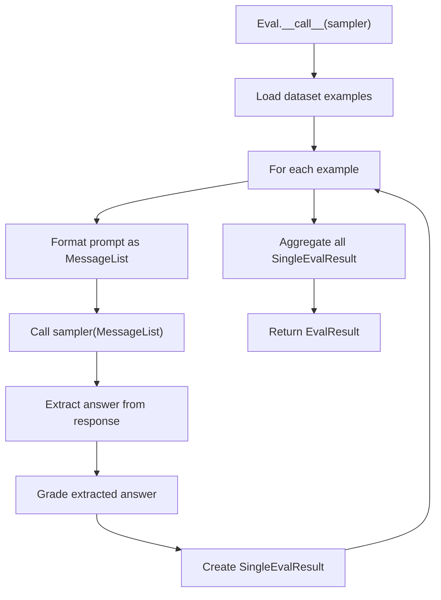
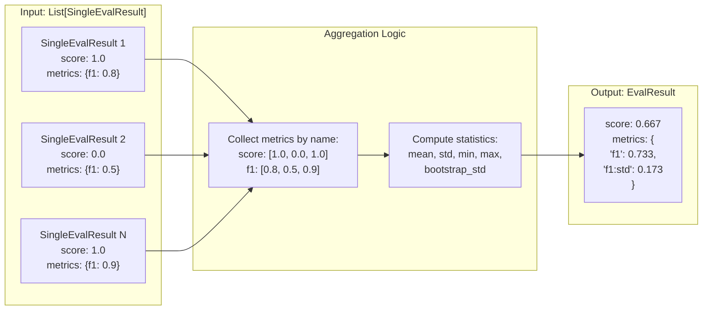
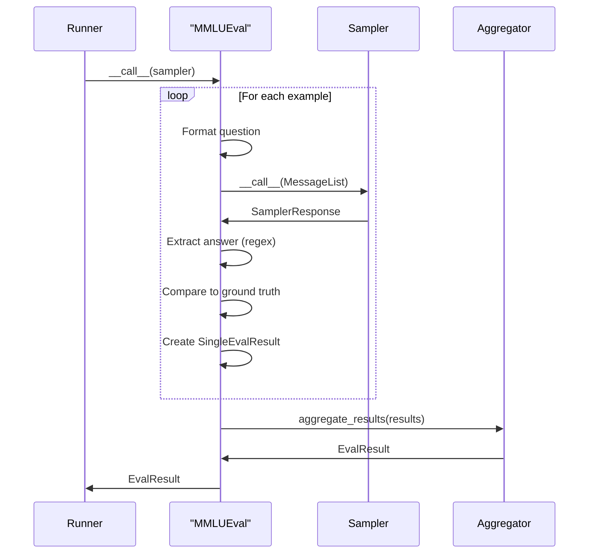
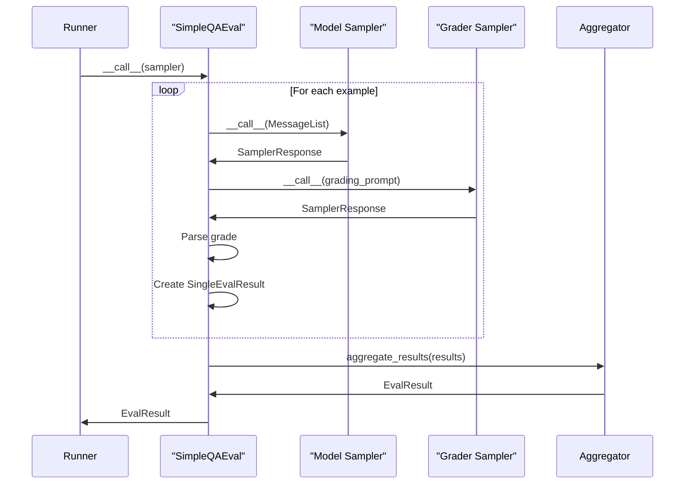
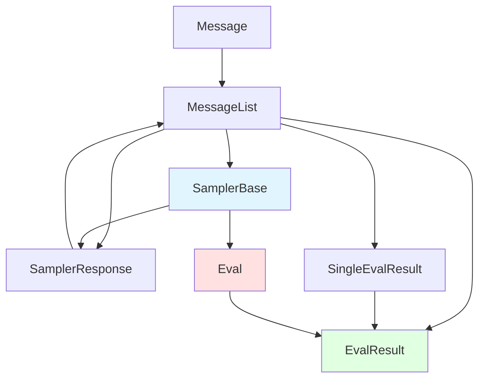

<!-- source: DeepWiki mcp.deepwiki.com · repo openai/simple-evals · page 3.1 Type System and Interfaces · fetched 2026-10-26 -->

# Type System and Interfaces

<details>
<summary>Relevant source files</summary>

The following files were used as context for generating this wiki page:

- [common.py](common.py)
- [types.py](types.py)

</details>


## Purpose and Scope

This document describes the core type system and abstract interfaces that form the foundation of simple-evals. These abstractions define the contracts between samplers (model wrappers), evaluations (benchmark implementations), and result types, enabling the modular architecture where any sampler can work with any evaluation.

For details on concrete sampler implementations, see [Model Samplers](#3.2). For evaluation implementation patterns, see [Evaluation Framework](#3.3).

---

## Overview of the Type System

The type system consists of five core abstractions defined in [types.py:1-67]():

| Type | Category | Purpose |
|------|----------|---------|
| `Message` | Type Alias | Represents a single message in a conversation |
| `MessageList` | Type Alias | Represents a conversation as a list of messages |
| `SamplerBase` | Abstract Class | Interface for model samplers |
| `SamplerResponse` | Dataclass | Response returned by samplers |
| `Eval` | Abstract Class | Interface for evaluation implementations |
| `SingleEvalResult` | Dataclass | Result for a single evaluation example |
| `EvalResult` | Dataclass | Aggregated results for an entire evaluation |

**Architecture Diagram: Type System Relationships**



**Sources:** [types.py:1-67]()

---

## Message Types

### Message Dictionary

A `Message` represents a single message in a conversation and is defined as a type alias [types.py:4]():

```python
Message = dict[str, Any]  # keys role, content
```

**Required Fields:**
| Field | Type | Description |
|-------|------|-------------|
| `role` | `str` | Message role: `"user"`, `"assistant"`, or `"system"` |
| `content` | `str` | Text content of the message |

**Optional Fields:**
| Field | Type | Description |
|-------|------|-------------|
| `variant` | `str` | Model-specific variant identifier (e.g., for tool calls) |

The message structure is validated by [common.py:404-408](), which checks for user-assistant-only conversations in certain contexts.

### MessageList

A `MessageList` represents an entire conversation [types.py:5]():

```python
MessageList = list[Message]
```

This type is used throughout the system:
- As input to samplers to generate responses
- As output from samplers showing the actual queried messages
- To store sampled conversations in results

**Sources:** [types.py:4-5](), [common.py:404-408]()

---

## Sampler Interface

### SamplerBase Abstract Class

`SamplerBase` defines the interface that all model samplers must implement [types.py:18-28]():

**Class Definition:**

```python
class SamplerBase:
    """
    Base class for defining a sampling model, which can be evaluated,
    or used as part of the grading process.
    """

    def __call__(
        self, 
        message_list: MessageList,
    ) -> SamplerResponse:
        raise NotImplementedError
```

**Contract:**
- Implement the `__call__` method to accept a `MessageList` and return a `SamplerResponse`
- Must handle message history formatting according to the model's API requirements
- Should handle errors gracefully and include metadata in the response

**Usage Example from common.py:**

The equality checker demonstrates sampler usage [common.py:157-161]():

```python
def check_equality(sampler: SamplerBase, expr1: str, expr2: str):
    prompt = EQUALITY_TEMPLATE % {"expression1": expr1, "expression2": expr2}
    sampler_response = sampler([dict(content=prompt, role="user")])
    response_text = sampler_response.response_text
    return response_text.lower().strip() == "yes"
```

### SamplerResponse Dataclass

The `SamplerResponse` encapsulates the output from a sampler [types.py:9-16]():

**Field Definitions:**

| Field | Type | Description |
|-------|------|-------------|
| `response_text` | `str` | The actual text response from the model |
| `actual_queried_message_list` | `MessageList` | The message list that was actually sent to the API (may differ from input due to system prompt handling) |
| `response_metadata` | `dict[str, Any]` | Additional metadata (e.g., token counts, model version, reasoning tokens) |

**Data Flow Diagram: Sampler Invocation**



**Sources:** [types.py:9-28](), [common.py:157-161]()

---

## Evaluation Interface

### Eval Abstract Class

`Eval` defines the interface that all benchmark implementations must implement [types.py:59-65]():

**Class Definition:**

```python
class Eval:
    """
    Base class for defining an evaluation.
    """

    def __call__(self, sampler: SamplerBase) -> EvalResult:
        raise NotImplementedError
```

**Contract:**
- Implement the `__call__` method to accept a `SamplerBase` and return an `EvalResult`
- Must load or generate evaluation examples
- Must format prompts for the sampler
- Must grade responses and produce results

**Typical Implementation Pattern:**



**Sources:** [types.py:59-65]()

---

## Result Types

### SingleEvalResult

`SingleEvalResult` represents the outcome of evaluating a single example [types.py:44-56]():

**Field Definitions:**

| Field | Type | Default | Description |
|-------|------|---------|-------------|
| `score` | `float \| None` | Required | Binary or continuous score for this example (e.g., 0.0 or 1.0 for correct/incorrect) |
| `metrics` | `dict[str, float]` | `{}` | Additional per-example metrics (e.g., F1 score, token counts) |
| `html` | `str \| None` | `None` | HTML snippet showing prompt, response, and grading details |
| `convo` | `MessageList \| None` | `None` | The sampled conversation for this example |
| `example_level_metadata` | `dict[str, Any] \| None` | `None` | Arbitrary metadata (e.g., rubric scores, question ID) |

**HTML Generation Example:**

The `common.py` module provides a Jinja template for generating HTML [common.py:139-150]():

```python
HTML_JINJA = """
<h3>Prompt conversation</h3>

{{ message_to_html(message) | safe }}

<h3>Sampled message</h3>
{{ message_to_html(next_message) | safe }}
<h3>Results</h3>
<p>Correct Answer: {{ correct_answer }}</p>
<p>Extracted Answer: {{ extracted_answer }}</p>
<p>Score: {{ score }}</p>
"""
```

### EvalResult

`EvalResult` represents aggregated results from an entire evaluation run [types.py:31-42]():

**Field Definitions:**

| Field | Type | Description |
|-------|------|-------------|
| `score` | `float \| None` | Top-line metric (e.g., overall accuracy) |
| `metrics` | `dict[str, float] \| None` | Aggregated metrics (mean, std, etc.) |
| `htmls` | `list[str]` | List of HTML snippets, one per example |
| `convos` | `list[MessageList]` | List of sampled conversations |
| `metadata` | `dict[str, Any] \| None` | Global metadata (e.g., list of per-example metadata) |

**Aggregation Process:**

The `aggregate_results` function transforms multiple `SingleEvalResult` objects into an `EvalResult` [common.py:183-216]():

**Aggregation Flow Diagram:**



**Supported Statistics:**

The `_compute_stat` function [common.py:164-180]() supports:

| Statistic | Description |
|-----------|-------------|
| `mean` | Average value |
| `std` | Standard deviation |
| `min` | Minimum value |
| `max` | Maximum value |
| `n_samples` | Number of samples |
| `bootstrap_std` | Bootstrap standard error (1000 resamples) |

**Sources:** [types.py:31-56](), [common.py:139-216]()

---

## Type System Usage Patterns

### Pattern 1: Self-Grading Evaluation

Self-grading evaluations directly compare model outputs to ground truth:



### Pattern 2: LLM-Graded Evaluation

LLM-graded evaluations use a grader model to assess quality:



**Sources:** Overall system patterns observed across multiple evaluation implementations

---

## Type Safety and Validation

### Message Validation

The `has_only_user_assistant_messages` function validates message lists [common.py:404-408]():

```python
def has_only_user_assistant_messages(messages: list[Message]) -> bool:
    """
    Check if the messages only contain user and assistant messages.
    """
    return all(m["role"] in ("user", "assistant") for m in messages)
```

This is used by samplers that don't support system messages (e.g., O-series models).

### Result Type Guarantees

The type system provides the following guarantees:

| Guarantee | Enforced By | Description |
|-----------|-------------|-------------|
| Score range | Convention | Scores are typically 0.0-1.0 for binary correctness |
| Metrics are numeric | Type annotation | All metrics must be `float` values |
| HTML validity | Jinja templates | HTML is generated from safe templates [common.py:237-266]() |
| Conversation structure | Type definition | Conversations are always `MessageList` |

**Sources:** [types.py:1-67](), [common.py:404-408](), [common.py:237-266]()

---

## Summary

The type system provides three key contracts:

1. **`SamplerBase`**: Any class implementing `__call__(MessageList) -> SamplerResponse` can serve as a model
2. **`Eval`**: Any class implementing `__call__(SamplerBase) -> EvalResult` can serve as a benchmark
3. **Result types**: Standardized structures (`SingleEvalResult`, `EvalResult`) enable consistent aggregation and reporting

This modular design enables:
- Adding new models without modifying evaluations
- Adding new evaluations without modifying samplers
- Consistent result aggregation across all benchmarks
- Uniform HTML and JSON output formats

**Complete Type Dependency Graph:**



**Sources:** [types.py:1-67](), [common.py:1-409]()

---

