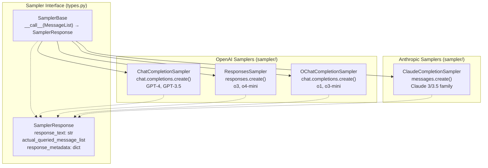
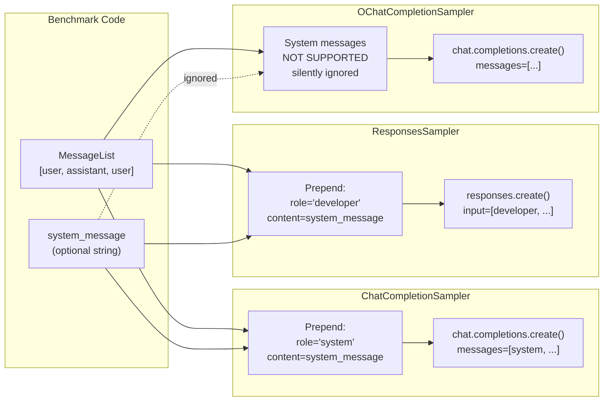
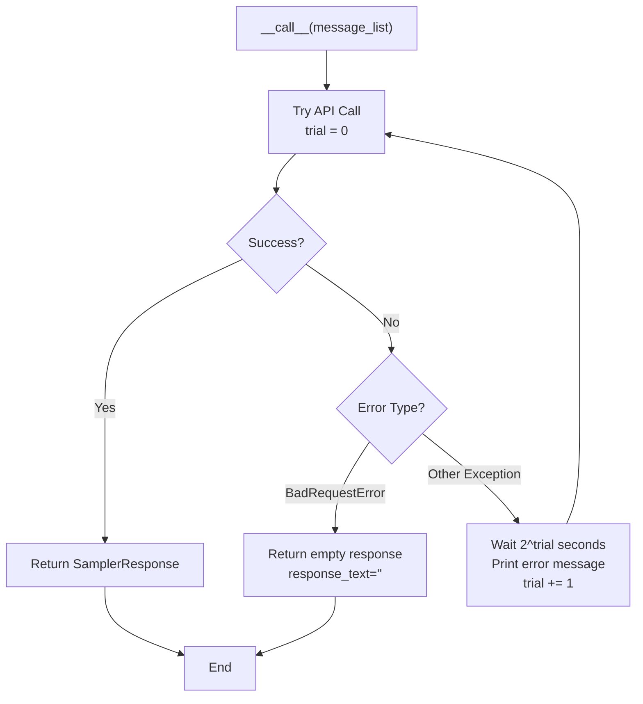

<!-- source: DeepWiki mcp.deepwiki.com · repo openai/simple-evals · page 3.2 Model Samplers · fetched 2026-10-26 -->

# Model Samplers

<details>
<summary>Relevant source files</summary>

The following files were used as context for generating this wiki page:

- [sampler/chat_completion_sampler.py](sampler/chat_completion_sampler.py)
- [sampler/responses_sampler.py](sampler/responses_sampler.py)
- [types.py](types.py)

</details>


## Purpose and Scope

This page documents the **sampler abstraction layer** that provides a unified interface for querying different language model APIs. Samplers handle API-specific details like message formatting, authentication, retry logic, and response parsing, allowing benchmark implementations to remain model-agnostic.

For detailed documentation of specific sampler implementations, see:
- OpenAI samplers (ChatCompletionSampler, ResponsesSampler, OChatCompletionSampler): [OpenAI Samplers](#3.2.1)
- Anthropic samplers (ClaudeCompletionSampler): [Claude Sampler](#3.2.2)

For information about how samplers fit into the evaluation pipeline, see [Evaluation Framework](#3.3).

Sources: [types.py:18-28](), [sampler/chat_completion_sampler.py:16-19](), [sampler/responses_sampler.py:11-14]()

---

## Sampler Architecture

The sampler system implements a **strategy pattern** to abstract different LLM API interfaces. All samplers inherit from `SamplerBase` and implement the same calling interface, but internally translate between the universal message format and provider-specific API requirements.

### SamplerBase Interface

The `SamplerBase` abstract class defines the contract all samplers must implement:

```python
class SamplerBase:
    def __call__(
        self, 
        message_list: MessageList,
    ) -> SamplerResponse:
        raise NotImplementedError
```

**Key characteristics:**
- **Input**: `MessageList` (list of message dictionaries with `role` and `content` keys)
- **Output**: `SamplerResponse` dataclass containing response text, metadata, and the actual queried message list
- **Stateless**: Each call is independent; samplers maintain only configuration state

Sources: [types.py:18-28]()

### SamplerResponse Structure

All samplers return a `SamplerResponse` object:

```python
@dataclass
class SamplerResponse:
    response_text: str                          # The model's generated text
    actual_queried_message_list: MessageList   # Messages actually sent to API
    response_metadata: dict[str, Any]          # Usage stats, tokens, etc.
```

The `actual_queried_message_list` field is crucial for debugging and logging, as it captures any modifications the sampler made (e.g., adding system messages) before sending to the API.

Sources: [types.py:9-16]()

---

## Sampler Hierarchy and Model Coverage



**Diagram: Sampler Class Hierarchy**

Sources: [types.py:4-28](), [sampler/chat_completion_sampler.py:16-19](), [sampler/responses_sampler.py:11-14]()

---

## Sampler Comparison

| Sampler Class | API Endpoint | Model Families | System Message Role | Key Parameters |
|--------------|--------------|----------------|---------------------|----------------|
| `ChatCompletionSampler` | `chat.completions.create()` | GPT-4, GPT-3.5-turbo | `system` | `temperature`, `max_tokens` |
| `ResponsesSampler` | `responses.create()` | o3, o4-mini | `developer` | `reasoning_model`, `reasoning_effort`, `max_output_tokens` |
| `OChatCompletionSampler` | `chat.completions.create()` | o1, o1-preview, o3-mini | Not supported | `reasoning_effort` (low/medium/high) |
| `ClaudeCompletionSampler` | `messages.create()` | Claude 3/3.5 family | `system` (optional) | `temperature`, `max_tokens` |

**Key Differences:**
- **O-series models** (o1, o3) do not support system messages at the API level
- **ResponsesSampler** uses the newer `responses` API with `input` parameter instead of `messages`
- **Reasoning models** (o3, o4-mini with `reasoning_model=True`) support `reasoning_effort` but not temperature
- **Message content types** differ: OpenAI uses `{"type": "text"}` while ResponsesSampler uses `{"type": "input_text"}`

Sources: [sampler/chat_completion_sampler.py:21-34](), [sampler/responses_sampler.py:16-34]()

---

## Message Formatting

Samplers translate between a universal message format and API-specific requirements. Each sampler implements three helper methods:

### Universal Message Structure

```python
Message = dict[str, Any]        # keys: role, content
MessageList = list[Message]     # conversation history
```

Example message list:
```python
[
    {"role": "user", "content": [{"type": "text", "text": "What is 2+2?"}]},
    {"role": "assistant", "content": [{"type": "text", "text": "4"}]},
    {"role": "user", "content": [{"type": "text", "text": "And 3+3?"}]}
]
```

Sources: [types.py:4-5]()

### Sampler-Specific Formatting Methods

Each sampler implements:

| Method | Purpose | Example (ChatCompletionSampler) | Example (ResponsesSampler) |
|--------|---------|--------------------------------|----------------------------|
| `_handle_text(text: str)` | Format text content | `{"type": "text", "text": "..."}` | `{"type": "input_text", "text": "..."}` |
| `_handle_image(image: str, ...)` | Format image content | `{"type": "image_url", "image_url": {...}}` | `{"type": "input_image", "image_url": "..."}` |
| `_pack_message(role: str, content: Any)` | Create message dict | `{"role": "user", "content": [...]}` | `{"role": "user", "content": [...]}` |

**ChatCompletionSampler formatting:**
```python
def _handle_text(self, text: str):
    return {"type": "text", "text": text}

def _handle_image(self, image: str, encoding: str = "base64", ...):
    return {
        "type": "image_url",
        "image_url": {"url": f"data:image/{format};{encoding},{image}"}
    }
```

**ResponsesSampler formatting:**
```python
def _handle_text(self, text: str) -> dict[str, Any]:
    return {"type": "input_text", "text": text}

def _handle_image(self, image: str, encoding: str = "base64", ...):
    return {
        "type": "input_image",
        "image_url": f"data:image/{format};{encoding},{image}"
    }
```

Sources: [sampler/chat_completion_sampler.py:37-56](), [sampler/responses_sampler.py:36-53]()

---

## System Message Handling

System messages are prepended to the conversation to set model behavior, but different APIs have different requirements:



**Diagram: System Message Handling Across Samplers**

**Implementation details:**

```python
# ChatCompletionSampler (lines 58-62)
if self.system_message:
    message_list = [
        self._pack_message("system", self.system_message)
    ] + message_list

# ResponsesSampler (lines 56-59)
if self.system_message:
    message_list = [
        self._pack_message("developer", self.system_message)
    ] + message_list

# OChatCompletionSampler (not shown - no system message support)
# System message passed to __init__ but never used in API calls
```

Sources: [sampler/chat_completion_sampler.py:58-62](), [sampler/responses_sampler.py:56-59]()

---

## Error Handling and Retry Logic

All samplers implement **exponential backoff** for rate limiting and transient failures:



**Diagram: Sampler Retry Flow**

**Code implementation:**

```python
trial = 0
while True:
    try:
        response = self.client.chat.completions.create(...)
        return SamplerResponse(...)
    except openai.BadRequestError as e:
        print("Bad Request Error", e)
        return SamplerResponse(
            response_text="", 
            response_metadata={"usage": None},
            ...
        )
    except Exception as e:
        exception_backoff = 2**trial  # exponential back off
        print(f"Rate limit exception so wait and retry {trial} after {exception_backoff} sec", e)
        time.sleep(exception_backoff)
        trial += 1
```

**Key behaviors:**
- **BadRequestError** (e.g., content policy violations): Returns immediately with empty response
- **Rate limiting / transient errors**: Retries indefinitely with exponential backoff (1s, 2s, 4s, 8s, ...)
- **Unknown errors**: Propagate as exceptions to caller

Sources: [sampler/chat_completion_sampler.py:63-96](), [sampler/responses_sampler.py:60-101]()

---

## Sampler Configuration Patterns

### Common Configuration Parameters

All samplers accept these constructor parameters:

| Parameter | Type | Purpose | Default |
|-----------|------|---------|---------|
| `model` | `str` | Model identifier (e.g., "gpt-4.1") | Varies by sampler |
| `system_message` | `str \| None` | System prompt to prepend | `None` |
| `temperature` | `float` | Sampling randomness (not for reasoning models) | `0.5` |
| `max_tokens` | `int` | Maximum output length | `1024` |

### Reasoning Model Parameters

Samplers that support reasoning models have additional parameters:

| Parameter | Sampler | Type | Purpose |
|-----------|---------|------|---------|
| `reasoning_model` | `ResponsesSampler` | `bool` | Enable reasoning model mode (o3, o4-mini) |
| `reasoning_effort` | `ResponsesSampler`, `OChatCompletionSampler` | `str \| None` | Effort level: "low", "medium", "high" |

**Example configurations:**

```python
# Standard GPT-4 sampler
sampler = ChatCompletionSampler(
    model="gpt-4.1",
    system_message="You are a helpful assistant.",
    temperature=0.5,
    max_tokens=1024
)

# O3 reasoning model sampler
sampler = ResponsesSampler(
    model="o3",
    reasoning_model=True,
    reasoning_effort="high"
)

# O1 reasoning model sampler  
sampler = OChatCompletionSampler(
    model="o1-preview",
    reasoning_effort="medium"
)
```

Sources: [sampler/chat_completion_sampler.py:21-34](), [sampler/responses_sampler.py:16-34]()

---

## Usage Metadata

All samplers populate the `response_metadata` field with usage statistics:

```python
return SamplerResponse(
    response_text=content,
    response_metadata={"usage": response.usage},
    actual_queried_message_list=message_list,
)
```

The `usage` object typically contains:
- `prompt_tokens`: Number of tokens in the input
- `completion_tokens`: Number of tokens generated
- `total_tokens`: Sum of prompt and completion tokens

This metadata is used for:
- **Cost tracking**: Token counts enable cost estimation
- **Performance analysis**: Token efficiency across different models
- **Result logging**: Included in evaluation output for reproducibility

**Note:** On API errors, `usage` is set to `None` to indicate no successful API call occurred.

Sources: [sampler/chat_completion_sampler.py:75-78](), [sampler/responses_sampler.py:81-85]()

---

## Integration with Evaluation Framework

Samplers are passed to evaluation implementations via the `Eval.__call__()` method:

```python
class Eval:
    def __call__(self, sampler: SamplerBase) -> EvalResult:
        raise NotImplementedError
```

Benchmarks use samplers without knowledge of the underlying API:

```python
# Example: Benchmark calling a sampler
def eval_example(self, sampler: SamplerBase, example: dict):
    # Construct messages
    message_list = [
        {"role": "user", "content": [{"type": "text", "text": example["prompt"]}]}
    ]
    
    # Query model (sampler handles all API details)
    response = sampler(message_list)
    
    # Process response
    score = grade_response(response.response_text, example["answer"])
    return SingleEvalResult(score=score, convo=response.actual_queried_message_list)
```

This architecture enables:
- **Model-agnostic benchmarks**: Same evaluation code works with any model
- **Easy model comparison**: Swap sampler to test different models
- **Flexible grading**: Graders can also use samplers (e.g., LLM-graded evaluations)

Sources: [types.py:59-65](), [sampler/chat_completion_sampler.py:58-79]()

---

## Authentication

All samplers require API credentials via environment variables:

| Sampler | Environment Variable | Assertion Location |
|---------|---------------------|-------------------|
| `ChatCompletionSampler` | `OPENAI_API_KEY` | [sampler/chat_completion_sampler.py:29]() |
| `ResponsesSampler` | `OPENAI_API_KEY` | [sampler/responses_sampler.py:26]() |
| `OChatCompletionSampler` | `OPENAI_API_KEY` | (inherited pattern) |
| `ClaudeCompletionSampler` | `ANTHROPIC_API_KEY` | (see [Claude Sampler](#3.2.2)) |

The samplers initialize their API clients in `__init__`:

```python
# OpenAI samplers
self.api_key_name = "OPENAI_API_KEY"
assert os.environ.get("OPENAI_API_KEY"), "Please set OPENAI_API_KEY"
self.client = OpenAI()  # Reads OPENAI_API_KEY from environment

# Anthropic samplers  
self.api_key_name = "ANTHROPIC_API_KEY"
assert os.environ.get("ANTHROPIC_API_KEY"), "Please set ANTHROPIC_API_KEY"
self.client = anthropic.Anthropic()  # Reads ANTHROPIC_API_KEY from environment
```

Sources: [sampler/chat_completion_sampler.py:28-29](), [sampler/responses_sampler.py:25-27]()

---

