<!-- source: DeepWiki mcp.deepwiki.com · repo openai/simple-evals · page 3.3 Evaluation Framework · fetched 2026-10-26 -->

# Evaluation Framework

Relevant source files

The following files were used as context for generating this wiki page:

- [common.py](common.py)
- [run_multilingual_mmlu.py](run_multilingual_mmlu.py)
- [simple_evals.py](simple_evals.py)
- [types.py](types.py)

This page documents the core evaluation framework that defines how benchmarks are structured, executed, and scored in the simple-evals system. It covers the `Eval` base class contract, the evaluation execution loop, prompt construction patterns, and result generation mechanisms.

For information about specific benchmark implementations, see [Evaluation Benchmarks](#4). For details on the sampler abstraction that evaluations use to query models, see [Model Samplers](#3.2). For utilities that support evaluations (result aggregation, HTML rendering), see [Common Utilities and Result Aggregation](#3.4).

## Eval Base Class Contract

All evaluations in the system implement the `Eval` base class, which defines a minimal interface for executing a benchmark against a model sampler.

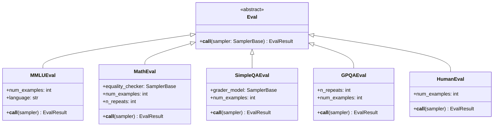

**Sources:** [types.py:59-66]()

The `Eval` interface consists of a single callable method that accepts a `SamplerBase` and returns an `EvalResult`:

| Component | Type | Purpose |
|-----------|------|---------|
| Input | `SamplerBase` | Model sampler that generates responses |
| Output | `EvalResult` | Aggregated evaluation results with metrics |
| Implementation | `__call__` method | Contains all benchmark-specific logic |

**Sources:** [types.py:59-66](), [simple_evals.py:262-335]()

## Evaluation Execution Pattern

Evaluations follow a consistent execution pattern orchestrated by the main runner. The pattern involves instantiating evaluation objects with configuration parameters and executing them against model samplers.

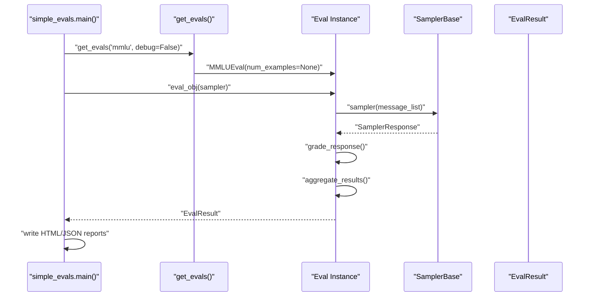

**Sources:** [simple_evals.py:29-426]()

### Evaluation Instantiation

The `get_evals` factory function creates evaluation objects with appropriate configuration:

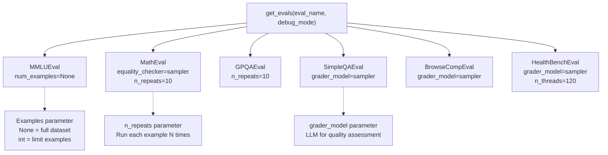

**Sources:** [simple_evals.py:262-335]()

Configuration parameters control evaluation behavior:

| Parameter | Purpose | Example Values |
|-----------|---------|----------------|
| `num_examples` | Limit dataset size | `None` (full), `10` (debug), `500` |
| `n_repeats` | Repeat each example | `1` (default), `10` (variance estimation) |
| `grader_model` | LLM grader sampler | `ChatCompletionSampler` with GPT-4.1 |
| `equality_checker` | Semantic equivalence | `ChatCompletionSampler` for MATH eval |
| `n_threads` | Parallel execution | `1` (sequential), `120` (parallel) |

**Sources:** [simple_evals.py:262-335]()

### Execution Loop

The core execution loop is implemented within each evaluation's `__call__` method. While specific implementations vary, they follow a common pattern:

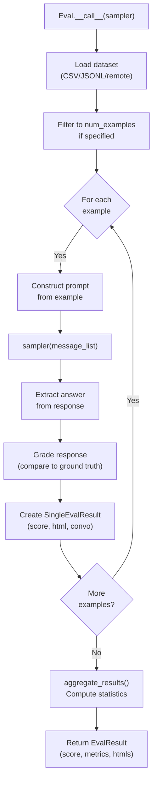

**Sources:** [common.py:183-217](), [simple_evals.py:374-375]()

## Prompt Construction Patterns

Evaluations construct prompts by formatting examples into message lists that conform to the chat API format. The framework provides standard templates and utilities for common patterns.

### Multiple Choice Format

The most common pattern is multiple choice questions, used by MMLU, GPQA, and MGSM:

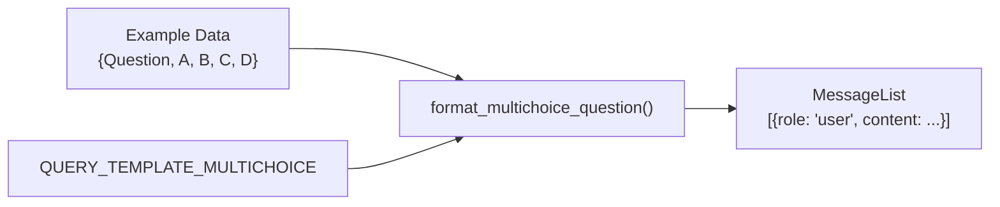

**Sources:** [common.py:15-24](), [common.py:153-154]()

The template instructs the model to provide structured output:

| Template Component | Purpose |
|-------------------|---------|
| Instruction | "Answer the following multiple choice question" |
| Format specification | "The last line of your response should be of the following format: 'Answer: $LETTER'" |
| Reasoning prompt | "Think step by step before answering" |
| Question formatting | Displays question with A/B/C/D options |

**Sources:** [common.py:15-24]()

### Custom Prompt Patterns

Different evaluations implement specialized prompt patterns:

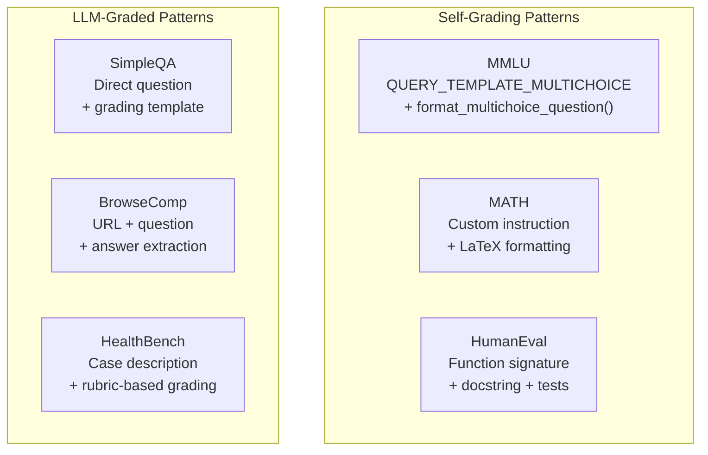

**Sources:** [common.py:15-24](), Various eval implementations

Each evaluation defines its prompt construction logic to match its grading methodology:

| Eval | Prompt Strategy | Key Feature |
|------|----------------|-------------|
| MMLU/GPQA | Template-based | Standardized multiple choice format |
| MATH | Custom formatting | LaTeX math notation handling |
| HumanEval | Code-centric | Function signatures and test cases |
| SimpleQA | Minimal | Direct questions for factuality |
| HealthBench | Rubric-driven | Medical case descriptions |

## Grading Strategies

Evaluations implement one of three grading strategies, each suited to different evaluation types:

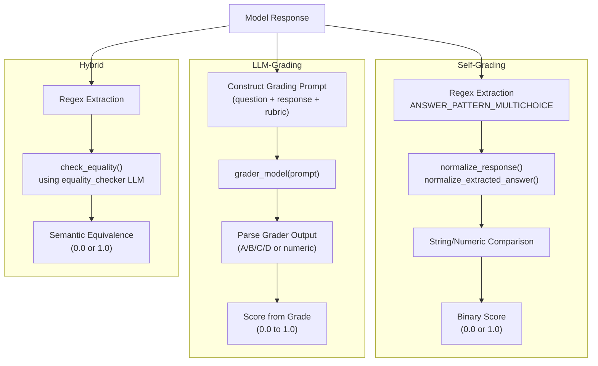

**Sources:** [common.py:26-27](), [common.py:157-162](), [common.py:355-396]()

### Answer Extraction and Normalization

Self-grading evaluations rely on regex patterns to extract answers:

| Pattern | Purpose | Example |
|---------|---------|---------|
| `ANSWER_PATTERN_MULTICHOICE` | Extract A/B/C/D choices | `"Answer: $B$"` → `"B"` |
| `ANSWER_PATTERN` | Extract free-form answers | `"Answer: 42"` → `"42"` |
| `MULTILINGUAL_ANSWER_PATTERN_TEMPLATE` | Handle non-Latin scripts | Arabic/Bengali/Japanese letters |

**Sources:** [common.py:26-75]()

The normalization pipeline removes formatting that prevents exact matching:

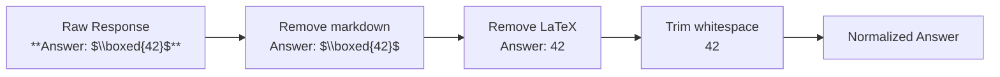

**Sources:** [common.py:355-396]()

### LLM-Based Equality Checking

The MATH evaluation uses an LLM to check semantic equivalence of mathematical expressions:

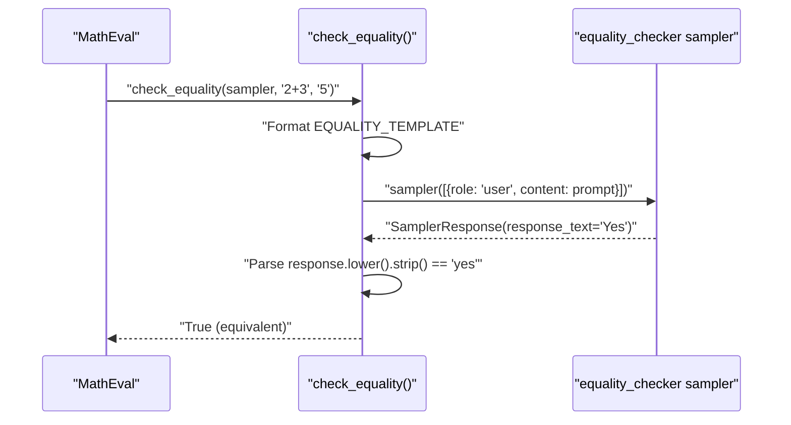

**Sources:** [common.py:78-136](), [common.py:157-162]()

The equality template provides examples of trivial simplifications that should be accepted and non-trivial ones that should not, instructing the LLM to respond with only "Yes" or "No".

**Sources:** [common.py:78-136]()

## Result Generation

Evaluations produce results in a two-level structure that supports both granular per-example analysis and aggregated metrics.

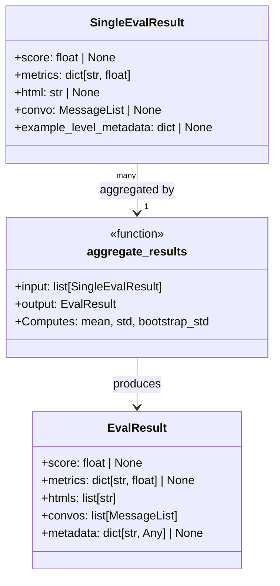

**Sources:** [types.py:31-56](), [common.py:183-217]()

### SingleEvalResult Structure

Each evaluated example produces a `SingleEvalResult` containing:

| Field | Type | Purpose |
|-------|------|---------|
| `score` | `float \| None` | Binary or numeric score (0.0-1.0) |
| `metrics` | `dict[str, float]` | Additional per-example metrics |
| `html` | `str \| None` | Formatted HTML for human review |
| `convo` | `MessageList \| None` | Full conversation trace |
| `example_level_metadata` | `dict \| None` | Extra data (rubric scores, theme) |

**Sources:** [types.py:44-56]()

### Aggregation Pipeline

The `aggregate_results` function consolidates individual results into overall metrics:

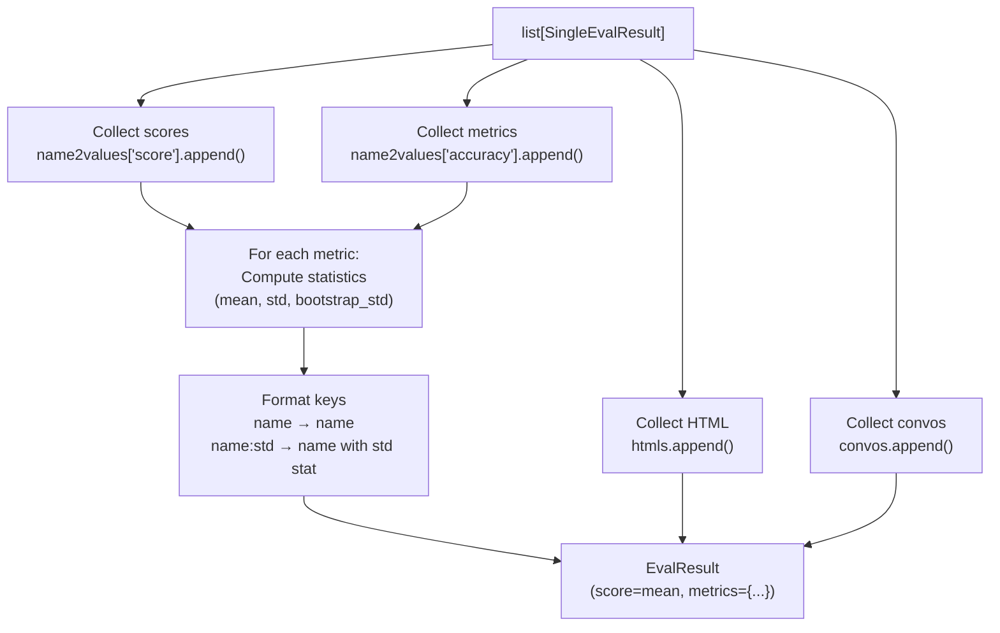

**Sources:** [common.py:183-217]()

Supported statistics for each metric:

| Statistic | Description | Use Case |
|-----------|-------------|----------|
| `mean` | Average value | Default primary metric |
| `std` | Standard deviation | Measure variance |
| `min` / `max` | Range bounds | Identify outliers |
| `bootstrap_std` | Bootstrap standard error | Confidence intervals |
| `n_samples` | Sample count | Verify coverage |

The aggregation function accepts custom statistics per metric via the `name2stats` parameter, allowing evaluations to specify which statistics are meaningful for each metric type.

**Sources:** [common.py:164-181](), [common.py:183-217]()

### EvalResult Structure

The final `EvalResult` provides a complete evaluation summary:

| Field | Type | Purpose |
|-------|------|---------|
| `score` | `float \| None` | Top-line metric (usually mean score) |
| `metrics` | `dict[str, float] \| None` | All computed statistics |
| `htmls` | `list[str]` | Per-example HTML for review |
| `convos` | `list[MessageList]` | All sampled conversations |
| `metadata` | `dict \| None` | Aggregated metadata |

**Sources:** [types.py:31-42]()

This structure enables multiple output formats:
- **HTML reports**: Render `htmls` with `metrics` table via `make_report()`
- **JSON metrics**: Serialize `score` and `metrics` for programmatic access
- **Full results**: Complete serialization including conversations and metadata

**Sources:** [simple_evals.py:380-404]()

## Integration with Main Runner

The evaluation framework integrates with the main runner through a simple calling convention:

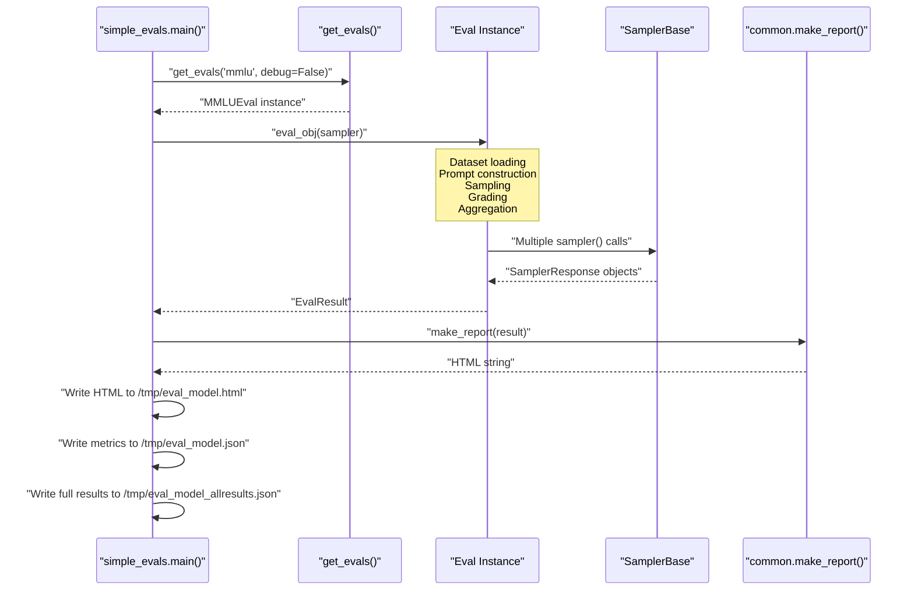

**Sources:** [simple_evals.py:373-404]()

This design cleanly separates concerns:
- **Runner**: Orchestrates execution, manages I/O, handles CLI
- **Evaluations**: Implement benchmark-specific logic
- **Samplers**: Abstract model APIs
- **Common utilities**: Provide shared functionality

The minimal interface (`Eval.__call__(sampler) -> EvalResult`) makes it straightforward to add new evaluations or modify existing ones without affecting other system components.

**Sources:** [types.py:59-66](), [simple_evals.py:29-426]()

---

