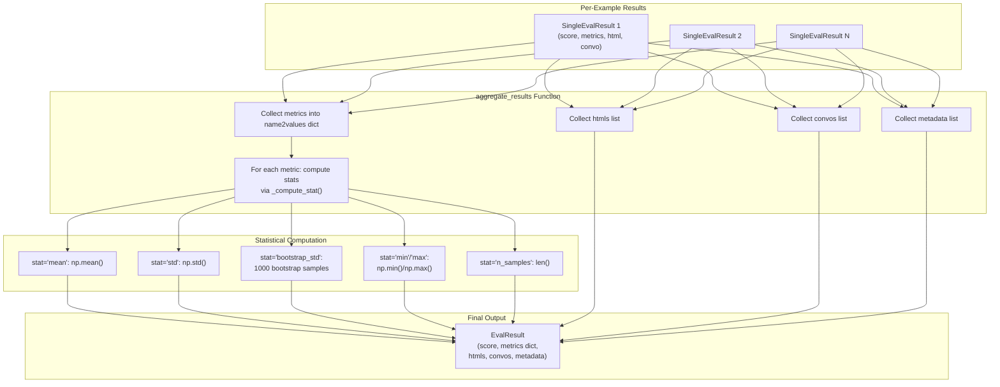
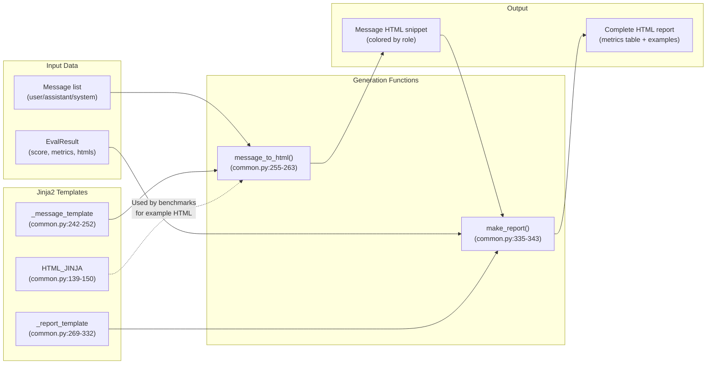
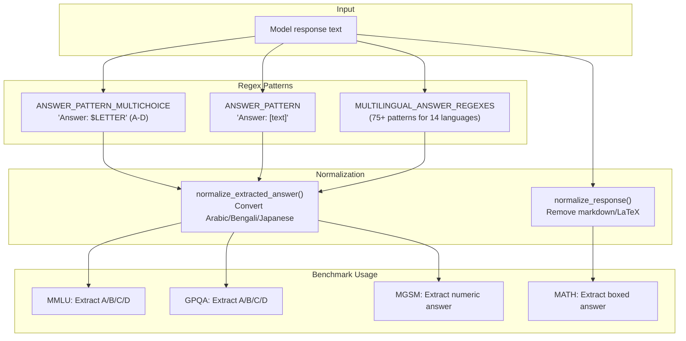
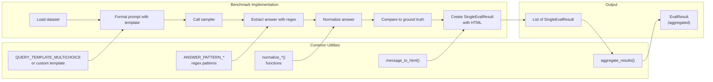

<!-- source: DeepWiki mcp.deepwiki.com · repo openai/simple-evals · page 3.4 Common Utilities and Result Aggregation · fetched 2026-10-26 -->

# Common Utilities and Result Aggregation

<details>
<summary>Relevant source files</summary>

The following files were used as context for generating this wiki page:

- [common.py](common.py)

</details>


## Purpose and Scope

This page documents the shared utilities and result aggregation infrastructure provided by [common.py](). These components are used across all benchmark implementations to standardize prompt formatting, answer extraction, result aggregation, and report generation. The utilities ensure consistency in evaluation methodology while allowing benchmarks to focus on domain-specific logic.

For information about how these utilities integrate with the evaluation framework, see [Evaluation Framework](#3.3). For details about the result types (`SingleEvalResult`, `EvalResult`), see [Type System and Interfaces](#3.1).

---

## Result Aggregation Pipeline

The result aggregation system transforms per-example evaluation results into statistical summaries. This two-stage architecture enables both detailed error analysis (via individual results) and high-level model comparison (via aggregated metrics).

### Aggregation Architecture



**Sources:** [common.py:183-216]()

### aggregate_results Function

The `aggregate_results` function [common.py:183-216]() is the central aggregation entry point. It accepts a list of `SingleEvalResult` objects and produces a consolidated `EvalResult`.

**Function signature:**
```python
def aggregate_results(
    single_eval_results: list[SingleEvalResult],
    default_stats: tuple[str, ...] = ("mean", "std"),
    name2stats: dict[str, tuple[str]] | None = None,
) -> EvalResult
```

**Parameters:**
| Parameter | Type | Description |
|-----------|------|-------------|
| `single_eval_results` | `list[SingleEvalResult]` | Individual evaluation results to aggregate |
| `default_stats` | `tuple[str, ...]` | Default statistics to compute for each metric (default: `("mean", "std")`) |
| `name2stats` | `dict[str, tuple[str]]` | Override statistics for specific metric names |

**Process:**
1. Collects all metric values into `name2values` dictionary [common.py:192-200]()
2. Collects HTML snippets, conversations, and metadata [common.py:193-203]()
3. For each metric, computes requested statistics via `_compute_stat` [common.py:205-209]()
4. Constructs final `EvalResult` with computed metrics [common.py:210-216]()

**Example aggregated metric names:**
- `"score"` (mean is default, stored without suffix)
- `"accuracy:std"` (standard deviation)
- `"f1:bootstrap_std"` (bootstrap standard error)
- `"precision:min"` (minimum value across examples)

**Sources:** [common.py:183-216]()

### Statistical Computation

The `_compute_stat` function [common.py:164-180]() computes various statistical measures:

| Statistic | Implementation | Use Case |
|-----------|----------------|----------|
| `"mean"` | `np.mean(values)` | Primary metric aggregation |
| `"std"` | `np.std(values)` | Simple variance measure |
| `"bootstrap_std"` | Bootstrap resampling (1000 iterations) | Confidence interval estimation |
| `"min"` | `np.min(values)` | Worst-case performance |
| `"max"` | `np.max(values)` | Best-case performance |
| `"n_samples"` | `len(values)` | Sample count verification |

The bootstrap standard deviation [common.py:175-178]() provides a more robust estimate of uncertainty by resampling with replacement:
```python
return np.std(
    [np.mean(np.random.choice(values, len(values))) for _ in range(1000)]
)
```

**Sources:** [common.py:164-180]()

---

## HTML Report Generation

The HTML generation system uses Jinja2 templates to create human-readable evaluation reports. This enables rapid iteration during benchmark development and facilitates qualitative error analysis.

### HTML Generation Pipeline



**Sources:** [common.py:139-150](), [common.py:242-263](), [common.py:269-343]()

### Message-Level HTML

The `message_to_html` function [common.py:255-263]() renders individual messages with role-based styling:

```python
def message_to_html(message: Message) -> str:
    """
    Generate HTML snippet (inside a <div>) for a message.
    """
    return jinja_env.from_string(_message_template).render(
        role=message["role"],
        content=message["content"],
        variant=message.get("variant", None),
    )
```

**Message roles and colors** [common.py:273-289]():
| Role | Background Color | Text Color | Use Case |
|------|-----------------|------------|----------|
| `user` | Light teal (#B2DFDB) | Dark teal (#00695C) | Input prompts |
| `assistant` | Light purple (#B39DDB) | Dark purple (#4527A0) | Model responses |
| `system` | Light gray (#EEEEEE) | Dark gray (#212121) | System instructions |

**Sources:** [common.py:242-289]()

### Report-Level HTML

The `make_report` function [common.py:335-343]() generates complete evaluation reports with:

1. **Metrics table** [common.py:306-323](): Overall score and per-metric statistics
2. **Example gallery** [common.py:325-329](): Individual evaluation results with prompts and responses

The template structure [common.py:269-332]() includes:
- CSS styling for messages and tables
- Conditional metrics section (only if metrics exist)
- Horizontal rule separators between examples
- Pre-formatted text with word wrapping

**Sources:** [common.py:269-343]()

---

## Prompt Templates

The module provides standard prompt templates used across multiple benchmarks.

### Multiple Choice Template

The `QUERY_TEMPLATE_MULTICHOICE` [common.py:15-24]() formats multiple-choice questions with standardized instructions:

```
Answer the following multiple choice question. The last line of your response 
should be of the following format: 'Answer: $LETTER' (without quotes) where 
LETTER is one of ABCD. Think step by step before answering.

{Question}

A) {A}
B) {B}
C) {C}
D) {D}
```

The `format_multichoice_question` helper [common.py:153-154]() applies this template to row dictionaries (typically from CSV/JSONL datasets).

**Used by:** MMLU [mmlu_eval.py](), GPQA [gpqa_eval.py](), MGSM [mgsm_eval.py]()

**Sources:** [common.py:15-24](), [common.py:153-154]()

### Mathematical Equality Template

The `EQUALITY_TEMPLATE` [common.py:78-136]() provides a few-shot prompt for LLM-based semantic equivalence checking. This is used when exact string matching is insufficient (e.g., `"3/2"` vs `"1.5"`).

**Key features:**
- 9 example comparisons demonstrating trivial vs. non-trivial simplifications
- Instructions to give benefit of doubt for unit differences
- Binary "Yes"/"No" response format without rationale

The `check_equality` function [common.py:157-161]() wraps this template:
```python
def check_equality(sampler: SamplerBase, expr1: str, expr2: str):
    prompt = EQUALITY_TEMPLATE % {"expression1": expr1, "expression2": expr2}
    sampler_response = sampler([dict(content=prompt, role="user")])
    response_text = sampler_response.response_text
    return response_text.lower().strip() == "yes"
```

**Used by:** MATH benchmark [math_eval.py]() for comparing extracted answers to ground truth

**Sources:** [common.py:78-161]()

---

## Answer Extraction Patterns

The module defines regex patterns for extracting answers from model responses. These patterns are critical for self-grading benchmarks that need deterministic answer verification.

### Answer Extraction Flow



**Sources:** [common.py:26-76](), [common.py:355-395]()

### Standard Patterns

**ANSWER_PATTERN_MULTICHOICE** [common.py:26]():
```python
r"(?i)Answer[ \t]*:[ \t]*\$?([A-D])\$?"
```
- Case-insensitive matching
- Optional dollar signs (LaTeX formatting)
- Captures letters A through D

**ANSWER_PATTERN** [common.py:27]():
```python
r"(?i)Answer\s*:\s*([^\n]+)"
```
- Generic pattern for open-ended answers
- Captures everything after "Answer:" until newline

**Sources:** [common.py:26-27]()

### Multilingual Patterns

The module supports 14 languages for multilingual evaluation:

**MULTILINGUAL_ANSWER_REGEXES** [common.py:32-75](): Array of 75+ regex patterns matching "Answer:" in:
- English, Korean, Bengali, Hindi, German
- Chinese (Simplified/Traditional), Japanese
- Arabic, Spanish, Italian, Indonesian
- French, Portuguese, Swahili, Yoruba

**MULTILINGUAL_ANSWER_PATTERN_TEMPLATE** [common.py:28-30](): Captures both Latin and non-Latin multiple-choice letters:
- Latin: A-D
- Arabic: أ-د
- Bengali: অ, ব, ড, ঢ
- Japanese full-width: Ａ, Ｂ, Ｃ, Ｄ

**Sources:** [common.py:28-75]()

---

## Normalization Utilities

Normalization functions remove formatting artifacts that would prevent correct answer matching while preserving semantic content.

### normalize_response

The `normalize_response` function [common.py:355-374]() removes common markdown and LaTeX formatting:

**Removed patterns:**
| Pattern | Purpose |
|---------|---------|
| `**` | Markdown bold |
| `$\boxed{...}$` | LaTeX boxed answers |
| `\$`, `$` | Dollar signs (LaTeX delimiters) |
| `\text{...}` | LaTeX text mode |
| `\mathrm{...}` | LaTeX roman font |
| `\mathbf{...}` | LaTeX bold font |
| `\{`, `{` | Braces |
| `\(`, `\)` | LaTeX inline math |

**Example:**
```
Input:  "$\\boxed{42}$"
Output: "42"
```

**Sources:** [common.py:355-374]()

### normalize_extracted_answer

The `normalize_extracted_answer` function [common.py:377-395]() converts non-Latin multiple-choice letters to Latin equivalents:

**Conversions** [common.py:380-393]():
| Script | Input Letters | Output |
|--------|---------------|--------|
| Arabic | أ, ب, ج, د | A, B, C, D |
| Bengali | অ, ব, ড, ঢ | A, B, C, D |
| Japanese full-width | Ａ, Ｂ, Ｃ, Ｄ | A, B, C, D |

This enables uniform comparison logic across languages.

**Sources:** [common.py:377-395]()

---

## Parallel Execution Utilities

### map_with_progress

The `map_with_progress` function [common.py:219-234]() provides parallel execution with progress tracking:

```python
def map_with_progress(
    f: Callable,
    xs: list[Any],
    num_threads: int = os.cpu_count() or 10,
    pbar: bool = True,
):
    """
    Apply f to each element of xs, using a ThreadPool, and show progress.
    """
```

**Features:**
- **ThreadPool parallelism**: Uses `multiprocessing.pool.ThreadPool` [common.py:233]()
- **Progress bar**: Integration with `tqdm` [common.py:228]()
- **Debug mode**: Falls back to serial execution when `debug` environment variable is set [common.py:230-231]()
- **Dynamic thread count**: Defaults to CPU count, capped by list length [common.py:233]()

**Usage pattern:**
```python
# Evaluate 100 examples in parallel with progress bar
results = map_with_progress(
    lambda ex: eval_single_example(sampler, ex),
    examples[:100],
    num_threads=20
)
```

**Used by:** All benchmark implementations for parallel model sampling

**Sources:** [common.py:219-234]()

---

## Additional Utilities

### has_only_user_assistant_messages

The `has_only_user_assistant_messages` function [common.py:404-408]() validates message list format:

```python
def has_only_user_assistant_messages(messages: list[Message]) -> bool:
    """
    Check if the messages only contain user and assistant messages.
    """
    return all(m["role"] in ("user", "assistant") for m in messages)
```

This is used by samplers that don't support system messages (e.g., o1-series models).

**Sources:** [common.py:404-408]()

### url_to_fileobj

The `url_to_fileobj` function [common.py:398-401]() fetches remote files into memory:

```python
def url_to_fileobj(url: str, binary=False) -> Any:
    response = requests.get(url)
    response.raise_for_status()
    return io.BytesIO(response.content) if binary else io.StringIO(response.text)
```

**Used by:** Benchmarks that load datasets from remote URLs (e.g., HumanEval [humaneval_eval.py]())

**Sources:** [common.py:398-401]()

---

## Usage Patterns

### Typical Benchmark Integration

Most benchmarks follow this pattern for using common utilities:



**Sources:** [common.py:1-409]()

### Statistical Reporting Example

Benchmarks can request custom statistics for specific metrics:

```python
# Request bootstrap standard error for accuracy, 
# but keep default (mean, std) for other metrics
result = aggregate_results(
    single_results,
    default_stats=("mean", "std"),
    name2stats={
        "accuracy": ("mean", "bootstrap_std", "n_samples"),
        "f1": ("mean", "std", "min", "max")
    }
)
# Produces metrics like:
# - accuracy (mean)
# - accuracy:bootstrap_std
# - accuracy:n_samples
# - f1 (mean)
# - f1:std
# - f1:min
# - f1:max
```

**Sources:** [common.py:183-216]()

---

