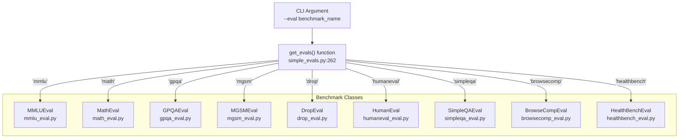
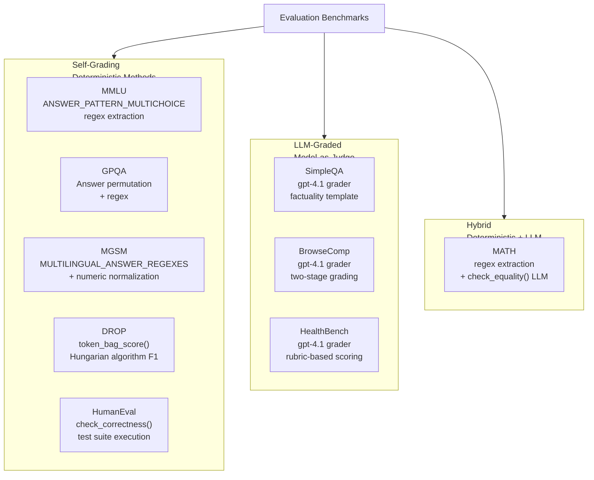
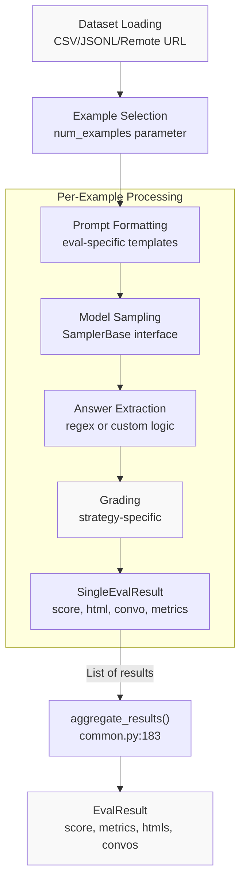

<!-- source: DeepWiki mcp.deepwiki.com · repo openai/simple-evals · page 4 Evaluation Benchmarks · fetched 2026-10-26 -->

# Evaluation Benchmarks

<details>
<summary>Relevant source files</summary>

The following files were used as context for generating this wiki page:

- [README.md](README.md)
- [common.py](common.py)
- [run_multilingual_mmlu.py](run_multilingual_mmlu.py)
- [simple_evals.py](simple_evals.py)

</details>


This page provides an overview of all evaluation benchmarks implemented in simple-evals, their grading strategies, and how they are organized. For details about the architecture that enables these benchmarks, see [Architecture](#3). For specific implementation details of individual benchmarks, see the subsections under this page.

**Important:** As of July 2025, most benchmarks in this repository are frozen and will not receive updates. Only three benchmarks remain actively maintained as reference implementations: SimpleQA, BrowseComp, and HealthBench (see [Reference Implementations](#4.1)).

## Overview of Available Benchmarks

The simple-evals repository contains nine evaluation benchmarks spanning different capabilities:

| Benchmark | Capability | Dataset Size | Grading Strategy | Active Status |
|-----------|-----------|--------------|------------------|---------------|
| **MMLU** | Language understanding, knowledge | 14,042 questions across 57 subjects | Self-grading (regex) | Frozen |
| **GPQA** | Graduate-level reasoning | 448 questions | Self-grading (regex + permutation) | Frozen |
| **MATH** | Mathematical problem solving | 500 or 12,500 problems | Hybrid (regex + LLM equality) | Frozen |
| **MGSM** | Multilingual grade school math | 250 per language (11 languages) | Self-grading (regex + normalization) | Frozen |
| **DROP** | Reading comprehension | 9,536 paragraphs | Self-grading (token bag F1) | Frozen |
| **HumanEval** | Code generation | 164 problems | Self-grading (test execution) | Frozen |
| **SimpleQA** | Short-form factuality | 4,326 questions | LLM-graded | **Active** |
| **BrowseComp** | Browsing agent capabilities | 274 questions | LLM-graded | **Active** |
| **HealthBench** | Medical domain reasoning | 1,007 questions | LLM-graded (rubric-based) | **Active** |

**Sources:** [README.md:73-85](), [simple_evals.py:262-334]()

## Benchmark Instantiation

All benchmarks are instantiated through the `get_evals()` function in the main evaluation runner. This function maps benchmark names (as specified via the `--eval` CLI argument) to their corresponding evaluation class instances:



**Diagram: Benchmark Name to Class Mapping**

Each benchmark is configured with specific parameters during instantiation. For example:
- `MMLUEval(num_examples=None)` for full evaluation
- `MathEval(equality_checker=equality_checker, num_examples=None, n_repeats=10)`
- `SimpleQAEval(grader_model=grading_sampler, num_examples=None)`

**Sources:** [simple_evals.py:262-334]()

## Grading Strategy Taxonomy

Benchmarks are categorized into three grading strategies based on how they determine correctness:



**Diagram: Grading Strategy Taxonomy with Code Entities**

### Self-Grading Benchmarks

Self-grading benchmarks use deterministic methods to evaluate correctness without additional LLM calls:

- **Regex-based extraction**: MMLU, GPQA, MGSM use pattern matching against `ANSWER_PATTERN_MULTICHOICE` and `MULTILINGUAL_ANSWER_REGEXES` constants defined in [common.py:26-75]()
- **Token-level matching**: DROP uses `token_bag_score()` with Hungarian algorithm for F1 calculation
- **Code execution**: HumanEval uses `check_correctness()` to run generated code against test suites

**Advantages:** Fast, cheap, reproducible, no grader bias  
**Limitations:** May reject semantically correct but differently formatted answers

**Sources:** [common.py:26-75](), Diagram 4 from high-level architecture

### LLM-Graded Benchmarks

LLM-graded benchmarks use a separate model (typically `gpt-4.1-2025-04-14`) to judge response quality:

- **SimpleQA**: Evaluates factuality with custom grading template
- **BrowseComp**: Two-stage grading (answer extraction + quality assessment)
- **HealthBench**: Rubric-based scoring across multiple axes and themes

All three use the same `grading_sampler` instance created in [simple_evals.py:254-258]():

```
grading_sampler = ChatCompletionSampler(
    model="gpt-4.1-2025-04-14",
    system_message=OPENAI_SYSTEM_MESSAGE_API,
    max_tokens=2048,
)
```

**Advantages:** Handles open-ended responses, captures semantic correctness  
**Limitations:** Slower, more expensive, introduces grader model dependencies

**Sources:** [simple_evals.py:254-258](), [simple_evals.py:292-332]()

### Hybrid Benchmarks

MATH benchmark uses a hybrid approach:
1. Extracts answer using `ANSWER_PATTERN` regex
2. Compares extracted answer to ground truth using `check_equality()` LLM call with `EQUALITY_TEMPLATE` prompt

This combines the speed of regex extraction with the robustness of semantic equivalence checking.

**Sources:** [common.py:78-136](), [common.py:157-161]()

## Benchmark Execution Flow

The following diagram shows how a benchmark evaluation flows from dataset loading through grading to result aggregation:



**Diagram: Evaluation Execution Pipeline**

Each benchmark implements this flow slightly differently:
- Dataset loading varies (CSV files, JSONL, encrypted datasets, remote URLs)
- Prompt formatting uses benchmark-specific templates
- Grading logic follows the strategy taxonomy above
- All benchmarks return `SingleEvalResult` objects that get aggregated into `EvalResult`

**Sources:** [common.py:183-216](), Diagram 2 from high-level architecture

## Configuration Parameters

Most benchmarks accept common configuration parameters during instantiation:

| Parameter | Type | Purpose | Default |
|-----------|------|---------|---------|
| `num_examples` | `int \| None` | Limit evaluation to N examples | `None` (all examples) |
| `n_repeats` | `int` | Number of repeated samples per example | Varies by eval |
| `grader_model` | `SamplerBase` | Model used for LLM-graded evals | `None` |
| `train_samples_per_prompt` | `int` | Few-shot examples (DROP only) | `0` |

Debug mode reduces example counts for faster testing. The `--debug` flag sets examples to 5-10 depending on the benchmark, while `--examples N` explicitly overrides the default.

**Sources:** [simple_evals.py:59-61](), [simple_evals.py:262-334]()

## Multilingual Support

Two benchmarks have multilingual capabilities:

**MMLU** supports 15 languages via the `run_multilingual_mmlu.py` runner:
- English (EN-US), Arabic (AR-XY), Bengali (BN-BD), German (DE-DE), Spanish (ES-LA)
- French (FR-FR), Hindi (HI-IN), Indonesian (ID-ID), Italian (IT-IT), Japanese (JA-JP)
- Korean (KO-KR), Portuguese (PT-BR), Chinese (ZH-CN), Swahili (SW-KE), Yoruba (YO-NG)

**MGSM** evaluates across 11 languages with language-specific prompt templates.

See [Multilingual Evaluation](#5) for more details on multilingual capabilities.

**Sources:** [run_multilingual_mmlu.py:48-102](), [README.md:81]()

## Relationship to Other Components

Benchmarks integrate with other system components:

- **Model Samplers** ([Architecture > Model Samplers](#3.2)): All benchmarks accept any `SamplerBase` implementation, enabling evaluation across different model APIs
- **Common Utilities** ([Architecture > Common Utilities](#3.4)): Benchmarks use shared functions like `format_multichoice_question()`, `normalize_response()`, and `aggregate_results()`
- **CLI Runner** ([Running Evaluations > Command-Line Interface](#6.1)): The `simple_evals.py` script orchestrates benchmark execution based on CLI arguments

**Sources:** [simple_evals.py:1-430](), [common.py:1-409]()

---

