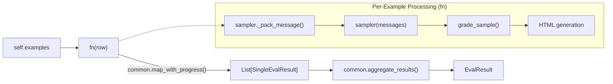
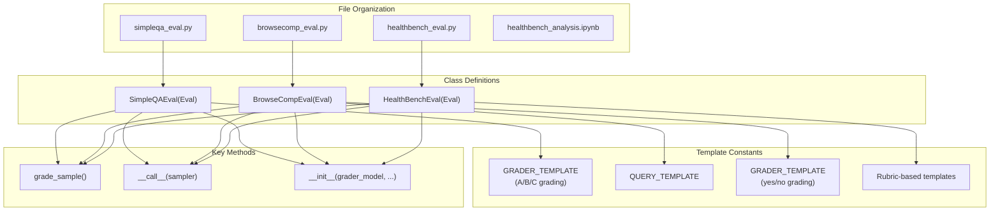

<!-- source: DeepWiki mcp.deepwiki.com · repo openai/simple-evals · page 4.1 Reference Implementations (Active) · fetched 2026-10-26 -->

# Reference Implementations (Active)

<details>
<summary>Relevant source files</summary>

The following files were used as context for generating this wiki page:

- [README.md](README.md)
- [browsecomp_eval.py](browsecomp_eval.py)
- [simpleqa_eval.py](simpleqa_eval.py)

</details>


This document covers the three actively maintained evaluation benchmarks in simple-evals: **SimpleQA**, **BrowseComp**, and **HealthBench**. As of July 2025, these are the only benchmarks receiving ongoing maintenance and new model evaluations, while all other benchmarks in the repository are frozen.

For information about the frozen benchmarks (MMLU, MATH, GPQA, DROP, MGSM, HumanEval), see [Language Understanding Benchmarks](#4.2), [Mathematical Reasoning Benchmarks](#4.3), and [Other Benchmarks](#4.4).

## Purpose and Scope

Reference implementations represent the maintainers' core research contributions to the evaluation landscape. Unlike the frozen benchmarks which were adapted from existing datasets, these three benchmarks were developed by the OpenAI team and continue to serve as canonical implementations for their respective evaluation domains:

| Benchmark | Domain | Primary Metric | Dataset Source |
|-----------|--------|----------------|----------------|
| SimpleQA | Short-form factuality | Accuracy given attempted, F1 | `simple_qa_test_set.csv` |
| BrowseComp | Browsing agents | Accuracy | `browse_comp_test_set.csv` (encrypted) |
| HealthBench | Medical domain | Theme/axis-specific metrics | `healthbench_*.csv` files |

These benchmarks share a common architectural pattern that distinguishes them from the frozen benchmarks: **two-stage LLM-based grading** where a separate grader model evaluates the quality of responses rather than using deterministic matching.

Sources: [README.md:1-10](), [README.md:66-85]()

## Architectural Pattern

All three reference implementations follow a common two-stage evaluation architecture that contrasts with the self-grading approaches used in frozen benchmarks.

```mermaid
graph TB
    subgraph "Reference Implementation Pattern"
        Dataset["Dataset Loading<br/>(CSV from blob storage)"]
        Query["Query Formation<br/>(problem → prompt)"]
        TargetModel["Target Model<br/>(model being evaluated)"]
        Response["Model Response"]
        GraderPrompt["Grader Prompt<br/>(GRADER_TEMPLATE)"]
        GraderModel["Grader Model<br/>(typically gpt-4.1)"]
        Grade["Grade Extraction<br/>(regex on grader response)"]
        Metrics["Metrics Calculation"]
    end
    
    Dataset --> Query
    Query --> TargetModel
    TargetModel --> Response
    Response --> GraderPrompt
    GraderPrompt --> GraderModel
    GraderModel --> Grade
    Grade --> Metrics
    
    Response -.->|included in prompt| GraderPrompt
```



**Two-Stage Evaluation Architecture**

Sources: [simpleqa_eval.py:95-127](), [browsecomp_eval.py:66-94]()

### Shared Components

The reference implementations share several code patterns:

#### Dataset Loading
All three load datasets from Azure blob storage during initialization:
- SimpleQA: `https://openaipublic.blob.core.windows.net/simple-evals/simple_qa_test_set.csv`
- BrowseComp: `https://openaipublic.blob.core.windows.net/simple-evals/browse_comp_test_set.csv`
- HealthBench: Multiple CSV files with `healthbench_` prefix

#### Grader Model Dependency
Each class requires a `grader_model` parameter of type `SamplerBase` in its constructor:

```python
def __init__(self, grader_model: SamplerBase, num_examples: int | None = None, n_repeats: int = 1)
```

This grader model is typically `gpt-4.1` and is used to evaluate the quality of the target model's responses.

Sources: [simpleqa_eval.py:99-110](), [browsecomp_eval.py:67-77]()

#### Grade Sample Method
Each class implements a `grade_sample` method that:
1. Formats a grading prompt with question, correct answer, and model response
2. Queries the grader model
3. Extracts the grade using regex pattern matching

For SimpleQA:
```python
def grade_sample(self, question: str, target: str, predicted_answer: str) -> str:
    # Returns "A", "B", or "C" (CORRECT, INCORRECT, NOT_ATTEMPTED)
```

For BrowseComp:
```python
def grade_sample(self, question: str, correct_answer: str, response: str) -> str:
    # Returns "yes" or "no"
```

Sources: [simpleqa_eval.py:112-127](), [browsecomp_eval.py:79-94]()

#### Evaluation Loop Pattern
All three follow the same execution pattern in their `__call__` method:



**Common Evaluation Loop Architecture**

Sources: [simpleqa_eval.py:128-194](), [browsecomp_eval.py:95-145]()

## Comparison with Frozen Benchmarks

Reference implementations differ from frozen benchmarks in several key aspects:

| Aspect | Reference Implementations | Frozen Benchmarks |
|--------|--------------------------|-------------------|
| **Grading Method** | LLM-based (requires grader model) | Deterministic (regex, code execution, exact match) |
| **Cost** | Higher (2 API calls per example) | Lower (1 API call per example) |
| **Flexibility** | Handles nuanced responses | Requires structured formats |
| **Maintenance** | Active (new models added) | Frozen (no updates after July 2025) |
| **Dataset Ownership** | OpenAI-authored | Adapted from external sources |

The two-stage grading approach enables these benchmarks to evaluate open-ended responses where deterministic matching is insufficient. For example, SimpleQA's grader can recognize that "San Francisco" and "San Francisco, California" are both correct answers to "What city is OpenAI headquartered in?"

Sources: [README.md:1-10](), [README.md:66-70]()

## Code Structure Mapping



**Code Entity Relationships for Reference Implementations**

Sources: [simpleqa_eval.py:1-197](), [browsecomp_eval.py:1-146](), [README.md:83-85]()

## Detailed Benchmark Documentation

Each reference implementation has unique characteristics detailed in dedicated pages:

- **[SimpleQA: Factuality Evaluation](#4.1.1)** - Documents the grading template with CORRECT/INCORRECT/NOT_ATTEMPTED classifications, accuracy_given_attempted and F1 metrics, and nuanced grading rules for handling hedging, typos, and numerical precision.

- **[BrowseComp: Browsing Agent Evaluation](#4.1.2)** - Covers the encrypted dataset mechanism (XOR cipher with canary keys), the browsing-specific query format requiring structured responses, and yes/no grading for correctness.

- **[HealthBench: Medical Domain Evaluation](#4.1.3)** - Explains the rubric-based grading system, theme/axis organization for medical question categorization, and the accompanying analysis notebook for result visualization.

Sources: [README.md:83-85]()

## Usage Example

Reference implementations require a grader model to be instantiated before use. Here's the typical pattern:

```python
# From simple_evals.py (example usage pattern)
from sampler.chat_completion_sampler import ChatCompletionSampler
from simpleqa_eval import SimpleQAEval

# Create grader model (typically gpt-4.1)
grader = ChatCompletionSampler(model="gpt-4.1")

# Create target model to evaluate
target_model = ChatCompletionSampler(model="gpt-4o")

# Instantiate evaluation with grader
eval_instance = SimpleQAEval(grader_model=grader, num_examples=100)

# Run evaluation on target model
result = eval_instance(target_model)
```

This pattern ensures that:
1. The grader model is separate from the model being evaluated
2. Multiple models can be evaluated using the same grader instance
3. The grader model choice is explicit and documented

Sources: [simpleqa_eval.py:99-110](), [README.md:116-127]()

## Metrics and Aggregation

All three reference implementations compute custom metrics beyond simple accuracy:

| Benchmark | Primary Metrics | Secondary Metrics |
|-----------|----------------|-------------------|
| **SimpleQA** | `accuracy_given_attempted` | `f1`, `is_correct`, `is_incorrect`, `is_not_attempted` |
| **BrowseComp** | `accuracy` | `is_correct`, `is_incorrect` |
| **HealthBench** | Theme-specific scores | Axis-specific scores, overall accuracy |

The `aggregate_results()` function from `common.py` collects per-example `SingleEvalResult` objects and computes aggregate statistics including mean, standard deviation, and bootstrap confidence intervals.

Sources: [simpleqa_eval.py:163-189](), [browsecomp_eval.py:131-145]()

## Integration with Main Runner

The main evaluation runner in `simple_evals.py` includes these benchmarks in the evaluation suite but handles them specially due to their grader model requirement. The runner must:

1. Instantiate a grader model before creating the evaluation instance
2. Pass the grader model to the evaluation constructor
3. Handle the two-stage evaluation cost (2x API calls per example)

This is reflected in the command-line interface where these evaluations may require additional configuration compared to frozen benchmarks.

Sources: [README.md:116-127]()

---

