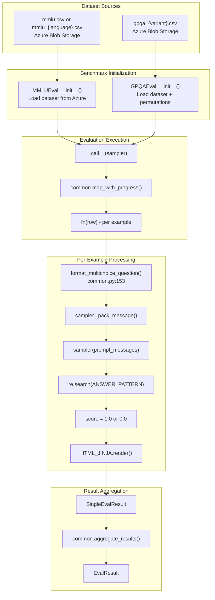
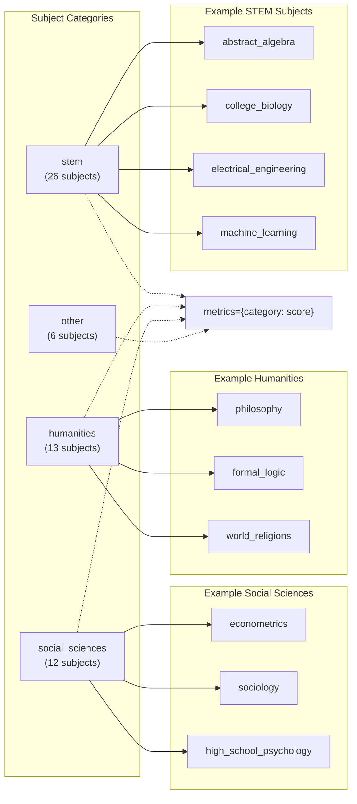
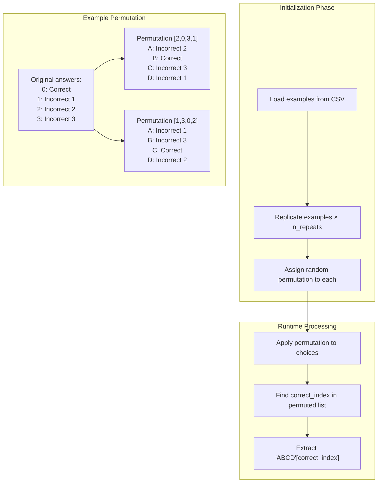
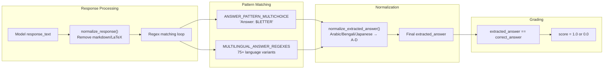
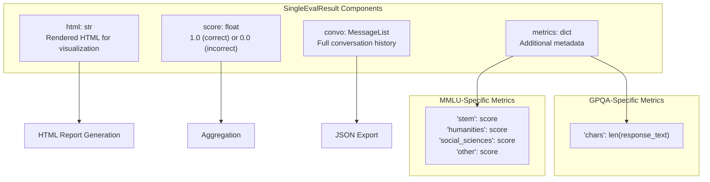
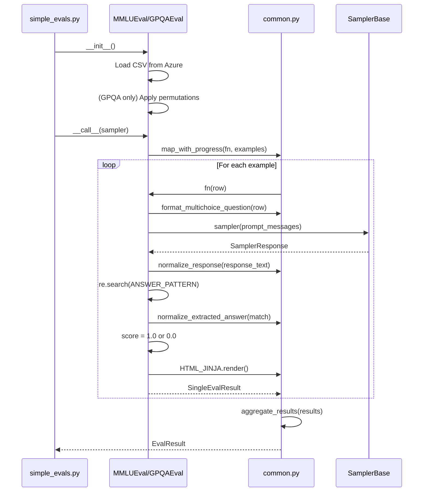

<!-- source: DeepWiki mcp.deepwiki.com · repo openai/simple-evals · page 4.2 Language Understanding Benchmarks · fetched 2026-10-26 -->

# Language Understanding Benchmarks

<details>
<summary>Relevant source files</summary>

The following files were used as context for generating this wiki page:

- [common.py](common.py)
- [gpqa_eval.py](gpqa_eval.py)
- [mmlu_eval.py](mmlu_eval.py)

</details>


## Purpose and Scope

This page documents the language understanding benchmarks in the simple-evals framework, specifically MMLU (Massive Multitask Language Understanding) and GPQA (Graduate-Level Google-Proof Q&A). These benchmarks evaluate a model's ability to answer multiple-choice questions across diverse academic subjects and graduate-level domains.

Both benchmarks use deterministic self-grading based on regex pattern matching to extract and verify answers. For mathematical reasoning benchmarks, see [Mathematical Reasoning Benchmarks](#4.3). For other evaluation types, see [Evaluation Benchmarks](#4).

**Note**: As of July 2025, these benchmarks are frozen and no new model results will be added to the main repository. They remain available as reference implementations.

Sources: [mmlu_eval.py:1-130](), [gpqa_eval.py:1-76]()

---

## Benchmark Comparison

The two language understanding benchmarks serve different purposes and difficulty levels:

| Feature | MMLU | GPQA |
|---------|------|------|
| **Implementation** | `MMLUEval` class | `GPQAEval` class |
| **Question Level** | High school to undergraduate | Graduate level |
| **Subject Count** | 57 subjects across 4 categories | Focused on science/reasoning |
| **Multilingual** | Yes (14 languages) | English only |
| **Answer Bias Mitigation** | None | Answer permutation across repeats |
| **Primary Use** | Broad knowledge assessment | Deep reasoning assessment |
| **File** | [mmlu_eval.py]() | [gpqa_eval.py]() |

Sources: [mmlu_eval.py:84-130](), [gpqa_eval.py:17-76]()

---

## Evaluation Architecture

Both benchmarks follow the same architectural pattern, differing primarily in dataset structure and answer permutation strategy:



**Diagram: Shared Evaluation Pipeline for MMLU and GPQA**

Both benchmarks implement the `Eval` interface and follow identical execution patterns. The key difference is that GPQA applies answer permutations during initialization to mitigate position bias, while MMLU loads examples directly.

Sources: [mmlu_eval.py:96-129](), [gpqa_eval.py:37-75](), [common.py:219-234]()

---

## MMLU: Massive Multitask Language Understanding

### Subject Categorization

MMLU evaluates knowledge across 57 subjects organized into four categories. The categorization enables reporting metrics by domain:



**Diagram: MMLU Subject Category Structure**

The mapping from subject to category is defined in `subject2category` dictionary [mmlu_eval.py:23-81](). Each example's score is tracked both overall and by category [mmlu_eval.py:123-126]().

Sources: [mmlu_eval.py:23-81](), [mmlu_eval.py:123-126]()

### Implementation Details

The `MMLUEval` class structure:

| Component | Description | Location |
|-----------|-------------|----------|
| `__init__(num_examples, language)` | Initialize with optional subset and language selection | [mmlu_eval.py:85-94]() |
| `__call__(sampler)` | Execute evaluation on all examples | [mmlu_eval.py:96-129]() |
| `fn(row)` | Process single example (nested function) | [mmlu_eval.py:97-126]() |
| Dataset URL | Azure Blob Storage CSV files | [mmlu_eval.py:87-89]() |

Key features:
- **Multilingual Support**: When `language != "EN-US"`, loads from `mmlu_{language}.csv` [mmlu_eval.py:86-89]()
- **Random Sampling**: Uses `random.Random(0)` for reproducible subset selection [mmlu_eval.py:93]()
- **Category Metrics**: Each result includes category-specific score [mmlu_eval.py:123-126]()

Sources: [mmlu_eval.py:84-94]()

### Multilingual Answer Extraction

MMLU supports 14 languages through sophisticated regex patterns that handle multiple writing systems:

```python
# Answer pattern handles multiple scripts
MULTILINGUAL_ANSWER_PATTERN_TEMPLATE = (
    "(?i){}[ \t]*([A-D]|[أ-د]|[অ]|[ব]|[ড]|[ঢ]|[Ａ]|[Ｂ]|[Ｃ]|[Ｄ])"
)
```

The evaluation iterates through 75+ language-specific "Answer:" variants [common.py:32-75]() until a match is found. Extracted answers are normalized to handle:
- Arabic letters (أ-د) → A-D [common.py:380-383]()
- Bengali letters (অ, ব, ড, ঢ) → A-D [common.py:384-388]()
- Japanese full-width letters (Ａ-Ｄ) → A-D [common.py:389-393]()

Sources: [common.py:28-75](), [common.py:377-396](), [mmlu_eval.py:106-113]()

---

## GPQA: Graduate-Level Q&A

### Answer Permutation Strategy

GPQA mitigates position bias by randomly permuting answer choices across repeated evaluations:



**Diagram: GPQA Answer Permutation Mechanism**

Implementation details:
- Permutation generation: `rng.sample(range(4), 4)` [gpqa_eval.py:33]()
- Choice reordering: `choices = [choices[i] for i in row["permutation"]]` [gpqa_eval.py:45]()
- Correct answer mapping: `correct_index = choices.index(row["Correct Answer"])` [gpqa_eval.py:46]()
- Letter extraction: `correct_answer = "ABCD"[correct_index]` [gpqa_eval.py:47]()

This ensures the correct answer appears in different positions across repeats, preventing models from exploiting positional patterns.

Sources: [gpqa_eval.py:28-50]()

### Implementation Details

The `GPQAEval` class structure:

| Component | Description | Location |
|-----------|-------------|----------|
| `__init__(n_repeats, variant, num_examples)` | Initialize with repeat count and diamond variant | [gpqa_eval.py:18-35]() |
| `n_repeats` parameter | Controls number of times each example is evaluated | [gpqa_eval.py:20]() |
| `variant` parameter | Dataset variant (default: "diamond") | [gpqa_eval.py:21]() |
| Dataset URL | `gpqa_{variant}.csv` from Azure | [gpqa_eval.py:24-26]() |

Key features:
- **Repeated Evaluation**: Default `n_repeats=4` provides statistical robustness [gpqa_eval.py:20]()
- **Subset Restriction**: `num_examples` requires `n_repeats=1` [gpqa_eval.py:30]()
- **Deterministic Permutation**: Uses `random.Random(0)` for reproducibility [gpqa_eval.py:28]()

Sources: [gpqa_eval.py:17-35]()

---

## Common Evaluation Pipeline

Both benchmarks share the same core evaluation pipeline implemented through common utilities:

### Question Formatting

Multiple-choice questions are formatted using a standard template:

```
Answer the following multiple choice question. The last line of your response 
should be of the following format: 'Answer: $LETTER' (without quotes) where 
LETTER is one of ABCD. Think step by step before answering.

{Question}

A) {A}
B) {B}
C) {C}
D) {D}
```

This template is defined as `QUERY_TEMPLATE_MULTICHOICE` [common.py:15-24]() and applied via `format_multichoice_question(row)` [common.py:153-154]().

Sources: [common.py:15-24](), [common.py:153-154]()

### Answer Extraction Pipeline



**Diagram: Answer Extraction and Grading Pipeline**

Pattern details:
- English pattern: `(?i)Answer[ \t]*:[ \t]*\$?([A-D])\$?` [common.py:26]()
- MMLU iterates through all multilingual patterns [mmlu_eval.py:108-113]()
- GPQA uses only English pattern [gpqa_eval.py:59]()

Sources: [common.py:26-30](), [common.py:355-396](), [mmlu_eval.py:106-114](), [gpqa_eval.py:59-61]()

### Response Normalization

Before pattern matching, responses are normalized to remove formatting that might interfere with answer extraction:

| Removed Pattern | Purpose |
|----------------|---------|
| `**` | Markdown bold |
| `$\boxed{...}$` | LaTeX boxed notation |
| `\text{...}` | LaTeX text commands |
| `\mathrm{...}` | LaTeX mathrm commands |
| `$` symbols | Inline/display math |

The `normalize_response()` function [common.py:355-374]() strips these patterns while preserving the answer content.

Sources: [common.py:355-374]()

---

## Result Structure and Metrics

Both benchmarks produce structured results with per-example and aggregated metrics:

### SingleEvalResult Structure

Each example produces a `SingleEvalResult` containing:



**Diagram: Per-Example Result Structure**

Implementation:
- MMLU includes category score [mmlu_eval.py:124-126]()
- GPQA includes character count [gpqa_eval.py:71]()
- HTML rendering uses `HTML_JINJA` template [common.py:139-150]()

Sources: [mmlu_eval.py:124-126](), [gpqa_eval.py:70-72](), [common.py:139-150]()

### EvalResult Aggregation

The `common.aggregate_results()` function [common.py:183-216]() computes:

| Metric | Description | Computation |
|--------|-------------|-------------|
| `score` | Overall accuracy | Mean of all example scores |
| `score:std` | Standard deviation | Std of example scores |
| `{category}` | Category-specific accuracy (MMLU) | Mean of category scores |
| `{category}:std` | Category standard deviation | Std of category scores |

For MMLU, this produces metrics for `stem`, `humanities`, `social_sciences`, and `other` categories in addition to the overall score.

Sources: [common.py:183-216](), [mmlu_eval.py:128-129](), [gpqa_eval.py:74-75]()

---

## Code Entity Reference

### Key Classes and Functions

| Entity | Type | Purpose | File |
|--------|------|---------|------|
| `MMLUEval` | Class | MMLU benchmark implementation | [mmlu_eval.py:84]() |
| `GPQAEval` | Class | GPQA benchmark implementation | [gpqa_eval.py:17]() |
| `format_multichoice_question()` | Function | Format question with answer choices | [common.py:153]() |
| `normalize_response()` | Function | Remove markdown/LaTeX formatting | [common.py:355]() |
| `normalize_extracted_answer()` | Function | Convert non-Latin scripts to A-D | [common.py:377]() |
| `aggregate_results()` | Function | Compute aggregate metrics | [common.py:183]() |
| `ANSWER_PATTERN_MULTICHOICE` | Constant | Regex for English answers | [common.py:26]() |
| `MULTILINGUAL_ANSWER_REGEXES` | List | 75+ language-specific patterns | [common.py:32-75]() |
| `subject2category` | Dict | MMLU subject categorization | [mmlu_eval.py:23-81]() |

Sources: [mmlu_eval.py:84](), [gpqa_eval.py:17](), [common.py:153](), [common.py:355](), [common.py:377](), [common.py:183](), [common.py:26](), [common.py:32-75](), [mmlu_eval.py:23-81]()

### Evaluation Flow



**Diagram: Evaluation Execution Sequence**

This sequence shows the interaction between CLI, evaluation classes, common utilities, and samplers during benchmark execution.

Sources: [mmlu_eval.py:96-129](), [gpqa_eval.py:37-75](), [common.py:219-234](), [common.py:183-216]()

---

