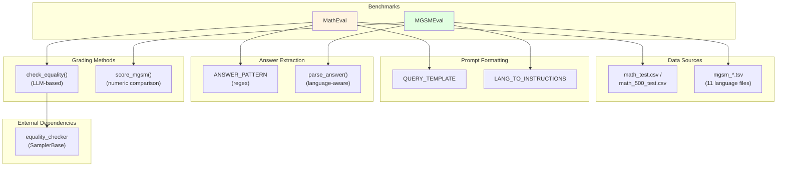
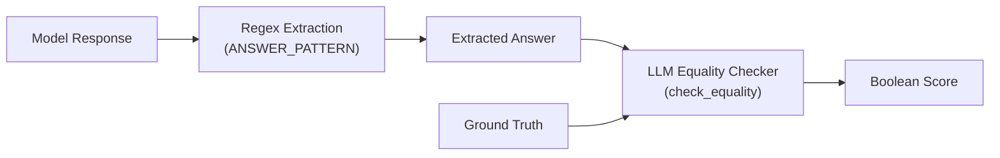
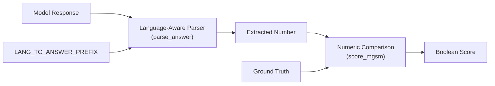
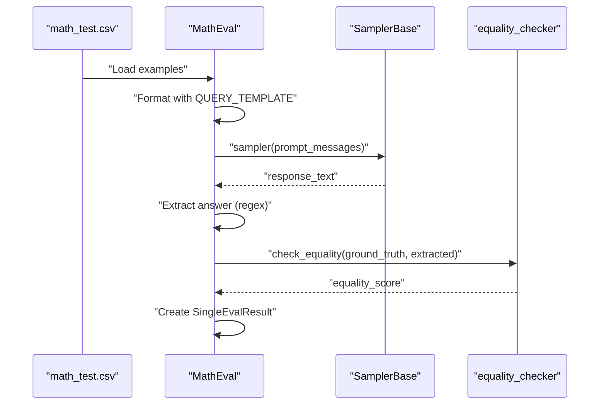
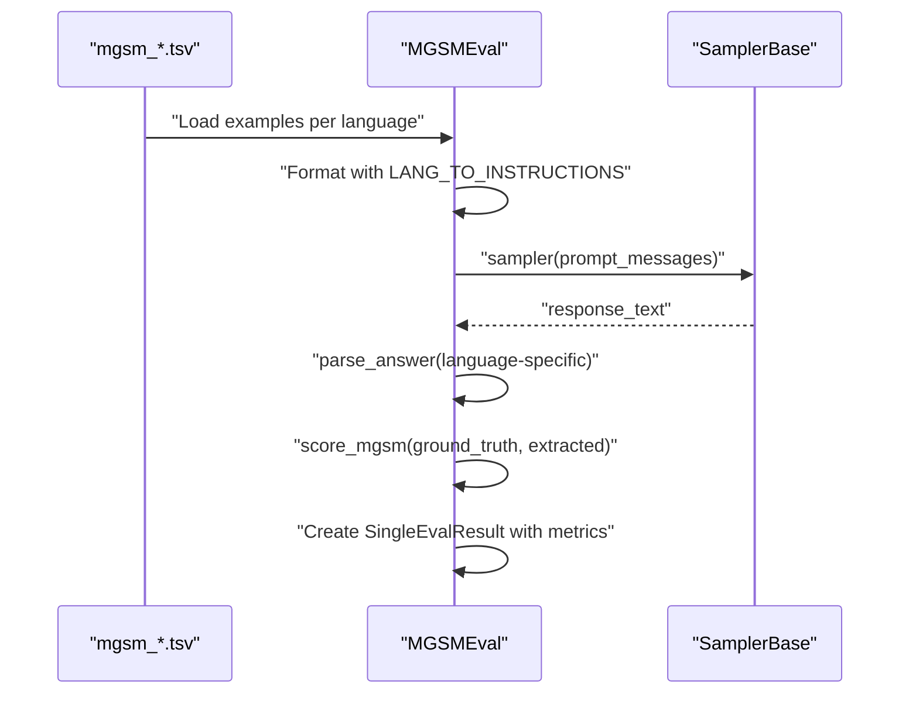
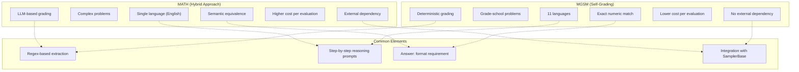
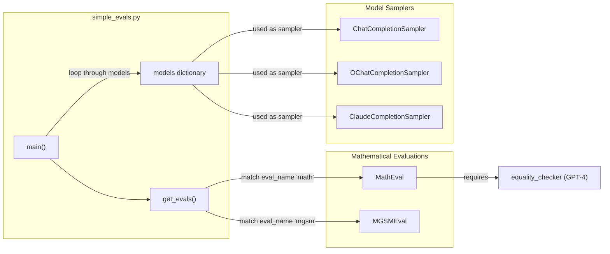

<!-- source: DeepWiki mcp.deepwiki.com · repo openai/simple-evals · page 4.3 Mathematical Reasoning Benchmarks · fetched 2026-10-26 -->

# Mathematical Reasoning Benchmarks

<details>
<summary>Relevant source files</summary>

The following files were used as context for generating this wiki page:

- [math_eval.py](math_eval.py)
- [mgsm_eval.py](mgsm_eval.py)

</details>


This page provides an overview of the mathematical reasoning benchmarks in simple-evals. The framework includes two distinct benchmarks that evaluate mathematical problem-solving capabilities: MATH for high-difficulty problems and MGSM for multilingual grade-school mathematics.

## Overview

Mathematical reasoning benchmarks assess a model's ability to understand mathematical concepts, perform multi-step reasoning, and produce correct numerical answers. The two benchmarks in simple-evals employ different evaluation strategies:

- **MATH**: Hybrid grading using regex extraction and LLM-based semantic equivalence checking
- **MGSM**: Self-grading using regex extraction and deterministic numeric comparison

**Benchmark Comparison**

| Aspect | MATH | MGSM |
|--------|------|------|
| **Implementation** | `MathEval` class | `MGSMEval` class |
| **File** | [math_eval.py]() | [mgsm_eval.py]() |
| **Problem Difficulty** | Graduate-level mathematical problems | Grade-school math word problems |
| **Languages** | English only | 11 languages (bn, de, en, es, fr, ja, ru, sw, te, th, zh) |
| **Answer Extraction** | `ANSWER_PATTERN` regex | `parse_answer()` with language-specific prefixes |
| **Grading Strategy** | LLM-based `check_equality()` | Deterministic `score_mgsm()` |
| **Dataset Size** | Variable (math_test or math_500_test) | 250 examples per language |
| **External Dependency** | Requires equality checker sampler | None |

Sources: [math_eval.py:1-68](), [mgsm_eval.py:1-193]()

## Mathematical Reasoning Evaluation Architecture

The diagram below shows how the two mathematical reasoning benchmarks fit into the evaluation framework and their different grading approaches:



Sources: [math_eval.py:14-15](), [math_eval.py:26-44](), [mgsm_eval.py:32-66](), [mgsm_eval.py:83-104](), [mgsm_eval.py:130-152]()

## Grading Strategy: Hybrid vs Self-Grading

The two mathematical reasoning benchmarks employ fundamentally different grading strategies, which affects their accuracy, cost, and applicability:

**MATH: Hybrid Grading with LLM-Based Equality Checking**

The `MathEval` benchmark uses a two-stage grading process:



1. **Regex Extraction**: Uses `ANSWER_PATTERN` to extract the answer following "Answer:"
2. **Semantic Equivalence**: Passes both extracted and ground truth answers to `check_equality()`, which uses an LLM (typically GPT-4) to determine mathematical equivalence

This hybrid approach handles variations in mathematical notation (e.g., "1/2" vs "0.5" vs "50%") and expression forms (e.g., "√2" vs "1.414...").

Sources: [math_eval.py:14](), [math_eval.py:53-55]()

**MGSM: Self-Grading with Deterministic Comparison**

The `MGSMEval` benchmark uses a purely deterministic grading process:



1. **Language-Aware Extraction**: Uses `parse_answer()` with language-specific answer prefixes to extract numeric values
2. **Deterministic Comparison**: Uses `score_mgsm()` for exact numeric matching after normalization (comma removal, trailing zero/decimal stripping)

This approach is faster and more predictable but less tolerant of alternative answer formats.

Sources: [mgsm_eval.py:68-80](), [mgsm_eval.py:83-104]()

## Evaluation Workflow Comparison

The following diagram shows how the two benchmarks process examples from dataset to final score:

**MATH Evaluation Workflow**



Sources: [math_eval.py:45-67]()

**MGSM Evaluation Workflow**



Sources: [mgsm_eval.py:154-192]()

## Key Differences Summary

The architectural diagram below highlights the structural differences between the two benchmarks:



Sources: [math_eval.py:1-68](), [mgsm_eval.py:1-193]()

## Integration with Simple-Evals Framework

Both mathematical reasoning evaluations are integrated into the simple-evals framework through [simple_evals.py]().



Sources: [simple_evals.py:131-174]()

### Configuration in Simple-Evals

The mathematical reasoning evaluations are configured in the `get_evals` function:

- `MathEval` is configured with an equality checker (GPT-4), optional number of examples, and number of repeats
- `MGSMEval` is configured with a number of examples per language (defaulting to 250 in normal mode)

Sources: [simple_evals.py:139-150]()

## Running the Evaluations

To run the mathematical reasoning evaluations using the command-line interface:

```
python -m simple_evals --model MODEL_NAME
```

This will run all evaluations, including both `math` and `mgsm` evaluations, on the specified model. Results are saved as HTML and JSON files for further analysis.

Sources: [simple_evals.py:22-213]()

## Best Practices and Usage

1. **Answer Formatting**: Models perform best when they follow the requested answer format (e.g., "Answer: 42")
2. **Step-by-Step Reasoning**: The prompts encourage models to show their work before providing a final answer
3. **Equality Checking**: Due to potential variations in mathematical notation, the framework uses a language model to check the equality of answers
4. **Multilingual Evaluation**: For a comprehensive assessment of mathematical capabilities, evaluate models across multiple languages using MGSM

These mathematical reasoning evaluations provide a robust way to measure a model's ability to understand and solve mathematical problems across different contexts and languages.

---

